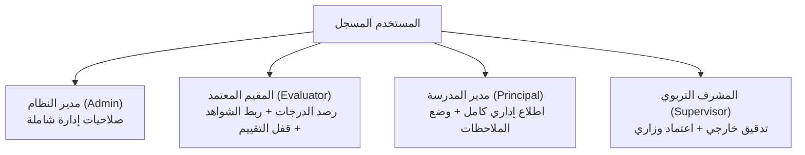

# الدليل القياسي الموحد لمعايير واجهة المستخدم ونظام التصميم (Universal UI Standards & Design System)
### منصة ارتقاء للتقييم الذاتي والتحسين المدرسي (Erteqa Platform for School Self-Evaluation & Improvement)

> **الإصدار الحالي:** 2.0.0 (النظام الشامل الموحد)  
> **تاريخ التحديث والاعتماد:** 16 نوفمبر 2026م  
> **النطاق الإلزامي:** كافة شاشات وبوابات المنظومة بدون استثناء (`/admin/*`، `/evaluation/*`، بوابة مدير المدرسة، بوابة المشرف التربوي).  
> **المصدر البرمجي للرموز:** `school-eval-web/src/styles/designTokens.ts`

---

## فهرس المحتويات
1. [المقدمة وقاعدة تسمية المنصة الرسمية](#1-المقدمة-وقاعدة-تسمية-المنصة-الرسمية)
2. [نظام التصميم والرموز البصرية المركزية (Design System Tokens)](#2-نظام-التصميم-والرموز-البصرية-المركزية-design-system-tokens)
3. [المصفوفة الوطنية لمستويات التقييم وشجرة المعايير (Rubric & Scoring Matrix)](#3-المصفوفة-الوطنية-لمستويات-التقييم-وشجرة-المعايير-rubric--scoring-matrix)
4. [معايير الأزرار والتفاعلات وهوية الملفات (Buttons & File Branding)](#4-معايير-الأزرار-والتفاعلات-وهوية-الملفات-buttons--file-branding)
5. [معايير الجداول وعرض البيانات المتقدم (Tables, Multi-Select Filters, Active Chips & Header Sorting)](#5-معايير-الجداول-وعرض-البيانات-المتقدم-tables-multi-select-filters-active-chips--header-sorting)
6. [كبسولة الانتقال المباشر والربط الإجرائي (Deep-Linking Capsule)](#6-كبسولة-الانتقال-المباشر-والربط-الإجرائي-deep-linking-capsule)
7. [الترويسة العلوية والقوائم الجانبية (TopBar, Sidebar, Drawer & Footers)](#7-الترويسة-العلوية-والقوائم-الجانبية-topbar-sidebar-drawer--footers)
8. [النوافذ المنبثقة والقوائم الذكية المترابطة (Modals, SearchableSelect & Cascading Selects)](#8-النوافذ-المنبثقة-والقوائم-الذكية-المترابطة-modals-searchableselect--cascading-selects)
9. [سياسة حظر البيانات الوهمية وهياكل التحميل (Zero Mock Policy & Shimmer Skeletons)](#9-سياسة-حظر-البيانات-الوهمية-وهياكل-التحميل-zero-mock-policy--shimmer-skeletons)
10. [معايير التصدير وإصدار التقارير (PDF & Excel Export Standards)](#10-معايير-التصدير-وإصدار-التقارير-pdf--excel-export-standards)
11. [حوكمة الأدوار وأنماط العرض (Admin, Evaluator, Principal & Supervisor Modes)](#11-حوكمة-الأدوار-وأنماط-العرض-admin-evaluator-principal--supervisor-modes)
12. [سجل التدقيق والأمان وحوكمة الأحداث (Security & Audit Trail)](#12-سجل-التدقيق-والأمان-وحوكمة-الأحداث-security--audit-trail)
13. [وضع الصيانة وحماية النظام (Maintenance Mode Protection)](#13-وضع-الصيانة-وحماية-النظام-maintenance-mode-protection)
14. [إمكانية الوصول والشمولية الرقمية (Accessibility - a11y)](#14-إمكانية-الوصول-والشمولية-الرقمية-accessibility---a11y)
15. [حدود معالجة الأخطاء ومنع الانهيار (Error Boundary)](#15-حدود-معالجة-الأخطاء-ومنع-الانهيار-error-boundary)
16. [عقد استجابة واجهة البرمجة الموحد (Unified API Response Contract)](#16-عقد-استجابة-واجهة-البرمجة-الموحد-unified-api-response-contract)
17. [المكونات المشتركة للمنظومة (`src/components/shared/`)](#17-المكونات-المشتركة-للمنظومة-srccomponentsshared)
18. [قائمة التحقق الإلزامية قبل تسليم أو دمج أي شاشة (18 سؤالاً)](#18-قائمة-التحقق-الإلزامية-قبل-تسليم-أو-دمج-أي-شاشة-18-سؤالاً)
19. [سجل التحديثات والإصدارات (Changelog)](#19-سجل-التحديثات-والإصدارات-changelog)

---

## 1. المقدمة وقاعدة تسمية المنصة الرسمية

يهدف هذا الدليل المرجعي إلى توحيد وتثبيت كافة المعايير الهندسية والأنماط البصرية وتجربة المستخدم عبر كافة بوابات **«منصة ارتقاء للتقييم الذاتي والتحسين المدرسي»**. يُعد هذا المستند **دستور الواجهات الإلزامي** لأي مطور في المشروع لضمان التكامل الكامل والنزاهة المطلقة للبيانات.

### 1.1 قاعدة الاسمين المعتمدين حصراً ومواضع استخدامهما
للقضاء التام على أي تشتت أو تضارب في المسميات عبر كافة شاشات ووثائق المنظومة، اعتمد النظام **اسمين محددين حصراً**:

| نوع الاسم | النص المعتمد | الثابت البرمجي في `systemConstants.ts` | مواضع الاستخدام المحددة |
| :--- | :--- | :--- | :--- |
| **الاسم القصير / التجاري** | **«منصة ارتقاء»** | `SYSTEM_SHORT_NAME` | 1. القوائم الجانبية لكافة البوابات (`Sidebar`).<br>2. الترويسات العلوية ومسارات التنقل (`TopBar` و `Breadcrumbs`).<br>3. أزرار وشارات النظام والشاشات الصغيرة (الجوال). |
| **الاسم الكامل الرسمي** | **«منصة ارتقاء للتقييم الذاتي والتحسين المدرسي»** | `SYSTEM_FULL_NAME` | 1. شاشة تسجيل الدخول الموحد (`LoginPage`).<br>2. ترويسات وتذييلات وثائق وتقارير الـ PDF الرسمية.<br>3. صفحة ورسائل وضع الصيانة (`MaintenancePage` و 503).<br>4. ترويسة التوثيق الرسمي ومسودات الاعتماد الوزارية. |

> [!CAUTION]
> يُحظر تماماً استخدام أي صيغ قديمة أو هجينة مثل «منظومة ارتقاء» أو «نظام الارتقاء» في الكود أو الواجهات أو التقارير.

---

## 2. نظام التصميم والرموز البصرية المركزية (Design System Tokens)

كافة الشاشات والمكونات تستورد وتعتمد القيم المعيارية من الملف المركزي:  
`school-eval-web/src/styles/designTokens.ts`

### 2.1 لوحة الألوان الأساسية والهوية البصرية (Brand Palette)
| العنصر | القيمة السداسية (Hex) | اسم الرمز البرمجي | الغرض والدلالة في النظام |
| :--- | :--- | :--- | :--- |
| **الزمردي الأساسي (Primary)** | `#059669` (Emerald 600) | `designTokens.colors.primary` | الأزرار الرئيسية، مؤشرات النشاط، أزرار التصدير |
| **الزمردي التفاعلي (Hover)** | `#047857` (Emerald 700) | `designTokens.colors.primaryHover`| حالة التمرير على العناصر والروابط الفعالة |
| **الزمردي الفاتح (Surface)** | `#ECFDF5` (Emerald 50) | `designTokens.colors.primarySurface`| خلفيات العناصر المحددة والكبسولات النشطة |
| **خلفية النظام (Background)**| `#F8FAFC` (Slate 50) | `designTokens.colors.background` | الخلفية العامة للشاشات وحاويات العمل |
| **السطوح والبطاقات (Surface)**| `#FFFFFF` (White) | `designTokens.colors.surface` | خلفيات البطاقات، الحاويات البيضاء، والجداول |
| **النصوص الرئيسية (Heading)** | `#0F172A` (Slate 900) | `designTokens.colors.textPrimary` | العناوين الرئيسية، الأرقام الكبرى، النصوص العريضة |
| **النصوص الفرعية (Muted)** | `#475569` (Slate 600) | `designTokens.colors.textSecondary` | شروحات الحقول، ترويسات الجداول، النصوص المساعدة |
| **الرمادي الهادئ (Hint)** | `#64748B` (Slate 500) | `designTokens.colors.textMuted` | التلميحات الخفيفة، الوحدات القياسية، التاريخ |
| **الحدود الافتراضية (Border)** | `#E2E8F0` (Slate 200) | `designTokens.colors.border` | فواصل الجداول، إطارات البطاقات، الحاويات |
| **الحدود التفاعلية (Active)** | `#CBD5E1` (Slate 300) | `designTokens.colors.borderDark` | إطارات حقول الإدخال، القوائم المنسدلة، أزرار التفاعل |
| **الخلفية الداكنة للقائمة** | `#0B0F19` (Slate 950) | `designTokens.colors.sidebarDark` | الخلفية الملكية للقائمة الجانبية في لوحة الإدارة |

### 2.2 الخطوط والاتجاه العام (Typography & Direction)
- **الاتجاه:** `dir="rtl"` إلزامي لكافة الشاشات.
- **عائلة الخطوط:** الاعتماد الحصري على خطوط واضحة وعصرية تدعم الأرقام والحروف العربية:  
  `font-family: 'Tajawal', 'IBM Plex Sans Arabic', system-ui, -apple-system, sans-serif;`
- **الأرقام والأكواد:** استخدام `font-mono` بخلفية رمادية خفيفة `#F1F5F9` لعرض الأكواد البرمجية والرموز المشفرة.

---

## 3. المصفوفة الوطنية لمستويات التقييم وشجرة المعايير (Rubric & Scoring Matrix)

لضمان الاتساق المطلق بين ما يراه المقيم، وما يراه مدير المدرسة، وما يصدر في التقارير الرسمية للإدارة والوزارة، **تلتزم كافة الشاشات بالمصفوفة اللونية الرباعية التالية حصراً**:


| المستوى المعياري | الدرجة | اللون الأساسي | لون الخلفية | لون الحدود | لون الشارة والنص | الدلالة الإجرائية |
| :--- | :---: | :--- | :--- | :--- | :--- | :--- |
| **متحقق كلياً (Full)** | **3** | `#059669` (Emerald) | `#ECFDF5` | `#A7F3D0` | خلفية `#DCFCE7`، نص `#166534` | الأداء مستوفٍ لكافة المعايير والشواهد |
| **متحقق بدرجة متوسطة (Medium)**| **2** | `#2563EB` (Blue) | `#EFF6FF` | `#BFDBFE` | خلفية `#DBEAFE`، نص `#1E40AF` | ممارسات قائمة تتطلب تحسينات طفيفة |
| **متحقق بدرجة ضعيفة (Low)** | **1** | `#D97706` (Amber) | `#FFFBEB` | `#FDE68A` | خلفية `#FEF3C7`، نص `#92400E` | فجوة أداء تتطلب خطة تحسين عاجلة |
| **غير متوفر / حرج (None)** | **0** | `#DC2626` (Red) | `#FEF2F2` | `#FECACA` | خلفية `#FEE2E2`، نص `#991B1B` | مؤشر حرج منعدم أو غياب تام للشواهد |
| **غير مرصود / معلق (Unscored)**| **-** | `#64748B` (Slate) | `#F1F5F9` | `#E2E8F0` | خلفية `#F1F5F9`، نص `#64748B` | لم يتم تقييمه بعد من المقيم المعتمد |

> [!IMPORTANT]
> يُمنع منعاً باتاً استخدام درجات ألوان بديلة (مثل البنفسجي، أو الأخضر الفاتح، أو الأصفر الفاقع) للتعبير عن درجات الرصد الوطنية في أي جدول أو رسم بياني.

---

## 4. معايير الأزرار والتفاعلات وهوية الملفات (Buttons & File Branding)

### 4.1 أنماط وأبعاد الأزرار القياسية
| نمط الزر | الأبعاد والحشو | النمط البرمجي (`designTokens.buttons`) | الاستخدام النموذجي |
| :--- | :--- | :--- | :--- |
| **الزر الأساسي (Primary)** | `padding: 10px 18px` | `designTokens.buttons.primary` | اعتماد نهائي، حفظ تقييم، رفع ملف جديد |
| **الزر الثانوي (Secondary)** | `padding: 8px 14px` | `designTokens.buttons.secondary` | تحديث البيانات، إلغاء، خيارات فرعية |
| **زر الحذف الهادئ (Danger Soft)**| `padding: 6px 12px` | `designTokens.buttons.dangerSoft` | مسح الفلاتر، فك الارتباط |
| **شريط الأيقونات الموحد (Icon Action)** | `width: 32px`, `height: 32px` | `designTokens.buttons.iconAction` | أزرار إجراءات صفوف الجداول (تحميل، تعديل، استبدال، أرشيف) |

### 4.2 قاعدة شريط الإجراءات في الجداول
- لا تُوضع أزرار نصية عريضة تستهلك عرض الجدول. يُستخدم شريط أيقونات `32x32px` مع تلميح فوري (`title` أو `Tooltip`).
- **أيقونة الحذف الحمراء (`Trash2`)**: تظهر **فقط** عندما يكون العنصر قابلاً للحذف فعلياً (مثل شاهد غير مرتبط بأي مؤشر)، وتُخفى أو تُستبدل بأيقونة أرشيف للشواهد المرتبطة لحماية سلامة التقييم.

### 4.3 هوية صيغ الملفات والتصدير الموحد
تُوحّد كافة أزرار التحميل والتصدير على اللون **الزمردي الأساسي `#059669`**، ويتم تمييز صيغة الملف بالأيقونة والشارة المرفقة:
- **ملفات PDF**: أيقونة `FileText` بلون `#DC2626` وشارة نصية حمراء `PDF`.
- **جداول Excel**: أيقونة `FileSpreadsheet` بلون `#059669` وشارة خضراء `Excel`.
- **مستندات Word**: أيقونة `FileCode` بلون `#2563EB` وشارة زرقاء `Word`.
- **حزم ZIP المجمعة**: أيقونة `Archive` بلون `#D97706` وشارة كهرمانية `ZIP`.

---

## 5. معايير الجداول وعرض البيانات المتقدم (Tables, Multi-Select Filters, Active Chips & Header Sorting)

لكافة جداول النظام بلا استثناء، يطبق الهيكل القياسي الثلاثي التالي:

```text
[ 1. شريط الأدوات: بحث نصي + فلاتر متعددة Multi-Select + مرشحات سريعة Presets ]
[ 2. كبسولات الفلاتر النشطة Active Chips مع أزرار (✕) وزر مسح الكل ]
[ 3. جدول البيانات المحتوى مع فرز تفاعلي لرؤوس الأعمدة Column Header Sorting ]
[ 4. شريط التنقل وتعدد الصفحات Pagination ]
```

### 5.1 احتواء التمرير الأفقي (Horizontal Scroll Containment)
```tsx
<div style={{
  overflowX: 'auto',
  WebkitOverflowScrolling: 'touch',
  width: '100%',
  borderRadius: '0.75rem',
  border: '1px solid #E2E8F0'
}}>
  <table style={{ minWidth: '920px', width: '100%', borderCollapse: 'collapse' }}>
    ...
  </table>
</div>
```

### 5.2 شريط الفلاتر متعددة الاختيار (Multi-Select Filters)
- يدعم اختيار أكثر من قيمة في القائمة الواحدة مع مربعات اختيار `checkbox`.
- مرشحات سريعة بنقرة واحدة (Presets) لأكثر الحالات تكراراً (مثل: «الكل»، «غير مكتمل»، «عالي الأولوية»).
- حقل بحث مباشر مع مؤقت تهدئة (`debounce` 300ms).

### 5.3 كبسولات الفلاتر النشطة (Active Filter Chips)
- تظهر فور اختيار أي فلتر في صف مستقل أسفل شريط الأدوات.
- كل كبسولة تتضمن اسم الفلتر وزر إغلاق `✕` لإلغائه بشكل فردي.
- زر «مسح الكل» باللون الرمادي لإعادة ضبط كافة الفلاتر دفعة واحدة.

### 5.4 الفرز التفاعلي من رؤوس الأعمدة (Column Header Sorting)
- كل عمود قابل للفرز يحتوي على رأس تفاعلي بنقرة واحدة.
- أيقونة الفرز: سهم تصاعدي `ArrowUp` (`#059669`)، سهم تنازلي `ArrowDown` (`#059669`)، أو أيقونة محايدة `ArrowUpDown` (`#94A3B8`).
- في عرض الشبكة (Grid View)، تتوفر قائمة منسدلة مطابقة ومتزامنة بالكامل مع نفس حالة الفرز البرمجية.

---

## 6. كبسولة الانتقال المباشر والربط الإجرائي (Deep-Linking Capsule)

- يتم نقل إجراء «الانتقال للمؤشر» من قائمة الأزرار ودمجه مباشرة في عمود كود المؤشر ذاته.
- يظهر كود المؤشر ككبسولة تفاعلية تنقل مباشرة إلى شاشة الرصد:
  ```tsx
  <button
    type="button"
    onClick={() => onNavigate('rubric-assessment', item.indicatorId)}
    style={{
      display: 'inline-flex',
      alignItems: 'center',
      gap: '4px',
      padding: '3px 8px',
      borderRadius: '6px',
      backgroundColor: '#EFF6FF',
      border: '1px solid #BFDBFE',
      color: '#1D4ED8',
      fontSize: '11px',
      fontWeight: 800,
      cursor: 'pointer',
    }}
    title={`الانتقال المباشر لتقييم المؤشر ${item.indicatorCode} ↗`}
  >
    <span>{item.indicatorCode}</span>
    <ExternalLink size={10} />
  </button>
  ```

---

## 7. الترويسة العلوية والقوائم الجانبية (TopBar, Sidebar, Drawer & Footers)

### 7.1 الترويسة العلوية (TopBar)
- **الارتفاع:** ثابت `68px`.
- **المحتوى الأيمن:** زر طي/فتح القائمة + مسار التنقل الدلالي (`Breadcrumbs`) يبدأ بـ **`SYSTEM_SHORT_NAME`** («منصة ارتقاء») + عنوان الصفحة الحالية.
- **المحتوى الأيسر:** كبسولة المستخدم (الأفاتار، الاسم، المسمى الوظيفي)، زر تغيير كلمة المرور، زر تسجيل الخروج، وزر وضع الصيانة (للإدارة).
- **قاعدة منع التاريخ:** يُحظر عرض التاريخ الميلادي أو الهجري عشوائياً في الشريط لتوفير المساحة وتجنب التشتت.

### 7.2 القائمة الجانبية (Sidebar)
- **الأبعاد:** Desktop (موسع `260px`، مطوي `76px`)، الجوال (درج `280px` مع تعتيم ضبابي `backdrop-filter: blur(4px)`).
- **ضوابط التسمية:** يجب ألا تتجاوز تسميات العناصر 18 حرفاً لتفادي اختصار النص بنقاط (`...`).
  - مثال معتمد: **«مقترحات ومبادرات AI»** بدلاً من النصوص الطويلة المنكسرة.
  - إزالة الشارات النصية العريضة من عناصر القائمة والاستعاضة عنها بشارات رقمية ذكية أو وسوم مصغرة مثل `AI`.
- **تذييل القائمة الجانبية (Footer):**
  - إزالة الصناديق الكبيرة المكررة لمعلومات المدرسة والمقيم.
  - الاكتفاء بوسم رمادي نحيف أنيق (11px): `🏫 {schoolName}` يعلو مباشرة أزرار الحساب والخروج، أو بطاقة حالة المنظومة النحيفة في لوحة التحكم الإدارية.

---

## 8. النوافذ المنبثقة والقوائم الذكية المترابطة (Modals, SearchableSelect & Cascading Selects)

### 8.1 دورة حياة النوافذ المنبثقة (Modals)
- مستوى التراكب: `z-index: 9000` للنوافذ العادية، و `z-index: 9999` لنوافذ التأكيد الحساسة مع خلفية معتمة بتمويه ضبابي.
- عند الفتح: تحميل أحدث البيانات فوراً.
- عند الإغلاق: تصفير النموذج ومسح رسائل الخطأ بالكامل.
- أثناء الحفظ: تعطيل الأزرار وإظهار مؤشر دوار لمنع النقر المزدوج (`disabled={isSubmitting}`).

### 8.2 القوائم المنسدلة الذكية (`SearchableSelect`)
- إلزامية لأي حقل يتجاوز 7 خيارات (المدارس، المحافظات، المديريات، المعايير).
- حقل بحث فوري مدمج مع دعم التنقل بمفاتيح الأسهم والإغلاق بـ `Escape`.

### 8.3 القوائم المترابطة (Cascading Selects)
- تعطيل الحقل الفرعي (مثل المديرية) حتى يتم اختيار الحقل الرئيسي (المحافظة).
- تصفير فوري للحقل الفرعي بمجرد تغيير الحقل الرئيسي لمنع ترحيل بيانات غير متوافقة.

---

## 9. سياسة حظر البيانات الوهمية وهياكل التحميل (Zero Mock Policy & Shimmer Skeletons)

1. **المنع الصارم للبيانات الافتراضية الثابتة (No Hardcoded Fallbacks):**
   - يُحظر تماماً كتابة نصوص افتراضية وهمية مثل أسماء مدارس (`'مدرسة الفاروق'`)، أو مدن (`'تعز'`)، أو أكواد وهمية (`'ARQ-MOCK-001'`).
   - يجب استخراج كافة البيانات من كائن المستخدم الموثق أو الخادم، وفي حال عدم التوفر تُعرض شارة انتظار: `قيد المعالجة...` أو يُخفى العنصر.
2. **هياكل التحميل النابضة (Skeleton Shimmer Cards):**
   - يُمنع عرض شاشات بيضاء فارغة أو كروت تحذيرية حمراء قبل اكتمال وصول البيانات.
   - يتم استخدام بطاقات نابضة `animate-pulse` باللون الرمادي الهادئ `#F8FAFC` لتعزيز الإحساس بالسرعة واستقرار المنظومة.
3. **حالات الخلو الصادقة (Empty States):**
   - عند غياب السجلات، يُعرض صندوق مركزي بأيقونة مناسبة ورسالة واضحة: `لا توجد بيانات متاحة حالياً`.

---

## 10. معايير التصدير وإصدار التقارير (PDF & Excel Export Standards)

1. **الصيغ المعتمدة:**
   - **جداول Excel (`.xlsx`)**: عبر مكتبة معتمدة على المتصفح مع تنسيق رسمي وأعمدة واضحة.
   - **تقارير PDF (`.pdf`)**: عبر محرك التقارير في الواجهة الخلفية (mPDF) حاملاً **`SYSTEM_FULL_NAME`** والشعار الرسمي.
   - **حظر CSV**: صيغة `CSV` ممنوعة منعاً باتاً لعدم استقرار التشفير العربي (UTF-8 BOM).
2. **التسمية القياسية الموحدة للملفات المصدرة:**
   ```text
   [اسم_التقرير]_[YYYY-MM-DD]_[HH-mm].[الصيغة]
   ```
   أمثلة: `school_eval_report_2026-11-16_13-00.pdf` ، `evidences_inventory_2026-11-16_13-00.xlsx`.
3. **تصدير كامل النطاق:** عند التصدير مع فلاتر نشطة، يتم تنزيل كافة السجلات المطابقة (`all=true`) وليس مجرد الصفحة الحالية.

---

## 11. حوكمة الأدوار وأنماط العرض (Admin, Evaluator, Principal & Supervisor Modes)

تعتمد المنصة نمط الصلاحيات المترابطة بحسب الدور الوظيفي للمستخدم (`Role-Based Views`):



### 11.1 دور مدير النظام (Admin)
- إدارة المستخدمين، المدارس، المعايير، النسخ الاحتياطي، وسجلات التدقيق والأمان.
- تفعيل وتعطيل وضع الصيانة.

### 11.2 دور المقيم المعتمد (Evaluator)
- الرصد النشط للدرجات (3، 2، 1، 0).
- رفع الشواهد وربطها بالمؤشرات وفك الارتباط.
- قفل التقييم النهائي بالختم الرقمي، واستقبال أو رفض طلبات الاستكمال.

### 11.3 دور مدير المدرسة (School Principal)
- **وضع الاطلاع والملاحظة الإدارية (`effectiveReadOnly`)**:
  - عرض شريط تنبيهي أعلى الواجهة يوضح نمط الملاحظة الإدارية.
  - إطفاء أو تكييف أزرار التعديل والحذف والقفل بتلميحات توضيحية: `خاص بالمقيم المعتمد - وضع الملاحظة فقط`.
  - الاطلاع الشامل على شجرة المعايير، استمارات الرصد، الشواهد، التقارير، ومقترحات AI.
- **تدوين الملاحظات الإدارية الرسمية (`reviews.write`)**:
  - نافذة مخصصة في صفحة المراجعة الداخلية لتدوين مرئيات وتوقيع إدارة المدرسة قبل الاعتماد النهائي.
- **متابعة خطة التحسين المدرسية**: متابعة إسناد المهام، المسؤولين، والمدى الزمني.

### 11.4 دور المشرف التربوي (Supervisor)
- مراجعة تقارير المدارس التابعة للمديرية وتدقيق الشواهد واعتماد خطط التحسين.

---

## 12. سجل التدقيق والأمان وحوكمة الأحداث (Security & Audit Trail)

- الأحداث المعتمدة للتدقيق تستند مباشرة إلى `AuditLoggerService` بالواجهة الخلفية (المصدر الوحيد للحقيقة).
- تصنيف الخطورة الثلاثي:
  1. **عمليات عادية (Normal):** شارة زرقاء/رمادية باهتة (تسجيل دخول، استعراض).
  2. **عمليات حساسة (Sensitive):** شارة كهرمانية `#FEF3C7` (تعديل صلاحيات، تحديث بيانات، تصدير).
  3. **عمليات حرجة (Critical):** شارة حمراء دافئة `#FEE2E2` (فشل تسجيل دخول متكرر، وصول غير مصرح، وضع الصيانة).

---

## 13. وضع الصيانة وحماية النظام (Maintenance Mode Protection)

- محمي بنافذة تأكيد مشددة ثنائية الخطوة تشرح التبعات وتتطلب تأكيداً صريحاً.
- تفعيل وسيط الحماية `CheckMaintenanceMode Middleware` الذي يعيد رمز الحالة `503` ورسالة صريحة تحمل **`SYSTEM_FULL_NAME`** مع توجيه المستخدمين تلقائياً إلى `MaintenancePage`.

---

## 14. إمكانية الوصول والشمولية الرقمية (Accessibility - a11y)

1. **تباين الألوان (Color Contrast):** تحقيق نسبة لا تقل عن `4.5:1` للنصوص العادية وفق WCAG 2.1 AA.
2. **تسمية الأزرار الأيقونية (`aria-label`):** كل زر أيقوني يجب أن يحمل `aria-label` و `title` بالعربية الصريحة.
3. **التنقل بلوحة المفاتيح:** دعم كامل لمفاتيح `Tab`، `Enter`، `Space`، ومفتاح `Escape` لإغلاق القوائم والنوافذ.
4. **مؤشر التركيز المرئي (`Focus Visible`):** إطار بصري بارز `focus:ring-2 focus:ring-emerald-500`.
5. **عدم الاعتماد الحصري على اللون:** إرفاق الأيقونة التوضيحية والنص الوصفي مع كل لون دلالي.

---

## 15. حدود معالجة الأخطاء ومنع الانهيار (Error Boundary)

- تغليف الشاشات الرئيسية بمكونات `ErrorBoundary` واقية.
- منع الشاشة البيضاء (White Screen of Death) وإظهار بطاقة خطأ أنيقة مع زر «إعادة المحاولة».
- استمرار عمل الإطار العام للتنقل (TopBar و Sidebar) حتى يتمكن المستخدم من التنقل دون إعادة تحميل الصفحة.

---

## 16. عقد استجابة واجهة البرمجة الموحد (Unified API Response Contract)

```json
{
  "success": true,
  "message": "تمت العملية بنجاح",
  "data": [],
  "meta": {
    "current_page": 1,
    "from": 1,
    "to": 15,
    "per_page": 15,
    "total": 100,
    "last_page": 7
  },
  "errors": null
}
```

---

## 17. المكونات المشتركة للمنظومة (`src/components/shared/`)

| اسم المكون | الغرض الأساسي | موضع الاستخدام |
| :--- | :--- | :--- |
| **`SearchableSelect`** | قائمة منسدلة ذكية ببحث فوري | الحقول التي تتجاوز 7 خيارات |
| **`PageHeader`** | ترويسة الصفحة مع مسار التنقل والأزرار | رأس كافة الشاشات الرئيسية |
| **`StatCard`** | بطاقة رقمية لمؤشرات الأداء (KPIs) | لوحات القيادة واستعراض النتائج |
| **`EmptyState`** | صندوق العرض عند خلو السجلات | عند عودة مصفوفة فارغة `[]` |
| **`ConfirmDialog`** | نافذة حوار تأكيد بارزة ومحمية | العمليات الحساسة (الحذف، القفل) |
| **`ExportButton`** | زر موحد للتصدير باللون الزمردي | أعلى الجداول لإصدار التقارير |
| **`StatusBadge`** | شارة نصية ملونة للحالات | داخل الجداول والبطاقات |
| **`SkeletonLoader`** | هيكل تحميل نابض | أثناء جلب البيانات من الخادم |
| **`ErrorBoundary`** | غلاف برمجي واقٍ لمنع الانهيار | تغليف الشاشات والأقسام |

---

## 18. قائمة التحقق الإلزامية قبل تسليم أو دمج أي شاشة (18 سؤالاً)

قبل اعتماد أو دمج أي شاشة في المنظومة، يجب التأكد من الإجابة بـ **«نعم»** على الأسئلة التالية:

- [ ] **1. التوافق واللغة:** هل اتجاه الصفحة بالكامل يمين-إلى-يسار (`RTL`) واللغة العربية تلتزم بقاعدة الاسمين المعتمدين؟
- [ ] **2. الرموز الموحدة:** هل تم استيراد الألوان والأنماط من `designTokens.ts` دون استخدام ألوان عشوائية خاصة؟
- [ ] **3. مصفوفة التقييم:** هل ألوان الدرجات تطابق بدقة مصفوفة التقييم (3: زمردي، 2: أزرق، 1: كهرماني، 0: أحمر، غير مرصود: رمادي)؟
- [ ] **4. منع البيانات الوهمية:** هل تم التأكد من خلو الشاشة تماماً من أي نصوص أو أكواد تجريبية وهمية (`mock fallback`)؟
- [ ] **5. هياكل التحميل:** هل تُعرض هياكل نابضة (`Skeleton Shimmer`) أثناء جلب البيانات بدلاً من الشاشات البيضاء أو بطاقات الخطأ الزائفة؟
- [ ] **6. التمرير الأفقي للجداول:** هل تم وضع الجدول داخل حاوية مرنة بـ `overflowX: 'auto'` وتحديد `minWidth` مناسب؟
- [ ] **7. الفرز التفاعلي لرؤوس الأعمدة:** هل تدعم أعمدة الجدول الفرز المباشر مع أسهم اتجاهية واضحة؟
- [ ] **8. الفلاتر والكبسولات النشطة:** هل يدعم شريط الأدوات الفلاتر متعددة الاختيار مع كبسولات نشطة قابلة للإلغاء الفردي بـ `✕` وزر مسح الكل؟
- [ ] **9. أزرار إجراءات الجداول:** هل أزرار الإجراءات في الصفوف مصممة كأيقونات موحدة `32x32px` مع تلميحات فورية؟
- [ ] **10. كبسولة الانتقال للمؤشر:** هل كود المؤشر معروض ككبسولة تفاعلية تنقل مباشرة لصفحة الرصد؟
- [ ] **11. نزاهة الترويسة:** هل الترويسة تلتزم بارتفاع `68px` ولا تحتوي على تاريخ عشوائي وتتضمن كبسولة المستخدم والمسار الصحيح؟
- [ ] **12. سلامة القائمة الجانبية:** هل عناصر القائمة مختصرة (<= 18 حرفاً) ولا تتقطع، مع فوتر نحيف خالٍ من التكرار؟
- [ ] **13. القوائم المنسدلة الذكية:** هل تم استخدام `SearchableSelect` للحقول التي تتجاوز 7 خيارات، مع ضبط منطق التصفير التلقائي للقوائم المترابطة؟
- [ ] **14. أمان النوافذ المنبثقة:** هل يتم مسح الأخطاء السابقة وتصفير النموذج عند الإغلاق، مع تعطيل الأزرار أثناء الإرسال؟
- [ ] **15. صيغ وتسمية التصدير:** هل التصدير مقصور على Excel و PDF مع حظر تام لصيغة CSV، وتسمية الملف بالنمط القياسي الزمني؟
- [ ] **16. حوكمة الأدوار وتكييف الأزرار:** هل تتكيف الشاشة بحسب دور المستخدم (مدير مدرسة: وضع الملاحظة الإدارية وإطفاء أزرار التعديل بتلميحات توضيحية)؟
- [ ] **17. إمكانية الوصول:** هل تحقق الشاشة معايير WCAG 2.1 AA مع دعم التنقل بلوحة المفاتيح وخصائص `aria-label` للأزرار الأيقونية؟
- [ ] **18. حماية الانهيار (Error Boundary):** هل الشاشة محمية بغلاف واقٍ يمنع انهيار الصفحة بالكامل عند حدوث أي خطأ برمجي؟

---

## 19. سجل التحديثات والإصدارات (Changelog)

- **الإصدار 1.0.0 (2026-11-06):**
  - الإصدار التأسيسي لمعايير لوحة التحكم الإدارية، وسلوك القوائم الجانبية، وقواعد التصدير، وسياسة حظر البيانات الوهمية.
- **الإصدار 1.1.0 (2026-11-06):**
  - إضافة متطلبات إمكانية الوصول (a11y)، وحدود معالجة الأخطاء (Error Boundary)، وعقد استجابة الـ API الموحد.
- **الإصدار 1.2.0 (2026-11-06):**
  - ربط سجلات التدقيق والأمان بخدمة `AuditLoggerService` كمصدر وحيد للحقيقة.
- **الإصدار 1.3.0 (2026-11-06):**
  - تثبيت قاعدة الاسمين المعتمدين حصراً: «منصة ارتقاء» و«منصة ارتقاء للتقييم الذاتي والتحسين المدرسي».
- **الإصدار 2.0.0 (2026-11-16) - [الإصدار الحالي المعتمد]:**
  - **الترقية لنظام التصميم الشامل الموحد لكافة بوابات المنظومة** (الإدارة، المقيم، مدير المدرسة، المشرف التربوي).
  - تثبيت مصفوفة الرموز المركزية `designTokens.ts` واللون الزمردي الأساسي `#059669`.
  - تثبيت مصفوفة ألوان التقييم الرباعية الإلزامية (3 زمردي، 2 أزرق، 1 كهرماني، 0 أحمر، غير مرصود رمادي) عبر كافة الشاشات والتقارير.
  - تعميم معايير الجداول المتقدمة: الفلاتر متعددة الاختيار، كبسولات الفلاتر النشطة بـ `✕` ومسح الكل، والفرز التفاعلي لرؤوس الأعمدة عبر كافة جداول المنظومة.
  - اعتماد شريط أيقونات الإجراءات الموحد `32x32px` وكبسولة الانتقال المباشر للمؤشرات `[كود ↗]`.
  - استئصال شامل للبيانات الوهمية واعتماد هياكل التحميل النابضة (Skeleton Shimmer).
  - توثيق نمط الملاحظة والحوكمة الإدارية لمدير المدرسة (`school_principal`).
  - توسيع قائمة التحقق الإلزامية إلى 18 سؤالاً معيارياً شاملاً.
