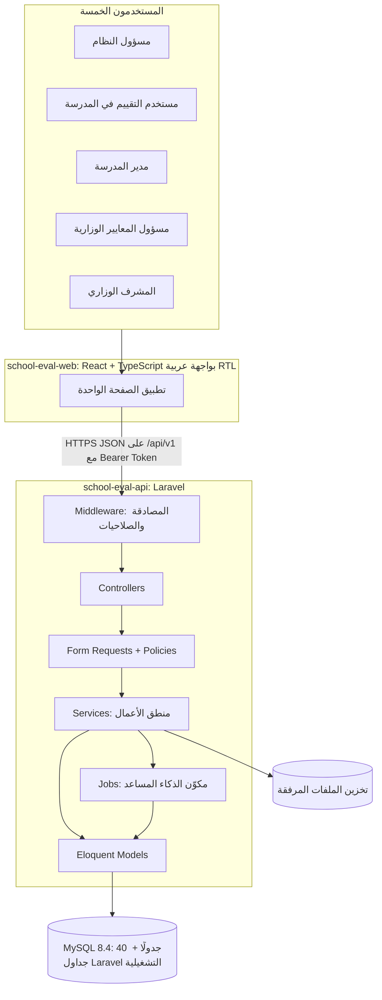
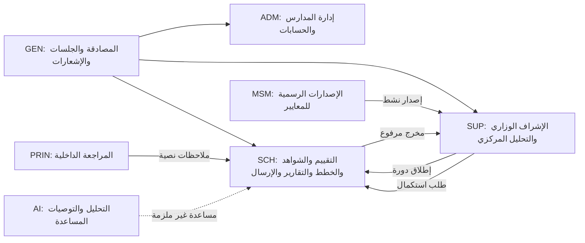
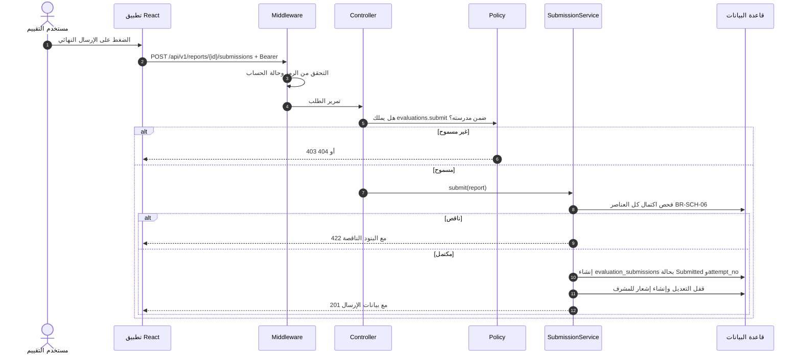
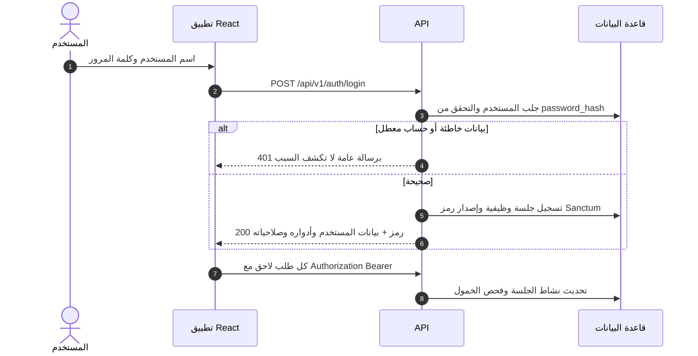
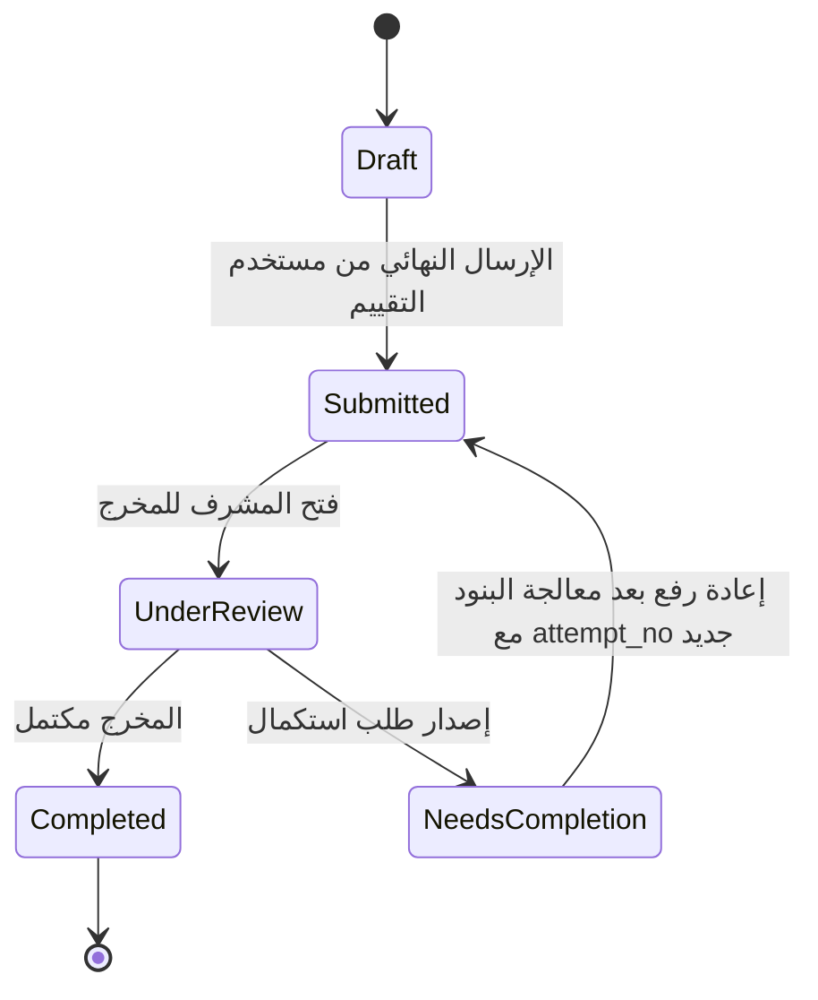
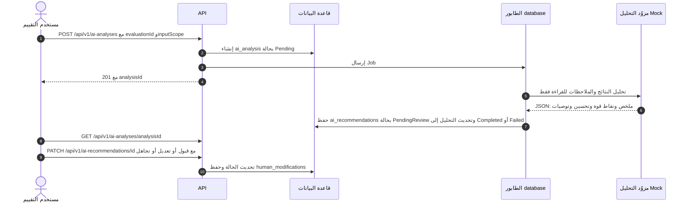
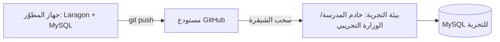

# الفصل الرابع: تصميم النظام (System Design)

> **المشروع:** نظام إدارة الجودة والخطط التعليمية في المدارس
> **الحالة:** مسودة أولى كاملة الهيكل — 16 أكتوبر 2026م
> **تسمية الفصل ورقمه:** [املأ: طابِق التسمية مع دليل الجامعة؛ في وثيقتك الفصل الثالث ينتهي بـ ERD (القسم 3.10)، فالفصل الرابع هو التصميم]

## مفتاح الوسوم المستخدمة في هذه المسودة

| الوسم | المعنى |
|---|---|
| **[موثق]** | مأخوذ من وثائقك: الفصول 1-3، قاموس البيانات، conventions.md، models_guide.md، تقارير الاختبار والـ Seeders |
| **[قرار]** | قرار اتُّخذ أثناء العمل على المشروع وتم اعتماده |
| **[مقترح]** | اقتراح تصميمي لم يُنفَّذ بعد، ولا يرد صراحة في وثائقك |
| **[املأ]** | جزء ينقصه محتوى أو رقم أو صورة منك |

لا تترك أي وسم في النسخة النهائية للتسليم. بعد التعبئة احذف الوسوم والملاحظات بين الأقواس المربعة.

---

## 4.1 مقدمة الفصل

ينقل هذا الفصل المشروع من التحليل في الفصل الثالث (الفاعلون، المتطلبات، قواعد العمل، حالات الاستخدام، ERD) إلى التصميم: كيف يُبنى النظام، وكيف تتوزع المسؤوليات بين مكوناته، وكيف تُحمى بياناته، وكيف تُترجم كل متطلبات الفصل الثالث إلى عناصر تصميمية قابلة للتنفيذ والاختبار.

### 4.1.1 نطاق التصميم
- منصة ويب عربية مركزية لإدارة التقييم الذاتي المدرسي وضمان الجودة وفق الإطار الرسمي المعتمد للمعايير السبعة. **[موثق §1.4.1]**
- التطبيق التجريبي محدود بمدرسة أو مدرستين من مرحلتي التعليم الأساسي والثانوي. **[موثق §1.4.2]**
- النظام لا ينفذ إجراءات الاعتماد الخارجي، ولا يصدر تقديرات رسمية مستقلة أو قرارات اعتماد؛ فالاعتماد النهائي خارج نطاقه. **[موثق §1.4.3]**
- مكوّن الذكاء الاصطناعي مساعد فقط؛ لا يعدّل التقديرات ولا البيانات الرسمية، وكل مخرجاته تخضع لمراجعة المستخدم. **[موثق §1.4.1 وBR-AI-01 وBR-AI-02]**

### 4.1.2 مدخلات التصميم من الفصل الثالث

| المدخل | القيمة | المصدر |
|---|---|---|
| الفاعلون | 5: مسؤول النظام، مستخدم التقييم في المدرسة، مدير المدرسة/المراجع الداخلي، مسؤول المعايير الوزارية، المشرف الوزاري | [موثق §3.2] |
| حالات الاستخدام | 21 حالة (GEN وADM وSCH وPRIN وAI وMSM وSUP) | [موثق §3.6] |
| المتطلبات الوظيفية | FR-GEN وFR-ADM وFR-SCH وFR-PRIN وFR-SUP وFR-MSM وFR-AI | [موثق §3.4] |
| المتطلبات غير الوظيفية | الأمان، الأداء، الموثوقية، قابلية الاستخدام، التوافقية، قابلية الصيانة، النزاهة والامتثال، التتبع والإشعارات | [موثق §3.5] |
| قاعدة البيانات | 40 جدولًا في 5 مخططات ERD | [موثق §3.10 وقاموس البيانات] |

### 4.1.3 تنظيم الفصل

| القسم | المحتوى |
|---|---|
| 4.2 | مبادئ التصميم والقرارات المعمارية |
| 4.3 | المعمارية العامة والتقنيات وهيكل المستودع |
| 4.4 | تصميم الخلفية وواجهة برمجة التطبيقات (API) |
| 4.5 | تصميم الأمان والصلاحيات |
| 4.6 | تصميم قاعدة البيانات |
| 4.7 | تصميم الوحدات والعمليات الرئيسية |
| 4.8 | تصميم مكوّن الذكاء الاصطناعي المساعد |
| 4.9 | تصميم واجهات المستخدم |
| 4.10 | تتبع المتطلبات إلى عناصر التصميم |
| 4.11 | بيئة التطوير والاختبار والنشر |
| 4.12 | ملخص الفصل |

---

## 4.2 مبادئ التصميم والقرارات المعمارية

### 4.2.1 المبادئ

1. **فصل المسؤوليات:** الواجهة تعرض وتجمع المدخلات، والخلفية وحدها تفرض قواعد العمل والصلاحيات. إخفاء زر في الواجهة ليس حماية. **[مقترح]**
2. **الإنسان في الحلقة:** لا يؤثر الذكاء الاصطناعي على أي بيانات رسمية قبل مراجعة بشرية. **[موثق BR-AI-01/02]**
3. **حفظ التاريخ:** لا حذف للبيانات التاريخية؛ المبدأ «تعطيل لا حذف». ربط كل دورة بإصدارها الأصلي من المعايير، وتفعيل إصدار جديد لا يغيّر الدورات القائمة. **[موثق BR-GEN-04/05، conventions]**
4. **مرجع واحد للبيانات:** قاموس البيانات هو المرجع الحاكم لأسماء الجداول والأعمدة والأنواع والقيود. **[قرار]**
5. **اتساق التسمية والاستجابات:** اتفاقيات موحدة للـ API والتسمية والـ Enums والتواريخ. **[موثق conventions.md]**
6. **قابلية الاختبار:** كل قاعدة عمل لها اختبار آلي يثبت تنفيذها في الخلفية. **[قرار]**

### 4.2.2 سجل القرارات المعمارية

| # | القرار | البديل المستبعد | السبب | الحالة |
|---|---|---|---|---|
| 1 | واجهة React منفصلة + Laravel API | Inertia داخل Laravel | فصل واضح بين الطبقتين، وإمكانية تبديل الواجهة لاحقًا | [قرار] |
| 2 | مصادقة Bearer Tokens عبر Laravel Sanctum | SPA Cookies | الواجهة على أصل منفصل؛ تفادي CSRF ومشاكل الكوكيز عبر المنافذ | [قرار 16/10/2026] |
| 3 | MySQL 8.4 | محركات أخرى | دعم قيود CHECK والمفاتيح المركبة المطلوبة في القاموس | [موثق] |
| 4 | RBAC عبر roles وpermissions وrole_permissions وuser_roles | صلاحيات مكتوبة في الكود | مرونة وتتبع، ومطابقة ERD-01 | [موثق] |
| 5 | عدم تحديد ON DELETE / ON UPDATE صراحة | CASCADE / SET NULL | حماية البيانات التاريخية؛ السلوك الافتراضي لـ MySQL يمنع حذف الأب عند وجود تابعين | [قرار] |
| 6 | قيد «نسخة current=true واحدة لكل شاهد» في طبقة التطبيق | Generated Column أو فهرس فريد | MySQL لا يدعم الفهارس الجزئية مباشرة؛ القاموس نص على التطبيق | [موثق] |
| 7 | قيم الحالات VARCHAR بلا ENUM وبلا CHECK | ENUM في MySQL | سهولة التطوير؛ تُفرض القيم في Enums داخل PHP | [قرار] |
| 8 | مفاتيح أساسية INT UNSIGNED بأسماء مخصصة (`<entity>_id`) | `id` الافتراضي | مطابقة ERD وقاموس البيانات | [موثق] |
| 9 | Cache وQueue عبر database مع جداول Laravel تشغيلية منفصلة عن الـ 40 | file / sync | جاهزية الطابور لمهام الذكاء الاصطناعي | [قرار] |
| 10 | جلسات Laravel على file، وجدول sessions وظيفي منفصل | database | منع التعارض مع جدول sessions الوظيفي | [موثق conventions §12] |
| 11 | الوقت UTC في التخزين، وISO 8601 في JSON، والعرض محليًا (+03) في الواجهة | تخزين محلي | وضوح ودقة | [موثق conventions] |
| 12 | الذكاء الاصطناعي عبر Jobs ومكوّن وهمي (Mock) في المرحلة الحالية | استدعاء مباشر لمزود خارجي | عزل المخاطر ونطاق المشروع التجريبي | [موثق conventions §10-11] |

---

## 4.3 المعمارية العامة للنظام

### 4.3.1 نظرة عامة



**الشرح:** يتواصل تطبيق React مع الخلفية عبر واجهة REST بصيغة JSON. تمر كل طلبية عبر طبقة المصادقة والصلاحيات، ثم المتحكم، ثم التحقق والتفويض، ثم خدمة الأعمال التي تفرض القواعد وتتعامل مع النماذج وقاعدة البيانات. المهام الثقيلة (تحليل الذكاء الاصطناعي) تنتقل إلى الطابور. **[مقترح للرسم؛ الطبقات موثقة في conventions.md]**

### 4.3.2 الطبقات ومسؤولياتها

| الطبقة | المسؤولية | المكونات | اتفاقية التسمية |
|---|---|---|---|
| العرض | الشاشات، النماذج، التنقل حسب الدور | React Components وHooks | PascalCase.tsx للمكونات، camelCase.ts للـ hooks (مثل `useAuth.ts`، `StatusBadge.tsx`) |
| الواجهة البرمجية | استقبال الطلبات والاستجابات | Routes وControllers | `EvaluationResultsController`، مسارات kebab-case |
| التحقق والتفويض | التحقق من المدخلات وصلاحية التنفيذ | Form Requests وPolicies | `StoreEvaluationResultRequest`، `EvaluationPolicy` |
| منطق الأعمال | قواعد العمل ومراحل الحالة | Services | `EvaluationService` |
| تمثيل البيانات | تحويل النماذج إلى JSON | API Resources | `IndicatorResource` |
| الوصول للبيانات | العلاقات والقيود | 40 Model | مفرد PascalCase (`EvaluationResult`) |
| التخزين | الجداول والفهارس والقيود | MySQL 8.4 | snake_case جمع (`evaluation_results`) |

المصدر: conventions.md. **[موثق]**

### 4.3.3 التقنيات المستخدمة

| المكوّن | التقنية | الإصدار |
|---|---|---|
| لغة الخلفية | PHP | 8.4.20 [موثق] |
| إطار الخلفية | Laravel | 13.35.0 [قرار] |
| قاعدة البيانات | MySQL | 8.4.3 [موثق] |
| الاختبار | PHPUnit | 12.5.x [موثق] |
| مصادقة API | Laravel Sanctum (Bearer Tokens) | مدمج ومدعوم في Laravel 13 [قرار] |
| الواجهة | React + TypeScript | React 19.2.8، Vite 8.3.0، TypeScript ~6.0.2 [قرار] |
| بيئة التشغيل للواجهة | Node.js | 22.22.0 [موثق] |
| إدارة الإصدارات | Git وGitHub | [موثق] |
| بيئة التطوير | Windows مع Laragon، وComposer 2.9.7 | [موثق] |

### 4.3.4 هيكل المستودع

```text
school-quality-system/            # مستودع واحد (Monorepo)
├── school-eval-api/              # الخلفية: Laravel
│   ├── app/
│   │   ├── Models/               # 40 موديلًا
│   │   ├── Http/Controllers/     # متحكمات API
│   │   ├── Http/Requests/        # Form Requests
│   │   ├── Http/Resources/       # API Resources
│   │   ├── Policies/             # سياسات الصلاحيات
│   │   ├── Services/             # منطق الأعمال
│   │   └── Jobs/                 # مهام الطابور (الذكاء الاصطناعي)
│   ├── database/
│   │   ├── migrations/           # الجداول الأربعون + جداول Laravel
│   │   └── seeders/              # البيانات المرجعية والتجريبية
│   └── tests/Feature/            # اختبارات الميزات
├── school-eval-web/              # الواجهة: React + TypeScript
│   └── src/features/             # وحدة لكل ميزة (مثل evaluation وai-assistant)
└── docs/                         # الوثائق: قاموس البيانات، المعايير، التقارير
```

الأفرع: `main` للإصدارات، و`develop` للتطوير، و`feature/<module>` للميزات. الالتزامات بصيغة Conventional Commits (feat وfix وdocs وrefactor وtest). **[موثق conventions §13]**

> ملاحظة: المسارات الفرعية داخل `app/` [مقترح] وفق اصطلاحات Laravel، وتحقق منها مع هيكل مشروعك الفعلي عند الاكتمال.

### 4.3.5 خريطة الوحدات



---

## 4.4 تصميم الخلفية وواجهة برمجة التطبيقات

### 4.4.1 اتفاقيات الواجهة البرمجية

| البند | الاتفاقية |
|---|---|
| المسار الأساسي | `/api/v1` |
| أسماء الموارد | kebab-case بصيغة الجمع (مثل `/api/v1/evaluation-results`) |
| صيغة البيانات | JSON بحقول camelCase، بينما قاعدة البيانات snake_case |
| بنية الاستجابة | `data` و`message` و`errors` و`meta` دائمًا |
| الترقيم | `page` و`perPage` (الحد الأقصى 100) |
| الترشيح والفرز | معلمات `q` و`sort` (البادئة `-` للتنازلي) ومرشحات مثل `status` و`cycleId` |
| التواريخ | UTC وISO 8601 (مثل `2026-10-12T09:41:00+03:00` عند العرض)؛ والتواريخ المجردة بصيغة `YYYY-MM-DD` |
| العام الدراسي | `YYYY/YYYY` (مثل `2026/2027`) |

المصدر: conventions.md §2-6. **[موثق]**

**نجاح عنصر واحد:**
```json
{
  "data": { "resultId": 12, "evaluationId": 3, "indicatorId": 57, "score": 2,
            "scoreDescriptorId": 210, "completionStatus": "Completed",
            "updatedAt": "2026-10-12T06:41:00Z" },
  "message": null, "errors": null, "meta": null
}
```

**قائمة مرقّمة:**
```json
{
  "data": [ { "submissionId": 8, "status": "NeedsCompletion", "attemptNo": 2,
              "submittedAt": "2026-10-10T08:20:00Z" } ],
  "message": null, "errors": null,
  "meta": { "page": 1, "perPage": 20, "total": 134, "lastPage": 7 }
}
```

> [!NOTE]
> تُرسل التواريخ في استجابات الـ API بصيغة UTC منتهية بـ Z، ويقوم تطبيق React بتحويلها إلى التوقيت المحلي (+03:00) عند العرض فقط.

**خطأ تحقق (422):**
```json
{
  "data": null, "message": "تعذر حفظ البيانات.",
  "errors": { "score": ["التقدير يجب أن يكون بين 0 و3."] },
  "meta": null
}
```

**خطأ غير مصرح (403):**
```json
{
  "data": null,
  "message": "غير مصرح",
  "errors": null,
  "meta": null
}
```

### 4.4.2 رموز الحالة

| الرمز | الاستخدام |
|---|---|
| 200 / 201 / 204 | نجاح القراءة أو التعديل / الإنشاء / الحذف المنطقي بلا محتوى |
| 401 | غير مصادَق (الرمز مفقود أو منتهٍ) |
| 403 | صلاحية غير كافية (NFR-SEC-03) |
| 404 | مورد غير موجود، أو خارج نطاق المستخدم (مدرسة أخرى) |
| 409 | تعارض فريد، مثل مشاركة مدرسة مكررة في الدورة (`UNIQUE(cycle_id, school_id)`) |
| 422 | فشل التحقق من المدخلات أو قاعدة عمل |
| 500 | خطأ خادم |

**[موثق conventions §3-4]** يُرجع 404 عند طلب مورد يخص مدرسة أخرى، لمنع كشف وجوده، مع بقاء 403 للحالات التي يُعرف فيها المورد ويُمنع الوصول إليه. **[قرار]**

### 4.4.3 دورة معالجة الطلب



**[مقترح للرسم؛ القواعد BR-SCH-02 وBR-SCH-03 وBR-SCH-06 موثقة]**

### 4.4.4 كتالوج نقاط النهاية

**[مقترح كله]** صيغته متسقة مع conventions.md، ويحتاج مراجعتك قبل التنفيذ.

| الطريقة | المسار | الحالة / المتطلب | الصلاحية |
|---|---|---|---|
| POST | `/api/v1/auth/login` | UC-GEN-01 / FR-GEN-01 | عامة |
| POST | `/api/v1/auth/logout` | FR-GEN-02 | مصادَق |
| GET | `/api/v1/auth/me` | FR-GEN-03 | مصادَق |
| POST | `/api/v1/auth/password/forgot` و`/reset` و`/change` | FR-GEN-01 | عامة / مصادَق |
| GET / POST / PATCH | `/api/v1/schools` | UC-ADM-01 / FR-ADM-01 | `schools.manage` |
| GET / POST | `/api/v1/users` | FR-ADM-02/03 | `users.manage` |
| PATCH | `/api/v1/users/{id}/status` | FR-ADM-04 (تعطيل/تفعيل بلا حذف) | `users.manage` |
| GET | `/api/v1/standard-versions` وتفاصيلها | UC-SCH-01 | `standards.view` |
| POST / PATCH | `/api/v1/standard-versions` | UC-MSM-01 / FR-MSM-01..04 | `standards.manage` |
| POST | `/api/v1/standard-versions/{id}/activate` | FR-MSM-03 | `standards.manage` |
| POST | `/api/v1/evaluation-cycles` | UC-SUP-01 / FR-SUP-01 | `cycles.launch` |
| GET | `/api/v1/evaluation-cycles` | UC-SCH-01 | `evaluations.view` |
| GET | `/api/v1/evaluations` و`/{id}` و`/{id}/results` | UC-SCH-01/02 | `evaluations.view` |
| PUT | `/api/v1/evaluation-results/{id}` | UC-SCH-02 | `evaluations.edit` |
| POST | `/api/v1/evaluation-results/{id}/notes` | FR-SCH-12 | `evaluations.edit` |
| POST | `/api/v1/evaluation-results/{id}/evidences` | UC-SCH-03 | `evidence.manage` |
| POST | `/api/v1/evidences/{id}/versions` | FR-SCH-14b | `evidence.manage` |
| GET / POST / PATCH | `/api/v1/improvement-areas` | UC-SCH-04 | `evaluations.view` / `plans.manage` |
| GET / POST / PATCH | `/api/v1/improvement-plans` وإجراءاتها | UC-SCH-05 | `plans.view` / `plans.manage` |
| POST | `/api/v1/improvement-plans/{id}/review-notes` | UC-PRIN-01 | `reviews.write` |
| POST | `/api/v1/evaluations/{id}/reports` | UC-SCH-06/07 / FR-SCH-30 | `reports.generate` |
| GET | `/api/v1/reports/{id}` | UC-SCH-06 | `reports.view` |
| POST | `/api/v1/reports/{id}/internal-review-notes` | FR-PRIN-02 | `reviews.write` |
| POST | `/api/v1/reports/{id}/submissions` | UC-SCH-07 / FR-SCH-33 | `evaluations.submit` |
| GET | `/api/v1/evaluation-submissions?status=` | UC-SUP-03 | `supervision.review` |
| POST | `/api/v1/evaluation-submissions/{id}/start-review` | FR-SUP-11 | `supervision.review` |
| POST | `/api/v1/evaluation-submissions/{id}/supervisor-notes` | FR-SUP-08 | `supervision.review` |
| POST | `/api/v1/evaluation-submissions/{id}/completion-requests` | UC-SUP-04 / FR-SUP-09 | `completion.request` |
| POST | `/api/v1/evaluation-submissions/{id}/complete` | FR-SUP-11 | `supervision.review` |
| POST | `/api/v1/ai-analyses` | UC-AI-01 / FR-AI-01 | `ai.use` |
| GET | `/api/v1/ai-analyses/{id}` | FR-AI-02/03 | `ai.use` |
| PATCH | `/api/v1/ai-recommendations/{id}` | FR-AI-05/06 | `ai.use` |
| GET | `/api/v1/analytics/...` | UC-SUP-05..07 / UC-SCH-09 | `analytics.view` / `evaluations.view` |
| GET / PATCH | `/api/v1/notifications` و`/{id}/read` | FR-GEN-05 | مصادَق |

> [!NOTE]
> يوجد تعارض معماري موروث من التحليل: FR-SUP-16 ينص على ربط ملاحظات المشرف بمدرسة أو مخرج أو طلب استكمال، بينما جدول القاموس يحصر الربط في المخرج (`submission_id`). يُعتمد جدول القاموس في هذا التصميم، ويُسجّل التعارض ليُحسم في مرحلة التنفيذ.

### 4.4.5 رفع الملفات

- الأنواع المسموحة: pdf وpng وjpg وjpeg وdocx وxlsx، والحد الأقصى نحو 10 ميغابايت. **[موثق conventions §9 وNFR-PER-02]**
- يُحفظ الملف باسم UUID، ويُخزَّن اسمه الأصلي ونوعه (MIME) وحجمه ومساره في `attachments`. **[موثق]**
- يُتحقق من النوع من محتوى الملف (MIME) لا من اللاحقة فقط. **[مقترح]**
- المرفق يرتبط عبر `target_type` و`target_id` بنسخة شاهد أو تقرير بلا مفتاح أجنبي تقليدي. **[موثق]**

---

## 4.5 تصميم الأمان والصلاحيات

### 4.5.1 المصادقة والجلسات



- تُخزَّن كلمة المرور مجزأة في `password_hash` (NFR-SEC-02)، ويُعدَّل النموذج ليستخدمه كاسم عمود كلمة المرور. **[موثق]**
- لا يمنح النظام أي وظيفة قبل نجاح المصادقة (BR-GEN-07)، ويمكن استعادة كلمة المرور عبر البريد المسجل (FR-GEN-01). **[موثق]**
- تنتهي الجلسة تلقائيًا بعد 30 دقيقة خمول (FR-GEN-02). **[موثق]**
- آلية فرض الخمول: فحص وتحديث حقل النشاط في جدول `sessions` الوظيفي عبر Middleware، وإلغاء الرمز عند تجاوز مدة الخمول (30 دقيقة). **[قرار]**
- جدول `personal_access_tokens` جدول تشغيلي منفصل خارج الجداول الأربعين، يُنشأ عند تثبيت Sanctum. **[قرار]**
- المصادقة: `POST /api/v1/auth/login` وفق conventions. **[موثق]**

### 4.5.2 الأدوار الخمسة

| الدور | الفاعل | نطاق البيانات |
|---|---|---|
| `admin` | مسؤول النظام | النظام كله: المدارس والحسابات فقط، ولا ينفذ تقييمًا (BR-GEN-06) |
| `school_evaluator` | مستخدم التقييم في المدرسة | مدرسته فقط |
| `school_principal` | مدير المدرسة / المراجع الداخلي | مدرسته فقط: استعراض بلا تعديل وملاحظة نصية |
| `ministry_supervisor` | المشرف الوزاري | المدارس المرتبطة بالمستوى الوزاري |
| `ministry_standards_manager` | مسؤول المعايير الوزارية | المعايير والإصدارات فقط (BR-MIN-01) |

### 4.5.3 مصفوفة الأدوار والصلاحيات (19 صلاحية و27 ربطًا)

| الصلاحية | admin | school_evaluator | school_principal | ministry_supervisor | ministry_standards_manager |
|---|---|---|---|---|---|
| `standards.view` |  | ✓ | ✓ | ✓ | ✓ |
| `standards.manage` |  |  |  |  | ✓ |
| `cycles.launch` |  |  |  | ✓ |  |
| `evaluations.create` |  | ✓ |  |  |  |
| `evaluations.view` |  | ✓ | ✓ | ✓ |  |
| `evaluations.edit` |  | ✓ |  |  |  |
| `evaluations.submit` |  | ✓ |  |  |  |
| `evidence.manage` |  | ✓ |  |  |  |
| `reports.generate` |  | ✓ |  |  |  |
| `reports.view` |  | ✓ | ✓ | ✓ |  |
| `plans.manage` |  | ✓ |  |  |  |
| `plans.view` |  | ✓ | ✓ |  |  |
| `reviews.write` |  |  | ✓ |  |  |
| `supervision.review` |  |  |  | ✓ |  |
| `completion.request` |  |  |  | ✓ |  |
| `ai.use` |  | ✓ |  |  |  |
| `analytics.view` |  |  |  | ✓ |  |
| `users.manage` | ✓ |  |  |  |  |
| `schools.manage` | ✓ |  |  |  |  |

**[قرار — منفّذ في Seeders ومحمي باختبارات]** المصفوفة مبنية على مخططات النشاط وقواعد العمل. الإرسال النهائي لمستخدم التقييم وحده (FR-SCH-33/BR-SCH-02)، ومدير المدرسة يستعرض ويدوّن ملاحظة نصية (FR-PRIN-02).

**فجوات معلنة:** إشعارات المستخدم نفسه متاحة لأي مستخدم مصادَق عليه بلا صلاحية خاصة **[مقترح]**، ولا توجد صلاحية مستقلة لإدارة الدورات الأخرى غير الإطلاق.

### 4.5.4 العزل بين الجهات

| نوع المستخدم | الارتباط في `users` | قاعدة العزل |
|---|---|---|
| `school` | `school_id` فقط | كل استعلام مقيَّد بمدرسته |
| `ministry` | `ministry_id` فقط | يرى المدارس المشاركة ضمن صلاحياته |
| `system` | لا مدرسة ولا وزارة | إدارة فقط، بلا بيانات تقييم |

قيد XOR بين `school_id` و`ministry_id` حسب `user_type` موثق في القاموس. **[موثق]** وتطبيق العزل عبر Policies و/أو Global Scope مع اختبار: مدير مدرسة بلقيس يطلب مورد الفاروق فيحصل على 404. **[مقترح]**

### 4.5.5 قواعد العمل الأمنية وكيفية فرضها

| القاعدة | الفرض | موضع الاختبار |
|---|---|---|
| BR-GEN-06: مسؤول النظام لا ينفذ التقييم | غياب صلاحيات التقييم عنه | اختبار مصفوفة الصلاحيات |
| BR-MIN-01: مسؤول المعايير لا يراجع المخرجات | غياب `supervision.review` و`reports.view` و`evaluations.view` عنه | اختبار مصفوفة الصلاحيات |
| BR-SCH-02: الإرسال النهائي لمستخدم التقييم وحده | `evaluations.submit` لدور واحد | اختبار + Policy |
| BR-SCH-03: قفل التعديل بعد الإرسال | `SubmissionService` يفحص الحالة | يُنفّذ في مرحلة بناء الخدمات |
| BR-SCH-05: التقدير 0-3 | Form Request + قيد الواصفات | `StandardsAndSeedersIntegrityTest` (فحص واصفات 0-3) + يُنفّذ في مرحلة بناء الخدمات |
| BR-SCH-06: اكتمال العناصر قبل التجهيز | Service | يُنفّذ في مرحلة بناء الخدمات |
| BR-AI-01/02: الذكاء لا يعدّل الرسمي ومراجعة بشرية | فصل جداول `ai_*` وحالة PendingReview | `CoreEntitiesCreationAndRelationsTest` + يُنفّذ في مرحلة بناء الخدمات |

### 4.5.6 حماية البيانات والبيئة

- ملف `.env` خارج Git، وكلمة مرور الحسابات التجريبية تُقرأ من `SEED_DEFAULT_PASSWORD` بلا قيمة افتراضية في الكود. **[قرار]**
- لا تُنفَّذ Seeders المستخدمين خارج بيئتي `local` و`testing`. **[قرار]**
- المستودع على GitHub عام؛ لا تُرفع بيانات حقيقية أو أسرار. **[موثق من فحص المستودع]**
- التشفير أثناء النقل (HTTPS) وسياسة النسخ الاحتياطي: [املأ]
- سجل التدقيق (Audit Log) للعمليات الحساسة: الاكتفاء بالهيكل الحالي (طوابع `created_at`/`updated_at`، وجدول `sessions`، وجدول `notifications`، وسجلات الملاحظات)، دون جدول Audit Log منفصل في المرحلة التجريبية. **[قرار]**

---

## 4.6 تصميم قاعدة البيانات

> التصميم المنطقي (مخططات ERD الخمسة) في القسم 3.10، والتفصيل الكامل لكل جدول وحقل في **قاموس البيانات**. هنا قرارات التصميم والتنفيذ. [املأ: أحِل إلى رقم الملحق]

### 4.6.1 ملخص

| المخطط | الموضوع | عدد الجداول |
|---|---|---:|
| ERD-01 | الهوية والجهات والصلاحيات | 8 |
| ERD-02 | الإطار المرجعي والإصدارات وأدوات التحقق | 9 |
| ERD-03 | دورات التقييم والنتائج والشواهد | 9 |
| ERD-04 | خطط التحسين وإجراءاتها | 4 |
| ERD-05 | التقارير والمخرجات والاستكمال والإشعارات والذكاء الاصطناعي | 10 |
| المجموع | | 40 |

المصدر: models_guide.md وقاموس البيانات المعتمد. **[موثق]** يتطابق الهيكل التنفيذي لقاعدة البيانات مع قاموس البيانات المعتمد، بإجمالي 40 جدولًا، و281 حقلًا، و63 علاقة تكاملية موزعة عبر مخططات ERD الخمسة. **[موثق]**

### 4.6.2 قرارات التصميم المنفذة

| الموضوع | القرار |
|---|---|
| المفاتيح الأساسية | `<entity>_id` من نوع INT UNSIGNED، وتُعرَّف في Model بـ `$primaryKey` |
| المفاتيح المركبة | أربعة جداول: `role_permissions` و`user_roles` و`cycle_participations` و`plan_improvement_areas` |
| المفتاح الأجنبي المركب | `improvement_actions (plan_id, area_id)` → `plan_improvement_areas` |
| القيود الفريدة المركبة | `evaluations (cycle_id, school_id)` و`evaluation_submissions (report_id, attempt_no)` |
| قيود CHECK | `improvement_areas` (نتيجة أو مؤشر)، و`completion_request_items` (مؤشر أو شاهد)، و`evaluation_submissions` (`submitted_at` فارغ في Draft فقط) |
| العلاقات متعددة الأشكال | `attachments (target_type, target_id)` و`notifications (related_entity_type, related_entity_id)` بلا مفتاح أجنبي تقليدي |
| الطوابع الزمنية | 22 موديلًا افتراضيًا، و3 بـ `created_at` فقط، و2 بـ `updated_at` فقط، و13 بلا طوابع |
| حالات الكيانات | VARCHAR بقيم محددة (Enums في PHP) دون ENUM أو CHECK |
| سلوك الحذف | بلا CASCADE؛ السلوك الافتراضي في MySQL يمنع حذف الأب عند وجود تابعين |
| الإصدار الحالي للشاهد | نسخة `current=true` واحدة لكل شاهد تُفرض في التطبيق |

المصدر: models_guide.md وقاموس البيانات وملف القرارات. **[موثق / قرار]**

### 4.6.3 جداول Laravel التشغيلية (خارج الـ 40)

| الجدول | الغرض |
|---|---|
| `migrations` | تتبع ملفات الـ Migration المنفذة |
| `cache` و`cache_locks` | الذاكرة المؤقتة (`CACHE_STORE=database`) |
| `jobs` و`job_batches` و`failed_jobs` | الطابور (`QUEUE_CONNECTION=database`) |
| `personal_access_tokens` | رموز Sanctum (قادم) |

### 4.6.4 البيانات المرجعية المغذّاة

| الجدول | عدد السجلات |
|---|---:|
| `standard_versions` | 1 |
| `standards` | 7 |
| `sub_standards` | 14 (منها اثنان اصطناعيان للمعيارين الثالث والسادس) |
| `indicators` | 109 |
| `indicator_score_descriptors` | 436 |
| `indicator_evidence_requirements` | 278 |
| `indicator_verification_methods` | 168 |
| `verification_tools` | 6 |
| `score_levels` | 4 |
| `roles` / `permissions` / `role_permissions` | 5 / 19 / 27 |

المصدر: تقرير التنفيذ. **[موثق]** المعيار الثالث والسادس بلا معايير فرعية في وثيقة الاعتماد، فأُنشئ لكل منهما معيار فرعي تنظيمي/تقني. أُنشئا لتحقيق التكامل المرجعي لقيد `NOT NULL` على `indicators.sub_standard_id`، دون إضافة محتوى معرفي جديد خارج الإطار الرسمي. **[قرار]**

### 4.6.5 الأوزان
وزن كل معيار ثابت (15 و20 و15 و20 و15 و5 و10 = 100). ويُوزَّع وزن المعيار الفرعي (أو المعيار نفسه للثالث والسادس) على مؤشراته بطريقة الباقي الأكبر بالسنتات، بحيث يساوي المجموع الوزنَ تمامًا. **[قرار]**

---

## 4.7 تصميم الوحدات والعمليات الرئيسية

### 4.7.1 جدول الوحدات

| الوحدة | الفاعل | حالات الاستخدام | الجداول الرئيسية |
|---|---|---|---|
| GEN | الجميع | UC-GEN-01 | `users` `sessions` `notifications` |
| ADM | مسؤول النظام | UC-ADM-01 | `schools` `users` `user_roles` |
| MSM | مسؤول المعايير | UC-MSM-01 | `standard_versions` `standards` `sub_standards` `indicators` |
| SCH-التقييم | مستخدم التقييم | UC-SCH-01..04 | `evaluations` `evaluation_results` `evidences` `evidence_versions` `attachments` `notes` |
| SCH-التحسين | مستخدم التقييم | UC-SCH-05 | `improvement_areas` `improvement_plans` `improvement_actions` |
| SCH-المخرج | مستخدم التقييم | UC-SCH-06..09 | `reports` `evaluation_submissions` `completion_requests` |
| PRIN | مدير المدرسة | UC-PRIN-01, UC-PRIN-02 | `internal_review_notes` `plan_review_notes` `reports` |
| SUP | المشرف الوزاري | UC-SUP-01..07 | `evaluation_cycles` `supervisor_notes` `completion_request_items` |
| AI | مستخدم التقييم | UC-AI-01 | `ai_analysis` `ai_recommendations` |

**[موثق في الفصل الثالث؛ ربط الجداول بالوحدات من models_guide.md]**

### 4.7.2 دورة حياة المخرج (الإرسال والاستكمال)



القواعد: التعديل مسموح في Draft لكل البيانات، وفي NeedsCompletion للبنود المحددة في الطلب فقط (FR-SCH-06/BR-SCH-03)، والمراجعة والاستلام لا يُعدّان اعتمادًا خارجيًا (BR-MIN-03). **[موثق]**

### 4.7.3 دورة حياة الشاهد

- كل شاهد له نسخ متتابعة في `evidence_versions`؛ نسخة واحدة فقط `current=true`.
- عند استبدال شاهد أثناء طلب استكمال، تُحفظ النسخة السابقة ولا تُحذف (FR-SCH-14b).
- يُفرض قيد النسخة الحالية في `EvidenceService` داخل معاملة (Transaction) مع اختبار يمنع النسختين الحاليتين. **[موثق / قرار]**

### 4.7.4 الإصدارات والدورات

1. مسؤول المعايير يُدخل إصدارًا رسميًا ويفعّله للدورات الجديدة فقط (FR-MSM-01..03).
2. تفعيل إصدار جديد لا يحذف إصدارًا سابقًا ولا يغيّر نتائج الدورات القائمة (BR-GEN-04/05).
3. المشرف يطلق الدورة ولا يُسمح بإطلاقها بلا إصدار نشط (FR-SUP-01).
4. تُنشأ إشعارات للمدارس عند التفعيل والإطلاق (FR-MSM-03/FR-GEN-05).

**[موثق]**

### 4.7.5 الإشعارات (FR-GEN-05)

| الحدث | نوع الإشعار | المستلم |
|---|---|---|
| إطلاق دورة | `cycle_launched` | مستخدمو المدارس المشاركة |
| إغلاق دورة | `cycle_closed` | مستخدمو المدارس المشاركة |
| إصدار طلب استكمال | `completion_requested` | المستخدم المخوّل في المدرسة |
| قرب موعد إجراء تحسين | `action_due_soon` | مستخدم التقييم المسؤول |
| تفعيل إصدار معايير | `version_activated` | المدارس ذات الدورات الجارية |

الأنواع **[موثق conventions §5]**. المستلمون محددون بحسب طبيعة الحدث ونطاق الفاعل. تُحفظ الإشعارات في سجل دائم لا يُحذف بجدول `notifications`، مع تأجيل النسخة البريدية لما بعد المرحلة التجريبية والاكتفاء بالقناة الداخلية. **[قرار]**

---

## 4.8 تصميم مكوّن الذكاء الاصطناعي المساعد



- المدخلات للقراءة فقط، والنطاق `results` أو `results_and_notes`. **[موثق]**
- أنواع المخرجات: `strength` و`improvement` و`recommendation` و`draft`، وحالاتها: `PendingReview` و`Accepted` و`Modified` و`Ignored`. **[موثق]**
- لا يعدّل المكوّن أي تقدير أو بيانات رسمية، ولا تدخل مخرجاته الخطط إلا بعد قرار المستخدم (BR-AI-01/02). **[موثق]**
- المكوّن الحالي وهمي (Mock) يعيد JSON ثابت البنية؛ وتجريد الخدمة خلف واجهة `AiAnalysisServiceInterface` لتسهيل استبداله بمزود خارجي مستقبلاً. **[قرار]**
- التحليل الحقيقي بمزود خارجي يقع خارج نطاق المشروع التجريبي، ويُدرج ضمن الأعمال المستقبلية بعد استيفاء اختبارات النموذج التجريبي. **[قرار]**

---

## 4.9 تصميم واجهات المستخدم

### 4.9.1 المبادئ
- واجهة عربية بالكامل بتخطيط من اليمين إلى اليسار (RTL). **[موثق conventions]**
- قائمة جانبية مختلفة لكل دور، تعرض الوظائف المسموحة فقط (FR-GEN-03). **[موثق]**
- زر «الإرسال النهائي» يظهر لمستخدم التقييم وحده، ويبقى معطلًا حتى تكتمل قائمة التحقق. **[موثق من ملف الواجهات السابق]**
- شاشة الحسابات تعطّل/تفعّل ولا تحتوي حذفًا نهائيًا. **[موثق من ملف الواجهات السابق]**
- حالة المخرج تُعرض بشارة موحدة (`StatusBadge`) بألوان ثابتة للحالات الخمس. **[مقترح]**

### 4.9.2 فئات الواجهات

الواجهات 33 موزعة على 6 فئات: عامة، مسؤول النظام، مستخدم التقييم، مدير المدرسة، مسؤول المعايير، المشرف الوزاري. **[موثق من ملف الواجهات السابق]**

| # | رمز الشاشة | اسم الشاشة / الواجهة | فئة الواجهة | الفاعل المستهدف | حالة الاستخدام / المتطلب المقابل |
|---|---|---|---|---|---|
| 1 | `UI-GEN-01` | شاشة تسجيل الدخول | عامة | كافة المستخدمين | `UC-GEN-01` / `FR-GEN-01` |
| 2 | `UI-GEN-02` | شاشة استعادة وتعيين كلمة المرور | عامة | كافة المستخدمين | `FR-GEN-01` |
| 3 | `UI-GEN-03` | شاشة الملف الشخصي وتغيير كلمة المرور | عامة | كافة المستخدمين | `FR-GEN-03` |
| 4 | `UI-GEN-04` | مركز الإشعارات والتنبيهات | عامة | كافة المستخدمين | `FR-GEN-05` |
| 5 | `UI-ADM-01` | لوحة تحكم مسؤول النظام | إدارة النظام | مسؤول النظام | `UC-ADM-01` |
| 6 | `UI-ADM-02` | شاشة إدارة وتفعيل المدارس | إدارة النظام | مسؤول النظام | `UC-ADM-01` / `FR-ADM-01` |
| 7 | `UI-ADM-03` | شاشة بيانات المدرسة وتفاصيلها | إدارة النظام | مسؤول النظام | `FR-ADM-01` |
| 8 | `UI-ADM-04` | شاشة إدارة حسابات المستخدمين | إدارة النظام | مسؤول النظام | `FR-ADM-02` / `FR-ADM-03` |
| 9 | `UI-ADM-05` | شاشة إنشاء وتعديل بيانات مستخدم | إدارة النظام | مسؤول النظام | `FR-ADM-02` |
| 10 | `UI-MSM-01` | لوحة تحكم مسؤول المعايير | المعايير المرجعية | مسؤول المعايير | `UC-MSM-01` |
| 11 | `UI-MSM-02` | شاشة استعراض إصدارات المعايير | المعايير المرجعية | مسؤول المعايير | `FR-MSM-01` |
| 12 | `UI-MSM-03` | شاشة إنشاء وتعديل إصدار المعايير | المعايير المرجعية | مسؤول المعايير | `FR-MSM-02` |
| 13 | `UI-MSM-04` | شاشة تفعيل الإصدار المعياري | المعايير المرجعية | مسؤول المعايير | `FR-MSM-03` |
| 14 | `UI-MSM-05` | مستعرض شجرة المعايير والمؤشرات والواصفات | المعايير المرجعية | مسؤول المعايير | `FR-MSM-04` |
| 15 | `UI-SCH-01` | لوحة تحكم التقييم المدرسي | التقييم الذاتي | مستخدم التقييم | `UC-SCH-01` |
| 16 | `UI-SCH-02` | استمارة التقييم الذاتي وتصفح المعايير | التقييم الذاتي | مستخدم التقييم | `UC-SCH-01` / `FR-SCH-01..05` |
| 17 | `UI-SCH-03` | شاشة رصد درجة المؤشر وملاحظاته | التقييم الذاتي | مستخدم التقييم | `UC-SCH-02` / `FR-SCH-07..12` |
| 18 | `UI-SCH-04` | شاشة إدارة وإرفاق شواهد المؤشر | التقييم الذاتي | مستخدم التقييم | `UC-SCH-03` / `FR-SCH-13..15` |
| 19 | `UI-SCH-05` | شاشة رفع إصدار جديد للشاهد | التقييم الذاتي | مستخدم التقييم | `FR-SCH-14b` |
| 20 | `UI-SCH-06` | شاشة مجالات التحسين المستخلصة | خطط التحسين | مستخدم التقييم | `UC-SCH-04` / `FR-SCH-16..19` |
| 21 | `UI-SCH-07` | شاشة بناء وتعديل خطة التحسين | خطط التحسين | مستخدم التقييم | `UC-SCH-05` / `FR-SCH-20..22` |
| 22 | `UI-SCH-08` | شاشة إجراءات خطة التحسين ومتابعتها | خطط التحسين | مستخدم التقييم | `FR-SCH-23..27` |
| 23 | `UI-SCH-09` | شاشة توليد واستعراض تقرير التقييم الأولي | التقارير والمخرجات | مستخدم التقييم | `UC-SCH-06` / `FR-SCH-28..31` |
| 24 | `UI-SCH-10` | شاشة قائمة التحقق والإرسال النهائي | التقارير والمخرجات | مستخدم التقييم | `UC-SCH-07` / `FR-SCH-32..33` |
| 25 | `UI-SCH-11` | شاشة متابعة طلبات الاستكمال ومعالجتها | التقارير والمخرجات | مستخدم التقييم | `UC-SCH-08` / `FR-SCH-34..35` |
| 26 | `UI-SCH-12` | نافذة المساعد الذكي للتحليل والتوصيات | الذكاء الاصطناعي | مستخدم التقييم | `UC-AI-01` / `FR-AI-01..06` |
| 27 | `UI-PRIN-01`| لوحة تحكم مدير المدرسة | الإدارة والمراجعة | مدير المدرسة | `UC-PRIN-01` / `FR-PRIN-01` |
| 28 | `UI-PRIN-02`| شاشة مراجعة التقرير وتدوين الملاحظات | الإدارة والمراجعة | مدير المدرسة | `UC-PRIN-02` / `FR-PRIN-02` |
| 29 | `UI-PRIN-03`| شاشة مراجعة واعتماد خطة التحسين | الإدارة والمراجعة | مدير المدرسة | `FR-PRIN-03` |
| 30 | `UI-SUP-01` | لوحة تحكم المشرف الوزاري | الإشراف والاعتماد | المشرف الوزاري | `UC-SUP-01` / `FR-SUP-01` |
| 31 | `UI-SUP-02` | شاشة إدارة وإطلاق دورات التقييم | الإشراف والاعتماد | المشرف الوزاري | `FR-SUP-01..02` |
| 32 | `UI-SUP-03` | شاشة فحص المخرجات المرفوعة وتدوين الملاحظات | الإشراف والاعتماد | المشرف الوزاري | `UC-SUP-03` / `FR-SUP-03..08` |
| 33 | `UI-SUP-04` | شاشة إصدار طلب استكمال الشواهد والبيانات | الإشراف والاعتماد | المشرف الوزاري | `UC-SUP-04` / `FR-SUP-09..11` |

**القائمة الشجرية للواجهات بحسب الدور:**

* **واجهات عامة لكافة المستخدمين:** `UI-GEN-01` (الدخول)، `UI-GEN-02` (استعادة كلمة المرور)، `UI-GEN-03` (الملف الشخصي)، `UI-GEN-04` (مركز الإشعارات).
* **مسؤول النظام (ADM):** لوحة التحكم (`UI-ADM-01`) ← إدارة المدارس (`UI-ADM-02`، `UI-ADM-03`) ← إدارة المستخدمين والحسابات (`UI-ADM-04`، `UI-ADM-05`).
* **مسؤول المعايير (MSM):** لوحة التحكم (`UI-MSM-01`) ← إصدارات المعايير (`UI-MSM-02`، `UI-MSM-03`، `UI-MSM-04`) ← شجرة المعايير والمؤشرات (`UI-MSM-05`).
* **مستخدم التقييم في المدرسة (SCH):**
  * لوحة تحكم التقييم (`UI-SCH-01`) ← استمارة التقييم الذاتي ورصد الدرجات (`UI-SCH-02`، `UI-SCH-03`) ← إدارة الشواهد والنسخ (`UI-SCH-04`، `UI-SCH-05`).
  * خطط التحسين: مجالات التحسين (`UI-SCH-06`) ← بناء الخطة (`UI-SCH-07`) ← إجراءات الخطة (`UI-SCH-08`).
  * المخرجات والإرسال: تقرير التقييم (`UI-SCH-09`) ← قائمة التحقق والإرسال النهائي (`UI-SCH-10`) ← متابعة الاستكمال (`UI-SCH-11`).
  * المساعد الذكي: نافذة الاستشارة والتوصيات (`UI-SCH-12`).
* **مدير المدرسة (PRIN):** لوحة التحكم (`UI-PRIN-01`) ← مراجعة التقرير وتدوين الملاحظات (`UI-PRIN-02`) ← مراجعة وتأكيد خطة التحسين (`UI-PRIN-03`).
* **المشرف الوزاري (SUP):** لوحة التحكم (`UI-SUP-01`) ← دورات التقييم (`UI-SUP-02`) ← فحص المخرجات وتدوين الملاحظات (`UI-SUP-03`) ← إصدار طلب استكمال (`UI-SUP-04`).

### 4.9.3 هيكل تطبيق React

```text
school-eval-web/src/
├── features/
│   ├── auth/            # الدخول وكلمة المرور
│   ├── admin/           # المدارس والحسابات
│   ├── standards/       # المعايير والإصدارات
│   ├── evaluation/      # التقييم والشواهد
│   ├── improvement/     # المجالات والخطط
│   ├── reports/         # المخرجات والإرسال
│   ├── supervision/     # المراجعة وطلبات الاستكمال
│   ├── ai-assistant/    # التحليل والتوصيات
│   └── notifications/   # الإشعارات
├── components/          # مكونات مشتركة (StatusBadge وغيرها)
├── hooks/               # useAuth.ts وغيرها
└── api/                 # عميل HTTP موحد
```

اسما `evaluation` و`ai-assistant` وارِدان في conventions.md؛ أما باقي الأسماء **[مقترح]**.

### 4.9.4 العلاقة بين الواجهة والـ API

| السلوك | التصميم |
|---|---|
| الرمز | يُخزَّن بعد الدخول في `sessionStorage` للجلسة الواحدة (أو `localStorage` مع تفضيل `sessionStorage` لحماية الجلسة عند إغلاق التبويب) ويُرسَل في ترويسة Authorization Bearer. **[قرار]** |
| 401 | مسح الجلسة المحلية والتحويل إلى صفحة الدخول |
| 403 / 404 | رسالة عربية واضحة دون كشف تفاصيل المورد |
| 422 | عرض كل خطأ تحت حقله من `errors` |
| عرض الوقت | تحويل UTC إلى المحلي (+03) في الواجهة فقط |
| إدارة الحالة | اعتماد `TanStack Query` (`React Query`) لإدارة بيانات الخادم والتخزين المؤقت، مع `Context API` لحالة التطبيق العامة والمصادقة. **[قرار]** |

### 4.9.5 ربط الشاشات بنقاط النهاية

| رمز الشاشة | اسم الشاشة | نقاط النهاية المقابلة (API Endpoints) | طريقة HTTP | الصلاحية المطلوبة |
|---|---|---|---|---|
| `UI-GEN-01` | تسجيل الدخول | `/api/v1/auth/login` | POST | عامة |
| `UI-GEN-02` | استعادة وتعيين كلمة المرور | `/api/v1/auth/password/forgot`, `/api/v1/auth/password/reset` | POST | عامة |
| `UI-GEN-03` | الملف الشخصي وتغيير كلمة المرور | `/api/v1/auth/me`, `/api/v1/auth/password/change` | GET / POST | مصادَق |
| `UI-GEN-04` | مركز الإشعارات والتنبيهات | `/api/v1/notifications`, `/api/v1/notifications/{id}/read` | GET / PATCH | مصادَق |
| `UI-ADM-01` | لوحة تحكم مسؤول النظام | `/api/v1/schools`, `/api/v1/users` (إحصاءات عامة) | GET | `schools.manage`, `users.manage` |
| `UI-ADM-02` | إدارة وتفعيل المدارس | `/api/v1/schools` | GET / POST / PATCH | `schools.manage` |
| `UI-ADM-03` | بيانات المدرسة وتفاصيلها | `/api/v1/schools/{id}` | GET / PATCH | `schools.manage` |
| `UI-ADM-04` | إدارة حسابات المستخدمين | `/api/v1/users`, `/api/v1/users/{id}/status` | GET / PATCH | `users.manage` |
| `UI-ADM-05` | إنشاء وتعديل بيانات مستخدم | `/api/v1/users`, `/api/v1/users/{id}` | POST / PATCH | `users.manage` |
| `UI-MSM-01` | لوحة تحكم مسؤول المعايير | `/api/v1/standard-versions` (ملخص الإصدارات) | GET | `standards.manage` |
| `UI-MSM-02` | استعراض إصدارات المعايير | `/api/v1/standard-versions` | GET | `standards.view` / `standards.manage` |
| `UI-MSM-03` | إنشاء وتعديل إصدار المعايير | `/api/v1/standard-versions`, `/api/v1/standard-versions/{id}` | POST / PATCH | `standards.manage` |
| `UI-MSM-04` | تفعيل الإصدار المعياري | `/api/v1/standard-versions/{id}/activate` | POST | `standards.manage` |
| `UI-MSM-05` | مستعرض شجرة المعايير والمؤشرات | `/api/v1/standard-versions/{id}` (المعايير والمؤشرات) | GET | `standards.view` / `standards.manage` |
| `UI-SCH-01` | لوحة تحكم التقييم المدرسي | `/api/v1/evaluation-cycles`, `/api/v1/evaluations` | GET | `evaluations.view` |
| `UI-SCH-02` | استمارة التقييم الذاتي وتصفح المعايير | `/api/v1/evaluations/{id}`, `/api/v1/evaluations/{id}/results` | GET | `evaluations.view` |
| `UI-SCH-03` | رصد درجة المؤشر وملاحظاته | `/api/v1/evaluation-results/{id}`, `/api/v1/evaluation-results/{id}/notes` | PUT / POST | `evaluations.edit` |
| `UI-SCH-04` | إدارة وإرفاق شواهد المؤشر | `/api/v1/evaluation-results/{id}/evidences` | POST | `evidence.manage` |
| `UI-SCH-05` | رفع إصدار جديد للشاهد | `/api/v1/evidences/{id}/versions` | POST | `evidence.manage` |
| `UI-SCH-06` | مجالات التحسين المستخلصة | `/api/v1/improvement-areas` | GET / POST / PATCH | `evaluations.view` / `plans.manage` |
| `UI-SCH-07` | بناء وتعديل خطة التحسين | `/api/v1/improvement-plans`, `/api/v1/improvement-plans/{id}` | GET / POST / PATCH | `plans.view` / `plans.manage` |
| `UI-SCH-08` | إجراءات خطة التحسين ومتابعتها | `/api/v1/improvement-plans/{id}` (الإجراءات) | GET / POST / PATCH | `plans.manage` |
| `UI-SCH-09` | توليد واستعراض تقرير التقييم الأولي | `/api/v1/evaluations/{id}/reports`, `/api/v1/reports/{id}` | POST / GET | `reports.generate`, `reports.view` |
| `UI-SCH-10` | قائمة التحقق والإرسال النهائي | `/api/v1/reports/{id}/submissions` | POST | `evaluations.submit` |
| `UI-SCH-11` | متابعة طلبات الاستكمال ومعالجتها | `/api/v1/evaluation-submissions?status=NeedsCompletion` | GET | `evaluations.view` |
| `UI-SCH-12` | نافذة المساعد الذكي للتحليل والتوصيات | `/api/v1/ai-analyses`, `/api/v1/ai-analyses/{id}`, `/api/v1/ai-recommendations/{id}` | POST / GET / PATCH | `ai.use` |
| `UI-PRIN-01`| لوحة تحكم مدير المدرسة | `/api/v1/evaluations`, `/api/v1/improvement-plans` | GET | `evaluations.view`, `plans.view` |
| `UI-PRIN-02`| مراجعة التقرير وتدوين الملاحظات | `/api/v1/reports/{id}`, `/api/v1/reports/{id}/internal-review-notes` | GET / POST | `reports.view`, `reviews.write` |
| `UI-PRIN-03`| مراجعة واعتماد خطة التحسين | `/api/v1/improvement-plans/{id}/review-notes` | POST | `reviews.write` |
| `UI-SUP-01` | لوحة تحكم المشرف الوزاري | `/api/v1/evaluation-submissions`, `/api/v1/analytics/...` | GET | `supervision.review`, `analytics.view` |
| `UI-SUP-02` | إدارة وإطلاق دورات التقييم | `/api/v1/evaluation-cycles` | POST | `cycles.launch` |
| `UI-SUP-03` | فحص المخرجات وتدوين الملاحظات | `/api/v1/evaluation-submissions?status=`, `/api/v1/evaluation-submissions/{id}/supervisor-notes` | GET / POST | `supervision.review` |
| `UI-SUP-04` | إصدار طلب استكمال الشواهد والبيانات | `/api/v1/evaluation-submissions/{id}/completion-requests`, `/api/v1/evaluation-submissions/{id}/complete` | POST | `completion.request`, `supervision.review` |

---

## 4.10 تتبع المتطلبات إلى عناصر التصميم

### 4.10.1 المتطلبات غير الوظيفية

| فئة المتطلبات | عنصر التصميم | وسيلة التحقق |
|---|---|---|
| الأمان | Sanctum، تجزئة كلمات المرور، RBAC، العزل بين المدارس، قيود الرفع | اختبارات المصادقة والصلاحيات والعزل |
| الأداء | ترقيم الصفحات (حد أقصى 100)، فهارس المفاتيح الأجنبية، إدخال دفعي في Seeders | زمن استجابة أقل من ثانيتين لـ 95% من الطلبات |
| الموثوقية والتوافر | معاملات (Transactions) للعمليات المركبة، طابور للمهام الطويلة | قيمة غير محددة في الفصل الثالث |
| قابلية الاستخدام | واجهة عربية RTL، قوائم بحسب الدور، رسائل خطأ واضحة | واجهة عربية RTL، قوائم بحسب الدور، رسائل خطأ واضحة، مع اختبارات قبول المستخدم (UAT) |
| التوافقية | واجهة ويب قياسية بلا اعتماد على نظام تشغيل | دعم المتصفحات الحديثة: Chrome وEdge وFirefox وSafari |
| قابلية الصيانة | طبقات واضحة، اتفاقيات موحدة، اختبارات آلية، وثائق مولّدة | 40 اختبارًا و2,914 تأكيدًا حتى الآن [موثق] |
| النزاهة والامتثال | إصدارات معايير لا تُعدَّل، «تعطيل لا حذف»، قيود قاعدة البيانات | اختبارات القيود والإصدارات |
| التتبع والإشعارات | جدول `notifications` دائم، وإشعارات الأحداث الخمسة | جدول `notifications` دائم، وإشعارات الأحداث الخمسة، ويُختبر في مرحلة بناء الخدمات |

### 4.10.2 المتطلبات الوظيفية والوحدات

| مجموعة المتطلبات | الوحدة |
|---|---|
| FR-GEN | GEN |
| FR-ADM | ADM |
| FR-SCH | SCH (التقييم والتحسين والمخرج) |
| FR-PRIN | PRIN |
| FR-MSM | MSM |
| FR-SUP | SUP |
| FR-AI | AI |

| معرف المتطلب | الواجهة | نقطة النهاية (API Endpoint) | الجدول / الموديل | الاختبار أو وسيلة التحقق |
|---|---|---|---|---|
| `FR-GEN-01` | `UI-GEN-01`, `UI-GEN-02` | `POST /api/v1/auth/login`, `POST /api/v1/auth/password/*` | `users` (`User`) | اختبارات المصادقة واسترجاع الحساب |
| `FR-GEN-02` | `UI-GEN-01` | `POST /api/v1/auth/logout` | `sessions` (`Session`) | فحص انتهاء الجلسة وإلغاء الرمز بعد 30 دقيقة |
| `FR-GEN-03` | `UI-GEN-03` | `GET /api/v1/auth/me` | `users`, `user_roles` | اختبارات التحقق من بيانات الملف الشخصي والأدوار |
| `FR-GEN-05` | `UI-GEN-04` | `GET /api/v1/notifications`, `PATCH .../read` | `notifications` (`Notification`) | فحص إنشاء وقراءة إشعارات الأحداث الخمسة |
| `FR-ADM-01` | `UI-ADM-02`, `UI-ADM-03` | `GET / POST / PATCH /api/v1/schools` | `schools` (`School`) | `CoreEntitiesCreationAndRelationsTest` + Policy |
| `FR-ADM-02` | `UI-ADM-04`, `UI-ADM-05` | `GET / POST /api/v1/users` | `users`, `user_roles` (`User`, `UserRole`) | اختبارات إدارة الحسابات وقيد XOR |
| `FR-ADM-04` | `UI-ADM-04` | `PATCH /api/v1/users/{id}/status` | `users` (`User`) | اختبار تعطيل وتفعيل الحساب بلا حذف نهائي |
| `FR-MSM-01..02` | `UI-MSM-02`, `UI-MSM-03` | `GET / POST / PATCH /api/v1/standard-versions` | `standard_versions` (`StandardVersion`) | اختبارات بناء وحفظ إصدارات المعايير |
| `FR-MSM-03` | `UI-MSM-04` | `POST /api/v1/standard-versions/{id}/activate` | `standard_versions` (`StandardVersion`) | اختبار قيد تفعيل إصدار واحد للدورات الجديدة |
| `FR-MSM-04` | `UI-MSM-05` | `GET /api/v1/standard-versions/{id}` | `standards`, `sub_standards`, `indicators` | `StandardsAndSeedersIntegrityTest` |
| `FR-SCH-01..05` | `UI-SCH-01`, `UI-SCH-02` | `GET /api/v1/evaluations/{id}/results` | `evaluations`, `evaluation_results` | `CoreEntitiesCreationAndRelationsTest` |
| `FR-SCH-07..12` | `UI-SCH-03` | `PUT /api/v1/evaluation-results/{id}` | `evaluation_results`, `notes` | اختبارات رصد الدرجات (0-3) والواصفات والملاحظات |
| `FR-SCH-13..15` | `UI-SCH-04`, `UI-SCH-05` | `POST .../evidences`, `POST .../versions` | `evidences`, `evidence_versions`, `attachments` | فحص قيد النسخة الحالية (`current=true`) وحفظ المرفقات |
| `FR-SCH-16..19` | `UI-SCH-06` | `GET / POST / PATCH /api/v1/improvement-areas` | `improvement_areas` (`ImprovementArea`) | فحص قيد CHECK لمصدر مجال التحسين |
| `FR-SCH-20..27` | `UI-SCH-07`, `UI-SCH-08` | `GET / POST / PATCH /api/v1/improvement-plans` | `improvement_plans`, `improvement_actions` | اختبارات بناء الخطط والإجراءات والمفتاح المركب |
| `FR-SCH-28..31` | `UI-SCH-09` | `POST .../reports`, `GET .../reports/{id}` | `reports` (`Report`) | اختبارات توليد مسودة التقرير وحساب الأوزان بالسنتات |
| `FR-SCH-32..33` | `UI-SCH-10` | `POST /api/v1/reports/{id}/submissions` | `evaluation_submissions` (`EvaluationSubmission`) | فحص قائمة التحقق والإرسال النهائي وقفل التعديل |
| `FR-SCH-34..35` | `UI-SCH-11` | `GET /api/v1/evaluation-submissions?status=` | `completion_requests`, `completion_request_items` | اختبارات معالجة بنود الاستكمال وإعادة الرفع |
| `FR-PRIN-01..02`| `UI-PRIN-01`, `UI-PRIN-02`| `POST .../reports/{id}/internal-review-notes` | `internal_review_notes` (`InternalReviewNote`) | فحص تدوين ملاحظات مدير المدرسة دون تعديل الدرجات |
| `FR-PRIN-03` | `UI-PRIN-03` | `POST .../improvement-plans/{id}/review-notes`| `plan_review_notes` (`PlanReviewNote`) | فحص مراجعة وتأكيد خطة التحسين المدرسية |
| `FR-SUP-01..02` | `UI-SUP-01`, `UI-SUP-02` | `POST /api/v1/evaluation-cycles` | `evaluation_cycles`, `cycle_participations` | اختبارات إطلاق الدورة وربط المدارس بالإصدار النشط |
| `FR-SUP-03..08` | `UI-SUP-03` | `POST .../supervisor-notes`, `POST .../start-review` | `supervisor_notes` (`SupervisorNote`) | اختبارات مراجعة المخرجات وتدوين ملاحظات المشرف |
| `FR-SUP-09..11` | `UI-SUP-04` | `POST .../completion-requests`, `POST .../complete` | `completion_requests`, `completion_request_items` | اختبارات إصدار طلب الاستكمال وإغلاق المراجعة |
| `FR-AI-01..06` | `UI-SCH-12` | `POST .../ai-analyses`, `PATCH .../ai-recommendations/{id}` | `ai_analysis`, `ai_recommendations` | فحص التحليل الوهمي وقبول/تعديل/تجاهل التوصيات |

---

## 4.11 بيئة التطوير والاختبار والنشر

### 4.11.1 بيئة التطوير

| العنصر | القيمة |
|---|---|
| نظام التشغيل | Windows مع Laragon |
| PHP / Composer | 8.4.20 / 2.9.7 |
| قاعدة البيانات | MySQL 8.4.3 (`school_eval` للتطوير، و`school_eval_test` للاختبار المعزول) |
| Node.js | 22.22.0 |
| الإصدارات | Git، ومستودع GitHub، وفرعا `main` و`develop` |

**[موثق]**

### 4.11.2 مخطط البيئات



[املأ: بيئة التجربة والنشر: خادم الاستضافة، نظام التشغيل، طريقة النشر. إن لم يكن النشر ضمن النطاق فاذكر ذلك صراحة.]

### 4.11.3 استراتيجية الاختبار

| الطبقة | ما يُختبر | الحالة |
|---|---|---|
| النماذج وقاعدة البيانات | `$fillable`، العلاقات، المفاتيح المركبة، العلاقات متعددة الأشكال، قيود FK وUNIQUE وCHECK | منفّذ: 25 اختبارًا [موثق] |
| البيانات المرجعية | أعداد المعايير والمؤشرات والواصفات، الأوزان، مصفوفة الصلاحيات، عدم التكرار | منفّذ: 15 اختبارًا [موثق] |
| المصادقة والصلاحيات | تسجيل الدخول، العزل، منع الأدوار من تجاوز صلاحياتها | [املأ بعد التنفيذ] |
| واجهة API | سيناريوهات كل وحدة | [املأ بعد التنفيذ] |
| الواجهة | [املأ] | [املأ] |

الاختبارات تعمل على قاعدة معزولة ولا تمس قاعدة التطوير. **[موثق]** تفاصيل التنفيذ والنتائج تُوثَّق في فصل التنفيذ والاختبار. [املأ: تحقق من تسمية الفصل الخامس]

## 4.12 ملخص الفصل

قدم هذا الفصل التصميم الهندسي والمعماري المتكامل لنظام إدارة الجودة والخطط التعليمية في المدارس، ناقلاً متطلبات التحليل إلى حلول برمجية قابلة للتنفيذ. اعتمد النظام معمارية الطبقات المنفصلة (Decoupled Architecture) بتكامل واجهة أمامية عربية عبر React مع خلفية برمجية متطورة مبنية بإطار Laravel API، محكومة بمصادقة Bearer Tokens عبر Laravel Sanctum، ومصفوفة صلاحيات وظيفية صارمة (RBAC) تميز بين الفاعلين الخمسة بـ 19 صلاحية محددة. كما فصّل الفصل بنية قاعدة البيانات المعتمدة المكونة من 40 جدولاً، ومحرك التقييم الذاتي الموزع بطريقة السنتات العادلة، ومكون الذكاء الاصطناعي الاستشاري الخاضع للحوكمة البشرية التامة. يمهد هذا التصميم المتماسك للانتقال المباشر إلى الفصل الخامس (التنفيذ والاختبار) لعرض آليات البرمجة الفعلية، وتشغيل الـ Seeders، ونتائج الاختبارات الآلية المنجزة.

---

## ملحق: حالة الأجزاء المطلوب تعبئتها

1. ~~رقم إصدار Laravel (وتوحيده بين conventions.md وتقرير الاختبارات).~~ *(عولج: Laravel 13.35.0)*
2. ~~إصدار React وأداة البناء، وأداة إدارة الحالة.~~ *(عولج: React 19.2.8 + Vite 8.3.0 + TypeScript ~6.0.2 + TanStack Query)*
3. ~~قرار فرض الخمول (30 دقيقة) مع Bearer Tokens.~~ *(عولج: فحص وتحديث جلسة sessions عبر Middleware)*
4. ~~مكان تخزين الرمز في المتصفح وسبب اختياره.~~ *(عولج: sessionStorage لحماية الجلسة)*
5. ~~جدول الواجهات الـ 33 وشجرتها وربط كل شاشة بنقطة النهاية.~~ *(عولج في القسمين 4.9.2 و4.9.5)*
6. ~~رقم ملحق قاموس البيانات ومراجعة رقمي 281 و63.~~ *(عولج: تأكيد 40 جدولاً و281 حقلاً و63 علاقة)*
7. ~~سجل التدقيق (Audit Log): هل ينفَّذ؟~~ *(عولج: الاكتفاء بالجداول الحالية في المرحلة التجريبية)*
8. HTTPS والنسخ الاحتياطي وبيئة النشر.
9. ~~قيم الأداء والمتصفحات من المتطلبات غير الوظيفية NFR-PER وNFR-COM وNFR-REL.~~ *(عولج في القسم 4.10.1)*
10. ~~أسماء الاختبارات التي تثبت قواعد BR-SCH-03 وBR-SCH-05 وBR-SCH-06 وBR-AI.~~ *(عولج في القسم 4.5.5)*
11. ~~مصفوفة التتبع التفصيلية (متطلب ← واجهة ← API ← جدول ← اختبار).~~ *(عولج في القسم 4.10.2)*
12. تسمية الفصلين الرابع والخامس حسب دليل الجامعة.
13. ~~فقرة الملخص في 4.12.~~ *(عولجت بصياغة معمارية هندسية متكاملة)*
14. إعادة فحص باقي الأجزاء الموسومة بمقترح وقبولها أو تعديلها عند إعداد النسخة المعدة للطباعة.
