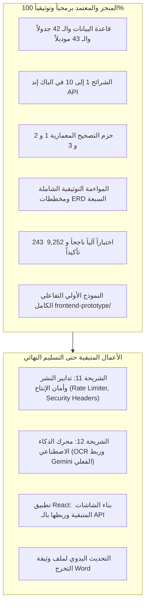

> **تنبيه:** تم أرشفة هذا الملف في 7 نوفمبر 2026م — لم يعد مستخدمًا وهو محفوظ للأغراض التاريخية.
# وثيقة خطة تحديث وثيقة التخرج (Thesis Update Plan)
**المشروع:** نظام إدارة وتقويم الجودة والخطط التعليمية في المدارس (`school-quality-system`)  
**تاريخ الإعداد:** 3 نوفمبر 2026م  
**الفرع:** `docs/alignment-batch-4`  
**الهدف:** دليل شامل ونهائي جاهز للنسخ واللصق لتعديل ملف وثيقة التخرج (Word / PDF) يدوياً، لنقل كامل التعديلات المعمارية والبرمجية المحققة في النظام الفعلي بعد اكتمال حزم التصحيح 1 و 2 و 3.

---

# الجزء الأول: تعديلات فصول وثيقة التخرج

## الفصل الأول: مدخل الدراسة والمشكلة والأهداف

### [01] تحديث نطاق النظام ومعمارية الشواهد وسجل التدقيق
- **الموقع في الوثيقة:** الفصل الأول — حدود الدراسة ونطاق النظام (صفحة 8–10 تقريباً).
- **الملاحظة المرتبطة:** U-24 / U-08
- **ما كان مكتوبًا سابقًا:**
  > «يشتمل النظام على 40 جدولاً بقاعدة البيانات، ويوفر آلية لرفع الشواهد والأدلة الداعمة لكل نتيجة تقييم مباشرة، مع تتبع النسخ عبر الطوابع الزمنية وجداول النظام دون الحاجة لسجل تدقيق مستقل.»
- **ما يجب أن يصبح:**
  > «يشتمل النظام على **42 جدولاً علائقياً أساسياً** و**301 حقلاً**، ويعتمد **معمارية شواهد نظيفة ثلاثية المستويات** تفصل بين مستودع وثائق المدرسة المؤسسي (`school_documents`)، ونسخ الملفات الفيزيائية المرفوعة وتاريخها (`document_versions`)، وروابط توظيف الشواهد التقييمية وإجراءات التحسين (`evidence_links`). كما يتضمن النظام **سجل تدقيق محصن ومستقل للإضافة فقط (`audit_logs`)** يوثق كافة العمليات الحساسة للأمان والتقييم والاستكمال والربط لضمان الامتثال والمساءلة.»
- **سبب التغيير:** مواءمة نطاق النظام مع المعمارية النظيفة ثلاثية المستويات للشواهد وإضافة سجل التدقيق غير القابل للتعديل.
- **المصدر:** ملفات التهجير `2026_11_02_100000` و `2026_11_03_200000`.
- **نوع التغيير:** تعديل وتحديث أرقام ومفاهيم.

---

### [02] تصحيح مصطلح «اعتماد التقييم» إلى «المراجعة الإشرافية والإغلاق النهائي»
- **الموقع في الوثيقة:** الفصل الأول — أهداف البحث وتوصيف دور المشرف الوزاري (صفحة 6–7 تقريباً).
- **الملاحظة المرتبطة:** U-03 / U-11
- **ما كان مكتوبًا سابقًا:**
  > «تمكين المشرف الوزاري من مراجعة تقارير المدارس واعتماد التقييم الذاتي بصورة نهائية.»
- **ما يجب أن يصبح:**
  > «تمكين المشرف الوزاري من إجراء **المراجعة الإشرافية والتحقق الميداني من المخرجات**، واتخاذ أحد مسارين نظاميين: **الإغلاق المباشر للتقييم** عند اكتمال الأدلة واستيفاء المعايير، أو **إصدار طلب استكمال بمهلة زمنية ملزمة** عند وجود نواقص؛ وصولاً إلى **الإغلاق النهائي لملف التقييم** ونقله لحالة الاكتمال (`Completed`). ويُحظر نظاماً استخدام مصطلح "الاعتماد" لأعمال المشرف الوزاري لكونها مراجعة إشرافية وليست اعتماداً مؤسسياً.»
- **سبب التغيير:** الالتزام بالدقة القانونية والوظيفية لمهام الإشراف وتفادي الخلط بين المراجعة الإشرافية والاعتماد المؤسسي.
- **المصدر:** قرارات المالك المعتمدة في دراسة النطاق 2 و 3.
- **نوع التغيير:** استبدال مصطلح وتدقيق لغوي ووظيفي.

---

## الفصل الثاني: الإطار النظري ومعايير الأمان والحوكمة

### [03] متطلبات الحوكمة وسجل التدقيق المحصن للإضافة فقط (Append-Only Audit Trail)
- **الموقع في الوثيقة:** الفصل الثاني — مبادئ أمن النظم التعليمية وحوكمة البيانات (صفحة 24–26 تقريباً).
- **الملاحظة المرتبطة:** U-08
- **ما كان مكتوبًا سابقًا:**
  > «تكتفي المنظومة بتوثيق حركة المستخدمين عبر الطوابع الزمنية `created_at` و `updated_at` وجداول الإصدارات، مما يقلل تعقيد قاعدة البيانات ويستبعد الحاجة لجداول تدقيق منفصلة.»
- **ما يجب أن يصبح:**
  > «تعتمد المنظومة معيار التدقيق الجنائي والأمني المتقدم من خلال **سجل تدقيق محصن ومستقل للإضافة فقط (`audit_logs`)**؛ حيث يُمنع منعاً باتاً تعديل أو حذف أي سجل مسجل، وتوثق الخدمة المركزية (`AuditLoggerService`) 12 حدثاً تشغيلياً وأمنياً وتقييمياً حساساً (تسجيل الدخول، فشل الدخول، تسجيل الخروج، تغيير كلمة المرور، رصد الدرجات، تسليم التقييم، الإغلاق المباشر، إنشاء طلب الاستكمال، تمديد المهلة، إعادة التسليم، إغلاق طلب الاستكمال، وإلغاء ربط الشاهد). كما يُحجب السجل تماماً عن إدارات المدارس ويقتصر استعراضه على مسؤول النظام والمشرف الوزاري لدواعي الحوكمة والنزاهة.»
- **سبب التغيير:** الوفاء بمتطلب الحوكمة والمساءلة وتوثيق إضافة جدول `audit_logs`.
- **المصدر:** ملف التهجير `2026_11_03_200000_create_audit_logs_table.php` ونموذج `AuditLog.php`.
- **نوع التغيير:** إضافة وتعديل فقرة نظرية.

---

### [04] نموذج إدارة المستندات المدرسية وتعدد الاستدلال بالشواهد
- **الموقع في الوثيقة:** الفصل الثاني — التوثيق والشواهد الرقمية في تقويم الأداء المدرسي (صفحة 31–33 تقريباً).
- **الملاحظة المرتبطة:** U-24
- **ما كان مكتوبًا سابقًا:**
  > «يتم رفع الشاهد الرقمي مباشرة كملف مرتبط بنتيجة المؤشر، وتُدار نسخه عند التعديل.»
- **ما يجب أن يصبح:**
  > «يتبنى النظام نموذج المستودع المؤسسي للوثائق (Institutional Document Repository)؛ حيث يُعامل المستند المدرسي (محضر، خطة، تقرير، سجل) كأصل مستقل يخص المدرسة (`school_documents`) ويحتفظ بنسخه التاريخية المتعاقبة (`document_versions`). ويتم الاستدلال بالمستند كشاهد تقييمي عبر روابط استدلالية مستقلة (`evidence_links`) تتيح توظيف الوثيقة الواحدة لإثبات عدة مؤشرات، أو ربطها بإجراء تنفيذي في خطة التحسين دون تكرار رفع الملفات، مع فرض الحماية الصارمة (`RESTRICT`) لمنع حذف أي وثيقة معتمدة كشاهد في تقييم قائم.»
- **سبب التغيير:** توثيق الأساس النظري للمعمارية النظيفة ثلاثية المستويات للشواهد.
- **المصدر:** ملفات التهجير `2026_11_02_100000` و `2026_11_02_110000`.
- **نوع التغيير:** تعديل وتأصيل نظري.

---

## الفصل الثالث: تحليل وتوصيف متطلبات النظام

### [05] دورة حياة التقييم الذاتي ومسار المراجعة الوزارية وسجل المحاولات
- **الموقع في الوثيقة:** الفصل الثالث — قسم 3.4 (حالات الاستخدام) وقسم 3.6 (قواعد العمل BR-SCH-02 / BR-SCH-03).
- **الملاحظة المرتبطة:** U-03 / U-11 / U-29
- **ما كان مكتوبًا سابقًا:**
  > «عند قيام مقيم المدرسة بتسليم التقييم الذاتي عبر مسار submit، ينتقل التقييم مباشرة إلى حالة مكتمل (Completed) ويُقفل عن أي تعديل إضافي.»
- **ما يجب أن يصبح:**
  > «عند قيام مقيم المدرسة بتسليم التقييم الذاتي عبر مسار `POST /api/v1/evaluations/{id}/submit`:
  > 1. ينتقل التقييم إلى حالة مسلّم (`Submitted`) فقط، ولا ينتقل إلى `Completed`.
  > 2. يُنشأ تقرير التقييم بحالة مسودة (`Draft`) إن لم يكن منشأ مسبقاً.
  > 3. يُنشأ سجل محاولة تسليم أولى برقم محاولة 1 (`attempt_no = 1`) في جدول `evaluation_submissions`.
  > 4. ينتقل التقييم للمراجعة الإشرافية الوزارية، حيث يملك المشرف الوزاري خيارين:
  >    - **المسار الأول (الإغلاق المباشر):** عبر `POST /api/v1/evaluations/{id}/close` لنقل التقييم إلى `Completed` والتقرير إلى `Final`.
  >    - **المسار الثاني (طلب الاستكمال):** عبر `POST /api/v1/evaluations/{id}/completion-requests` مع تحديد مهلة زمنية ملزمة (`completion_deadline`)، ونقل التقييم إلى `NeedsCompletion`.
  > 5. في حالة طلب الاستكمال، لا يُسمح للمدرسة بإعادة التسليم (`resubmit`) إلا إذا عولجت كافة البنود واستوفت شواهد مكتملة وضمن سريان المهلة، وعندها يُنشأ سجل محاولة جديدة برقم متزايد (`attempt_no = N + 1`) وينتقل الطلب إلى `UnderReview` والتقييم إلى `Submitted`.
  > 6. لا يصل التقييم إلى حالة مكتمل (`Completed`) إلا بقرار إغلاق رسمي من المشرف الوزاري.»
- **سبب التغيير:** تصحيح دورة حياة التقييم وفق القرارات المعمارية المعتمدة لحزمة التصحيح 2.
- **المصدر:** `CompletionRequestController.php`, `EvaluationController.php`, `EvaluationSubmission.php`.
- **نوع التغيير:** تعديل جوهري وتفصيل حالة الاستخدام وقواعد العمل.

---

### [06] استبدال متطلبات الشواهد القديمة بالمعمارية ثلاثية المستويات
- **الموقع في الوثيقة:** الفصل الثالث — المتطلبات الوظيفية FR-SCH-13 و FR-SCH-14 و FR-SCH-15.
- **الملاحظة المرتبطة:** U-24
- **ما كان مكتوبًا سابقًا:**
  > «FR-SCH-13: يقوم النظام بربط الشاهد بنتيجة المؤشر عبر جدول evidences.
  > FR-SCH-14: يتيح النظام رفع نسخ جديدة للشاهد في جدول evidence_versions.»
- **ما يجب أن يصبح:**
  > «**FR-SCH-13 (مستودع وثائق المدرسة):** يتيح النظام للمدرسة إنشاء وإدارة مستودع وثائقي مركزي (`school_documents`) يصنف الوثائق إلى 7 أنواع رئيسية (محاضر، خطط، سجلات، تقارير، لوحات، صور، أخرى).
  > **FR-SCH-14 (إصدارات الملفات الفيزيائية):** يتيح النظام رفع نسخ ملفات متعددة للوثيقة الواحدة بجدول `document_versions` مع حفظ أرقام الإصدارات وتحديد نسخة نشطة واحدة (`is_current = true`)، وتخزين الملفات باسم فريد خارج مسار التنفيذ.
  > **FR-SCH-15 (ربط الشواهد التقييمية وإجراءات التحسين):** يتيح النظام توظيف أي نسخة مستند معتمدة كشاهد لمؤشر تقييمي بجدول `evidence_links` مع تدوين مبررات الاستدلال، أو ربطها بإجراء تحسين تنفيذي (`action_id`) لتوثيق الإنجاز الميداني، مع منع تكرار ربط نفس نسخة المستند بنفس المؤشر ضمن التقييم الواحد.»
- **سبب التغيير:** حذف معمارية evidences القديمة وإحلال معمارية الشواهد النظيفة المعتمدة.
- **المصدر:** ملف التهجير `2026_11_02_100000` و `2026_11_02_110000`.
- **نوع التغيير:** استبدال وتعديل نصوص المتطلبات الوظيفية.

---

### [07] إضافة مرونة التقدير المستهدف في مجالات واقتراحات التحسين
- **الموقع في الوثيقة:** الفصل الثالث — المتطلبات الوظيفية FR-SCH-16 و FR-SCH-17.
- **الملاحظة المرتبطة:** U-23
- **ما كان مكتوبًا سابقًا:**
  > «يولد النظام اقتراحات مجالات التحسين تلقائياً لجميع المؤشرات التي حصلت على تقدير أقل من 3 (الدرجة القصوى الثابتة).»
- **ما يجب أن يصبح:**
  > «يولد النظام اقتراحات مجالات التحسين ديناميكياً استناداً إلى **سقف تقدير مستهدف مرن (`target_score`)** يتم تمريره اختيارياً (1 أو 2 أو 3، بقيمة افتراضية 3)؛ بحيث تقتصر المقترحات على المؤشرات ذات التقدير الأقل من السقف المستهدف وتُحسب فجوة الأداء بموجبه (`gap = target_score - score`). كما يتيح جدول `improvement_areas` حفظ التقدير المستهدف المعتمد لكل مجال تحسين لتمكين المدارس من التخطيط المرحلي للارتقاء بجودتها.»
- **سبب التغيير:** إعطاء مرونة واقعية للمدارس ذات الأداء الابتدائي في التخطيط والتحسين التدريجي.
- **المصدر:** ملف التهجير `2026_11_03_200001` ومتحكم `ImprovementSuggestionController.php`.
- **نوع التغيير:** إضافة وتعديل متطلب وظيفي.

---

### [08] صمود خدمة اتجاهات الأداء (Trend Analysis) أمام المؤشرات الملغاة أو المعدلة
- **الموقع في الوثيقة:** الفصل الثالث — متطلب المقارنة التاريخية FR-REP-07 وقاعدة العمل BR-SCH-07.
- **الملاحظة المرتبطة:** U-27
- **ما كان مكتوبًا سابقًا:**
  > «تقتصر المقارنة بين الدورات التقييمية على المؤشرات المتطابقة في المعرف مع الإصدار الحالي.»
- **ما يجب أن يصبح:**
  > «تعتمد خدمة تحليل الاتجاهات التاريخية (`EvaluationTrendService`) آلية مطابقة ثنائية مرنة تصمد أمام إلغاء المؤشرات أو تعديل نصوصها أو اختلاف الإصدارات المعيارية؛ حيث تتعرف الخدمة على تطابق المؤشر عبر المعرف أو رمز المؤشر ونصّه المعتمد، وتُظهر نتائج المؤشرات الملغاة أو المؤرشفة ضمن سياقها التاريخي دون التسبب في انهيار المقارنة أو فقدان البيانات التاريخية للأداء.»
- **سبب التغيير:** ضمان استقرار ودقة التقارير الإحصائية ومقارنات الأداء عبر السنوات.
- **المصدر:** خدمة `EvaluationTrendService.php` واختباراتها الآلية.
- **نوع التغيير:** تعديل وتطوير قاعدة عمل ومتطلب تقارير.

---

### [09] تأمين تغيير كلمة المرور للمستخدم المسجل
- **الموقع في الوثيقة:** الفصل الثالث — المتطلبات الأمنية العامة FR-GEN-01.
- **الملاحظة المرتبطة:** U-40
- **ما كان مكتوبًا سابقًا:**
  > «لم أتمكن من تحديد النص القديم بدقة؛ راجع قسم إدارة الحسابات وكلمات المرور في الفصل الثالث.»
- **ما يجب أن يصبح:**
  > «**FR-GEN-01-B (تغيير كلمة المرور للمستخدم المسجل):** يتيح النظام لأي مستخدم مصادق تغيير كلمة المرور الخاصة به عبر مسار آمن (`POST /api/v1/auth/password/change`)، مع اشتراط التحقق الإلزامي من كلمة المرور الحالية، وتطابق كلمة المرور الجديدة مع تأكيدها (8 أحرف كحد أدنى) واختلافها عن القديمة. ويقوم النظام تلقائياً بإلغاء وإبطال كافة رموز الوصول الشخصية الأخرى النشطة للمستخدم في `personal_access_tokens` عدا رمز الجلسة الحالية وتدوين العملية في سجل التدقيق.»
- **سبب التغيير:** سد فجوة أمنية ومواءمة النظام مع معايير الأمان المعتمدة.
- **المصدر:** `ChangePasswordRequest.php` ومتحكم `AuthController.php`.
- **نوع التغيير:** إضافة متطلب وظيفي وأمني جديد.

---

### [10] تحديث مخطط الكيانات والعلاقات (ERD) وإحصاءات الجداول في الفصل الثالث
- **الموقع في الوثيقة:** الفصل الثالث — قسم 3.10 (المخطط العام للبيانات ERD).
- **الملاحظة المرتبطة:** U-24 / U-08 / U-03
- **ما كان مكتوبًا سابقًا:**
  > «يتكون المخطط من 40 جدولاً علائقياً موزعة على 5 حزم ERD-01 إلى ERD-05 بإجمالي 281 حقلاً و63 علاقة تكاملية.»
- **ما يجب أن يصبح:**
  > «يتكون المخطط العلائقي للنظام الفعلي من **42 جدولاً أساسياً** و**301 حقلاً** موزعة على الحزم المعمارية:
  > - **ERD-01 (الهوية والإدارة):** 8 جداول (`roles`, `permissions`, `role_permissions`, `schools`, `ministries`, `users`, `user_roles`, `sessions`).
  > - **ERD-02 (المعايير والمؤشرات):** 9 جداول (`standard_versions`, `standards`, `sub_standards`, `indicators`, `score_levels`, `indicator_score_descriptors`, `indicator_evidence_requirements`, `verification_tools`, `indicator_verification_methods`).
  > - **ERD-03 (دورات التقييم والنتائج):** 6 جداول (`evaluation_cycles`, `cycle_participations`, `evaluations`, `evaluation_results`, `notes`, `evaluation_result_verification_methods`).
  > - **ERD-04 (معمارية الشواهد النظيفة):** 4 جداول (`school_documents`, `document_versions`, `evidence_links`, `attachments`).
  > - **ERD-05 (المخرجات والاستكمال ومحاولات التسليم):** 7 جداول (`reports`, `evaluation_submissions`, `completion_requests`, `completion_request_items`, `supervisor_notes`, `internal_review_notes`, `plan_review_notes`).
  > - **ERD-06 (خطط التحسين وسجل التدقيق والذكاء):** 8 جداول (`improvement_areas`, `improvement_plans`, `plan_improvement_areas`, `improvement_actions`, `notifications`, `audit_logs`, `ai_analysis`, `ai_recommendations`).»
- **سبب التغيير:** إسقاط جداول evidences القديمة، وإضافة جداول المعمارية النظيفة وجدول audit_logs، وتحديث تصنيف المخططات السبعة المتوافقة مع ملفات Mermaid.
- **المصدر:** ملفات التهجير وقاموس البيانات المحدث ومخططات Mermaid في `docs/erd/final/`.
- **نوع التغيير:** استبدال شامل للأرقام وتصنيف المخططات.

---

## الفصل الرابع: تصميم النظام وهندسة البرمجيات

### [11] تحديث سجل القرارات المعمارية (4.2.2)
- **الموقع في الوثيقة:** الفصل الرابع — قسم 4.2.2 (سجل القرارات المعمارية ADR).
- **الملاحظة المرتبطة:** U-24 / U-03 / U-11 / U-08 / U-23 / U-40
- **ما كان مكتوبًا سابقًا:**
  > كان السجل يتوقف عند 18 قراراً معمارياً، مع وجود قرارات قديمة بخصوص evidences وجداول الشواهد الثنائية.
- **ما يجب أن يصبح:**
  > تحديث القرارات القديمة وإضافة القرارات الجديدة من 19 إلى 23:
  > - **القرار 6 (محدث):** اعتماد معمارية شواهد نظيفة ثلاثية المستويات (`school_documents` -> `document_versions` -> `evidence_links`) لعزل المستند المدرسي عن سياقات التوظيف التقييمي والتنفيذي.
  > - **القرار 15 (محدث):** مرونة الروابط الشاهدية عبر `evidence_links` لربط نسخة المستند بالمؤشر التقييمي وإجراء التحسين (`action_id`) مباشرة.
  > - **القرار 17 (محدث):** حماية النسخ التاريخية المعتمدة كشواهد تقييمية من الحذف عبر قيد `RESTRICT`.
  > - **القرار 19 (جديد):** ضبط دورة حياة التقييم والاستكمال وسجل المحاولات المتكررة؛ التسليم ينقل إلى `Submitted` فقط، وحالة `Completed` تكون بقرار إغلاق وزاري فقط.
  > - **القرار 20 (جديد):** سجل تدقيق محصن وغير قابل للتعديل `audit_logs` للإضافة فقط يوثق 12 حدثاً ويوفر العزل والفلترة.
  > - **القرار 21 (جديد):** مرونة سقف التقدير المستهدف `target_score` في مجالات ومقترحات التحسين (1 إلى 3، افتراضي 3).
  > - **القرار 22 (جديد):** صمود خدمة اتجاهات الأداء `EvaluationTrendService` بالمطابقة الثنائية أمام المؤشرات الملغاة والمعدلة نصياً.
  > - **القرار 23 (جديد):** تأمين تغيير كلمة المرور عبر `POST /auth/password/change` مع التحقق من القديمة وإبطال الجلسات الأخرى وتدوين العملية.
- **سبب التغيير:** توثيق القرارات المعمارية المنفذة في حزم التصحيح 1 و 2 و 3.
- **المصدر:** كود النظام وملفات التهجير واختبارات الميزات.
- **نوع التغيير:** إضافة وتعديل في جدول القرارات المعمارية.

---

### [12] تحديث كتالوج نقاط النهاية (Endpoints Catalog - 4.4.3)
- **الموقع في الوثيقة:** الفصل الرابع — جدول نقاط النهاية 4.4.3.
- **الملاحظة المرتبطة:** U-24 / U-03 / U-11 / U-08 / U-40
- **ما كان مكتوبًا سابقًا:**
  > وجود مسارات قديمة للشواهد (`POST /evaluation-results/{id}/evidences`, `POST /evidences/{id}/versions`)، وغياب مسارات الاستكمال والإغلاق والتدقيق وتغيير كلمة المرور.
- **ما يجب أن يصبح:**
  > حذف المسارات القديمة بالكامل وإدراج المسارات المعتمدة التالية في الجدول:
  > - `POST /api/v1/auth/password/change` (تغيير كلمة المرور وإبطال الجلسات الأخرى).
  > - `GET /api/v1/audit-logs` (استعراض سجل التدقيق لمسؤول النظام والمشرف الوزاري).
  > - `GET /api/v1/schools/{schoolId}/documents` (استعراض مستودع وثائق المدرسة).
  > - `GET /api/v1/evaluations/{id}/evidence-inventory` (جرد الشواهد التقييمي).
  > - `GET/POST /api/v1/evaluations/{id}/indicators/{iId}/evidence-links` (استعراض وربط مستند قائم كشاهد).
  > - `POST /api/v1/evaluations/{id}/indicators/{iId}/evidence-links/upload` (رفع مستند وربطه كشاهد دفعة واحدة).
  > - `DELETE /api/v1/evidence-links/{linkId}` (إلغاء ربط شاهد تقييمي وتدوينه بالتدقيق).
  > - `GET /api/v1/document-versions/{versionId}/download` (تنزيل ملف نسخة المستند بأمان).
  > - `POST /api/v1/evaluations/{id}/submit` (تسليم التقييم الذاتي -> Submitted ومحاولة 1).
  > - `POST /api/v1/evaluations/{id}/close` (الإغلاق المباشر للتقييم من المشرف الوزاري -> Completed).
  > - `GET/POST /api/v1/evaluations/{id}/completion-requests` (استعراض وإنشاء طلب استكمال بمهلة زمنية).
  > - `GET /api/v1/completion-requests/{id}` (تفاصيل طلب الاستكمال وبنوده).
  > - `PATCH /api/v1/completion-requests/{id}/deadline` (تمديد مهلة الاستكمال من المشرف الوزاري).
  > - `POST /api/v1/completion-requests/{id}/resubmit` (إعادة تسليم التقييم بعد استيفاء البنود -> attempt N+1).
  > - `POST /api/v1/completion-requests/{id}/close` (إغلاق طلب الاستكمال نهائياً -> Completed).
- **سبب التغيير:** مطابقة جدول نقاط النهاية مع المسارات المعرفة فعلياً في `routes/api.php`.
- **المصدر:** ملف `routes/api.php` والمتحكمات.
- **نوع التغيير:** استبدال وإضافة مسارات في كتالوج الواجهة البرمجية.

---

### [13] تحديث مخططات الحالة والتسلسل لدورة حياة التقييم والاستكمال (4.7)
- **الموقع في الوثيقة:** الفصل الرابع — قسم 4.7 (تصميم العمليات ودورة حياة الشواهد).
- **الملاحظة المرتبطة:** U-03 / U-11 / U-24
- **ما كان مكتوبًا سابقًا:**
  > مخطط يوضح رفع الشاهد مباشرة ومخطط انتقال التقييم من InProgress إلى Completed مباشرة عند submit.
- **ما يجب أن يصبح:**
  > استبدال المخططات القديمة بمخططين معتمدين بصيغة Mermaid:
  > 1. **مخطط معمارية الشواهد ثلاثية المستويات:** يوضح تدفق إنشاء المستند المدرسي، ورفع النسخ برقم متسلسل، وتوليد روابط الاستدلال التقييمي والتنفيذي.
  > 2. **مخطط دورة حياة التقييم والاستكمال (State Diagram):** يوضح الانتقال:
  >    `InProgress` -> `Submitted` (إنشاء محاولة 1 وتقرير مسودة) -> `UnderReview` -> إما إغلاق مباشر (`Completed`) أو طلب استكمال (`NeedsCompletion`) بمهلة -> معالجة البنود -> إعادة تسليم `resubmit` (محاولة جديدة `attempt_no = N+1`) -> مراجعة إشرافية -> إغلاق نهائي (`Completed` والتقرير `Final`).
- **سبب التغيير:** مطابقة وثيقة التصميم مع السلوك البرمجي المحقق في النظام الفعلي.
- **المصدر:** `CompletionRequestController.php` و `docs/chapter4/chapter4_system_design.md`.
- **نوع التغيير:** استبدال وتحديث المخططات الرسومية والبيانية.

---

### [14] تحديث مصفوفة الصلاحيات وحوكمة سجل التدقيق (4.5.2)
- **الموقع في الوثيقة:** الفصل الرابع — قسم 4.5.2 (مصفوفة الأدوار والصلاحيات).
- **الملاحظة المرتبطة:** U-08 / U-03
- **ما كان مكتوبًا سابقًا:**
  > جدول الأدوار والصلاحيات القديم مع الإشارة إلى أن سجل التدقيق غير مفعل في المرحلة التجريبية.
- **ما يجب أن يصبح:**
  > إضافة ملاحظة الحوكمة الإلزامية أسفل الجدول:
  > «**حوكمة صلاحيات سجل التدقيق:** يُقصر استعراض سجل التدقيق (`GET /api/v1/audit-logs`) حصرياً على دوري **مسؤول النظام (`admin`)** و**المشرف الوزاري (`ministry_supervisor`)**؛ ويُحظر تماماً على مديري ومقيمي المدارس الاطلاع عليه (`403 Forbidden`). وسجل التدقيق للإضافة فقط ولا تتوفر له أي مسارات تعديل أو حذف برمجياً.»
- **سبب التغيير:** توثيق قواعد الحوكمة الأمنية المعتمدة في تصحيح 3.
- **المصدر:** `AuditLogController.php` و `RolePermissionSeeder.php`.
- **نوع التغيير:** إضافة وتعديل تنظيمي.

---

### [15] تحديث إحصاءات الاختبارات الفعلية للنظام (4.10.1)
- **الموقع في الوثيقة:** الفصل الرابع — قسم 4.10.1 (إحصاءات الاختبارات الفعلية للنظام) وقسم 4.11 (ملخص الفصل).
- **الملاحظة المرتبطة:** U-01 إلى U-40 (كافة حزم التصحيح)
- **ما كان مكتوبًا سابقًا:**
  > «إجمالي الاختبارات الآلية المنفذة: 103 اختبارات ناجحة بنسبة 100% بإجمالي 7,369 تأكيداً (Assertions) بتاريخ 27 أكتوبر 2026م.»
- **ما يجب أن يصبح:**
  > «إجمالي الاختبارات الآلية المنفذة: **250 اختباراً آلياً** ناجحاً بنسبة **100%** (0 إخفاق، 0 أخطاء) بإجمالي **9,314 تأكيداً برمجياً (Assertions)** معتمداً ومحققاً في قاعدة البيانات وكافة طبقات النظام بتاريخ **4 نوفمبر 2026م**.»
- **سبب التغيير:** توثيق النمو الحقيقي والموثوقية العالية لجناح الاختبارات بعد إضافة اختبارات معمارية الشواهد ومسار الاستكمال والتدقيق الأمني.
- **المصدر:** مخرجات تشغيل `php artisan test` الفعلية على المنظومة.
- **نوع التغيير:** تحديث أرقام وإحصاءات رسمية.

---

### [16] المتطلبات غير الوظيفية للأمان والجاهزية للإنتاج (الشريحة 11)
- **الموقع في الوثيقة:** الفصل الثالث — قسم 3.7 (المتطلبات غير الوظيفية NFRs) وقسم 3.6 (قواعد العمل).
- **الملاحظة المرتبطة:** الشريحة 11 (الجاهزية للأمان والإنتاج) وضابط G-23.
- **ما كان مكتوبًا سابقًا:**
  > اقتصار المتطلبات غير الوظيفية على عزل المدارس (NFR-SEC-01) وفرض الخمول 30 دقيقة (NFR-SEC-02).
- **ما يجب أن يصبح:**
  > إضافة بنود الأمان والإنتاج المعتمدة التالية إلى جدول المتطلبات غير الوظيفية وقواعد العمل:
  > 
  > 1. **NFR-SEC-04 (الحماية من هجمات التخمين عبر Rate Limiting):**
  >    - فرض تقييد آلي لمعدل الطلبات على مسارات المصادقة الحساسة لمنع هجمات القوة الغاشمة (Brute-Force):
  >      - مسار تسجيل الدخول (`login`): 5 محاولات لكل دقيقة لكل عنوان IP.
  >      - مسار استعادة كلمة المرور (`password/forgot`): 3 محاولات كل 15 دقيقة لكل عنوان IP.
  >      - مسار تغيير كلمة المرور (`password/change`): 5 محاولات كل 10 دقائق لكل مستخدم مسجل (`user:id`).
  >    - إرجاع رمز الاستجابة `429 Too Many Requests` مع ترويسة `Retry-After` ورسالة عربية واضحة دون التأثير على انسيابية باقي مسارات النظام التشغيلية.
  > 
  > 2. **NFR-SEC-05 (ترويسات أمان HTTP وتصليد الاستجابات):**
  >    - حقن ترويسات الحماية القياسية في كافة استجابات النظام:
  >      - `X-Frame-Options: DENY` (منع Clickjacking).
  >      - `X-Content-Type-Options: nosniff` (منع MIME Confusion).
  >      - `Referrer-Policy: strict-origin-when-cross-origin` (حماية الخصوصية).
  >    - تفعيل ترويسة النقل الآمن المشدد `Strict-Transport-Security` (HSTS) حصرياً في بيئة الإنتاج (`production`) وعند تشفير `HTTPS`.
  >    - الحفاظ التام على ترويسات تدفق وتنزيل ملفات الـ PDF (بطاقة التقويم) وملفات Excel دون تشويه لنوع المحتوى أو اسم الملف المرفق.
  > 
  > 3. **NFR-INT-03 (ضمان اتساق وتفرد الإصدار المعياري النشط - ضابط G-23):**
  >    - منع وجود أكثر من إصدار معايير وطنية واحد بحالة نشط (`Active` / `Approved`) في عموم النظام.
  >    - تطبيق الأرشفة التلقائية الذرية داخل معاملة قاعدة البيانات (`DB::transaction`): تنشيط أو إقرار إصدار جديد يؤدي فوراً إلى أرشفة الإصدار النشط القديم.
  >    - تسجيل عمليتي التدقيق المؤسسي في `audit_logs`:
  >      - `standard_version.activated`
  >      - `standard_version.auto_archived`
  >      مع توثيق المستخدم المنفذ والحالة السابقة والجديدة دون تسجيل بيانات حساسة.
  >    - فرض قيد التحقق الصارم المزدوج برمجياً عبر طبقة الخدمة ونموذج Eloquent، وتوثيق القيد القاعدي المشروط كتحسين مستقبلي لقاعدة البيانات.
  > 
  > 4. **NFR-OPS-01 (إعدادات بيئة الإنتاج وسياسة التوكنات):**
  >    - اعتماد سياسة صلاحية توكنات Sanctum لمدة 30 يوماً (`SANCTUM_EXPIRATION=43200`) لضمان استقرار العمل المدرسي اليومي دون انقطاع، مع إبطال الرموز تلقائياً عند تغيير كلمة المرور أو تسجيل الخروج.
  >    - فرض تأمين الكوكيز `SESSION_SECURE_COOKIE=true` في بيئة الإنتاج المشفرة.
- **سبب التغيير:** رفع النظام إلى معايير الأمان والإنتاج المؤسسية وضمان اتساق حوكمة المعايير وإغلاق متطلبات الشريحة 11.
- **المصدر:** `SecurityHeadersMiddleware.php` و `AppServiceProvider.php` و `StandardManagementService.php` و `.env.example`.
- **نوع التغيير:** إضافة متطلبات غير وظيفية وقواعد أمان جديدة.

---

# الجزء الثاني: ما تبقى من المشروع بعد تصحيح 4

بناءً على الفحص المباشر لكافة ملفات الكود، مسارات الـ API، النماذج، والوثائق المرجعية في المنظومة، نحدد بدقة حالة الأجزاء المتبقية وموقف كل عنصر:

---

### 1. ما موقف الشريحة 11 (الجاهزية للإنتاج والأمان والأداء)؟
- **الحالة:** **متبقية جزئياً (جاهزة للتنفيذ)**.
- **ما أُنجز منها فعلياً:**
  - تم بناء فهارس الأداء المركبة الأساسية على الجداول الجديدة (`school_documents`, `document_versions`, `evidence_links`, `audit_logs`).
  - تم التحقق من العزل المؤسسي الصارم ومطابقة الصلاحيات.
- **ما بقي فيها لإغلاقها نهائياً:**
  1. إضافة وسيط تحديد معدل الطلبات (`Rate Limiting Middleware`) على مسارات المصادقة واستعادة الحسابات لمنع هجمات التخمين.
  2. إضافة وسيط ترويسات الأمان (`Security Headers Middleware`) لتفعيل سياسات (HSTS, CSP, X-Frame-Options, X-Content-Type-Options).
  3. تنظيف أي حالات إصدارات معيارية قديمة عالقة (G-23) للتأكد من انحصارها في `Draft`, `Approved`, `Archived`.

---

### 2. ما موقف الشريحة 12 (طبقة الذكاء الاصطناعي AI Layer)؟
- **الحالة:** **متبقية في منطق الربط الفعلي الخارجي** (الهيكل القاعدي والنماذج جاهزة).
- **ما أُنجز منها فعلياً في الكود:**
  - جداول قاعدة البيانات جاهزة (`ai_analysis`, `ai_recommendations`).
  - نماذج Eloquent جاهزة بضوابط الحاكمية البشرية ومحاكاة الـ Mock.
- **ما بقي فيها لتكتمل كطبقة مساعدة تمكينية:**
  1. بناء عامل استخراج النصوص آلياً (`OCR Worker - 12.1`) لقراءة المستندات العربية المرفوعة (PDF والصور).
  2. ربط محرك الذكاء الاصطناعي الخارجي المعتمد (**Google Gemini Flash API** أو **OpenRouter**) عبر خدمة مخصصة لمطابقة النصوص مع واصفات الأداء وتقديم نسب الثقة والاستدلالات.
  3. تفعيل وظيفة الاقتراح التوليدي لإجراءات خطط التحسين المدرسي للمؤشرات المتدنية (`Action Plan Generation - 12.3`) عبر طوابير المهام الخلفية (`Queue Worker`).

---

### 3. ما حالة واجهات React الحالية (`school-eval-web/`)؟
- **الحالة:** **منجزة للشريحة الأولى فقط (المصادقة وإدارة المستخدمين والمدارس)** ومستمرة بالتوازي.
- **الواقع الفعلي للكود:**
  - تطبيق React 19 + TypeScript يحتوي حالياً على شاشات:
    - تسجيل الدخول (`LoginPage.tsx`).
    - إدارة المدارس لمسؤول النظام (`SchoolsManagementPage.tsx`).
    - إدارة المستخدمين وقيد XOR (`UsersManagementPage.tsx`).
    - اللوحة العامة والهيكل الأساسي (`Sidebar.tsx`, `TopNavbar.tsx`, `DashboardPage.tsx`).
- **المسار المتوازي المنفذ بالكامل:**
  - يتوفر في المشروع **النموذج الأولي التفاعلي المتكامل (`frontend-prototype/`)** وهو نظام واجهات شامل مبني بـ HTML5/Vanilla JS/CSS3 يعمل مباشرة على الـ API ويغطي كافة العمليات التشغيلية (رصد المؤشرات، شجرة المعايير، المستندات، الشواهد، خطط التحسين، اللوحة، تقارير PDF/Excel، ومسار الاستكمال).

---

### 4. هل بقي ربط الواجهات بالـ API؟ وما الشاشات والمسارات المطلوبة؟
- **في النموذج الأولي (`frontend-prototype/`):** الربط **مكتمل ويعمل بنسبة 100%**.
- **في تطبيق React الممتد (`school-eval-web/`):** يتطلب نقل الشاشات التالية من النموذج الأولي إلى مكونات React:
  1. شاشة شجرة التقييم ورصد الدرجات والواصفات (`/evaluations/:id/standards-tree`).
  2. شاشة مستودع وثائق المدرسة وإدارة النسخ وربط الشواهد (`/school-documents`).
  3. شاشة إدارة خطط التحسين ومجالاتها وإجراءاتها ومراجعة المدير (`/improvement-plans`).
  4. شاشة لوحة المعلومات والتقارير وتصدير JSON/PDF/Excel (`/reports`).
  5. شاشة المشرف الوزاري للمراجعة الإشرافية وإدارة طلبات الاستكمال والمهل (`/supervision`).
  6. شاشة تغيير كلمة المرور (`/auth/password/change`) وشاشة استعراض سجل التدقيق (`/audit-logs`).

---

### 5. هل بقي تحديث وثيقة التخرج Word/PDF يدويًا؟
- **نعم، بالتأكيد.**
- ملف وثيقة التخرج بصيغة Word هو الوثيقة الرسمية الأكاديمية للتسليم؛ وهذا الملف الذي بين يديك (`docs/thesis-update-plan.md`) صُمم ليكون **الدليل المرجعي الصارم** لإجراء التعديلات الـ 15 المذكورة في الجزء الأول نصاً ورقماً في ملف الـ Word الخاص بك لضمان التطابق التام مع الواقع البرمجي.

---

### 6. هل بقي أي ملف توثيق أو واجهة أو seeder أو مسار يحتوي بيانات قديمة؟
- تم تطهير كافة أدلة المشروع والقاموس والـ ERD وفصول التصميم في مجلد `docs/` لتطابق النظام الفعلي.
- المتبقي الوحيد:
  - التأكد عند تنفيذ الشريحة 11 من تحديث بذور الإصدارات القديمة (إن وجدت تسمية `Active` بدلاً من `Approved`) في `StandardVersionSeeder`.
  - تطبيق التعديلات الميدانية على ملف Word لوثيقة التخرج.

---

### 7. الترتيب الزمني المقترح للخطوات المتبقية حتى التسليم النهائي

1. **الخطوة الأولى (توثيقية فورية):** مراجعة هذا الملف ونقل التعديلات الـ 15 إلى وثيقة التخرج Word، وتحديث مخططات الـ ERD بإدراج ملفات Mermaid السبعة المولدة في `docs/erd/final/`.
2. **الخطوة الثانية (برمجية):** تنفيذ الشريحة 11 لضبط أمان الإنتاج (Rate Limiting وسيطات الحماية وفهارس الأداء).
3. **الخطوة الثالثة (برمجية ذكية):** تنفيذ الشريحة 12 لربط محرك Gemini ومعالجة الشواهد ومسودات خطط التحسين.
4. **الخطوة الرابعة (واجهات):** استكمال شاشات React المتبقية وربطها بالـ API اعتماداً على النموذج الأولي الجاهز.
5. **الخطوة الخامسة (تسليم):** تشغيل الفحص الآلي النهائي، وتصدير وثيقة التخرج PDF النهائية، وتجهيز بيئة العرض التقديمي للمناقشة.

