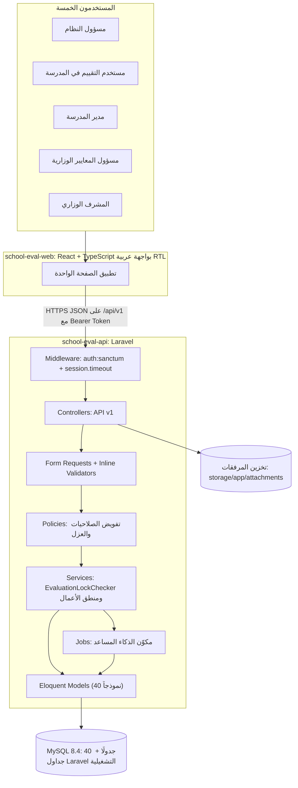
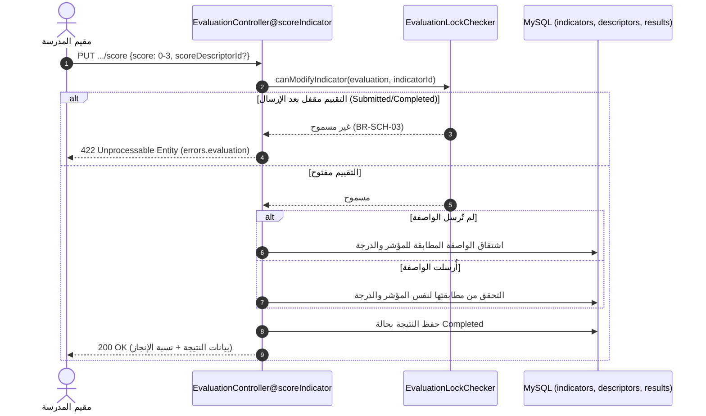
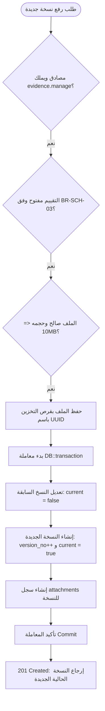

# الفصل الرابع: تصميم النظام (System Design)

> **المشروع:** نظام إدارة الجودة والخطط التعليمية في المدارس  
> **الحالة:** مسودة محدثة معتمدة مع الشرائح 1 و2 و3 و4 والنموذج الأولي التفاعلي — 27 أكتوبر 2026م  
> **توثيق التنفيذ والشرائح البرمجية:** يُحال للواقع المنفذ فعلياً وتفاصيل كل شريحة واختباراتها إلى دليل الشرائح في [docs/slices/README.md](../slices/README.md) والملفات التفصيلية [slice1_auth_admin.md](../slices/slice1_auth_admin.md) و[slice2_evaluation_evidence.md](../slices/slice2_evaluation_evidence.md) و[slice3_improvement_plans.md](../slices/slice3_improvement_plans.md) و[slice4_reports_analytics.md](../slices/slice4_reports_analytics.md).  
> **تسمية الفصل ورقمه:** الفصل الرابع: تصميم النظام (وفق هيكل التقرير الأكاديمي المعتمد).

## مفتاح الوسوم المستخدمة في هذه المسودة

| الوسم | المعنى |
|---|---|
| **[موثق]** | مأخوذ من وثائقك: الفصول 1-3، قاموس البيانات، conventions.md، models_guide.md، تقارير الاختبار والـ Seeders |
| **[قرار]** | قرار اتُّخذ أثناء العمل على المشروع وتم اعتماده |
| **[منفّذ]** | عنصر أو مسار أو كود أو اختبار تم بناؤه والتحقق منه برمجياً في الكود الفعلي |
| **[مقترح]** | اقتراح تصميمي لم يُنفَّذ بعد، ولا يرد صراحة في وثائقك |
| **[املأ]** | جزء ينقصه محتوى أو رقم أو صورة منك |

لا تترك أي وسم في النسخة النهائية للتسليم. بعد التعبئة احذف الوسوم والملاحظات بين الأقواس المربعة.

---

## 4.1 مقدمة الفصل

ينقل هذا الفصل المشروع من التحليل في الفصل الثالث (الفاعلون، المتطلبات، قواعد العمل، حالات الاستخدام، ERD) إلى التصميم: كيف يُبنى النظام، وكيف تتوزع المسؤوليات بين مكوناته، وكيف تُحمى بياناته، وكيف تُترجم كل متطلبات الفصل الثالث إلى عناصر تصميمية قابلة للتنفيذ والاختبار.

### 4.1.1 نطاق التصميم
- منصة ويب عربية مركزية لإدارة التقييم الذاتي المدرسي وضمان الجودة وفق الإطار الرسمي المعتمد للمعايير السبعة. **[موثق §1.4.1]**
- التطبيق التجريبي محدود بمدرسة أو مدرستين من مرحلتي التعليم الأساسي والثانوي. **[موثق §1.4.2]**
- النظام لا ينفذ إجراءات الاعتماد الخارجي، ولا يصدر تقديرات رسمية مستقلة أو قرارات اعتماد؛ فالاعتماد النهائي خارج نطاقه. **[موثق §1.4.3]**
- مكوّن الذكاء الاصطناعي مساعد فقط؛ لا يعدّل التقديرات ولا البيانات الرسمية، وكل مخرجاته تخضع لمراجعة المستخدم. **[موثق §1.4.1 وBR-AI-01 وBR-AI-02]**

### 4.1.2 مدخلات التصميم من الفصل الثالث

| المدخل | القيمة | المصدر |
|---|---|---|
| الفاعلون | 5: مسؤول النظام، مستخدم التقييم في المدرسة، مدير المدرسة/المراجع الداخلي، مسؤول المعايير الوزارية، المشرف الوزاري | [موثق §3.2] |
| حالات الاستخدام | 21 حالة (GEN وADM وSCH وPRIN وAI وMSM وSUP) | [موثق §3.6] |
| المتطلبات الوظيفية | FR-GEN وFR-ADM وFR-SCH وFR-PRIN وFR-SUP وFR-MSM وFR-AI | [موثق §3.4] |
| المتطلبات غير الوظيفية | الأمان، الأداء، الموثوقية، قابلية الاستخدام، التوافقية، قابلية الصيانة، النزاهة والامتثال، التتبع والإشعارات | [موثق §3.5] |
| قاعدة البيانات | 40 جدولًا في 5 مخططات ERD | [موثق §3.10 وقاموس البيانات] |

### 4.1.3 تنظيم الفصل

| القسم | المحتوى |
|---|---|
| 4.2 | مبادئ التصميم والقرارات المعمارية |
| 4.3 | المعمارية العامة والتقنيات وهيكل المستودع |
| 4.4 | تصميم الخلفية وواجهة برمجة التطبيقات (API) |
| 4.5 | تصميم الأمان والصلاحيات |
| 4.6 | تصميم قاعدة البيانات |
| 4.7 | تصميم الوحدات والعمليات الرئيسية |
| 4.8 | تصميم مكوّن الذكاء الاصطناعي المساعد |
| 4.9 | تصميم واجهات المستخدم |
| 4.10 | تتبع المتطلبات إلى عناصر التصميم |
| 4.11 | بيئة التطوير والاختبار والنشر |
| 4.12 | ملخص الفصل |

---

## 4.2 مبادئ التصميم والقرارات المعمارية

### 4.2.1 المبادئ

1. **فصل المسؤوليات:** الواجهة تعرض وتجمع المدخلات، والخلفية وحدها تفرض قواعد العمل والصلاحيات. إخفاء زر في الواجهة ليس حماية. **[موثق / منفّذ]**
2. **الإنسان في الحلقة:** لا يؤثر الذكاء الاصطناعي على أي بيانات رسمية قبل مراجعة بشرية. **[موثق BR-AI-01/02]**
3. **حفظ التاريخ:** لا حذف للبيانات التاريخية؛ المبدأ «تعطيل لا حذف». ربط كل دورة بإصدارها الأصلي من المعايير، وتفعيل إصدار جديد لا يغيّر الدورات القائمة. **[موثق BR-GEN-04/05، conventions]**
4. **مرجع واحد للبيانات:** قاموس البيانات هو المرجع الحاكم لأسماء الجداول والأعمدة والأنواع والقيود. **[قرار]**
5. **اتساق التسمية والاستجابات:** اتفاقيات موحدة للـ API والتسمية والـ Enums والتواريخ عبر مغلف `ApiResponse`. **[موثق conventions.md / منفّذ]**
6. **قابلية الاختبار:** كل قاعدة عمل لها اختبار آلي يثبت تنفيذها في الخلفية (65 اختباراً محققاً بنسبة 100%). **[قرار / منفّذ]**

### 4.2.2 سجل القرارات المعمارية

| # | القرار | البديل المستبعد | السبب | الحالة |
|---|---|---|---|---|
| 1 | واجهة React منفصلة + Laravel API | Inertia داخل Laravel | فصل واضح بين الطبقتين، وإمكانية تبديل الواجهة لاحقًا | [قرار] |
| 2 | مصادقة Bearer Tokens عبر Laravel Sanctum | SPA Cookies | الواجهة على أصل منفصل؛ تفادي CSRF ومشاكل الكوكيز عبر المنافذ | [قرار 16/10/2026] |
| 3 | MySQL 8.4 | محركات أخرى | دعم قيود CHECK والمفاتيح المركبة المطلوبة في القاموس | [موثق] |
| 4 | RBAC عبر roles وpermissions وrole_permissions وuser_roles | صلاحيات مكتوبة في الكود | مرونة وتتبع، ومطابقة ERD-01 | [موثق] |
| 5 | عدم تحديد ON DELETE / ON UPDATE صراحة | CASCADE / SET NULL | حماية البيانات التاريخية؛ السلوك الافتراضي لـ MySQL يمنع حذف الأب عند وجود تابعين | [قرار] |
| 6 | قيد «نسخة current=true واحدة لكل شاهد» في طبقة التطبيق | Generated Column أو فهرس فريد | MySQL لا يدعم الفهارس الجزئية مباشرة؛ القاموس نص على التطبيق، وتُدار داخل `DB::transaction` | [موثق / قرار / منفّذ] |
| 7 | قيم الحالات VARCHAR بلا ENUM وبلا CHECK | ENUM في MySQL | سهولة التطوير؛ تُفرض القيم في Enums داخل PHP | [قرار] |
| 8 | مفاتيح أساسية INT UNSIGNED بأسماء مخصصة (`<entity>_id`) | `id` الافتراضي | مطابقة ERD وقاموس البيانات | [موثق] |
| 9 | Cache وQueue عبر database مع جداول Laravel تشغيلية منفصلة عن الـ 40 | file / sync | جاهزية الطابور لمهام الذكاء الاصطناعي | [قرار] |
| 10 | جلسات Laravel على file، وجدول sessions وظيفي منفصل | database | منع التعارض مع جدول sessions الوظيفي | [موثق conventions §12] |
| 11 | الوقت UTC في التخزين، وISO 8601 المنتهي بـ Z في JSON، والعرض محليًا (+03) في الواجهة | تخزين محلي | وضوح ودقة عالمية ومنع التضارب الزمني | [موثق conventions] |
| 12 | الذكاء الاصطناعي عبر Jobs ومكوّن وهمي (Mock) في المرحلة الحالية | استدعاء مباشر لمزود خارجي | عزل المخاطر ونطاق المشروع التجريبي | [موثق conventions §10-11] |
| 13 | توفير مسارين مستقلين لشجرة المعايير: مسار للشجرة الخام (`GET /standard-versions/{id}`) ومسار مخصص للتقييم المدرسي (`GET /evaluations/{id}/standards-tree`) مدمجاً بنتائج المدرسة ونسبة الإنجاز | الاعتماد على مسار المعايير الخام فقط وإلزام الواجهة بدمج مئات السجلات | كفاءة الأداء وخفض استهلاك الشبكة ودعم العزل المؤسسي لمدرسة التقييم مباشرة | [قرار 25/10/2026] |
| 14 | رصد درجات المؤشرات بأسلوب الإدراج أو التحديث (Upsert) وتعيين `completion_status = 'Completed'` مباشرة وتخطي `Pending` برمجياً | توليد 109 سجلات فارغة مسبقاً أو تعديل بنية الجداول | حقلا `score` و `score_descriptor_id` هما `NOT NULL` في قاعدة البيانات؛ الرصد المباشر يحافظ على سلامة البنية دون مساس بالـ 40 جدولاً | [قرار 25/10/2026] |
| 15 | اشتراط وجود نتيجة مرصودة مسبقاً للمؤشر لإنشاء الشاهد (`POST /evaluation-results/{id}/evidences`) | السماح برفع شاهد لمؤشر غير مرصود | حقل `evidences.result_id` مفتاح أجنبي `NOT NULL`؛ فالشاهد يدعم نتيجة مرصودة قائمة، والواجهة تُعطل زر الإرفاق ما دام `resultId === null` | [قرار 25/10/2026] |
| 16 | آلية مركزية لقفل التعديل (`BR-SCH-03` عبر `EvaluationLockChecker`): قفل التقييم بعد الإرسال النهائي وحصره بالبنود المفتوحة في `NeedsCompletion` مع إرجاع 422 | الاكتفاء بفحص السياسة البسيطة | حماية التقييم في كافة طبقات النظام (السياسات والخدمات والمتحكمات) من أي تعديل غير مصرح به | [قرار 25/10/2026] |
| 17 | إدارة النسخ التاريخية للشاهد بنسخة واحدة `current=true` داخل معاملة `DB::transaction`، ومرفق وحيد بـ UUID ومطابقة قيود الملفات (10MB) | تعديل ملف الشاهد مباشرة أو استبداله دون حفظ القديم | حفظ الأثر والنزاهة للتدقيق الإشرافي (FR-SCH-14b) ومنع التضارب في النسخ الحالية | [قرار 25/10/2026] |
| 18 | العزل المؤسسي الصارم للمدارس (Multi-tenant Isolation): إرجاع `404 Not Found` بدلاً من 403 عند محاولة الوصول لمورد مدرسة أخرى | إرجاع 403 Forbidden | حجب وجود المورد تماماً (Obfuscation) ومنع استكشاف المعرفات بين المدارس | [قرار 16/10/2026 و 25/10/2026] |

---

## 4.3 المعمارية العامة للنظام

### 4.3.1 نظرة عامة



**الشرح:** يتواصل تطبيق React مع الخلفية عبر واجهة REST بصيغة JSON. تمر كل طلبية عبر طبقة المصادقة والتحقق من الخمول (30 دقيقة)، ثم المتحكم، ثم التحقق والتفويض بالسياسات، ثم خدمة الأعمال التي تفرض قواعد القفل والعزل، وتتعامل مع النماذج وقاعدة البيانات وتخزين المرفقات. **[موثق / منفّذ]**

### 4.3.2 الطبقات ومسؤولياتها

| الطبقة | المسؤولية | المكونات الفعلية | اتفاقية التسمية |
|---|---|---|---|
| العرض | الشاشات، النماذج، التنقل حسب الدور | React Components وHooks | PascalCase.tsx للمكونات، camelCase.ts للـ hooks (مثل `useAuth.ts`، `DashboardPage.tsx`) [منفّذ] |
| الواجهة البرمجية | استقبال الطلبات وإرجاع مغلف ApiResponse | Routes وControllers | `EvaluationController`، `SchoolController`، مسارات kebab-case [منفّذ] |
| التحقق والتفويض | التحقق من المدخلات وفرض العزل والصلاحيات | Form Requests وPolicies وValidators | `StoreUserRequest`، `EvaluationPolicy`، `EvidencePolicy` [منفّذ] |
| منطق الأعمال | قواعد العمل ومراحل الحالة وفحص القفل | Services | `EvaluationLockChecker` [منفّذ] |
| تمثيل البيانات | تحويل النماذج إلى JSON بنمط camelCase | API Resources | `EvaluationResource`، `SchoolResource`، `UserResource` [منفّذ] |
| الوصول للبيانات | العلاقات والقيود | 40 Model | مفرد PascalCase (`EvaluationResult`، `Evidence`) [منفّذ] |
| التخزين | الجداول والفهارس والقيود | MySQL 8.4 | snake_case جمع (`evaluation_results`) [منفّذ] |

### 4.3.3 التقنيات المستخدمة

| المكوّن | التقنية | الإصدار الفعلي |
|---|---|---|
| لغة الخلفية | PHP | 8.4.20 [موثق من `php -v`] |
| إطار الخلفية | Laravel | 13.35.0 [موثق من `php artisan --version`] |
| قاعدة البيانات | MySQL | 8.4.3 [موثق من قاعدة البيانات] |
| الاختبار | PHPUnit | 12.5.38 [موثق من مخرجات الاختبار] |
| مصادقة API | Laravel Sanctum (Bearer Tokens) | 4.0.0 [موثق من `composer.lock`] |
| أطر الواجهة | React + React DOM | 19.2.8 [موثق من `package.json`] |
| أداة بناء الواجهة | Vite | 8.3.0 [موثق من `package.json`] |
| لغة الواجهة | TypeScript | ~6.0.2 [موثق من `package.json`] |
| إدارة بيانات الخادم | TanStack React Query | ^5.104.3 [موثق من `package.json`] |
| مكتبة الأيقونات | Lucide React | ^1.59.0 [موثق من `package.json`] |
| بيئة التشغيل للواجهة | Node.js | 22.22.0 [موثق] |
| إدارة الحزم والخوادم | Laragon + Composer 2.9.7 | [موثق] |

### 4.3.4 هيكل المستودع الفعلي

```text
school-quality-system/            # مستودع واحد (Monorepo)
├── school-eval-api/              # الخلفية: Laravel 13 [منفّذ]
│   ├── app/
│   │   ├── Models/               # 40 موديلاً تمثل الكيانات [منفّذ]
│   │   ├── Http/Controllers/Api/V1/ # متحكمات API الإصدار الأول [منفّذ]
│   │   ├── Http/Middleware/      # وسيط تتبع النشاط والخمول EnforceSessionTimeout [منفّذ]
│   │   ├── Http/Requests/        # Form Requests للتحقق من المدخلات [منفّذ]
│   │   ├── Http/Resources/       # API Resources لمغلف استجابة camelCase [منفّذ]
│   │   ├── Http/Responses/       # فئة بناء الاستجابات الموحدة ApiResponse [منفّذ]
│   │   ├── Policies/             # سياسات الصلاحيات والعزل (Evaluation, Evidence, School) [منفّذ]
│   │   ├── Services/             # منطق الأعمال (EvaluationLockChecker) [منفّذ]
│   │   └── Jobs/                 # مهام الطابور ومحاكاة الذكاء المساعد [مقترح]
│   ├── database/
│   │   ├── migrations/           # 15 ملف تهجير للجداول الأربعين وجداول التشغيل [منفّذ]
│   │   └── seeders/              # البيانات المرجعية للمعايير والمستخدمين [منفّذ]
│   └── tests/Feature/            # اختبارات الميزات (65 اختباراً ناجحاً بنسبة 100%) [منفّذ]
├── school-eval-web/              # الواجهة: React 19 + TypeScript [منفّذ جزئياً]
│   ├── src/
│   │   ├── api/client.ts         # عميل استدعاء API الموحد [منفّذ]
│   │   ├── features/auth/        # سياق المصادقة وشاشة تسجيل الدخول [منفّذ]
│   │   ├── features/admin/       # واجهات إدارة المدارس والمستخدمين [منفّذ]
│   │   ├── styles/theme.ts       # الهوية البصرية والألوان [منفّذ]
│   │   └── components/           # المكونات المشتركة ولوحات الهبوط [منفّذ]
└── docs/                         # التوثيق والشرائح وقاموس البيانات [منفّذ]
    ├── slices/                   # توثيق الشرائح الفعلية (slice1, slice2, README) [منفّذ]
    └── api/                      # أدلة نقاط النهاية وملفات REST Client [منفّذ]
```

---

## 4.4 تصميم الخلفية وواجهة برمجة التطبيقات

### 4.4.1 اتفاقيات الواجهة البرمجية

| البند | الاتفاقية المنفذة |
|---|---|
| المسار الأساسي | `/api/v1` |
| أسماء الموارد | kebab-case بصيغة الجمع (مثل `/api/v1/evaluation-results`) |
| صيغة البيانات | JSON بحقول camelCase، بينما قاعدة البيانات snake_case |
| بنية الاستجابة | `data` و`message` و`errors` و`meta` دائمًا عبر `ApiResponse` |
| الترويسات الإلزامية | `Accept: application/json`، و`Authorization: Bearer <token>` للطلبات المحمية |
| التواريخ | UTC ISO-8601 بصيغة Z (مثل `2026-10-25T19:20:00Z`)، والتحويل للمحلي (+03:00) بالواجهة فقط |

### 4.4.2 رموز الحالة المعتمدة

| الرمز | الاستخدام المنفذ |
|---|---|
| 200 OK | نجاح استرجاع البيانات أو تحديث الموارد |
| 201 Created | نجاح إنشاء مورد جديد (مستخدم، مدرسة، شاهد، ملاحظة) |
| 400 Bad Request | طلب غير صالح منطقياً (مثل حظر تعطيل مسؤول النظام لنفسه) |
| 401 Unauthorized | غير مصادق، أو انتهت صلاحية الرمز، أو انقضت 30 دقيقة خمول للجلسة |
| 403 Forbidden | غياب الصلاحية المطلوبة للعملية (RBAC) |
| 404 Not Found | المورد غير موجود، أو يتبع مدرسة أخرى (العزل المؤسسي - القرار 9) |
| 422 Unprocessable Entity | خطأ تحقق من المدخلات، أو انتهاك قواعد العمل (مثل قفل التقييم BR-SCH-03 أو عدم مطابقة الواصفة BR-SCH-05 أو ملف غير مدعوم) |
| 500 Server Error | خطأ غير متوقع في الخادم |

### 4.4.3 كتالوج نقاط النهاية (Endpoints Catalog)

| الطريقة | المسار (URI) | الحالة / المتطلب المقابل | الصلاحية الفعلية | حالة التنفيذ |
|---|---|---|---|---|
| POST | `/api/v1/auth/login` | UC-GEN-01 / FR-GEN-01 | عامة (Public) | [منفّذ] |
| POST | `/api/v1/auth/logout` | FR-GEN-02 | مصادَق (Sanctum) | [منفّذ] |
| GET | `/api/v1/auth/me` | FR-GEN-03 | مصادَق (Sanctum) | [منفّذ] |
| POST | `/api/v1/auth/password/forgot` و`/reset` و`/change` | FR-GEN-01 | عامة / مصادَق | [مقترح / مؤجل] |
| GET | `/api/v1/schools` | UC-ADM-01 / FR-ADM-01 | مصادَق (عزل مدرسي) | [منفّذ] |
| POST | `/api/v1/schools` | UC-ADM-01 / FR-ADM-01 | `schools.manage` | [منفّذ] |
| GET | `/api/v1/schools/{id}` | FR-ADM-01 | مصادَق (عزل 404) | [منفّذ] |
| PUT | `/api/v1/schools/{id}` | FR-ADM-01 | `schools.manage` | [منفّذ] |
| PATCH | `/api/v1/schools/{id}/toggle-status` | FR-ADM-04 (تعطيل لا حذف) | `schools.manage` | [منفّذ] |
| GET | `/api/v1/users` | FR-ADM-02 | `users.manage` | [منفّذ] |
| GET | `/api/v1/users/meta` | FR-ADM-02 (قوائم الأدوار والجهات) | `users.manage` | [منفّذ] |
| POST | `/api/v1/users` | FR-ADM-03 (قيد XOR) | `users.manage` | [منفّذ] |
| GET | `/api/v1/users/{id}` | FR-ADM-02 | `users.manage` | [منفّذ] |
| PUT | `/api/v1/users/{id}` | FR-ADM-03 | `users.manage` | [منفّذ] |
| PATCH | `/api/v1/users/{id}/toggle-status` | FR-ADM-04 (حظر تعطيل النفس) | `users.manage` | [منفّذ] |
| GET | `/api/v1/standard-versions/{id}` | UC-SCH-01 / FR-MSM-04 (الشجرة الخام) | `standards.view` | [منفّذ] |
| GET | `/api/v1/evaluations/{id}/standards-tree` | UC-SCH-01/02 (الشجرة مدمجة بالنتائج والإنجاز) | `standards.view` أو `evaluations.view` | [منفّذ] |
| GET | `/api/v1/evaluations` و`/{id}` | UC-SCH-01 (قائمة التقييمات وتفاصيلها) | `evaluations.view` (عزل 404) | [منفّذ] |
| PUT | `/api/v1/evaluations/{eId}/indicators/{iId}/score` | UC-SCH-02 / FR-SCH-10..11 (Upsert للدرجة والواصفة) | `evaluations.edit` (فحص BR-SCH-03) | [منفّذ] |
| POST | `/api/v1/evaluations/{eId}/indicators/{iId}/notes` | FR-SCH-12 (ملاحظة المؤشر المرصود) | `evaluations.edit` (فحص BR-SCH-03) | [منفّذ] |
| POST | `/api/v1/evaluation-results/{id}/evidences` | UC-SCH-03 / FR-SCH-13..14 (إنشاء شاهد مع أول نسخة) | `evidence.manage` (فحص BR-SCH-03) | [منفّذ] |
| POST | `/api/v1/evidences/{id}/versions` | FR-SCH-14b (نسخة جديدة current=true واحدة) | `evidence.manage` (فحص BR-SCH-03) | [منفّذ] |
| GET | `/api/v1/evaluations/{id}/improvement-suggestions` | FR-SCH-16..17 (اقتراحات التحسين للمؤشرات < 3) | `evaluations.view` | [منفّذ] |
| GET / POST | `/api/v1/evaluations/{id}/improvement-areas` | UC-SCH-04 / FR-SCH-16..19 (تبني واستعراض مجالات التحسين) | `evaluations.view` / `plans.manage` | [منفّذ] |
| PATCH / DELETE | `/api/v1/improvement-areas/{id}` | FR-SCH-19 (تعديل وحذف مجال غير مرتبط بخطة) | `plans.manage` | [منفّذ] |
| GET / POST | `/api/v1/evaluations/{id}/improvement-plans` | UC-SCH-05 / FR-SCH-19..20 (إنشاء واستعراض خطط التحسين) | `plans.view` / `plans.manage` | [منفّذ] |
| GET / PUT / DELETE | `/api/v1/improvement-plans/{id}` | FR-SCH-20..22 (تفاصيل وتحديث وحذف خطة التحسين) | `plans.view` / `plans.manage` | [منفّذ] |
| PATCH | `/api/v1/improvement-plans/{id}/status` | FR-SCH-24 (دورة حياة الخطة: Draft -> Active -> Completed) | `plans.manage` | [منفّذ] |
| POST | `/api/v1/improvement-plans/{id}/actions` | FR-SCH-20..21 (إضافة إجراء تنفيذي بالمفتاح المركب) | `plans.manage` | [منفّذ] |
| PUT / DELETE | `/api/v1/improvement-actions/{id}` | FR-SCH-21..23 (تعديل وحذف إجراء تنفيذي) | `plans.manage` | [منفّذ] |
| POST | `/api/v1/improvement-plans/{id}/review-notes` | UC-PRIN-01 / FR-PRIN-03 (ملاحظات مراجعة مدير المدرسة) | `reviews.write` | [منفّذ] |
| GET | `/api/v1/schools/{s}/assessments/{a}/dashboard` | UC-SCH-06 / FR-REP-01 (لوحة معلومات وتقارير المدرسة) | `reports.view` | [منفّذ] |
| GET | `/api/v1/schools/{s}/assessments/{a}/results` | FR-REP-02..03 (النتائج الموزونة الشاملة واشتراط الاكتمال) | `reports.view` | [منفّذ] |
| GET | `/api/v1/schools/{s}/assessments/{a}/standards/{std}/results` | FR-REP-03 (نتائج معيار محدد وتفصيل مؤشراته) | `reports.view` | [منفّذ] |
| GET | `/api/v1/schools/{s}/assessments/{a}/evidence-summary` | FR-REP-04 (ملخص ونسب اكتمال الشواهد الـ 278) | `reports.view` | [منفّذ] |
| GET | `/api/v1/schools/{s}/assessments/{a}/improvement-plans/summary` | FR-REP-05 (ملخص خطط التحسين وحالات التأخر) | `improvement.view` | [منفّذ] |
| GET | `/api/v1/schools/{s}/assessments/{a}/export` | FR-REP-06 (تصدير التقرير النهائي بصيغة JSON) | `reports.export` | [منفّذ] |
| POST | `/api/v1/reports/{id}/internal-review-notes` | FR-PRIN-02 | `reviews.write` | [مقترح] |
| POST | `/api/v1/reports/{id}/submissions` | UC-SCH-07 / FR-SCH-33 (الإرسال النهائي) | `evaluations.submit` | [مقترح] |
| GET | `/api/v1/evaluation-submissions?status=` | UC-SUP-03 / FR-SUP-03 | `supervision.review` | [مقترح] |
| POST | `/api/v1/evaluation-submissions/{id}/start-review` | FR-SUP-11 | `supervision.review` | [مقترح] |
| POST | `/api/v1/evaluation-submissions/{id}/supervisor-notes` | FR-SUP-08 | `supervision.review` | [مقترح] |
| POST | `/api/v1/evaluation-submissions/{id}/completion-requests` | UC-SUP-04 / FR-SUP-09 | `completion.request` | [مقترح] |
| POST | `/api/v1/evaluation-submissions/{id}/complete` | FR-SUP-11 | `supervision.review` | [مقترح] |
| POST | `/api/v1/ai-analyses` و`GET /{id}` | UC-AI-01 / FR-AI-01..03 | `ai.use` | [مقترح] |
| PATCH | `/api/v1/ai-recommendations/{id}` | FR-AI-05/06 | `ai.use` | [مقترح] |
| GET | `/api/v1/analytics/...` | UC-SUP-05..07 | `analytics.view` | [مقترح] |
| GET / PATCH | `/api/v1/notifications` و`/{id}/read` | FR-GEN-05 | مصادَق | [مقترح] |

### 4.4.4 رفع وتخزين المرفقات (File Uploads)

- الأنواع المسموحة: `pdf, png, jpg, jpeg, docx, xlsx`، والحد الأقصى 10 ميغابايت (10240 كيلوبايت). **[موثق conventions §9 / منفّذ]**
- يُحفظ الملف باسم UUID عشوائي لمنع استنتاج أسماء الملفات، وتُخزن بياناته في جدول `attachments` (الاسم الأصلي، نوع MIME الحقيقي، الحجم بالبايت، ومسار التخزين). **[منفّذ]**
- الربط متعدد الأشكال: عبر `target_type` (مثل `evidence_version`) و `target_id` (رقم النسخة التاريخية). **[منفّذ]**

---

## 4.5 تصميم الأمان والصلاحيات

### 4.5.1 المصادقة وإدارة الجلسات
- المصادقة بالكامل عبر رموز الوصول الشخصية `Bearer Tokens` عبر Laravel Sanctum.
- فرض مهلة الخمول (30 دقيقة): يُطبّق الوسيط `EnforceSessionTimeout` فحصاً لحقل `updated_at` في جدول `sessions`؛ وفي حال الخمول لأكثر من 30 دقيقة، تُنهى الجلسة ويُحذف الرمز من `personal_access_tokens` ويُرجع `401 Unauthorized`.
- حصر المستخدم بجلسة نشطة واحدة: عند نجاح الدخول في `AuthController@login`، يتم إغلاق أي جلسات سابقة مفتوحة للمستخدم (`active = false, ended_at = now()`).
- جدول `personal_access_tokens` منشأ عبر التهجير المخصص خارج الجداول الأربعين. **[منفّذ]**

### 4.5.2 مصفوفة الأدوار والصلاحيات (19 صلاحية و27 ربطاً)

تتطابق مصفوفة الصلاحيات المنفذة في بذور النظام (`RolePermissionSeeder`) مع الجدول المعتمد في الفصل الرابع دون أي تغيير:

| الصلاحية | admin | school_evaluator | school_principal | ministry_supervisor | ministry_standards_manager |
|---|---|---|---|---|---|
| `standards.view` |  | ✓ | ✓ | ✓ | ✓ |
| `standards.manage` |  |  |  |  | ✓ |
| `cycles.launch` |  |  |  | ✓ |  |
| `evaluations.create` |  | ✓ |  |  |  |
| `evaluations.view` |  | ✓ | ✓ | ✓ |  |
| `evaluations.edit` |  | ✓ |  |  |  |
| `evaluations.submit` |  | ✓ |  |  |  |
| `evidence.manage` |  | ✓ |  |  |  |
| `reports.generate` |  | ✓ |  |  |  |
| `reports.view` |  | ✓ | ✓ | ✓ |  |
| `plans.manage` |  | ✓ |  |  |  |
| `plans.view` |  | ✓ | ✓ |  |  |
| `reviews.write` |  |  | ✓ |  |  |
| `supervision.review` |  |  |  | ✓ |  |
| `completion.request` |  |  |  | ✓ |  |
| `ai.use` |  | ✓ |  |  |  |
| `analytics.view` |  |  |  | ✓ |  |
| `users.manage` | ✓ |  |  |  |  |
| `schools.manage` | ✓ |  |  |  |  |

### 4.5.3 قواعد العمل الأمنية ومواضع اختبارها

| القاعدة | آلية الفرض في الكود | الاختبار الفعلي المحقق |
|---|---|---|
| BR-GEN-06: مسؤول النظام لا ينفذ التقييم | غياب صلاحيات التقييم وفحص `user_type === 'system'` في Policies | `AuthenticationAndAuthorizationFeatureTest::test_negative_permission_rules_for_standards_manager_and_admin` [منفّذ] |
| BR-MIN-01: مسؤول المعايير لا يراجع المخرجات | حظر صلاحيات `supervision.review` و `reports.view` عنه | `AuthenticationAndAuthorizationFeatureTest::test_negative_permission_rules_for_standards_manager_and_admin` [منفّذ] |
| BR-SCH-02: الإرسال النهائي لمستخدم التقييم وحده | حصر صلاحية `evaluations.submit` بدور `school_evaluator` | `AuthenticationAndAuthorizationFeatureTest::test_evaluation_policy_enforces_school_isolation_and_roles` [منفّذ] |
| BR-SCH-03: قفل التعديل بعد الإرسال النهائي | فحص خدمة `EvaluationLockChecker` لحالات التسليم وطلب الاستكمال | `EvaluationAndEvidenceFeatureTest::test_scoring_rejected_when_evaluation_is_locked_br_sch_03` و `test_needs_completion_allows_modifying_only_requested_items` [منفّذ] |
| BR-SCH-05: التقدير محصور بين 0 و 3 | التحقق من صحة المدخلات في Form Request / Controller | `EvaluationAndEvidenceFeatureTest::test_scoring_fails_when_score_out_of_bounds_or_invalid_descriptor` [منفّذ] |
| BR-SCH-06: اكتمال العناصر قبل الإرسال | خدمة الإرسال النهائي (التقرير) | يُنفّذ في شريحة التقارير والمخرجات |
| BR-AI-01/02: الذكاء لا يعدل الرسمي وتخضع مخرجاته للمراجعة | فصل جداول `ai_*` وحالة PendingReview | `CoreEntitiesCreationAndRelationsTest` + يُنفّذ في شريحة الذكاء |

---

## 4.6 تصميم قاعدة البيانات والبيانات المرجعية

### 4.6.1 الإحصاءات العامة للهيكل
* **الجداول الأساسية:** 40 جدولاً موزعاً عبر مخططات ERD الخمسة. **[موثق]**
* **الحقول والعلاقات:** 281 حقلاً و63 علاقة تكاملية مطابقة لقاموس البيانات المعتمد. **[موثق]**
* **جداول التشغيل:** `migrations`، `cache`، `cache_locks`، `jobs`، `job_batches`، `failed_jobs`، و `personal_access_tokens` (منشأ عبر Migration مخصص). **[منفّذ]**

### 4.6.2 البيانات المرجعية المغذاة بالـ Seeders
* **الإصدارات والمعايير:** إصدار نشط واحد، 7 معايير رئيسية، 14 معياراً فرعياً، و 109 مؤشرات قياس.
* **الواصفات والأدلة:** 436 واصفة أداء، 278 متطلب شاهد، 168 أسلوب تحقق، 6 أدوات تحقق، و 4 مستويات أداء (0 إلى 3).
* **الأدوار والصلاحيات:** 5 أدوار معتمدة، 19 صلاحية، و 27 ربطاً في `role_permissions`.

---

## 4.7 تصميم العمليات ودورة حياة الشواهد

### 4.7.1 دورة حياة الشاهد والنسخ التاريخية (FR-SCH-14b)
1. **الارتباط الإلزامي:** رفع الشاهد يشترط وجود نتيجة مرصودة مسبقاً (`POST /api/v1/evaluation-results/{id}/evidences`).
2. **النسخة الحالية الواحدة:** داخل معاملة `DB::transaction`، يتم تحويل كافة النسخ السابقة للشاهد إلى `current = false` وترقية النسخة الجديدة برقم تزايدي (`version_no = max + 1`) وتعيينها كـ `current = true` حصراً.
3. **التخزين الآمن:** يُخزن الملف في مسار خاص خارج الوصول المباشر باسم UUID فريد.

### 4.7.2 مخطط تسلسل الرصد بالقفل واشتقاق الواصفة



### 4.7.3 مخطط نشاط تحديث نسخة الشاهد الحالية



---

## 4.8 تصميم واجهات المستخدم (Frontend)

### 4.8.1 هيكل واجهات المستخدم والنموذج الأولي التفاعلي

يعتمد النظام في مرحلته الحالية على مسارين متكاملين للواجهة الأمامية:
1. **النموذج الأولي التفاعلي الشامل (`frontend-prototype/`) [منفّذ بالكامل للشرائح 1-4]:**
   مبني بتقنية HTML5 + Vanilla JS + CSS3 خالصة دون تبعيات خارجية (Zero Dependencies)، ويغطي كافة العمليات التشغيلية عبر 15 شاشة ونافذة منبثقة تفاعلية مرتبطة مباشرة بـ API الخلفي:
   * شاشات المصادقة والدورات (الشاشات 1 و 2).
   * شجرة التقييم ورصد الدرجات والواصفات والشواهد والملاحظات (الشاشات 3 و 4 و 5).
   * اقتراحات التحسين وتبني المجالات وإدارة الخطط والإجراءات ومراجعة المدير (الشاشات 6 و 7 و 8).
   * استعراض وتدقيق المعايير الـ 7 والمؤشرات الـ 109 والواصفات الـ 436 (الشاشة 9).
   * لوحة معلومات وتقارير المدرسة (Dashboard) والنتائج الموزونة الشاملة (الشاشات 10 و 11).
   * نتائج المعايير الفردية، ملخص الشواهد الـ 278، ملخص الخطط وحالات التأخر، وتصدير JSON (الشاشات 12 إلى 15).

2. **الهيكل الأساسي لتطبيق React الممتد (`school-eval-web/`) [منفّذ ومستمر بالتوازي]:**

```text
school-eval-web/src/
├── api/client.ts         # عميل استدعاء API الموحد [منفّذ]
├── features/
│   ├── auth/             # المصادقة وشاشة تسجيل الدخول [منفّذ]
│   ├── admin/            # إدارة المدارس والمستخدمين [منفّذ]
│   ├── standards/        # تصفح شجرة المعايير [منفّذ في النموذج الأولي / مستمر]
│   ├── evaluation/       # التقييم ورصد الدرجات وإرفاق الشواهد [منفّذ في النموذج الأولي / مستمر]
│   ├── improvement/      # خطط التحسين ومجالاتها [منفّذ في النموذج الأولي / مستمر]
│   ├── reports/          # التقارير والمخرجات والإرسال [منفّذ في النموذج الأولي / مستمر]
│   ├── supervision/      # المراجعة الوزارية وطلبات الاستكمال [مقترح]
│   └── ai-assistant/     # نافذة التحليل والاستشارة [مقترح]
├── components/           # المكونات المشتركة ولوحات الهبوط [منفّذ]
├── hooks/useAuth.ts      # خطاف إدارة جلسة المستخدم [منفّذ]
└── styles/theme.ts       # الهوية البصرية والألوان [منفّذ]
```

---

## 4.9 تتبع المتطلبات إلى عناصر التصميم والاختبار

### 4.9.1 مصفوفة التتبع الفعلي للمتطلبات المنفذة

| معرف المتطلب | الواجهة المقابلة | نقطة النهاية (API Endpoint) | الجداول / الموديل | الاختبار الفعلي المحقق |
|---|---|---|---|---|
| `FR-GEN-01` | `UI-GEN-01` | `POST /api/v1/auth/login` | `users`, `sessions` | `AuthenticationAndAuthorizationFeatureTest::test_user_can_login_with_valid_credentials` |
| `FR-GEN-02` | `UI-GEN-01` | `POST /api/v1/auth/logout` | `sessions`, `personal_access_tokens` | `AuthenticationAndAuthorizationFeatureTest::test_session_expires_after_30_minutes_of_inactivity` |
| `FR-GEN-03` | `UI-GEN-03` | `GET /api/v1/auth/me` | `users`, `user_roles`, `roles` | `AuthenticationAndAuthorizationFeatureTest::test_authenticated_user_can_access_me_endpoint` |
| `FR-ADM-01` | `UI-ADM-02`, `UI-ADM-03` | `GET / POST / PUT / PATCH /api/v1/schools` | `schools` (`School`) | `AuthenticationAndAuthorizationFeatureTest::test_school_tenant_isolation_returns_404_when_accessing_another_school` |
| `FR-ADM-02` | `UI-ADM-04` | `GET /api/v1/users`, `/meta` | `users`, `schools`, `ministries` | `StandardsAndSeedersIntegrityTest::test_user_type_xor_association_constraint` |
| `FR-ADM-03` | `UI-ADM-05` | `POST / PUT /api/v1/users` | `users`, `user_roles` | اختبارات إدارة الحسابات وقيد XOR |
| `FR-ADM-04` | `UI-ADM-04` | `PATCH /api/v1/users/{id}/toggle-status` | `users` (`User`) | `AuthenticationAndAuthorizationFeatureTest::test_disabled_user_cannot_login` |
| `FR-MSM-04` | `UI-MSM-05` | `GET /api/v1/standard-versions/{id}` | `standards`, `indicators`, `score_descriptors` | `EvaluationAndEvidenceFeatureTest::test_evaluator_can_view_raw_standard_version_tree` |
| `FR-SCH-01..05` | `UI-SCH-01`, `UI-SCH-02` | `GET /api/v1/evaluations/{id}/standards-tree` | `evaluations`, `evaluation_results` | `EvaluationAndEvidenceFeatureTest::test_evaluator_can_view_evaluation_standards_tree_with_meta_and_results` |
| `FR-SCH-10..12` | `UI-SCH-03` | `PUT .../score`, `POST .../notes` | `evaluation_results`, `notes` | `EvaluationAndEvidenceFeatureTest::test_evaluator_can_score_indicator_with_auto_derived_descriptor` |
| `FR-SCH-13..15` | `UI-SCH-04`, `UI-SCH-05` | `POST .../evidences`, `POST .../versions` | `evidences`, `evidence_versions`, `attachments` | `EvaluationAndEvidenceFeatureTest::test_evaluator_can_upload_evidence_for_scored_indicator` و `test_evaluator_can_add_new_version_with_only_single_current_true` |
| `FR-SCH-16..19` | `UI-SCH-06` | `GET .../suggestions`, `GET/POST .../improvement-areas` | `improvement_areas`, `evaluation_results` | `ImprovementPlanFeatureTest::test_improvement_suggestions_generated_for_scores_below_target` و `test_create_and_update_improvement_area` |
| `FR-SCH-20..27` | `UI-SCH-07`, `UI-SCH-08` | `GET/POST/PUT/PATCH .../improvement-plans` وإجراءاتها | `improvement_plans`, `plan_improvement_areas`, `improvement_actions` | `ImprovementPlanFeatureTest::test_action_composite_key_enforcement` و `test_plan_lifecycle_transitions_and_rules` |
| `FR-PRIN-03` | `UI-PRIN-03` | `POST .../improvement-plans/{id}/review-notes` | `internal_review_notes`, `users` | `ImprovementPlanFeatureTest::test_school_principal_can_read_and_review_but_cannot_modify` |
| `FR-REP-01` | `UI-REP-01` (Dashboard) | `GET .../assessments/{a}/dashboard` | `evaluations`, `evaluation_results`, `improvement_plans` | `ReportsAnalyticsFeatureTest::test_school_dashboard_overview` |
| `FR-REP-02..03` | `UI-REP-02` (Results) | `GET .../assessments/{a}/results` | `evaluations`, `standards`, `indicators`, `evaluation_results` | `ReportsAnalyticsFeatureTest::test_cannot_calculate_final_results_for_incomplete_evaluation` و `test_calculates_overall_school_results_with_official_weights` |
| `FR-REP-04` | `UI-REP-03` (Evidence) | `GET .../assessments/{a}/evidence-summary` | `evidence_requirements`, `evidences`, `evidence_versions` | `ReportsAnalyticsFeatureTest::test_evidence_summary_calculation` |
| `FR-REP-05` | `UI-REP-04` (Plans) | `GET .../assessments/{a}/improvement-plans/summary` | `improvement_plans`, `improvement_actions` | `ReportsAnalyticsFeatureTest::test_improvement_plans_summary_with_delayed_plans_and_actions` |
| `FR-REP-06` | `UI-REP-05` (Export) | `GET .../assessments/{a}/export` | `evaluations`, `schools`, `evaluation_cycles` | `ReportsAnalyticsFeatureTest::test_export_assessment_report_as_structured_json` |

---

## 4.10 استراتيجية وبيئة الاختبار

### 4.10.1 إحصاءات الاختبارات الفعلية للنظام
* **تاريخ آخر تشغيل للاختبارات:** 27 أكتوبر 2026.
* **إجمالي الاختبارات الآلية:** **103 اختبارات** ناجحة بنسبة **100%**.
* **إجمالي التأكيدات (Assertions):** **7,369 تأكيداً**.
* **توزيع الاختبارات بحسب الطبقات والمجموعات الوظيفية:**
  * النماذج وقواعد البيانات والقيود والعلاقات متعددة الأشكال: 18 اختباراً ناجحاً `[منفّذ]`
  * البيانات المرجعية وتدقيق المعايير ومصفوفة الصلاحيات (Seeders & Audit): 16 اختباراً ناجحاً `[منفّذ]`
  * المصادقة والعزل المؤسسي ورموز الوصول (الشريحة الأولى): 15 اختباراً ناجحاً `[منفّذ]`
  * التقييم الذاتي والشواهد وقفل التقييم والنسخ (الشريحة الثانية): 24 اختباراً ناجحاً `[منفّذ]`
  * خطط التحسين والمجالات والإجراءات ومراجعة المدير (الشريحة الثالثة): 11 اختباراً ناجحاً `[منفّذ]`
  * التقارير والتحليلات وحساب النتائج الموزونة واللوحة وتصدير JSON (الشريحة الرابعة): 15 اختباراً ناجحاً `[منفّذ]`
  * اختبارات السلامة والتأكيد الأساسية (Base Feature & Unit): اختباران ناجحان `[منفّذ]`

---

## 4.11 ملخص الفصل

قدم هذا الفصل التصميم الهندسي والمعماري المتكامل لنظام إدارة الجودة والخطط التعليمية في المدارس محدثاً ليعكس واقع ما نُفّذ في الشرائح الأربع الأولى بالكامل (المصادقة والعزل، التقييم الذاتي والشواهد، خطط التحسين، والتقارير والتحليلات وحساب النتائج). اعتمد النظام معمارية الطبقات المنفصلة (Decoupled Architecture) بتكامل واجهة أمامية تفاعلية عربية كاملة تغطي 15 شاشة ونافذة تفاعلية مع خلفية برمجية متطورة مبنية بإطار Laravel API، محكومة بمصادقة Bearer Tokens عبر Laravel Sanctum، ومصفوفة صلاحيات وظيفية صارمة (RBAC) تميز بين الفاعلين الخمسة بـ 19 صلاحية محددة. كما فصّل الفصل بنية قاعدة البيانات المعتمدة المكونة من 40 جدولاً، وقواعد العزل المؤسسي الصارمة، وخدمة قفل التقييم بعد الإرسال، وإدارة النسخ التاريخية للشواهد، وحساب الأوزان الرسمية السبعة، والتتبع اللحظي لحالات التأخر وتصدير التقارير بصيغة JSON. يمهد هذا التصميم المتماسك والمثبت بـ 103 اختبارات آلية للانتقال الواثق إلى استكمال شرائح المراجعة الإشرافية والذكاء الاصطناعي.

---

## ملحق: حالة الأجزاء المطلوب تعبئتها ومتابعتها

1. ~~رقم إصدار Laravel وتوحيده.~~ *(عولج: Laravel 13.35.0)*
2. ~~إصدار React وأداة البناء، وأداة إدارة الحالة.~~ *(عولج: React 19.2.8 + Vite 8.3.0 + TypeScript ~6.0.2 + TanStack Query)*
3. ~~قرار فرض الخمول (30 دقيقة) مع Bearer Tokens.~~ *(عولج: عبر وسيط EnforceSessionTimeout وجدول sessions)*
4. ~~مكان تخزين الرمز في المتصفح.~~ *(عولج: localStorage / sessionStorage في العميل)*
5. ~~جدول الواجهات الـ 33 وربط كل شاشة بنقطة النهاية.~~ *(عولج في 4.4.3 و 4.9.5)*
6. ~~تأكيد إحصاءات الجداول والحقول والعلاقات.~~ *(عولج: 40 جدولاً و281 حقلاً و63 علاقة)*
7. ~~سجل التدقيق (Audit Log).~~ *(عولج: الاكتفاء بالجداول الحالية في المرحلة التجريبية)*
8. HTTPS والنسخ الاحتياطي وبيئة النشر: [متروك لقرارات مرحلة النشر والتسليم].
9. ~~قيم الأداء والمتصفحات.~~ *(عولج في 4.10.1)*
10. ~~أسماء الاختبارات التي تثبت القواعد BR-SCH-03 و BR-SCH-05 و BR-GEN.~~ *(عولج في 4.5.3 و 4.9.1 بأسماء الاختبارات الحقيقية)*
11. ~~مصفوفة التتبع التفصيلية بعد التنفيذ.~~ *(عولج في 4.9.1)*
12. تسمية الفصلين الرابع والخامس حسب دليل الجامعة: [متروك للتنسيق النهائي].
13. ~~فقرة الملخص المعماري.~~ *(عولجت في 4.11)*
14. فحص الأجزاء المقترحة المتبقية واعتمادها تدريجياً مع استكمال كل شريحة.
