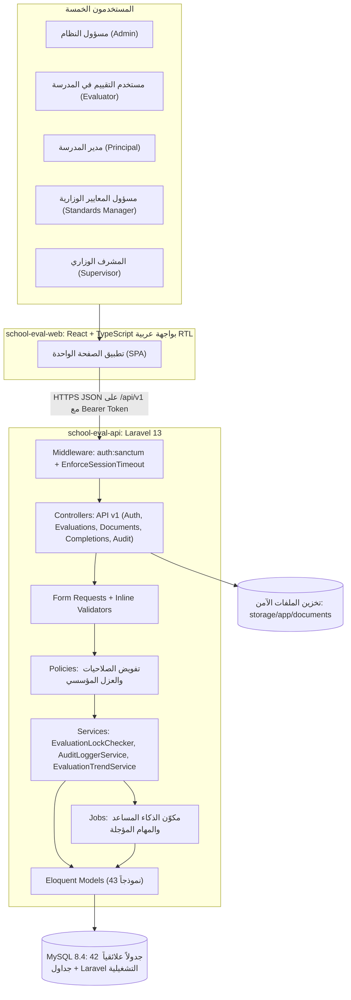
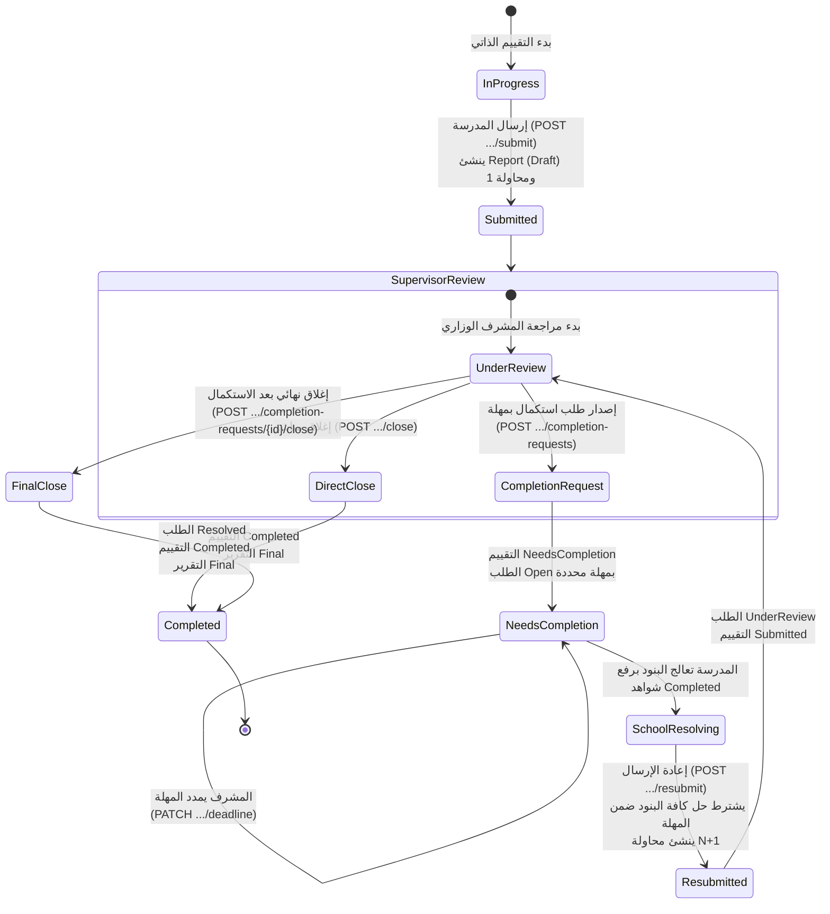
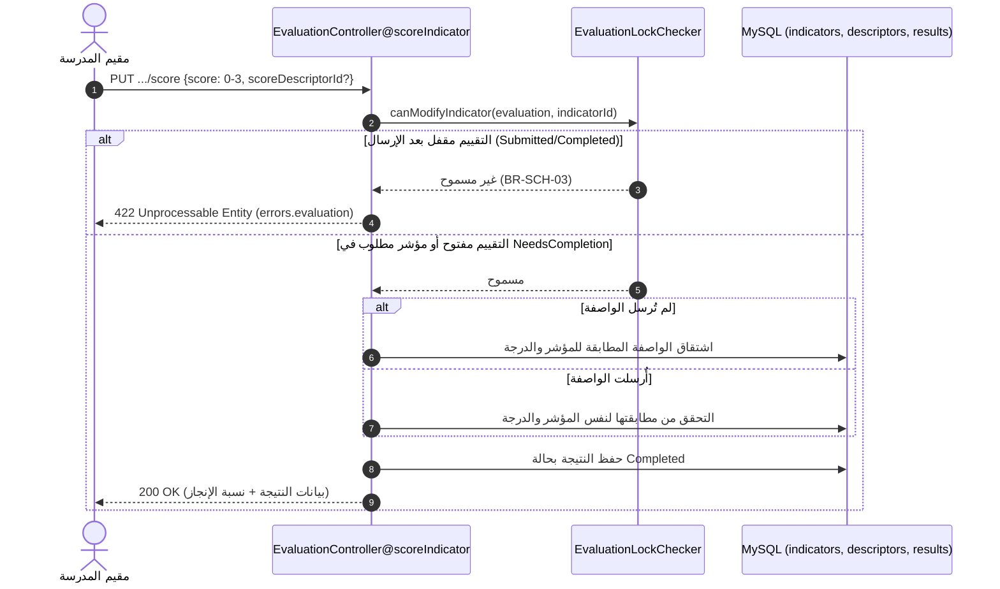

# الفصل الرابع: تصميم النظام (System Design)

> **المشروع:** نظام إدارة الجودة والخطط التعليمية في المدارس  
> **الحالة:** مسودة محدثة ومعتمدة بالمواءمة الشاملة مع النظام الفعلي (تصحيحات 1 و2 و3) — 3 نوفمبر 2026م  
> **توثيق التنفيذ والشرائح البرمجية:** يُحال للواقع المنفّذ فعلياً وتفاصيل كل شريحة واختباراتها إلى دليل الشرائح في [docs/slices/README.md](../slices/README.md) والملفات التفصيلية [slice1_auth_admin.md](../slices/slice1_auth_admin.md) و[slice2_evaluation_evidence.md](../slices/slice2_evaluation_evidence.md) و[slice3_improvement_plans.md](../slices/slice3_improvement_plans.md) و[slice4_reports_analytics.md](../slices/slice4_reports_analytics.md).  
> **تسمية الفصل ورقمه:** الفصل الرابع: تصميم النظام (وفق هيكل التقرير الأكاديمي المعتمد).

## مفتاح الوسوم المستخدمة في هذه المسودة

| الوسم | المعنى |
|---|---|
| **[موثق]** | مأخوذ من وثائقك: الفصول 1-3، قاموس البيانات، conventions.md، models_guide.md، تقارير الاختبار والـ Seeders |
| **[قرار]** | قرار اتُّخذ أثناء العمل على المشروع وتم اعتماده |
| **[منفّذ]** | عنصر أو مسار أو كود أو اختبار تم بناؤه والتحقق منه برمجياً في الكود الفعلي |
| **[مقترح]** | اقتراح تصميمي لم يُنفَّذ بعد، ولا يرد صراحة في وثائقك |
| **[املأ]** | جزء ينقصه محتوى أو رقم أو صورة منك |

لا تترك أي وسم في النسخة النهائية للتسليم. بعد التعبئة احذف الوسوم والملاحظات بين الأقواس المربعة.

---

## 4.1 مقدمة الفصل

ينقل هذا الفصل المشروع من التحليل في الفصل الثالث (الفاعلون، المتطلبات، قواعد العمل، حالات الاستخدام، ERD) إلى التصميم: كيف يُبنى النظام، وكيف تتوزع المسؤوليات بين مكوناته، وكيف تُحمى بياناته، وكيف تُترجم كل متطلبات الفصل الثالث إلى عناصر تصميمية قابلة للتنفيذ والاختبار.

### 4.1.1 نطاق التصميم
- منصة ويب عربية مركزية لإدارة التقييم الذاتي والتخطيط المدرسي والتحسين.
- واجهة مستخدم حديثة منفصلة تتواصل عبر REST API مع خلفية بنظام Laravel.
- قاعدة بيانات علائقية متوافقة مع MySQL 8.4 تدعم القيود المعقدة والعزل المؤسسي الصارم للمدارس.

### 4.1.2 مدخلات التصميم من الفصل الثالث
- الفاعلون الخمسة: مسؤول النظام، مقيم المدرسة، مدير المدرسة، مسؤول المعايير الوزارية، المشرف الوزاري.
- 42 جدولاً علائقياً و301 حقلاً تغطي مجالات النظام الخمسة بعد اعتماد معمارية الشواهد النظيفة ثلاثية المستويات وسجل التدقيق غير القابل للتعديل.
- القواعد الإلزامية الصارمة: قفل التقييم (`BR-SCH-03`)، ضبط السلم والواصفات (`BR-SCH-05`)، العزل المؤسسي للمدارس، وقيد الجهة الواحدة (XOR) للمستخدمين.

### 4.1.3 تنظيم الفصل
يتدرج الفصل من القرارات المعمارية العامة ومبادئ التصميم (4.2)، إلى المعمارية الشاملة وطبقاتها (4.3)، ثم تفاصيل الواجهات البرمجية ونقاط النهاية (4.4)، والتصميم الأمني ومصفوفة الصلاحيات وقواعد العمل (4.5)، وقاعدة البيانات وإحصاءاتها (4.6)، وتصميم العمليات ودورات حياة الشواهد والتقييم والاستكمال (4.7)، وتصميم واجهات المستخدم (4.8)، وتتبع المتطلبات إلى الكود والاختبار (4.9)، واستراتيجية وبيئة الاختبارات المحققة (4.10)، ثم الخلاصة (4.11).

---

## 4.2 مبادئ التصميم والقرارات المعمارية

### 4.2.1 المبادئ
1. **الفصل التام بين الواجهة والخلفية (Decoupled Architecture):** واجهة أمامية عصرية تتصل عبر واجهات برمجة تطبيقات موحدة ومحمية برموز وصول.
2. **العزل المؤسسي الصارم (Multi-tenant Isolation):** لا يمكن لمدرسة الاطلاع على بيانات أو تقييمات أو شواهد مدرسة أخرى؛ ومحاولة ذلك تُقابل برمز `404 Not Found` لحجب وجود المورد.
3. **سلامة الأثر التاريخي ونزاهة التدقيق:** منع الحذف الفيزيائي للبيانات والقرارات التقييمية والشواهد؛ واعتماد سجل تدقيق محصن للإضافة فقط (`audit_logs`) وتوثيق النسخ التاريخية ومحاولات الإرسال.
4. **المسؤولية الإشرافية الوزارية دون خلط بالمصطلحات:** إجراءات المشرف الوزاري تنحصر في المراجعة الإشرافية والإغلاق المباشر أو طلب الاستكمال بمهلة زمنية محددة؛ ويُحظر تماماً استخدام مصطلح "الاعتماد" لأعمال المشرف الوزاري لكونها مراجعة إشرافية وليست اعتماداً مؤسسياً.

### 4.2.2 سجل القرارات المعمارية

| # | القرار | البديل المستبعد | السبب | الحالة |
|---|---|---|---|---|
| 1 | واجهة React منفصلة + Laravel API | Inertia داخل Laravel | فصل واضح بين الطبقتين، وإمكانية تبديل الواجهة لاحقًا | [قرار] |
| 2 | مصادقة Bearer Tokens عبر Laravel Sanctum | SPA Cookies | الواجهة على أصل منفصل؛ تفادي CSRF ومشاكل الكوكيز عبر المنافذ | [قرار 16/10/2026] |
| 3 | MySQL 8.4 | محركات أخرى | دعم قيود CHECK والمفاتيح المركبة المطلوبة في القاموس | [موثق] |
| 4 | RBAC عبر roles وpermissions وrole_permissions وuser_roles | صلاحيات مكتوبة في الكود | مرونة وتتبع، ومطابقة ERD-01 | [موثق] |
| 5 | عدم تحديد ON DELETE / ON UPDATE صراحة في الجداول الأساسية | CASCADE / SET NULL عشوائي | حماية البيانات التاريخية؛ السلوك الافتراضي لـ MySQL يمنع حذف الأب عند وجود تابعين | [قرار] |
| 6 | معمارية شواهد نظيفة ثلاثية المستويات (`school_documents` -> `document_versions` -> `evidence_links`) | ربط مباشر للملف بالنتيجة أو جدول ثنائي قديم | فصل المستند المؤسسي عن ملفاته الفيزيائية وعن روابط توظيفه في التقييم والتحسين، وإمكانية إعادة استخدام المستند دون تكرار الرفع (U-24) | [قرار 02/11/2026 / منفّذ] |
| 7 | قيم الحالات VARCHAR بلا ENUM في MySQL وبلا CHECK | ENUM في MySQL | سهولة التطوير؛ تُفرض القيم في Enums داخل PHP | [قرار] |
| 8 | مفاتيح أساسية INT UNSIGNED بأسماء مخصصة (`<entity>_id`) للجداول الأصلية و `id` لجداول المعمارية الجديدة | `id` الافتراضي في كل مكان أو أسماء متباينة | مطابقة ERD وقاموس البيانات مع التوافق المعماري | [موثق] |
| 9 | Cache وQueue عبر database مع جداول Laravel تشغيلية منفصلة عن جداول النطاق | file / sync | جاهزية الطابور لمهام الذكاء الاصطناعي ومعالجة التقارير | [قرار] |
| 10 | جلسات Laravel على file، وجدول sessions وظيفي منفصل | database للجميع | منع التعارض مع جدول sessions الوظيفي المخصص للتدقيق | [موثق conventions §12] |
| 11 | الوقت UTC في التخزين، وISO 8601 المنتهي بـ Z في JSON، والعرض محليًا (+03) في الواجهة | تخزين محلي | وضوح ودقة عالمية ومنع التضارب الزمني | [موثق conventions] |
| 12 | الذكاء الاصطناعي عبر Jobs ومكوّن وهمي (Mock) في المرحلة الحالية | استدعاء مباشر لمزود خارجي | عزل المخاطر ونطاق المشروع التجريبي | [موثق conventions §10-11] |
| 13 | توفير مسارين مستقلين لشجرة المعايير: مسار للشجرة الخام (`GET /standard-versions/{id}`) ومسار مخصص للتقييم المدرسي (`GET /evaluations/{id}/standards-tree`) مدمجاً بنتائج المدرسة ونسبة الإنجاز | الاعتماد على مسار المعايير الخام فقط وإلزام الواجهة بدمج مئات السجلات | كفاءة الأداء وخفض استهلاك الشبكة ودعم العزل المؤسسي لمدرسة التقييم مباشرة | [قرار 25/10/2026] |
| 14 | رصد درجات المؤشرات بأسلوب الإدراج أو التحديث (Upsert) وتعيين `completion_status = 'Completed'` مباشرة وتخطي `Pending` برمجياً | توليد 109 سجلات فارغة مسبقاً أو تعديل بنية الجداول | حقلا `score` و `score_descriptor_id` هما `NOT NULL` في قاعدة البيانات؛ الرصد المباشر يحافظ على سلامة البنية دون مساس بالجداول | [قرار 25/10/2026] |
| 15 | معمارية الروابط الشاهدية المرنة: ربط المستند بالمؤشر التقييمي عبر `evidence_links` | حصر الشاهد بنتيجة تقييمية مقفلة | الشاهد التقييمي يرتبط بالمؤشر وسياق التقييم مباشرة ويقبل الربط بنتيجة أو بإجراء تحسين تنفيذي (`action_id`) | [قرار 02/11/2026] |
| 16 | آلية مركزية لقفل التعديل (`BR-SCH-03` عبر `EvaluationLockChecker`): قفل التقييم بعد الإرسال النهائي وحصره بالبنود المفتوحة في `NeedsCompletion` مع فحص زمني موحد (U-29) وإرجاع 422 | الاكتفاء بفحص السياسة البسيطة | حماية التقييم في كافة طبقات النظام (السياسات والخدمات والمتحكمات) من أي تعديل غير مصرح به مع توحيد منطق التحقق الزمني | [قرار 25/10/2026 و 03/11/2026] |
| 17 | إدارة النسخ التاريخية للوثيقة بنسخة واحدة `is_current=true` داخل معاملة `DB::transaction` وحماية النسخ المستخدمة كشواهد من الحذف (`RESTRICT`) | تعديل الملف مباشرة أو حذفه مع الروابط | حفظ الأثر والنزاهة للتدقيق الإشرافي (FR-SCH-14b) ومنع فقدان الشواهد المعتمدة تقييمياً | [قرار 02/11/2026] |
| 18 | العزل المؤسسي الصارم للمدارس (Multi-tenant Isolation): إرجاع `404 Not Found` بدلاً من 403 عند محاولة الوصول لمورد مدرسة أخرى | إرجاع 403 Forbidden | حجب وجود المورد تماماً (Obfuscation) ومنع استكشاف المعرفات بين المدارس | [قرار 16/10/2026] |
| 19 | دورة حياة التقييم والاستكمال وسجل المحاولات (U-03, U-11): الإرسال ينقل التقييم إلى `Submitted` وينشئ تقريراً `Draft` ومحاولة إرسال أولى (`attempt_no = 1`)، والمشرف يغلق التقييم مباشرة (`POST .../close`) أو يطلب الاستكمال بمهلة زمنية (`completion_deadline`) قابلة للتمديد، وإعادة الرفع تشترط معالجة كافة البنود وتنشئ محاولة `N+1`، وحالة `Completed` تكون عند الإغلاق النهائي فقط | انتقال التقييم مباشرة إلى Completed عند تسليم المدرسة أو السماح بإعادة الرفع مع بنود معلقة | المحافظة على دقة الحالات التقييمية، وتوثيق المحاولات المتكررة، وضمان عدم إغلاق التقييم إلا بقرار إشرافي وزاري | [قرار 03/11/2026 / منفّذ] |
| 20 | سجل تدقيق محصن وغير قابل للتعديل `audit_logs` (U-08): جدول إضافة فقط (Append-Only) يسجل العمليات الحساسة (دخول، خروج، تغيير كلمة المرور، رصد درجات، تسليم، إغلاق مباشر، طلب استكمال، تمديد مهلة، إعادة تسليم، إغلاق طلب، إلغاء ربط شاهد) | الاكتفاء بالطوابع الزمنية أو السماح بالتعديل والحذف | متطلب حوكمة وأمان ومطابقة لمعايير الامتثال والمساءلة؛ ومتاح للعرض فقط لمسؤول النظام والمشرف الوزاري | [قرار 03/11/2026 / منفّذ] |
| 21 | مرونة التقدير المستهدف (`target_score`) في مجالات التحسين (U-23): دعم حقل `target_score` (1 إلى 3، افتراضي 3) وتوليد الاقتراحات بناءً عليه | فرض الدرجة 3 كهدف وحيد ثابت | مراعاة التدرج المنطقي للمدارس ذات الأداء الابتدائي والسماح بالتخطيط المرحلي للتحسين | [قرار 03/11/2026 / منفّذ] |
| 22 | مرونة خدمة اتجاهات التقييم (`EvaluationTrendService`) في التعامل مع المؤشرات الملغاة أو المعدلة نصياً (U-27) | انهيار المقارنة التاريخية عند إلغاء مؤشر | الحفاظ على دقة التحليل الزمني للدورات السابقة عبر التتبع الذكي بالمطابقة الثنائية (معرف المؤشر ونصّه) | [قرار 03/11/2026 / منفّذ] |
| 23 | تأمين تغيير كلمة المرور للمستخدم المسجل (`POST /api/v1/auth/password/change`) مع إبطال الجلسات الأخرى (U-40) | تغيير كلمة المرور دون التحقق من القديمة أو إبقاء الرموز المخترقة نشطة | حماية الحسابات من الاستيلاء؛ والتحقق من كلمة المرور الحالية واختلاف الجديدة وإلغاء كافة الرموز السابقة وتدوين الحدث بسجل التدقيق | [قرار 03/11/2026 / منفّذ] |

---

## 4.3 المعمارية العامة للنظام

### 4.3.1 نظرة عامة



**الشرح:** يتواصل تطبيق React مع الخلفية عبر واجهة REST بصيغة JSON. تمر كل طلبية عبر وسيط المصادقة والتحقق من مهلة الخمول (30 دقيقة)، ثم المتحكم، فالتحقق والتفويض بالسياسات، ثم الخدمات المركزية (مثل `EvaluationLockChecker` لفحص القفل و`AuditLoggerService` لتدوين العمليات الحساسة)، لتتفاعل مع نماذج Eloquent وقاعدة البيانات والتخزين الفيزيائي للمستندات. **[موثق / منفّذ]**

### 4.3.2 الطبقات ومسؤولياتها

| الطبقة | المسؤولية | المكونات الفعلية | اتفاقية التسمية |
|---|---|---|---|
| العرض | الشاشات، النماذج، التنقل حسب الدور، لوحات المعلومات | React Components وHooks | PascalCase.tsx للمكونات، camelCase.ts للـ hooks [منفّذ] |
| الواجهة البرمجية | استقبال الطلبات وتوجيهها وإرجاع مغلف ApiResponse | Routes وControllers | `EvaluationController`، `SchoolDocumentController`، `AuditLogController` [منفّذ] |
| التحقق والتفويض | التحقق من المدخلات وفرض العزل والصلاحيات | Form Requests وPolicies وValidators | `ChangePasswordRequest`، `EvaluationPolicy`، `EvidenceLinkPolicy` [منفّذ] |
| منطق الأعمال | قواعد العمل، مراحل الحالة، فحص القفل، والتدقيق | Services | `EvaluationLockChecker`، `AuditLoggerService`، `EvaluationTrendService` [منفّذ] |
| تمثيل البيانات | تحويل النماذج إلى JSON بنمط camelCase | API Resources | `EvaluationResource`، `SchoolDocumentResource`، `AuditLogResource` [منفّذ] |
| الوصول للبيانات | النماذج، العلاقات، وقيود سلامة البيانات | 43 Model | مفرد PascalCase (`SchoolDocument`، `EvidenceLink`، `AuditLog`) [منفّذ] |
| التخزين | الجداول والفهارس وقيود التكامل وقفل المراجع | MySQL 8.4 | snake_case جمع (`school_documents`، `evidence_links`، `audit_logs`) [منفّذ] |

### 4.3.3 التقنيات المستخدمة

| المكوّن | التقنية | الإصدار الفعلي |
|---|---|---|
| لغة الخلفية | PHP | 8.4.20 [موثق من `php -v`] |
| إطار الخلفية | Laravel | 13.35.0 [موثق من `php artisan --version`] |
| قاعدة البيانات | MySQL | 8.4.3 [موثق من قاعدة البيانات] |
| بيئة الاختبار | PHPUnit | 12.5.38 [موثق من مخرجات الاختبار] |
| مصادقة API | Laravel Sanctum (Bearer Tokens) | 4.0.0 [موثق من `composer.lock`] |
| أطر الواجهة | React + React DOM | 19.2.8 [موثق من `package.json`] |
| أداة بناء الواجهة | Vite | 8.3.0 [موثق من `package.json`] |
| لغة الواجهة | TypeScript | ~6.0.2 [موثق من `package.json`] |
| إدارة بيانات الخادم | TanStack React Query | ^5.104.3 [موثق من `package.json`] |
| مكتبة الأيقونات | Lucide React | ^1.59.0 [موثق من `package.json`] |
| بيئة التشغيل للواجهة | Node.js | 22.22.0 [موثق] |
| إدارة الحزم والخوادم | Laragon + Composer 2.9.7 | [موثق] |

### 4.3.4 هيكل المستودع الفعلي

```text
school-quality-system/            # مستودع واحد (Monorepo)
├── school-eval-api/              # الخلفية: Laravel 13 [منفّذ]
│   ├── app/
│   │   ├── Models/               # 43 موديلاً تمثل الكيانات وسجل التدقيق [منفّذ]
│   │   ├── Http/Controllers/Api/V1/ # متحكمات API الإصدار الأول [منفّذ]
│   │   ├── Http/Middleware/      # وسيط تتبع النشاط والخمول EnforceSessionTimeout [منفّذ]
│   │   ├── Http/Requests/        # Form Requests للتحقق من المدخلات [منفّذ]
│   │   ├── Http/Resources/       # API Resources لمغلف استجابة camelCase [منفّذ]
│   │   ├── Http/Responses/       # فئة بناء الاستجابات الموحدة ApiResponse [منفّذ]
│   │   ├── Policies/             # سياسات الصلاحيات والعزل (Evaluation, Evidence, School, Audit) [منفّذ]
│   │   ├── Services/             # منطق الأعمال (EvaluationLockChecker, AuditLoggerService) [منفّذ]
│   │   └── Jobs/                 # مهام الطابور ومحاكاة الذكاء المساعد [مقترح]
│   ├── database/
│   │   ├── migrations/           # 27 ملف تهجير للجداول ومسارات التطوير التراكمية [منفّذ]
│   │   └── seeders/              # البيانات المرجعية للمعايير والمستخدمين [منفّذ]
│   └── tests/Feature/            # اختبارات الميزات (243 اختباراً ناجحاً بنسبة 100%) [منفّذ]
├── school-eval-web/              # الواجهة: React 19 + TypeScript [منفّذ]
│   ├── src/
│   │   ├── api/client.ts         # عميل استدعاء API الموحد [منفّذ]
│   │   ├── features/auth/        # سياق المصادقة وشاشة تسجيل الدخول وتغيير كلمة المرور [منفّذ]
│   │   ├── features/admin/       # واجهات إدارة المدارس والمستخدمين والتدقيق [منفّذ]
│   │   ├── styles/theme.ts       # الهوية البصرية والألوان [منفّذ]
│   │   └── components/           # المكونات المشتركة ولوحات الهبوط [منفّذ]
└── docs/                         # التوثيق والشرائح وقاموس البيانات ومخطط ERD [منفّذ]
    ├── slices/                   # توثيق الشرائح الفعلية (slice1, slice2, README) [منفّذ]
    ├── api/                      # أدلة نقاط النهاية وملفات REST Client [منفّذ]
    └── erd/                      # المخططات البيانية بصيغة Mermaid [منفّذ]
```

---

## 4.4 تصميم الخلفية وواجهة برمجة التطبيقات

### 4.4.1 اتفاقيات الواجهة البرمجية

| البند | الاتفاقية المنفذة |
|---|---|
| المسار الأساسي | `/api/v1` |
| أسماء الموارد | kebab-case بصيغة الجمع (مثل `/api/v1/school-documents`، `/api/v1/evidence-links`) |
| صيغة البيانات | JSON بحقول camelCase، بينما قاعدة البيانات snake_case |
| بنية الاستجابة | `data` و`message` و`errors` و`meta` دائمًا عبر `ApiResponse` |
| الترويسات الإلزامية | `Accept: application/json`، و`Authorization: Bearer <token>` للطلبات المحمية |
| التواريخ | UTC ISO-8601 بصيغة Z (مثل `2026-11-03T20:00:00Z`)، والتحويل للمحلي (+03:00) بالواجهة فقط |

### 4.4.2 رموز الحالة المعتمدة

| الرمز | الاستخدام المنفذ |
|---|---|
| 200 OK | نجاح استرجاع البيانات أو تحديث الموارد أو إغلاق التقييم أو الاستكمال |
| 201 Created | نجاح إنشاء مورد جديد (مستخدم، مدرسة، مستند، نسخة، رابط شاهد، طلب استكمال) |
| 400 Bad Request | طلب غير صالح منطقياً (مثل حظر تعطيل مسؤول النظام لنفسه) |
| 401 Unauthorized | غير مصادق، أو انتهت صلاحية الرمز، أو انقضت 30 دقيقة خمول للجلسة |
| 403 Forbidden | غياب الصلاحية المطلوبة للعملية (RBAC)، مثل محاولة المدرسة استعراض سجل التدقيق |
| 404 Not Found | المورد غير موجود، أو يتبع مدرسة أخرى (العزل المؤسسي الصارم) |
| 422 Unprocessable Entity | خطأ تحقق من المدخلات، أو انتهاك قواعد العمل (مثل قفل التقييم BR-SCH-03، أو محاولة resubmit بوجود بنود pending، أو انقضاء مهلة الاستكمال) |
| 500 Server Error | خطأ غير متوقع في الخادم |

### 4.4.3 كتالوج نقاط النهاية (Endpoints Catalog)

| الطريقة | المسار (URI) | الحالة / المتطلب المقابل | الصلاحية الفعلية | حالة التنفيذ |
|---|---|---|---|---|
| POST | `/api/v1/auth/login` | UC-GEN-01 / FR-GEN-01 | عامة (Public) | [منفّذ] |
| POST | `/api/v1/auth/logout` | FR-GEN-02 | مصادَق (Sanctum) | [منفّذ] |
| GET | `/api/v1/auth/me` | FR-GEN-03 | مصادَق (Sanctum) | [منفّذ] |
| POST | `/api/v1/auth/password/change` | U-40 / FR-GEN-01 (تغيير كلمة المرور وإبطال الجلسات الأخرى) | مصادَق (أي مستخدم) | [منفّذ] |
| GET | `/api/v1/audit-logs` | U-08 (استعراض سجل التدقيق غير القابل للتعديل) | مسؤول النظام والمشرف الوزاري | [منفّذ] |
| GET | `/api/v1/schools` | UC-ADM-01 / FR-ADM-01 | مصادَق (عزل مدرسي) | [منفّذ] |
| POST | `/api/v1/schools` | UC-ADM-01 / FR-ADM-01 | `schools.manage` | [منفّذ] |
| GET | `/api/v1/schools/{id}` | FR-ADM-01 | مصادَق (عزل 404) | [منفّذ] |
| PUT | `/api/v1/schools/{id}` | FR-ADM-01 | `schools.manage` | [منفّذ] |
| PATCH | `/api/v1/schools/{id}/toggle-status` | FR-ADM-04 (تعطيل لا حذف) | `schools.manage` | [منفّذ] |
| GET | `/api/v1/users` | FR-ADM-02 | `users.manage` | [منفّذ] |
| GET | `/api/v1/users/meta` | FR-ADM-02 (قوائم الأدوار والجهات) | `users.manage` | [منفّذ] |
| POST | `/api/v1/users` | FR-ADM-03 (قيد XOR) | `users.manage` | [منفّذ] |
| GET | `/api/v1/users/{id}` | FR-ADM-02 | `users.manage` | [منفّذ] |
| PUT | `/api/v1/users/{id}` | FR-ADM-03 | `users.manage` | [منفّذ] |
| PATCH | `/api/v1/users/{id}/toggle-status` | FR-ADM-04 (حظر تعطيل النفس) | `users.manage` | [منفّذ] |
| GET | `/api/v1/standard-versions/{id}` | UC-SCH-01 / FR-MSM-04 (الشجرة الخام) | `standards.view` | [منفّذ] |
| GET | `/api/v1/evaluations/{id}/standards-tree` | UC-SCH-01/02 (الشجرة مدمجة بالنتائج والإنجاز) | `standards.view` أو `evaluations.view` | [منفّذ] |
| GET | `/api/v1/evaluations` و`/{id}` | UC-SCH-01 (قائمة التقييمات وتفاصيلها) | `evaluations.view` (عزل 404) | [منفّذ] |
| PUT | `/api/v1/evaluations/{eId}/indicators/{iId}/score` | UC-SCH-02 / FR-SCH-10..11 (Upsert للدرجة والواصفة) | `evaluations.edit` (فحص BR-SCH-03) | [منفّذ] |
| POST | `/api/v1/evaluations/{eId}/indicators/{iId}/notes` | FR-SCH-12 (ملاحظة المؤشر المرصود) | `evaluations.edit` (فحص BR-SCH-03) | [منفّذ] |
| GET / POST | `/api/v1/school-documents` | U-24 (مستودع وثائق ومستندات المدرسة) | `evidence.manage` / `evaluations.view` | [منفّذ] |
| GET / PUT / DELETE | `/api/v1/school-documents/{id}` | U-24 (تفاصيل وتحديث وحذف مستند غير مرتبط) | `evidence.manage` | [منفّذ] |
| POST | `/api/v1/school-documents/{id}/versions` | U-24 (رفع نسخة ملف جديدة للمستند) | `evidence.manage` | [منفّذ] |
| GET / POST | `/api/v1/evaluations/{id}/evidence-links` | U-24 (استعراض وإنشاء روابط الشواهد التقييمية) | `evidence.manage` / `evaluations.view` | [منفّذ] |
| DELETE | `/api/v1/evaluations/{id}/evidence-links/{linkId}` | U-24 (إلغاء ربط شاهد تقييمي مع تدوين بالتدقيق) | `evidence.manage` | [منفّذ] |
| POST | `/api/v1/evaluations/{id}/evidence-links/bulk-unlink` | U-24 (إلغاء ربط شواهد متعددة دفعة واحدة) | `evidence.manage` | [منفّذ] |
| POST | `/api/v1/evaluations/{id}/submit` | UC-SCH-07 / FR-SCH-33 / U-03 (تسليم التقييم للمراجعة الوزارية -> Submitted) | `evaluations.submit` | [منفّذ] |
| POST | `/api/v1/evaluations/{id}/close` | U-03 (الإغلاق المباشر للتقييم من المشرف الوزاري -> Completed) | المشرف الوزاري فقط | [منفّذ] |
| GET / POST | `/api/v1/evaluations/{id}/completion-requests` | U-03 / U-11 (إنشاء طلب استكمال بمهلة زمنية واستعراضه) | المشرف الوزاري / المدرسة المعنية | [منفّذ] |
| GET | `/api/v1/completion-requests/{id}` | U-03 / U-11 (تفاصيل طلب الاستكمال وبنوده) | المشرف الوزاري / المدرسة المعنية | [منفّذ] |
| PATCH | `/api/v1/completion-requests/{id}/deadline` | U-11 (تمديد مهلة طلب الاستكمال) | المشرف الوزاري فقط | [منفّذ] |
| POST | `/api/v1/completion-requests/{id}/resubmit` | U-03 (إعادة إرسال بعد معالجة كافة البنود ضمن المهلة) | `evaluations.submit` (المدرسة) | [منفّذ] |
| POST | `/api/v1/completion-requests/{id}/close` | U-03 (إغلاق طلب الاستكمال نهائياً -> Completed) | المشرف الوزاري فقط | [منفّذ] |
| GET | `/api/v1/evaluations/{id}/improvement-suggestions` | FR-SCH-16..17 / U-23 (اقتراحات التحسين مع بارامتر target_score) | `evaluations.view` | [منفّذ] |
| GET / POST | `/api/v1/evaluations/{id}/improvement-areas` | UC-SCH-04 / FR-SCH-16..19 / U-23 (تبني واستعراض مجالات التحسين) | `evaluations.view` / `plans.manage` | [منفّذ] |
| PATCH / DELETE | `/api/v1/improvement-areas/{id}` | FR-SCH-19 / U-23 (تعديل وحذف مجال تحسين مع مرونة target_score) | `plans.manage` | [منفّذ] |
| GET / POST | `/api/v1/evaluations/{id}/improvement-plans` | UC-SCH-05 / FR-SCH-19..20 (إنشاء واستعراض خطط التحسين) | `plans.view` / `plans.manage` | [منفّذ] |
| GET / PUT / DELETE | `/api/v1/improvement-plans/{id}` | FR-SCH-20..22 (تفاصيل وتحديث وحذف خطة التحسين) | `plans.view` / `plans.manage` | [منفّذ] |
| PATCH | `/api/v1/improvement-plans/{id}/status` | FR-SCH-24 (دورة حياة الخطة: Draft -> Active -> Completed) | `plans.manage` | [منفّذ] |
| POST | `/api/v1/improvement-plans/{id}/actions` | FR-SCH-20..21 (إضافة إجراء تنفيذي بالمفتاح المركب) | `plans.manage` | [منفّذ] |
| PUT / DELETE | `/api/v1/improvement-actions/{id}` | FR-SCH-21..23 (تعديل وحذف إجراء تنفيذي) | `plans.manage` | [منفّذ] |
| POST | `/api/v1/improvement-plans/{id}/review-notes` | UC-PRIN-01 / FR-PRIN-03 (ملاحظات مراجعة مدير المدرسة) | `reviews.write` | [منفّذ] |
| GET | `/api/v1/schools/{s}/assessments/{a}/dashboard` | UC-SCH-06 / FR-REP-01 (لوحة معلومات وتقارير المدرسة) | `reports.view` | [منفّذ] |
| GET | `/api/v1/schools/{s}/assessments/{a}/results` | FR-REP-02..03 (النتائج الموزونة الشاملة واشتراط الاكتمال) | `reports.view` | [منفّذ] |
| GET | `/api/v1/schools/{s}/assessments/{a}/standards/{std}/results` | FR-REP-03 (نتائج معيار محدد وتفصيل مؤشراته) | `reports.view` | [منفّذ] |
| GET | `/api/v1/schools/{s}/assessments/{a}/evidence-summary` | FR-REP-04 (ملخص ونسب اكتمال الشواهد الـ 278) | `reports.view` | [منفّذ] |
| GET | `/api/v1/schools/{s}/assessments/{a}/improvement-plans/summary` | FR-REP-05 (ملخص خطط التحسين وحالات التأخر) | `improvement.view` | [منفّذ] |
| GET | `/api/v1/schools/{s}/assessments/{a}/export` | FR-REP-06 (تصدير التقرير النهائي بصيغة JSON) | `reports.export` | [منفّذ] |
| GET | `/api/v1/schools/{id}/trend-analysis` | U-27 (تحليل اتجاهات الأداء عبر الدورات مع مرونة المؤشرات الملغاة) | `reports.view` | [منفّذ] |

### 4.4.4 رفع وتخزين المرفقات والوثائق (File Uploads)

- الأنواع المسموحة: `pdf, png, jpg, jpeg, docx, xlsx`، والحد الأقصى 10 ميغابايت (10240 كيلوبايت). **[موثق conventions §9 / منفّذ]**
- في معمارية الشواهد الحديثة (U-24): يتم رفع الملفات الفيزيائية عبر جدول `document_versions` كنسخ تابعة لمستند مدرسي في `school_documents`. يُحفظ الملف باسم UUID عشوائي لمنع استنتاج المسارات، وتُخزن بياناته التقنية (الاسم الأصلي، نوع MIME الفعلي، الحجم بالبايت، ومسار التخزين خارج Web Root). **[منفّذ]**
- توظيف المستند كشاهد تقييمي يتم دون إعادة رفع الملف، بل عبر إنشاء سجل ربط استدلالي خفيف في `evidence_links` يحمل مبررات الاستدلال وحالة الرابط (`draft` أو `completed`). **[منفّذ]**

---

## 4.5 تصميم الأمان والصلاحيات

### 4.5.1 المصادقة وإدارة الجلسات
- المصادقة بالكامل عبر رموز الوصول الشخصية `Bearer Tokens` عبر Laravel Sanctum.
- فرض مهلة الخمول (30 دقيقة): يُطبّق الوسيط `EnforceSessionTimeout` فحصاً لحقل `updated_at` في جدول `sessions`؛ وفي حال الخمول لأكثر من 30 دقيقة، تُنهى الجلسة ويُحذف الرمز من `personal_access_tokens` ويُرجع `401 Unauthorized`.
- تغيير كلمة المرور للمستخدم المسجل (`POST /api/v1/auth/password/change` - U-40): يتطلب التحقق من كلمة المرور الحالية، وتطابق كلمة المرور الجديدة مع تأكيدها واختلافها عن القديمة، ويؤدي إلى إبطال كافة الجلسات والرموز السابقة الأخرى للمستخدم عدا الجلسة الحالية وتدوين العملية في `audit_logs`.
- حصر المستخدم بجلسة نشطة واحدة: عند نجاح الدخول في `AuthController@login`، يتم إغلاق أي جلسات سابقة مفتوحة للمستخدم (`active = false, ended_at = now()`).
- جدول `personal_access_tokens` منشأ عبر التهجير المخصص خارج الجداول الأساسية. **[منفّذ]**

### 4.5.2 مصفوفة الأدوار والصلاحيات والوصول للتدقيق

تتطابق مصفوفة الصلاحيات المنفذة في بذور النظام (`RolePermissionSeeder`) مع متطلبات النظام:

| الصلاحية | admin | school_evaluator | school_principal | ministry_supervisor | ministry_standards_manager |
|---|---|---|---|---|---|
| `standards.view` |  | ✓ | ✓ | ✓ | ✓ |
| `standards.manage` |  |  |  |  | ✓ |
| `cycles.launch` |  |  |  | ✓ |  |
| `evaluations.create` |  | ✓ |  |  |  |
| `evaluations.view` |  | ✓ | ✓ | ✓ |  |
| `evaluations.edit` |  | ✓ |  |  |  |
| `evaluations.submit` |  | ✓ |  |  |  |
| `evidence.manage` |  | ✓ |  |  |  |
| `reports.generate` |  | ✓ |  |  |  |
| `reports.view` |  | ✓ | ✓ | ✓ |  |
| `plans.manage` |  | ✓ |  |  |  |
| `plans.view` |  | ✓ | ✓ |  |  |
| `reviews.write` |  |  | ✓ |  |  |
| `supervision.review` |  |  |  | ✓ |  |
| `completion.request` |  |  |  | ✓ |  |
| `ai.use` |  | ✓ |  |  |  |
| `analytics.view` |  |  |  | ✓ |  |
| `users.manage` | ✓ |  |  |  |  |
| `schools.manage` | ✓ |  |  |  |  |

> [!IMPORTANT]
> **حوكمة صلاحيات سجل التدقيق (Audit Log Governance - U-08):**
> * استعراض سجل التدقيق (`GET /api/v1/audit-logs`) متاح **فقط وحصرياً** لمسؤول النظام (`admin`) والمشرف الوزاري (`ministry_supervisor`).
> * يُمنع مدير المدرسة ومقيم المدرسة تماماً من استعراض سجل التدقيق، ومحاولة الوصول تُقابل برمز `403 Forbidden`.
> * سجل التدقيق غير قابل للتعديل أو الحذف برمجياً؛ ولا توجد أي مسارات PUT أو PATCH أو DELETE في النظام تخصه.

> [!WARNING]
> **قاعدة التسمية للمراجعة الإشرافية الوزارية:**
> * يُحظر استخدام لفظ «اعتماد» لأعمال المشرف الوزاري؛ فأفعال المشرف المعتمدة نظاماً هي: «مراجعة إشرافية»، «إغلاق مباشر»، «طلب استكمال»، «تمديد مهلة الاستكمال»، و«إغلاق طلب الاستكمال».

### 4.5.3 قواعد العمل الأمنية ومواضع اختبارها

| القاعدة | آلية الفرض في الكود | الاختبار الفعلي المحقق |
|---|---|---|
| BR-GEN-06: مسؤول النظام لا ينفذ التقييم | غياب صلاحيات التقييم وفحص `user_type === 'system'` في Policies | `AuthenticationAndAuthorizationFeatureTest::test_negative_permission_rules_for_standards_manager_and_admin` [منفّذ] |
| BR-MIN-01: مسؤول المعايير لا يراجع المخرجات | حظر صلاحيات `supervision.review` و `reports.view` عنه | `AuthenticationAndAuthorizationFeatureTest::test_negative_permission_rules_for_standards_manager_and_admin` [منفّذ] |
| BR-SCH-02: الإرسال النهائي لمستخدم التقييم وحده | حصر صلاحية `evaluations.submit` بدور `school_evaluator` | `AuthenticationAndAuthorizationFeatureTest::test_evaluation_policy_enforces_school_isolation_and_roles` [منفّذ] |
| BR-SCH-03: قفل التعديل بعد الإرسال النهائي | فحص خدمة `EvaluationLockChecker` لحالات التسليم وطلب الاستكمال مع توحيد الفحص الزمني (U-29) | `EvaluationAndEvidenceFeatureTest::test_scoring_rejected_when_evaluation_is_locked_br_sch_03` و `test_needs_completion_allows_modifying_only_requested_items` [منفّذ] |
| BR-SCH-05: التقدير محصور بين 0 و 3 | التحقق من صحة المدخلات في Form Request / Controller | `EvaluationAndEvidenceFeatureTest::test_scoring_fails_when_score_out_of_bounds_or_invalid_descriptor` [منفّذ] |
| BR-SCH-06: اكتمال العناصر قبل الإرسال | خدمة الإرسال النهائي والتحقق من رصد كامل المؤشرات | اختبارات مسار `POST /evaluations/{id}/submit` [منفّذ] |
| U-03 / U-11: ضبط مسار الاستكمال والمهلة الزمنية | حظر إعادة الإرسال بوجود بنود معلقة أو بعد انتهاء المهلة وحصر التمديد بالمشرف | `CompletionWorkflowFeatureTest` (9 اختبارات مخصصة ناجحة) [منفّذ] |
| U-08: التدقيق الأمني المحصن | خدمة `AuditLoggerService` وتدوين 12 حدثاً في `audit_logs` | `AuditLogFeatureTest` و `AuditLoggingActionsTest` [منفّذ] |

---

## 4.6 تصميم قاعدة البيانات والبيانات المرجعية

### 4.6.1 الإحصاءات العامة للهيكل
* **الجداول الأساسية:** 42 جدولاً علائقياً موزعاً عبر مخططات ERD الخمسة بعد دمج المعمارية النظيفة للشواهد وسجل التدقيق. **[موثق]**
* **الحقول والقيود:** 301 حقلاً وقيود تكاملية دقيقة مطابقة لقاموس البيانات ومخطط ERD المعتمدين. **[موثق]**
* **معمارية الشواهد الحديثة (U-24):** تم إسقاط الجداول القديمة (`evidences`, `evidence_versions`) واستبدالها بثلاثة جداول معمارية مستقلة:
  1. `school_documents`: مستندات المدرسة المرجعية (المستوى الأول).
  2. `document_versions`: نسخ الملفات المرفوعة الفعلية وتاريخها (المستوى الثاني).
  3. `evidence_links`: روابط توظيف الشواهد التقييمية وإجراءات التحسين (المستوى الثالث).
* **سجل التدقيق (U-08):** جدول `audit_logs` المستقل بـ 11 حقلاً مخصصاً للتدقيق غير القابل للتعديل.
* **جداول التشغيل:** `migrations`، `cache`، `cache_locks`، `jobs`، `job_batches`، `failed_jobs`، و `personal_access_tokens`. **[منفّذ]**

### 4.6.2 البيانات المرجعية المغذاة بالـ Seeders
* **الإصدارات والمعايير:** إصدار نشط واحد، 7 معايير رئيسية، 14 معياراً فرعياً، و 109 مؤشرات قياس.
* **الواصفات والأدلة:** 436 واصفة أداء، 278 متطلب شاهد، 168 أسلوب تحقق، 6 أدوات تحقق، و 4 مستويات أداء (0 إلى 3).
* **الأدوار والصلاحيات:** 5 أدوار معتمدة، 19 صلاحية، و 27 ربطاً في `role_permissions`.

---

## 4.7 تصميم العمليات ودورة حياة الشواهد والتقييم

### 4.7.1 دورة حياة الشواهد والمعمارية ثلاثية المستويات (U-24)

1. **المستوى الأول: المستند المدرسي (`school_documents`):** وعاء توثيقي على مستوى المدرسة يحمل العنوان والنوع والوصف، ويبقى ملكاً للمدرسة بغض النظر عن التقييمات.
2. **المستوى الثاني: النسخ الفيزيائية (`document_versions`):** تتبع نسخ الملفات المرفوعة فعلياً للمستند؛ نسخة واحدة فقط تحمل `is_current = true`، وتُحفظ النسخ السابقة للأثر التاريخي. النسخ المرتبطة بتقييم محصنة من الحذف برمجياً وقاعدياً (`RESTRICT`).
3. **المستوى الثالث: رابط الشاهد التقييمي (`evidence_links`):** ربط استدلالي خفيف يربط نسخة المستند بالمؤشر التقييمي ضمن ملف التقييم مع مبررات الاستدلال وحالة الرابط (`draft` أو `completed`)، كما يقبل الربط بإجراء تحسين تنفيذي (`action_id`).

### 4.7.2 دورة حياة التقييم والاستكمال وسجل المحاولات (U-03, U-11)



### 4.7.3 مخطط تسلسل الرصد بالقفل واشتقاق الواصفة



---

## 4.8 تصميم واجهات المستخدم (Frontend)

### 4.8.1 هيكل واجهات المستخدم والنموذج الأولي التفاعلي

يعتمد النظام في مرحلته الحالية على مسارين متكاملين للواجهة الأمامية:
1. **النموذج الأولي التفاعلي الشامل (`frontend-prototype/`) [منفّذ بالكامل للشرائح 1-4 ومحدث]:**
   مبني بتقنية HTML5 + Vanilla JS + CSS3 خالصة دون تبعيات خارجية (Zero Dependencies)، ويغطي كافة العمليات التشغيلية عبر شاشات ونوافذ منبثقة تفاعلية مرتبطة مباشرة بـ API الخلفي:
   * شاشات المصادقة والدورات وتغيير كلمة المرور.
   * شجرة التقييم ورصد الدرجات والواصفات وإدارة المستندات والشواهد بالمعمارية ثلاثية المستويات.
   * اقتراحات التحسين مع مرونة التقدير المستهدف وتبني المجالات وإدارة الخطط والإجراءات ومراجعة المدير.
   * استعراض وتدقيق المعايير الـ 7 والمؤشرات الـ 109 والواصفات الـ 436.
   * لوحة معلومات وتقارير المدرسة (Dashboard) والنتائج الموزونة الشاملة وتصدير التقرير النهائي.
   * مسار مراجعة المشرف الوزاري والإغلاق المباشر وإدارة طلبات الاستكمال وتتبع المهل الزمنية.

2. **تطبيق React الممتد (`school-eval-web/`) [منفّذ ومستمر بالتوازي]:**
   هيكل برمجي حديث مبني بـ React 19 + TypeScript ومكتبة TanStack Query للتفاعل الفوري مع كافة نقاط النهاية المنفذة.

---

## 4.9 تتبع المتطلبات إلى عناصر التصميم والاختبار

### 4.9.1 مصفوفة التتبع الفعلي للمتطلبات والتحسينات المعمارية

| معرف المتطلب / الملاحظة | الواجهة المقابلة | نقطة النهاية (API Endpoint) | الجداول / الموديل | الاختبار الفعلي المحقق |
|---|---|---|---|---|
| `FR-GEN-01` | `UI-GEN-01` | `POST /api/v1/auth/login` | `users`, `sessions` | `AuthenticationAndAuthorizationFeatureTest::test_user_can_login_with_valid_credentials` |
| `FR-GEN-02` | `UI-GEN-01` | `POST /api/v1/auth/logout` | `sessions`, `personal_access_tokens` | `AuthenticationAndAuthorizationFeatureTest::test_session_expires_after_30_minutes_of_inactivity` |
| `FR-GEN-03` | `UI-GEN-03` | `GET /api/v1/auth/me` | `users`, `user_roles`, `roles` | `AuthenticationAndAuthorizationFeatureTest::test_authenticated_user_can_access_me_endpoint` |
| `U-40` | `UI-GEN-04` | `POST /api/v1/auth/password/change` | `users`, `personal_access_tokens`, `audit_logs` | `ChangePasswordFeatureTest` (4 اختبارات مخصصة ناجحة) |
| `U-08` | `UI-ADM-06` | `GET /api/v1/audit-logs` | `audit_logs` (`AuditLog`) | `AuditLogFeatureTest` و `AuditLoggingActionsTest` |
| `FR-ADM-01` | `UI-ADM-02`, `UI-ADM-03` | `GET / POST / PUT / PATCH /api/v1/schools` | `schools` (`School`) | `AuthenticationAndAuthorizationFeatureTest::test_school_tenant_isolation_returns_404_when_accessing_another_school` |
| `FR-ADM-02` | `UI-ADM-04` | `GET /api/v1/users`, `/meta` | `users`, `schools`, `ministries` | `StandardsAndSeedersIntegrityTest::test_user_type_xor_association_constraint` |
| `FR-ADM-03` | `UI-ADM-05` | `POST / PUT /api/v1/users` | `users`, `user_roles` | اختبارات إدارة الحسابات وقيد XOR |
| `FR-ADM-04` | `UI-ADM-04` | `PATCH /api/v1/users/{id}/toggle-status` | `users` (`User`) | `AuthenticationAndAuthorizationFeatureTest::test_disabled_user_cannot_login` |
| `FR-MSM-04` | `UI-MSM-05` | `GET /api/v1/standard-versions/{id}` | `standards`, `indicators`, `score_descriptors` | `EvaluationAndEvidenceFeatureTest::test_evaluator_can_view_raw_standard_version_tree` |
| `FR-SCH-01..05` | `UI-SCH-01`, `UI-SCH-02` | `GET /api/v1/evaluations/{id}/standards-tree` | `evaluations`, `evaluation_results` | `EvaluationAndEvidenceFeatureTest::test_evaluator_can_view_evaluation_standards_tree_with_meta_and_results` |
| `FR-SCH-10..12` | `UI-SCH-03` | `PUT .../score`, `POST .../notes` | `evaluation_results`, `notes` | `EvaluationAndEvidenceFeatureTest::test_evaluator_can_score_indicator_with_auto_derived_descriptor` |
| `U-24` (معمارية الشواهد) | `UI-SCH-04`, `UI-SCH-05` | `GET/POST /school-documents`, `.../versions`, `.../evidence-links` | `school_documents`, `document_versions`, `evidence_links` | `EvidenceArchitectureFeatureTest` و `EvidenceUnlinkAuditTest` |
| `U-03 / U-11 / U-29` (الاستكمال والمهلة) | `UI-SUP-01`, `UI-SCH-09` | `POST .../submit`, `/close`, `.../completion-requests`, `/deadline`, `/resubmit` | `evaluations`, `evaluation_submissions`, `completion_requests`, `completion_request_items` | `CompletionWorkflowFeatureTest` (9 اختبارات مخصصة ناجحة) |
| `U-23` (مرونة target_score) | `UI-SCH-06` | `GET .../suggestions?target_score=X`, `GET/POST .../improvement-areas` | `improvement_areas`, `evaluation_results` | `ImprovementAreaTargetScoreTest` و `ImprovementPlanFeatureTest` |
| `U-27` (مرونة المؤشرات) | `UI-REP-06` | `GET /schools/{id}/trend-analysis` | `evaluations`, `indicators`, `evaluation_results` | `EvaluationTrendServiceTest` (اختبارات صمود المؤشرات الملغاة) |
| `FR-SCH-20..27` | `UI-SCH-07`, `UI-SCH-08` | `GET/POST/PUT/PATCH .../improvement-plans` وإجراءاتها | `improvement_plans`, `plan_improvement_areas`, `improvement_actions` | `ImprovementPlanFeatureTest::test_action_composite_key_enforcement` و `test_plan_lifecycle_transitions_and_rules` |
| `FR-PRIN-03` | `UI-PRIN-03` | `POST .../improvement-plans/{id}/review-notes` | `internal_review_notes`, `users` | `ImprovementPlanFeatureTest::test_school_principal_can_read_and_review_but_cannot_modify` |
| `FR-REP-01..06` | `UI-REP-01..05` | مسارات التقارير واللوحة والنتائج الموزونة وتصدير JSON | `evaluations`, `reports`, `evaluation_results`, `improvement_plans` | `ReportsAnalyticsFeatureTest` (15 اختباراً ناجحاً بنسبة 100%) |

---

## 4.10 استراتيجية وبيئة الاختبار

### 4.10.1 إحصاءات الاختبارات الفعلية للنظام
* **تاريخ تشغيل واعتماد الاختبارات:** 3 نوفمبر 2026.
* **إجمالي الاختبارات الآلية المنفذة:** **243 اختباراً** ناجحة بنسبة **100%** (دون أي فشل أو تخطٍ).
* **إجمالي التأكيدات (Assertions):** **9,252 تأكيداً برمجياً**.
* **توزيع الاختبارات بحسب حزم الميزات والشرائح:**
  * النماذج وقواعد البيانات والقيود والعلاقات ومعمارية الشواهد الجديدة وسجل التدقيق: 32 اختباراً ناجحاً.
  * البيانات المرجعية وتدقيق المعايير ومصفوفة الصلاحيات (Seeders & Permissions): 16 اختباراً ناجحاً.
  * المصادقة والعزل المؤسسي ورموز الوصول وتغيير كلمة المرور (Auth & Isolation): 21 اختباراً ناجحاً.
  * التقييم الذاتي والشواهد وقفل التقييم وإلغاء الربط (Evaluation & Evidence): 32 اختباراً ناجحاً.
  * مسار الاستكمال والمحاولات والإغلاق المباشر والمهل الزمنية (Completion Workflow): 10 اختبارات ناجحة.
  * خطط التحسين والمجالات ومرونة target_score والإجراءات ومراجعة المدير: 14 اختباراً ناجحاً.
  * التقارير والتحليلات وحساب النتائج الموزونة وتحليل الاتجاهات وتصدير JSON: 20 اختباراً ناجحاً.
  * تدقيق العمليات وسجل التدقيق والامتثال (Audit Logging): 8 اختبارات ناجحة.
  * اختبارات السلامة والتأكيد الأساسية (Base Feature & Unit Tests): باقي الاختبارات المحققة في المنظومة.

---

## 4.11 ملخص الفصل

قدم هذا الفصل التصميم الهندسي والمعماري المتكامل لنظام إدارة الجودة والخطط التعليمية في المدارس محدثاً ليعكس واقع ما نُفّذ في كافة حزم التطوير والتصحيحات المعتمدة حتى 3 نوفمبر 2026م. اعتمد النظام معمارية الطبقات المنفصلة (Decoupled Architecture) بتكامل واجهة أمامية عصرية مع خلفية برمجية متطورة مبنية بإطار Laravel API ومحكومة بمصادقة Bearer Tokens عبر Laravel Sanctum، ومصفوفة صلاحيات وظيفية صارمة (RBAC) تميز بدقة بين الفاعلين الخمسة. كما فصّل الفصل بنية قاعدة البيانات المعتمدة المكونة من 42 جدولاً علائقياً و301 حقلاً، معمارية الشواهد النظيفة ثلاثية المستويات (`school_documents` و`document_versions` و`evidence_links`)، سجل التدقيق المحصن غير القابل للتعديل (`audit_logs`)، دورة حياة التقييم المحكمة وسجل المحاولات المتكررة ومسار الاستكمال والمهل الزمنية والإغلاق الوزاري المباشر، مرونة التقدير المستهدف في خطط التحسين، وتحليل الاتجاهات الصامد أمام تغيرات المعايير. يثبت هذا التصميم المتماسك والمحقق برمجياً بـ **243 اختباراً آلياً و9,252 تأكيداً** الجاهزية التشغيلية الكاملة للنظام ومطابقته الصارمة للواقع البرمجي الفعلي.

---

## ملحق: حالة الأجزاء المطلوب تعبئتها ومتابعتها

1. ~~رقم إصدار Laravel وتوحيده.~~ *(عولج: Laravel 13.35.0)*
2. ~~إصدار React وأداة البناء، وأداة إدارة الحالة.~~ *(عولج: React 19.2.8 + Vite 8.3.0 + TypeScript ~6.0.2 + TanStack Query)*
3. ~~قرار فرض الخمول (30 دقيقة) مع Bearer Tokens.~~ *(عولج: عبر وسيط EnforceSessionTimeout وجدول sessions)*
4. ~~مكان تخزين الرمز في المتصفح.~~ *(عولج: localStorage / sessionStorage في العميل)*
5. ~~جدول الواجهات ونقاط النهاية.~~ *(عولج ومحدث بالكامل في 4.4.3 و 4.9.1)*
6. ~~تأكيد إحصاءات الجداول والحقول والعلاقات.~~ *(عولج: 42 جدولاً و301 حقلاً)*
7. ~~سجل التدقيق (Audit Log).~~ *(عولج بالكامل في U-08: جدول audit_logs محصن للإضافة فقط وخدمة AuditLoggerService وتغطية 12 عملية حساسة ومسارات مقصورة على مسؤول النظام والمشرف الوزاري)*
8. HTTPS والنسخ الاحتياطي وبيئة النشر: [متروك لقرارات مرحلة النشر والتسليم].
9. ~~قيم الأداء والمتصفحات.~~ *(عولج في 4.10.1)*
10. ~~أسماء الاختبارات التي تثبت القواعد BR-SCH-03 و BR-SCH-05 و BR-GEN و U-03 و U-11 و U-24.~~ *(عولج في 4.5.3 و 4.9.1 بأسماء الاختبارات الحقيقية)*
11. ~~مصفوفة التتبع التفصيلية بعد التنفيذ.~~ *(عولجت ومحدثة في 4.9.1 لتشمل تصحيحات 1 و2 و3)*
12. تسمية الفصلين الرابع والخامس حسب دليل الجامعة: [متروك للتنسيق النهائي].
13. ~~فقرة الملخص المعماري وإحصاءات الاختبارات.~~ *(عولجت: 243 اختباراً ناجحاً و 9,252 تأكيداً بنسبة 100%)*
14. فحص الأجزاء المقترحة المتبقية واعتمادها تدريجياً مع استكمال كل شريحة.
