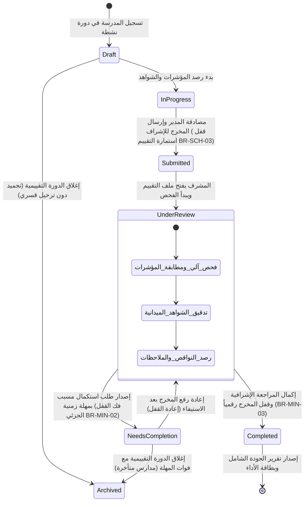
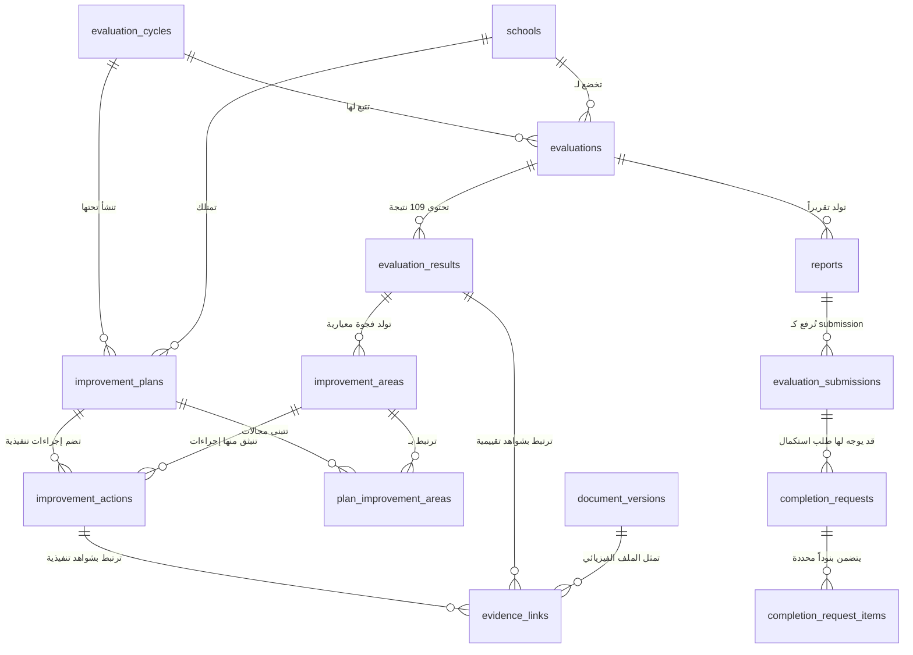

# دليل دورة حياة التقييم المدرسي وحوكمة الحالات الاستثنائية العابرة للبوابات
## وثيقة المعمارية المرجعية وقواعد سير العمل (Evaluation Lifecycle & Edge Cases Specification)

> **المشروع:** نظام إدارة الجودة والتقويم والاعتماد المدرسي (`school-quality-system`)  
> **مسار الوثيقة:** `docs/evaluation-lifecycle-and-edge-cases.md`  
> **حالة الوثيقة:** مرجع معماري رسمي ملزم لجميع البوابات (المشرف الوزاري، مقيم المدرسة، مدير المدرسة، إدارة النظام)  
> **تاريخ الإصدار:** 21 نوفمبر 2026م  
> **المرجعيات التشريعية:** [الفصل الرابع - وثيقة التخرج] | [supervision-impact-register.md](../school-eval-web/src/features/supervision/supervision-impact-register.md) | [BR-MIN-01..03] | [BR-SCH-01..03] | [FR-SCH-23, FR-SCH-24]

---

## 1. القواعد الحاكمة لدورة حياة التقييم والمراجعة الإشرافية

### 1.1 آلة الحالات (State Machine) ومصفوفة الانتقالات المشروعة
يخضع ملف التقييم الذاتي المدرسي (`Evaluation`) لدورة حياة منضبطة بأقفال برمجية محكمة، توضحها المصفوفة التالية:

---

### 1.2 قاعدة تصحيح خطط التحسين (`BR-MIN-02`)
1. **ربط الفجوات المعيارية:**
   - كل مؤشر وطني يحصل على تقدير منخفض في التقييم الذاتي (**المستوى 0: غير متوفر**، أو **المستوى 1: متحقق بدرجة ضعيفة**، أو **المستوى 2: متحقق بدرجة متوسطة**) يمثل فجوة معيارية (`Gap = Target - Baseline`)، ويجب إلزامياً ربطه بمجال تحسين مستهدف (`ImprovementArea`).
2. **تعدد الإجراءات التنفيذية للمؤشر الواحد (`1 : N`):**
   - يدعم النظام برمجياً ربط أكثر من إجراء تنفيذي (`ImprovementAction`) بالمؤشر الواحد؛ حيث قد يتطلب علاج فجوة مؤشر ما تدخلاً إدارياً (مثل تعديل لائحة) وتدخلاً مالياً/مادياً (مثل صيانة وتوفير أجهزة) وتدخلاً تدريبياً (تأهيل الكادر).
3. **احتساب إنجاز المؤشر:**
   - يتم احتساب متوسط نسبة الإنجاز للمؤشر في خطة التحسين من مجموع نسب إنجاز الإجراءات التنفيذية المرتبطة به:
     $$\text{Area Progress \%} = \frac{\sum_{i=1}^{n} \text{Action Progress \%}_i}{n}$$

---

### 1.3 مصير المدارس المتأخرة عند إغلاق الدورة (`Draft` أو `NeedsCompletion` عند `Closed`)
1. **منع الرفع القسري:**
   - لا يجوز تحت أي ظرف رفع ملفات المدارس المتأخرة تلقائياً إلى المشرف الوزاري، ولا تُحتسب كمخرجات مكتملة أو ناجحة في إحصائيات الدورة.
2. **التجميد والأرشفة التاريخية:**
   - عند قيام المشرف العام بإغلاق الدورة التقييمية (`EvaluationCycle::status = 'Closed'`)، تُجمّد كافة الاستمارات المفتوحة للمدارس التي لم تُكمل متطلباتها بحالتها الراهنة (`Draft`, `InProgress`, `NeedsCompletion`)، وتُقفل صلاحية التعديل فيها تماماً (`canStartEvaluation = false`)، وتُؤرشف في سجل الدورة تحت بند **«مدارس غير مستكملة / متأخرة عن التسليم»**.
3. **التهيئة للدورة اللاحقة:**
   - عند إطلاق دورة تقييمية جديدة، يُتاح إلحاق المدرسة بالدورة الجديدة وتهيئة مسودتها السابقة كنقطة انطلاق أولية للمقيم لتحديث شواهدها ورصدها دون الحاجة لإعادة إدخال البيانات الثابتة من الصفر.

---

### 1.4 مبدأ عزل لقطة التقييم المرفوعة ومتابعة التنفيذ الميداني (`Snapshot Isolation` & `FR-SCH-23`, `FR-SCH-24`)
هذا المبدأ يمثل الركيزة المعمارية الأهم في الربط بين التقويم وضمان الجودة المستمرة:

1. **اللقطة التقييمية التاريخية الثابتة (`Immutable Evaluation Snapshot`):**
   - لحظة اعتماد المدير وإرسال المخرج (`Submitted`) أو إغلاق المراجعة الإشرافية (`Completed`)، تُؤخذ لقطة غير قابلة للتغيير (`Snapshot`) لكافة درجات المؤشرات الـ 109، ومبررات المقيم، والشواهد المودعة، والخطط المعتمدة.
   - **يُحظر منعاً باتاً** تعديل درجات المؤشرات أو درجات المعايير للدورة الحالية بأثر رجعي مهما كان التقدم الميداني اللاحق في أنشطة الخطة.
2. **سجل التنفيذ الميداني المفتوح للأنشطة (`Living Execution Log`):**
   - على مدار العام الدراسي، يظل سجل متابعة الأنشطة في خطط التحسين المدرسية الثلاث مفتوحاً لمسؤول الجودة وفريق التحسين بالمدرسة:
     * لتحديث نسبة الإنجاز الفعلية (`0% - 100%`).
     * لنقل حالة الإجراء من `Pending` إلى `InProgress` ثم `Done`.
     * لإرفاق **شواهد التنفيذ الميداني** من مستودع الوثائق وربطها بالإجراء (`evidence_links.action_id`).
3. **دورة الأثر التحسيني:**
   - لا يرفع تنفيذ إجراءات الخطة درجات المؤشرات في الدورة التقييمية الحالية؛ بل يُعد ملف التنفيذ وشواهده ركيزة أساسية تُثبت ارتقاء الأداء عند خضوع المدرسة للتقييم في **الدورة التقييمية للعام الدراسي القادم**.

---

### 1.5 حوكمة القفل الجزئي أثناء طلب الاستكمال (`BR-MIN-02`)
1. **القفل الانتقائي (Selective Field-Level Locking):**
   - عند إصدار المشرف الوزاري طلب استكمال (`NeedsCompletion`)، لا تُفتح الاستمارة بكامل مؤشراتها الـ 109 للعبث؛ بل يُفك القفل **حصرياً** عن المؤشرات المحددة في بنود الطلب (`CompletionRequestItem::indicator_id`).
   - تظل بقية المؤشرات الـ 108 أو الـ 105 مقفلة تماماً للقراءة فقط.
2. **صلاحيات الفك الجزئي المتعددة الممنوحة للمدرسة (Multi-Select Unlock Permissions):**
   - يدعم النظام تحديد صلاحيات متعددة لكل مؤشر مستهدف في `completion_request_items.allowed_actions` و `supervision_deficiency_notes.allowed_actions` وفق المصطلحات المعيارية الأربعة:
     * `upload_replace_evidence`: رفع / استبدال وثائق الشواهد الميدانية.
     * `edit_justification`: تعديل المبرر التوثيقي للمقيم.
     * `review_score`: مراجعة وتصويب درجة تقييم المؤشر على مقياس الروبك.
     * `link_improvement_plan`: ربط المؤشر بأولوية وإجراء في خطة التحسين.
3. **مهلة الاستكمال وسقف الدورة التقييمية (Default 14 Days & Dynamic Ceiling):**
   - نص قاعدة `BR-MIN-02` في وثيقة التخرج يخول المشرف الوزاري طلب استكمال النواقص وإعادة رفع التقييم دون تحديد عدد أيام ثابت ملزم (مثل 14 يوماً).
   - **قاعدة الـ 14 يوماً هي قيمة افتراضية تطويرية معتمدة**، مع مرونة ضبط السقف الأقصى للمهلة من إعدادات كل دورة تقييمية عبر خاصية `evaluation_cycles.max_completion_days` (المدى: 1 إلى 60 يوماً).
   - يُلزم النظام المشرف برمجياً بعدم تجاوز التاريخ الأقرب بين: (تاريخ الطلب + الحد الأقصى لأيام الاستكمال بالدورة) وتاريخ إغلاق الدورة التقييمية الجارية.
4. **خيارات استجابة المقيم المدرسي:**
   - إذا كان المقيم مقتنعاً بصحة رصده، يُتاح له إرفاق الشاهد الإضافي المطلوب أو كتابة توضيح وتبرير فني إضافي يدعم درجته دون تغييرها.
   - إذا اقتنع المقيم بوجود خطأ في الرصد، يُتاح له تعديل مستوى الروبك وتحديث الشواهد ثم إعادة الرفع للمدير والمشرف.

---

### 1.6 استئصال لفظ "الاعتماد" في أعمال المتابعة الإشرافية (`BR-MIN-03`)
1. **المفهوم القانوني والمؤسسي:**
   - وفق وثيقة التخرج وقوانين وزارة التربية والتعليم، يقتصر دور الإشراف والمتابعة المركزية على **«المراجعة والتدقيق والتحقق من صحة رصد المؤشرات الوطنية واكتمال الشواهد الميدانية ومطابقة خطط التحسين»**.
   - لا تملك الإدارة العامة للتقويم والمتابعة المركزية منح شهادات "اعتماد مدرسي" بقرار إشرافي منفرد؛ فالاعتماد المؤسسي مسار مستقل يخضع لهيئة الاعتماد الأكاديمي وضمان الجودة.
2. **المصطلحات المعتمدة للنظام:**
   - استبدال "اعتماد التقرير" بـ **«إكمال المراجعة الإشرافية وقفل المخرج»**.
   - استبدال مسار `/approve` بـ `/close`.
   - استخدام الحالة الرسمية `Completed` (مكتمل المراجعة) بدلاً من `Approved`.

---

### 1.7 قاعدة احتساب المدارس «المتأخرة عن التسليم» آلياً عند مضي 80% من فترة الدورة (`FR-SUP-15`)
1. **المرجعية النظامية في وثيقة التخرج:**
   - تنص النسخة النهائية رقم 5 من وثيقة التخرج (ص 41، جدول 3.15، المتطلب `FR-SUP-15`) صراحةً على ما يلي:
     > *«يجب أن تتيح المنصة للمشرف الوزاري إعداد تقرير مركزي يعرض حالة كل مدرسة (مكتملة / تحتاج استكمال / متأخرة — وتُحتسب «متأخرة» آلياً إذا مضى 80% من مدة الدورة التقييمية دون إرسال مخرجها) ومخرجاتها وطلبات الاستكمال الصادرة لها وحالة معالجتها.»*
2. **طبيعة الحالة واشتقاقها الديناميكي (Derived Dynamic Status):**
   - حالة «متأخرة» ليست قيمة ثابتة مسجلة في قاعدة البيانات داخل جدول `CYCLE_PARTICIPATIONS` أو `EVALUATIONS`؛ بل هي **حالة مشتقة ديناميكياً** عند استعلام التقارير ولوحات المتابعة المركزية.
   - شرط انطباق حالة التأخير:
     $$\text{current\_timestamp} \ge \text{cycle.start\_date} + 0.80 \times (\text{cycle.end\_date} - \text{cycle.start\_date})$$
     مع بقاء حالة ملف التقييم أو المخرج ضمن المسودات: `status IN ('Draft', 'InProgress', 'Notified')`.
3. **المرونة التطويرية وقابلية التعديل (Configurable Default Threshold):**
   - تُعد نسبة **80%** هي القيمة المعتمدة والافتراضية رسمياً وفق نص الوثيقة.
   - لمرونة النظام في بيئات الاختبار والتطبيق الميداني المتدرج، يتم توفير إمكانية ضبط هذه العتبة في إعدادات كل دورة تقييمية (بمدى مرن يتراوح بين 50% إلى 95%، وقيمتها الافتراضية 80%)، بما يماثل مرونة سقف مهلة الاستكمال (`max_completion_days`) المعتمدة في `BR-MIN-02`.

---

### 1.8 مستويات الكفاءة والتحقق الإشرافي وعتبات التصنيف (Competency Attainment Bands)
1. **المرجعية والغرض الإشرافي (`FR-SUP-12`, `FR-SUP-13`, `FR-SUP-14`):**
   - تهدف لوحة التحليلات والتقارير المركزية إلى تصنيف المدارس والمؤشرات حسب مستويات الكفاءة ونسب التحقق لتوجيه التدخلات الميدانية وتركيز الدعم الفني دون إصدار أحكام تصنيفية تنافسية (حظر الـ Leaderboards).
2. **العتبات التطويرية الافتراضية المعتمدة (Development Defaults):**
   - **متقدم / متميز (Exemplary):** نسبة تحقق $\ge 80\%$ (أو متوسط مقياس الروبك $\ge 2.40$ من 3.00).
   - **متوسط / مستقر (Proficient):** نسبة تحقق بين $60\%$ و $79.9\%$ (أو متوسط مقياس الروبك بين $1.80$ و $2.39$ من 3.00).
   - **بحاجة لدعم وأولوية تدخل (Needs Support / Intervention):** نسبة تحقق $< 60\%$ (أو متوسط مقياس الروبك $< 1.80$ من 3.00).
3. **الضوابط الصارمة لعرض البيانات:**
   - تُستخدم هذه العتبات حصراً لتوزيع المدارس إحصائياً وتحديد أهم 10 نقاط قوة وأهم 10 فجوات إشرافية بالمؤشرات لتوجيه خطط الدعم.
   - يُحظر برمجياً تحويل هذه العتبات إلى قوائم ترتيب تنافسي للمدارس (Ranking / Leaderboards) التزاماً بالمعايير الأخلاقية للتقويم الإشرافي.

---

## 2. التحليل الهيكلي لقاعدة البيانات وتكامل البوابات

### 2.1 هيكلية الجداول المعنية في قاعدة البيانات (`school_eval`)

### 2.2 شواهد التنفيذ في جدول `evidence_links`:
- يحتوي جدول `evidence_links` بالفعل على حقل `action_id` (Nullable Foreign Key).
- عندما يُرفع شاهد تقييمي للمؤشر: يُملأ `evaluation_result_id` و `indicator_id`، ويكون `action_id = NULL`.
- عندما يُرفق شاهد تنفيذ لإجراء في خطة التحسين: يُملأ `action_id` و `school_id` و `document_version_id`.
- هذا التصميم ممتاز معمارياً ويوفر قاعدة بيانات موحدة لكافة الشواهد سواء كانت شواهد تقييم أداء ذاتي أو شواهد إنجاز ميداني للخطط.

---

## 3. القرارات المعمارية المعتمدة نهائياً (Adopted Architectural Decisions)

تم اعتماد التوصيات المعمارية وحسم القواعد التشغيلية بشكل رسمي ونهائي، كالتالي:

### النقطة 1: فك قفل متابعة التنفيذ الميداني لأنشطة خطط التحسين في بوابة المدرسة
- **القرار المعتمد:**
  * اعتماد مبدأ عزل لقطة التقييم (`Snapshot Isolation`) وتفكيك قفل الخطة إلى مستويين:
    1. `isPlanStructureLocked`: يُقفل إضافة أو حذف مجالات تحسين جديدة أو تغيير العناوين والأهداف بعد اعتماد الخطة ورفعها للمشرف.
    2. `isExecutionTrackingOpen`: يظل متاحاً لمسؤول الجودة والمدير لتحديث نسبة الإنجاز (`completion_percentage`) وتغيير الحالة إلى `InProgress` أو `Done`، واستدعاء نافذة ربط شواهد التنفيذ.
- **نطاق التنفيذ الحالي (Scope Boundary):**
  > [!IMPORTANT]
  > تنفيذ وترقية **[الشاشة رقم 4: مركز استلام ومراجعة المخرجات]** في المرحلة الراهنة **لا يمس ولا يُعدّل أي سطر كود في بوابتي المقيم والمدير (`ImprovementPlanPage.tsx`, إلخ)**؛ بل يتم تفعيل وعرض الخطط الثلاث وإجراءاتها ونسب إنجازها وشواهد تنفيذها **حصرياً داخل الشاشة رقم 4** تحت صلاحيات المشرف الوزاري الحاكمة (اطلاع وتدقيق وتدوين ملاحظات النواقص وإصدار القرار الإشرافي). وسيتم تطبيق التعديل في بوابة المدرسة في مرحلتها المخصصة لاحقاً.

---

### النقطة 2: آلية استدعاء وربط شاهد التنفيذ بالإجراء التنفيذي
- **القرار المعتمد:**
  * اعتماد المسارين بالتوازي في بوابة المدرسة: (1) اختيار وثيقة قائمة من خزانة شواهد المدرسة، أو (2) رفع ملف جديد عبر `POST /api/v1/improvement-actions/{id}/evidences` ليُسجل في الخزانة ويُرتبط تلقائياً بـ `evidence_links.action_id`.
  * في بوابة المشرف (الشاشة 4): يتم جرد وعرض كافة الشواهد المرتبطة بالإجراء مع إمكانية المعاينة والتحميل المصادق.

---

### النقطة 3: حسم الحالات الاستثنائية الحرجة

#### أ. طلب استرداد المخرج من المدرسة قبل بدء المشرف بالمراجعة (Early Recall / Undo Submit):
- **القرار المعتمد:** اعتماد **الخيار الثاني (حوكمة صارمة)**؛ بمجرد قيام المدرسة بالرفع المصادق للمشرف، لا يحق للمدرسة استرداده ذاتياً. وإذا وُجد أي تصويب تتواصل المدرسة مع المشرف الوزاري ليقوم هو بفحص الملف وإصدار طلب استكمال نظامي مسبب ومسجل في سجل التدقيق (`AuditLog`) وفق مسار `NeedsCompletion`.

#### ب. تزامن مهلة طلب الاستكمال مع موعد إغلاق الدورة التقييمية (Deadline Governance):
- **القرار المعتمد:**
  * **يمنع النظام المشرف برمجياً منعاً باتاً من حفظ أو إصدار أي طلب استكمال تتجاوز مهلته الزمنية (`deadline`) تاريخ إغلاق الدورة التقييمية النشطة (`EvaluationCycle::end_date`).**
  * يُظهر النظام تنبيهاً وتحققاً برمجياً: *«مهلة الاستكمال المحددة تتجاوز الموعد النهائي لإغلاق الدورة التقييمية النشطة. يرجى ضبط المهلة قبل تاريخ إغلاق الدورة أو التنسيق لتمديد الدورة مركزياً أولاً»*.

#### ج. الحد الأقصى لمحاولات الاستكمال (`attempt_no <= 3`):
- **القرار المعتمد:**
  * **سقف 3 محاولات تسليم إجمالية كحد أقصى (`attempt_no <= 3`) لكل مدرسة خلال الدورة الواحدة.**
  > [!NOTE]
  > هذا السقف هو **قرار حوكمة معماري جديد معتمد أثناء التطوير** (لمنع دوران الاستكمال اللانهائي وضمان استقرار المخرجات الزمنية للدورات الوطنية)، وليس نصاً رقمياً منصوصاً عليه في وثيقة التخرج الأصلية.
  * في حال استنفاد المحاولة الثالثة دون استيفاء الشواهد، يُلزم النظام المشرف بقفل المراجعة وتثبيت الدرجة المنخفضة مع رصد التقرير النهائي.

---

## 4. خطة التطوير والترقية الفنية للشاشة رقم 4 (مركز استلام ومراجعة المخرجات)

بناءً على المقارنة التشريحية التفصيلية بين واجهات المقيم والمدير المعتمدة وشاشة المشرف رقم 4 الحالية، تتلخص خطة التطوير المعمارية في المعالجات التالية:

| المحور | الوضع في واجهة المقيم والمدير | القصور الحالي في شاشة المشرف 4 | المعالجة المعتمدة للترقية |
|---|---|---|---|
| **أزرار التصدير والتحميل** | تحميل Blob مصادق عبر Token دون فتح نوافذ بيضاء أو أخطاء 401 | استخدام وسوم `<a>` بروابط نسبية غير مصادقة تفشل في المتصفح | استخدام آلية التحميل المعتمدة عبر Axios Blob Download لجميع الشواهد وتقارير PDF وسجلات Excel |
| **تغطية الشواهد في شجرة المعايير** | شارة: `1 شاهد (غطى 2 من 2 متطلبات)` مع تفصيل المتطلبات | تكرار أرقام الشواهد دون تفصيل المتطلبات الإلزامية | إظهار مصفوفة تغطية المتطلبات الإلزامية لكل مؤشر وعرض أسماء الوثائق التي غطت كل متطلب بالتفصيل |
| **تسميات سلم التقدير** | تسميات رسمية واضحة (`متحقق (3)`, `متوسط (2)`, `ضعيف (1)`, `غير متوفر (0)`) | استخدام رموز النجوم (`3★`, `2★`, `1★`, `0★`) | استبدال الرموز بالتسميات الرسمية المعتمدة في سلم التقويم الوطني وتلوينها بـ Design Tokens |
| **الإطار التوجيهي والمبررات** | عرض إطار المعيار الفرعي، مبررات المقيم، وتوجيهات المدير | عرض تبرير المقيم فقط بشكل مقتضب | عرض الإطار التوجيهي، مبررات المقيم الميدانية، وتوجيهات المراجعة الداخلية للمدير |
| **مستودع الوثائق (التبويب 2)** | تعريب التصنيفات، عرض رمز المؤشر وعنوانه، فلاتر كاملة، فرز متعدد | تصنيفات إنجليزية (`plan`, `minutes`) وعرض رمز المؤشر مجرداً | تعريب كافة التصنيفات، إبراز اسم المؤشر كاملاً، وإضافة فلاتر نوع المستند وصيغة الملف والفرز المتقدم |
| **جرد الشواهد (التبويب 2)** | بطاقات إحصائية، تفصيل كل متطلب والوثيقة المغطية له، أزرار ربط | جدول مختصر لحالة الكفاية العامة | إضافة البطاقات الإحصائية الأربع، وتفصيل كل متطلب إثبات مع اسم المستند المغطي له |
| **خطط التحسين (التبويب 3)** | دعم الخطط الثلاث والتبديل بينها، وإجراءات متعددة `1 : N` | عرض خطة واحدة فقط دون إمكانية التبديل | إضافة محدد الخطط الثلاث (`الجودة الشاملة`، `التطوير المهني`، `التشغيلية`) ومصفوفة تغطية المؤشرات المنخفضة (`0-2`) وتعدد الإجراءات |

---

## 5. الخلاصة والتوصية المعمارية
تمثل هذه الوثيقة الميثاق المعماري الملزم لربط بوابة المشرف ببوابة المقيم والمدير وإحكام الحالات الاستثنائية دون أي تعارض، وتنتظر الاعتماد والمصادقة للبدء في تنفيذ ترقية الشاشة رقم 4.
