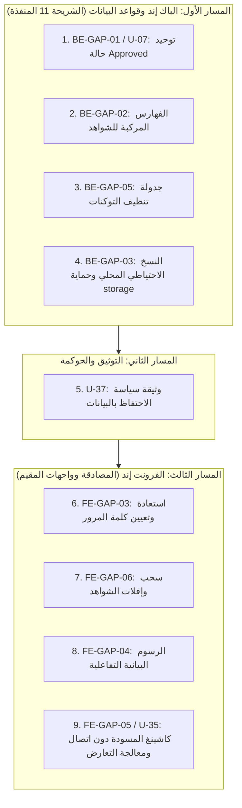

# خطة العمل التنفيذية المحدثة لمعالجة الفجوات (Gap Remediation Plan)
## نطاق العمل الفعلي: واجهات مسؤول النظام + واجهات المقيم المدرسي

> **المشروع:** نظام إدارة الجودة والتقويم والاعتماد المدرسي (`school-quality-system`)  
> **الفرع الحالي:** `feature/school-evaluator-ui`  
> **تاريخ إعداد واعتماد الخطة:** 7 نوفمبر 2026م  
> **تاريخ آخر مراجعة وتدقيق:** 7 نوفمبر 2026م  
> **الحالة:** خطة معتمدة وملزمة للتنفيذ الفوري للمرحلة الحالية  
> **مبدأ الحوكمة المعتمد:**
> 1. **نطاقك المباشر:** واجهات مسؤول النظام (`Admin`) + واجهات مقيم المدرسة (`School Evaluator`) والباك إند والتوثيق وقواعد البيانات المرتبطة بها.
> 2. **خارج نطاقك:** واجهات المشرف الوزاري (`FE-GAP-01`) ومسؤول المعايير (`FE-GAP-02`) مسندة لزميل الفرونت إند وموسومة كـ **«بانتظار زميل الفرونت إند»** لمراجعتها وربطها لاحقاً.
> 3. **الشريحة 11 منجزة ومغلقة:** إغلاق كافة الفجوات المرتبطة بها محلياً الآن (`BE-GAP-01`، `BE-GAP-02`، والجزء المحلي من `BE-GAP-03`).
> 4. **الشريحة 12 والخدمات الخارجية:** مؤجلة بالكامل لمرحلة متقدمة (ما بعد اكتمال الواجهات، ثم الشريحة 12، ثم التجهيز للنشر).

---

## 1. الجدول الشامل لحصر وتصنيف الفجوات الـ 16 وفق النطاق الفعلي

| # | كود الفجوة | الفجوة المتقاطعة | عنوان الفجوة | المجال | التصنيف المعتمد | الأولوية |
|:---:|---|---|---|:---:|:---:|:---:|
| **1** | **BE-GAP-01** | **U-07** | توحيد حالة الإصدار المعياري إلى `Approved` | باك إند (شريحة 11 منجزة) | **مكتملة ومغلقة ✅** | **عالية** |
| **2** | **BE-GAP-02** | **G-15** | الفهارس المركبة لروابط الشواهد والمستندات | باك إند (شريحة 11 منجزة) | **مكتملة ومغلقة ✅** | **متوسطة** |
| **3** | **BE-GAP-05** | — | جدولة حذف توكنات Sanctum وجلسات الخمول | باك إند (Laravel Scheduler) | **مكتملة ومغلقة ✅** | **عالية** |
| **4** | **BE-GAP-03 (المحلي)** | — | تكامل النسخ الاحتياطي المحلي الآمن وحماية مجلد storage | باك إند (شريحة 11 - محلي) | **مكتملة ومغلقة ✅** | **متوسطة** |
| **5** | **U-37** | — | وثيقة سياسة الاحتفاظ بالبيانات والأرشفة الرسمية | توثيق وحوكمة ونظم | **مكتملة ومغلقة ✅** | **متوسطة** |
| **6** | **FE-GAP-03** | — | واجهات استعادة وتعيين كلمة المرور المنسية | فرونت إند عام (أدمن ومستخدمين) | **مكتملة ومغلقة ✅** | **عالية** |
| **7** | **FE-GAP-06** | — | السحب والإفلات (Drag & Drop) في رفع الشواهد | فرونت إند (المقيم المدرسي) | **مكتملة ومغلقة ✅** | **متوسطة** |
| **8** | **FE-GAP-04** | — | الرسوم البيانية التفاعلية للمقيم ومقارنة الأداء | فرونت إند (المقيم المدرسي) | **مكتملة ومغلقة ✅** | **متوسطة** |
| **9** | **FE-GAP-05** | **U-35** | وضع العمل دون اتصال (Offline Caching) ومعالجة التعارض | فرونت إند (المقيم المدرسي) | **مكتملة ومغلقة ✅** | **متوسطة** |
| **10** | **FE-GAP-01** | — | حزمة شاشات المشرف الوزاري ودورات التقييم | فرونت إند (المشرف الوزاري) | **ب. خارج نطاقك — بانتظار زميل الفرونت إند** ⏳ | — |
| **11** | **FE-GAP-02** | — | واجهات إدارة وتفعيل المعايير وحوكمة الأوزان | فرونت إند (مسؤول المعايير) | **ب. خارج نطاقك — بانتظار زميل الفرونت إند** ⏳ | — |
| **12** | **BE-GAP-04** | **U-42** | الربط الحي مع Gemini API للذكاء الاصطناعي | باك إند (خدمة خارجية - الشريحة 12) | **ج. مؤجلة لمرحلة لاحقة** 🤖 | — |
| **13** | **FE-GAP-07** | **U-42** | واجهة المحادثة التفاعلية للمساعد الذكي | فرونت إند (الشريحة 12) | **ج. مؤجلة لمرحلة لاحقة** 🤖 | — |
| **14** | **الجزء السحابي من BE-GAP-03** | — | التخزين السحابي الخارجي للنسخ الاحتياطي (S3) | تكامل خارجي / سحابي | **ج. مؤجلة لمرحلة لاحقة** ☁️ | — |
| **15** | **U-07** | *انظر #1* | *(مدمجة ومحققة ضمن BE-GAP-01)* | باك إند | **أ. ضمن نطاقك — قابلة للإصلاح الآن** 🚀 | **عالية** |
| **16** | **U-35** | *انظر #9* | *(مدمجة ومحققة ضمن FE-GAP-05)* | فرونت إند | **أ. ضمن نطاقك — قابلة للإصلاح الآن** 🚀 | **متوسطة** |

---

## 2. تفاصيل الفجوات الـ 9 المقررة للتنفيذ الفوري

### 1. `BE-GAP-01` / `U-07` — توحيد حالة الإصدار المعياري إلى `Approved`
- **الوصف:** استبدال القيم القديمة `Active` بحالة `Approved` الرسمية في جدول `standard_versions` ليصبح الاستعلام متسقاً لغوياً وقاعدياً.
- **الملفات المتأثرة:**
  - ملف تهجير: `school-eval-api/database/migrations/2026_11_07_220000_standardize_standard_versions_status.php`.
  - الموديل: `school-eval-api/app/Models/StandardVersion.php`.
- **خطوات التنفيذ:**
  1. إنشاء Migration يحدث القيم: `UPDATE standard_versions SET status = 'Approved' WHERE status = 'Active'`.
  2. تحديث دوال النموذج ليكون `STATUS_APPROVED` هو المرجع الأساسي مع حفظ التوافق.
- **الاختبارات:** `StandardVersionTest`.
- **التقدير الزمني:** 1 ساعة.

### 2. `BE-GAP-02` (`G-15`) — الفهارس المركبة لروابط الشواهد والمستندات
- **الوصف:** إضافة فهارس مركبة لتسريع استعلامات تصفية الشواهد حسب المدرسة والنسخة الحالية، وعزل الروابط حسب المؤشر والمستند لضمان أداء فائق للشريحة 11.
- **الملفات المتأثرة:**
  - ملف تهجير: `school-eval-api/database/migrations/2026_11_07_221000_add_performance_composite_indexes.php`.
- **خطوات التنفيذ:**
  1. إضافة الفهارس:
     - جدول `document_versions`: إضافة `INDEX (school_id, is_current)`.
     - جدول `evidence_links`: إضافة `INDEX (document_version_id, status)`.
     - جدول `evidence_links`: إضافة `INDEX (school_id, indicator_id)`.
- **الاختبارات:** تشغيل `migrate` واختبارات `EvidenceManagementFeatureTest`.
- **التقدير الزمني:** 1.5 ساعة.

### 3. `BE-GAP-05` — جدولة تنظيف التوكنات المنتهية وسجلات الجلسات الخاملة
- **الوصف:** تسجيل مهام الجدولة الدورية لحذف رموز Sanctum المنتهية وسجلات الجلسات التي تجاوزت 30 يوماً.
- **الملفات المتأثرة:**
  - `school-eval-api/routes/console.php`.
  - اختبار آلي: `school-eval-api/tests/Feature/PruneExpiredTokensTest.php`.
- **خطوات التنفيذ:**
  1. تسجيل `sanctum:prune-expired --hours=24` يومياً عبر `Schedule`.
  2. تسجيل تنظيف سجلات جدول `sessions` القديمة (>30 يوماً).
- **الاختبارات:** اختبار ميزة آلي يؤكد حذف الرموز المنتهية وبقاء السارية.
- **التقدير الزمني:** 2 ساعة.

### 4. `BE-GAP-03` (الجزء المحلي) — تفعيل النسخ الاحتياطي المحلي الآمن وحماية مجلد storage
- **الوصف:** تفعيل مسار إنشاء النسخ الاحتياطية محلياً وتنزيلها مع التأكد التام من أن المجلد `storage/app/backups/` محمي وغير متاح للويب مباشرة (ليس داخل `public/`) مع حماية التنزيل بصلاحية مسؤول النظام فقط.
- **الملفات المتأثرة:**
  - `school-eval-api/config/filesystems.php`.
  - `school-eval-api/app/Http/Controllers/Api/V1/AdminController.php`.
  - `school-eval-api/tests/Feature/AdminBackupFeatureTest.php`.
- **خطوات التنفيذ:**
  1. التأكد من حفظ النسخ في مسار محمي `storage/app/backups/` مع ملف `.gitignore` وملف `.htaccess` مانع للوصول المباشر.
  2. إنشاء أرشيف النسخ المحلي وحساب الهاش `hash_file('sha256', ...)`.
  3. حظر تنزيل ملفات النسخ إلا عبر مسار API معتمد محمي بسياسة `admin`.
- **الاختبارات:** اختبار إنشاء وتحميل نسخة احتياطية محلية والتأكد من منع الوصول غير المصرح.
- **التقدير الزمني:** 3 - 4 ساعات.

### 5. `U-37` — وثيقة سياسة الاحتفاظ بالبيانات والأرشفة الرسمية (Data Retention Policy)
- **الوصف:** إعداد الوثيقة المرجعية الرسمية لتنظيم دورة حياة البيانات والنسخ الاحتياطية وسجلات التدقيق وضوابط الأرشفة المؤسسية.
- **الملفات المتأثرة:**
  - إنشاء: `docs/data-retention-policy.md`.
  - تحديث: `docs/issues-tracking.md`.
- **خطوات التنفيذ:**
  1. صياغة سياسة الاستبقاء (10 سنوات للتقارير، 5 سنوات للشواهد، 7 سنوات لسجل التدقيق، 30 يوماً للجلسات).
  2. ربطها بالفصل الرابع ووثائق المتطلبات.
- **التقدير الزمني:** 3 ساعات.

### 6. `FE-GAP-03` — واجهات استعادة وتعيين كلمة المرور المنسية
- **الوصف:** توفير شاشة استعادة كلمة المرور ونافذة إدخال البريد وشاشة تعيين كلمة المرور الجديدة في React مع التحقق الصارم وربطها بالباك إند الجاهز.
- **الملفات المتأثرة:**
  - `school-eval-web/src/api/auth.ts`.
  - `school-eval-web/src/features/auth/ForgotPasswordModal.tsx`.
  - `school-eval-web/src/features/auth/ResetPasswordPage.tsx`.
  - `school-eval-web/src/features/auth/LoginPage.tsx`.
  - `school-eval-web/src/App.tsx`.
- **خطوات التنفيذ:**
  1. بناء المكونات التفاعلية وفق `UI_STANDARDS.md`.
  2. فحص تطابق وقوة كلمة المرور وإرجاع المستخدم لصفحة الدخول بنجاح.
- **الاختبارات:** اختبار دورة الاستعادة وإعادة التعيين والتأكد من عمل البناء `npm run build`.
- **التقدير الزمني:** 5 - 6 ساعات.

### 7. `FE-GAP-06` — السحب والإفلات (Drag & Drop) في رفع الشواهد
- **الوصف:** ترقية نافذة رفع الشواهد للمقيم المدرسي لدعم السحب والإفلات المباشر للوثائق مع معاينة اسم الملف وحجمه والتحقق الفوري.
- **الملفات المتأثرة:**
  - `school-eval-web/src/features/evaluation/components/evidences/UploadEvidenceModal.tsx`.
- **خطوات التنفيذ:**
  1. إضافة مستمعات `onDragOver`, `onDragLeave`, `onDrop` لمنطقة الرفع.
  2. تنسيق منطقة الإسقاط وفق `theme.ts` وفحص امتداد وحجم الملف (أقل من 10MB).
- **الاختبارات:** فحص السحب والإفلات واختبار البناء `npm run build`.
- **التقدير الزمني:** 3 - 4 ساعات.

### 8. `FE-GAP-04` — الرسوم البيانية التفاعلية للمقيم ومقارنة الأداء
- **الوصف:** تزويد شاشة لوحة تحكم المقيم وشاشة مقارنة الاتجاهات برسوم بيانية تفاعلية نظيفة (مكونات SVG خفيفة معربة أو Recharts) لعرض توزيع مستويات المؤشرات ونسب استيفاء المجالات.
- **الملفات المتأثرة:**
  - `school-eval-web/src/features/evaluation/components/dashboard/CycleProgressTracker.tsx`.
  - `school-eval-web/src/features/evaluation/components/dashboard/EvaluatorDashboard.tsx`.
  - مكونات جديدة: `school-eval-web/src/components/ui/InteractiveBarChart.tsx` و `InteractiveDonutChart.tsx`.
- **خطوات التنفيذ:**
  1. رسم بياني حلقي لتوزيع مستويات الأداء (0-3).
  2. رسم بياني شريطي لمقارنة أداء المجالات السبعة.
- **الاختبارات:** التحقق من الاستجابة عند التكبير (125% و 150%) واختبار البناء `npm run build`.
- **التقدير الزمني:** 6 - 8 ساعات.

### 9. `FE-GAP-05` / `U-35` — وضع العمل دون اتصال (Offline Caching) ومعالجة التعارض
- **الوصف:** حفظ مسودة التقديرات والمبررات محلياً عند انقطاع الشبكة في المتصفح، مع إظهار شارة تنبيه برتقالية «وضع عدم الاتصال — المسودة محفوظة محلياً»، وإضافة **معالجة تعارض بسيطة** (تنبيه المستخدم عند وجود تعديل أحدث على الخادم، مع مبدأ آخر تعديل محلي يفوز بعد التأكيد)، والمزامنة التلقائية فور عودة الاتصال.
- **الملفات المتأثرة:**
  - `school-eval-web/src/features/evaluation/hooks/useSelfEvaluation.ts`.
  - `school-eval-web/src/features/evaluation/components/self-evaluation/SelfEvaluationForm.tsx`.
- **خطوات التنفيذ:**
  1. الاستماع لأحداث الاتصال `online` / `offline`.
  2. تخزين المسودة مع طابع زمني محلي `cachedAt`.
  3. فحص التعارض مع تاريخ تحديث الخادم `updated_at`، وتنبيه المستخدم أو اعتماد أحدث تعديل، والمزامنة التلقائية عند الاتصال.
- **الاختبارات:** اختبار انقطاع الاتصال ومحاكاة المزامنة واختبار البناء `npm run build`.
- **التقدير الزمني:** 8 - 10 ساعات.

---

## 3. الترتيب التنفيذي المعتمد للفجوات الـ 9

1. **`BE-GAP-01` / `U-07`:** توحيد حالة الإصدار المعياري.
2. **`BE-GAP-02`:** الفهارس المركبة لروابط الشواهد والمستندات.
3. **`BE-GAP-05`:** جدولة تنظيف التوكنات والجلسات المنتهية.
4. **`BE-GAP-03 (المحلي)`:** النسخ الاحتياطي المحلي وحماية مجلد storage.
5. **`U-37`:** وثيقة سياسة الاحتفاظ بالبيانات والأرشفة الرسمية.
6. **`FE-GAP-03`:** واجهات استعادة وتعيين كلمة المرور.
7. **`FE-GAP-06`:** السحب والإفلات في رفع الشواهد.
8. **`FE-GAP-04`:** الرسوم البيانية التفاعلية للمقيم.
9. **`FE-GAP-05` / `U-35`:** وضع عدم الاتصال ومعالجة التعارض.

---

## 4. مصفوفة الاعتماديات والتقدير الزمني

* **الاعتماديات:**
  - فجوات الباك إند الـ 4 مستقلة ويمكن تنفيذها تباعاً.
  - فجوة التوثيق `U-37` مستقلة.
  - فجوات الفرونت إند الـ 4 تتبع نظام مكونات الواجهة وتستفيد من استقرار الباك إند.
* **إجمالي التقدير الزمني:** **4.5 إلى 5 أيام عمل**.
