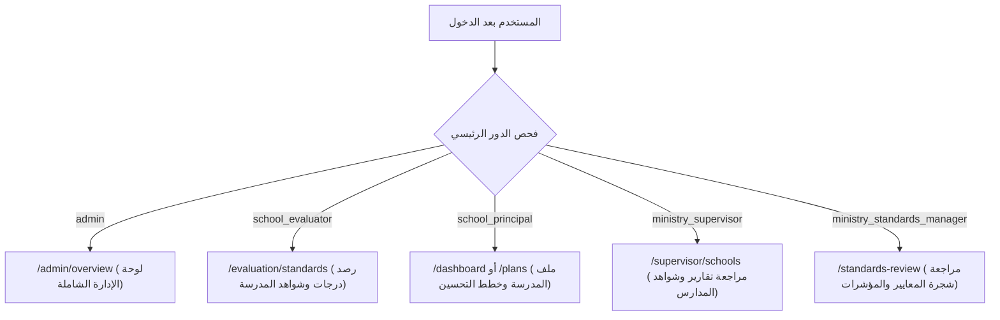

# دليل التسليم الهندسي لتكامل واجهة React
## نظام تقويم جودة المدارس (school-eval-web)
### تغطية الشرائح المنجزة: 1 إلى 8 (الإصدار v0.8.0)

---

## مقدمة وهدف الدليل

أهلاً بك زميلي في فريق تطوير الواجهة الأمامية!  
هذا الدليل أُعد خصيصًا ليكون مرجعك الهندسي الشامل والوحيد لتكامل تطبيق **React (school-eval-web)** مع الواجهة البرمجية الخلفية **(school-eval-api)** المبنية بـ Laravel 11.

تم إنجاز واختبار الشرائح الوظيفية من **1 إلى 8** بنسبة نجاح **100%** (185 اختبارًا آليًا مؤكدًا)، وقاعدة البيانات ومسارات الـ API جاهزة تمامًا ومستقرة للربط والإنتاج. ستجد في هذا الدليل كل ما تحتاجه من هياكل الطلبات والاستجابات، خرائط الصلاحيات، تدفقات العمل، وقواعد الأعمال الصارمة التي يجب التزامها في الواجهة.

---

## القسم 1: نظرة عامة على الباك إند (Backend Overview)

### 1.1 العنوان الأساسي للـ API والتشغيل المحلي
- **Local Base URL:** `http://127.0.0.1:8000/api/v1` (أو عبر النطاق الافتراضي لبيئة Laragon: `http://school-quality.test/api/v1`).
- **تشغيل الباك إند محليًا:**
  ```bash
  cd school-eval-api
  php artisan serve --port=8000
  ```
- **فحص الاتصال والصحة:**
  ```http
  GET http://127.0.0.1:8000/api/v1/auth/me
  ```

### 1.2 نوع التوثيق وإدارة الجلسة (Bearer Token)
- التوثيق مبني على **Laravel Sanctum**.
- بعد نجاح تسجيل الدخول عبر `POST /api/v1/auth/login`، يستقبل تطبيق React الرمز في حقل `data.token`.
- **التخزين:** يُحفظ الرمز إما في `localStorage` (للبقاء مسجلًا) أو في ذاكرة التطبيق مع `sessionStorage`.
- **الإرسال الإلزامي:** يجب إرفاق الترويسة التالية في كل طلب محمي:
  ```http
  Authorization: Bearer <access_token>
  Accept: application/json
  Content-Type: application/json
  ```
- **مهلة الخمول:** تطبق الواجهة البرمجية سياسة خمول مدتها **30 دقيقة**؛ في حال عدم وجود نشاط تنتهي صلاحية الجلسة تلقائيًا.

### 1.3 صيغة الاستجابة الموحدة (Standard ApiResponse Envelope)
تعتمد جميع مسارات الـ API بدون استثناء صيغة JSON موحدة:

```typescript
interface ApiResponse<T> {
  success: boolean;       // true عند النجاح، false عند الفشل
  message: string;        // رسالة نصية توضيحية بالعربية
  data: T | null;         // البيانات الفعلية المعادة
  errors: Record<string, string[]> | null; // تفاصيل أخطاء التحقق
  meta?: Record<string, any>; // بيانات الترقيم أو التلخيص الإحصائي إن وجدت
}
```

#### مثال 1: استجابة ناجحة (Success 200/201)
```json
{
  "success": true,
  "message": "تم رصد درجة المؤشر بنجاح",
  "data": {
    "indicator_id": 12,
    "score": 3,
    "level": "متقدم",
    "justification": "تم توفير كافة الأدلة الإحصائية لنسبة المعلمين المؤهلين."
  },
  "errors": null
}
```

#### مثال 2: خطأ تحقق من المدخلات (Validation Failure 422)
```json
{
  "success": false,
  "message": "بيانات غير صالحة، يرجى مراجعة الحقول المطلوبة.",
  "data": null,
  "errors": {
    "score": ["حقل الدرجة يجب أن يكون رقمًا بين 1 و 4."],
    "justification": ["يجب كتابة مبرر الرصد عند منح مستوى متقدم."]
  }
}
```

### 1.4 جدول رموز الأخطاء (HTTP Status Codes) وكيفية معالجتها في React

| رمز الحالة | المعنى التقني | سبب الحدوث في الباك إند | السلوك المطلوب في واجهة React |
| :---: | :---: | :--- | :--- |
| **200 OK** | نجاح | استرجاع بيانات أو تعديل ناجح | تحديث الحالة وعرض إشعار نجاح (Toast). |
| **201 Created** | إنشاء ناجح | حفظ كيان جديد (مستخدم، مدرسة، مرفق، شاهد) | إغلاق الـ Modal وتحديث القائمة. |
| **401 Unauthorized** | غير مسجل أو انتهت الجلسة | التوكن غير موجود، غير صالح، أو انتهت مهلة الخمول (30 دقيقة) | مسح التوكن من الـ Storage وتوجيه المستخدم فورًا إلى `/login` مع حفظ مسار الإرجاع `returnUrl`. |
| **403 Forbidden** | غير مصرح | المستخدم يحاول تنفيذ عملية لا يملك صلاحيتها (مثلاً مقيّم يحاول حذف مستخدم) | إظهار رسالة تنبيه حمراء واضحة: *"ليس لديك صلاحية لتنفيذ هذا الإجراء"*. |
| **404 Not Found** | غير موجود (العزل المؤسسي) | السجل غير موجود، أو موجود لكنه يتبع مدرسة أخرى لا ينتمي إليها المستخدم | عرض رسالة: *"البيانات المطلوبة غير موجودة أو لا تملك صلاحية الوصول إليها"*. لا تفترض خطأ خادم. |
| **422 Unprocessable** | خطأ تحقق | فشل قواعد إدخال الحقول أو قيود الإلزامية عند تقديم التقييم | استخراج قاموس `errors` وتمريره للنموذج لعرض نصوص الأخطاء مباشرة تحت كل حقل بالعربية. |
| **500 Server Error** | خطأ خادم داخلي | استثناء غير متوقع في قاعدة البيانات أو الخادم | عرض شاشة خطأ عامة ودية: *"حدث خطأ غير متوقع، يرجى إعادة المحاولة لاحقًا"*. |

---

## القسم 2: خريطة الأدوار والصلاحيات (RBAC & Multi-Tenancy)

النظام مبني على 5 أدوار رئيسية محددة بدقة، مع تطبيق العزل المؤسسي الكامل للمدارس.



### 2.1 تفصيل مصفوفة الأدوار

#### 1. مدير النظام (`admin`)
- **ما يمكنه رؤيته:** لوحة الإحصائيات العامة للنظام، قائمة كافة المدارس، قائمة كافة المستخدمين، وسجل الأدوار والصلاحيات.
- **ما يمكنه فعله:** إضافة/تعديل/تعطيل المدارس، إنشاء الحسابات وإسناد الأدوار، تفعيل وتعطيل المستخدمين.
- **ما لا يمكنه فعله:** لا يتدخل في رصد درجات تقييم المدارس أو كتابة مبررات المؤشرات.
- **شاشة التوجيه بعد الدخول:** `/admin/overview`.

#### 2. مقيّم المدرسة (`school_evaluator`)
- **ما يمكنه رؤيته:** شجرة المعايير والمؤشرات الخاصة بمدرسته فقط، بطاقات السياق الإحصائي للمؤشرات، شواهد المدرسة، ونتائج التقييم المسودة.
- **ما يمكنه فعله:** رصد الدرجات وكتابة مبررات الرصد للمؤشرات، رفع الشواهد وربطها بالمؤشرات، تغيير تصنيف الشاهد، وتنفيذ إجراء "إنهاء وتقديم التقييم" (submit).
- **ما لا يمكنه فعله:** لا يرى ولا يعدل ملاحظات المراجعة الداخلية لمدير المدرسة، ولا ملاحظات المراجع الخارجي. لا يستطيع تعديل أي درجة بعد قفل التقييم.
- **شاشة التوجيه بعد الدخول:** `/evaluation/standards`.

#### 3. مدير المدرسة (`school_principal`)
- **ما يمكنه رؤيته:** لوحة معلومات المدرسة، ملف المدرسة والمرافق والكادر والطلاب، شجرة التقييم ونتائجها، واقتراحات التحسين.
- **ما يمكنه فعله:** إدارة وتحديث الملف الإحصائي للمدرسة ومرافقها وكادرها، كتابة "الملاحظات الداخلية" على مؤشرات التقييم، تبني اقتراحات التحسين، وإنشاء ومتابعة خطط التحسين وإجراءاتها.
- **ما لا يمكنه فعله:** لا يرصد الدرجات بنفسه (مهمة المقيّم)، ولا يحرر مبررات المقيّم، ولا يعدل بعد تقديم التقييم وقفله.
- **شاشة التوجيه بعد الدخول:** `/dashboard` (أو تبويب ملف المدرسة / خطط التحسين).

#### 4. المشرف الوزاري (`ministry_supervisor`)
- **ما يمكنه رؤيته:** قائمة المدارس التابعة لنطاق إشرافه، تقارير تقييم المدارس، جرد الشواهد، وخطط التحسين المدرسية.
- **ما يمكنه فعله:** تدوين "ملاحظات المراجعة الخارجية/الإشرافية" (Reviewer Notes) على الشواهد والخطط، واستعراض الإحصاءات المقارنة.
- **ما لا يمكنه فعله:** لا يعدل درجات المدرسة ولا يحذف شواهدها.
- **شاشة التوجيه بعد الدخول:** `/supervisor/reports`.

#### 5. مدير المعايير الوزاري (`ministry_standards_manager`)
- **ما يمكنه رؤيته:** شاشة إدارة الإصدارات المعيارية (`/standards/manager`)، شجرة المعايير والمؤشرات التفصيلية (`/standards/review`)، سلم الواصفات الأربع (0 إلى 3)، متطلبات الشواهد، ومصفوفة الأوزان النسبية للمعايير.
- **ما يمكنه فعله (شاشات وعمليات فعلية مكتملة في الشريحة 7):**
  - إنشاء مسودة إصدار فارغة جديدة (`POST /standard-versions`).
  - استنساخ إصدار مُقرّ بالكامل بجميع معاييره ومؤشراته كمسودة جديدة مستقلة (`POST /standard-versions/{id}/clone`).
  - تعديل مصفوفة الأوزان النسبية للمعايير مع التحقق من شرط المجموع = 100.00% (`PUT /standard-versions/{id}/weights`).
  - إضافة/تعديل/حذف المعايير (بما فيها المعيار 8 فأكثر) والمجالات الفرعية والمؤشرات ومتطلبات الشواهد في المسودات.
  - إقرار المسودة رسمياً كإصدار نافذ وتجميده (`POST /standard-versions/{id}/approve`)، مع الأرشفة التلقائية للإصدار السابق.
  - أرشفة إصدار مُقرّ يدوياً (`POST /standard-versions/{id}/archive`).
- **ما لا يمكنه فعله:** لا يتدخل في التقييم الميداني ولا يملك صلاحية الاطلاع على بيانات وتقارير المدارس الفردية (فصل تام بين الحوكمة والتقييم).
- **شاشة التوجيه بعد الدخول:** `/standards/manager` (لوحة إدارة الإصدارات المعيارية) أو `/standards/review` (محرر الشجرة والأوزان).

### 2.2 قراءة الصلاحيات واستخدامها في React
تعيد استجابة تسجيل الدخول ومسار `/auth/me` كائن المستخدم بالشكل التالي:

```typescript
interface UserProfile {
  id: number;
  name: string;
  email: string;
  school_id: number | null; // معرف المدرسة للعزل المؤسسي
  roles: Array<{ id: number; name: string; display_name: string }>;
  permissions: string[];     // قائمة نصوص الصلاحيات الدقيقة
}
```

**دوال المساعدة الموصى بها في React (مثال `useAuth.ts`):**
```typescript
export const useAuth = () => {
  const { user } = useContext(AuthContext);

  const hasRole = (roleName: string): boolean => {
    return user?.roles.some(r => r.name === roleName) ?? false;
  };

  const hasPermission = (permissionKey: string): boolean => {
    return user?.permissions.includes(permissionKey) ?? false;
  };

  return { user, hasRole, hasPermission };
};
```

### 2.3 قاعدة العزل المؤسسي الصارم (Multi-Tenancy)
- المستخدم المنتمي لمدرسة (`school_id: 5`) لا يستطيع قراءة أو تعديل أي تقييم أو شاهد أو خطة تعود لمدرسة أخرى (`school_id: 8`).
- الباك إند يرد تلقائيًا بـ `404 Not Found` (وليس 403) لحماية الخصوصية الأمنية ومنع استكشاف الموارد (Resource Enumeration).
- **قاعدة الواجهة:** عند استقبال 404، أظهر رسالة: *"السجل المطلوب غير موجود أو لا تملك صلاحية الوصول إليه"* مع زر عودة آمن.

---

## القسم 3: مسارات الـ API حسب الشريحة (1 إلى 6)

### 3.1 الشريحة 1: المصادقة وإدارة المستخدمين والمدارس (Auth & Administration)

| المسار | الطريقة | الصلاحية المطلوبة | مثال Request Body | مثال Response | أخطاء التحقق المحتملة (422) |
| :--- | :---: | :---: | :--- | :--- | :--- |
| `/auth/login` | `POST` | عام (Public) | `{"email": "evaluator@school.edu", "password": "password"}` | `{"token": "1|xyz...", "user": {...}}` | `email مطلوب وصحيح`, `password مطلوب` |
| `/auth/logout` | `POST` | مسجل دخول | _فارغ_ | `{"message": "تم تسجيل الخروج بنجاح"}` | - |
| `/auth/me` | `GET` | مسجل دخول | _فارغ_ | `{"user": {"id": 1, "name": "...", "roles": [...]}}` | 401 عند انتهاء الجلسة |
| `/admin/overview` | `GET` | `admin` | _فارغ_ | `{"schools_count": 12, "users_count": 48, ...}` | 403 لغير الأدمن |
| `/schools` | `GET` | `admin` | `?page=1&status=active` | `{"data": [{ "id": 1, "name": "..." }], "meta": {...}}` | - |
| `/schools` | `POST` | `admin` | `{"name": "ثانوية اليرموك", "code": "SCH-101", "type": "public"}` | `{"id": 5, "name": "ثانوية اليرموك"}` | `code فريد`, `name مطلوب` |
| `/schools/{id}` | `PUT` | `admin` | `{"name": "مدرسة اليرموك المطورة", "type": "public"}` | `{"id": 5, "name": "مدرسة اليرموك المطورة"}` | `name مطلوب` |
| `/schools/{id}/toggle-status` | `PATCH` | `admin` | _فارغ_ | `{"id": 5, "is_active": false, "message": "تم تعطيل المدرسة"}` | 404 إن لم توجد |
| `/users` | `GET` | `admin` | `?role=school_evaluator&school_id=5` | `{"data": [{ "id": 2, "name": "...", "email": "..." }]}` | - |
| `/users` | `POST` | `admin` | `{"name": "سعد علي", "email": "saad@sch.sa", "password": "Pass@123", "role_id": 2, "school_id": 5}` | `{"id": 14, "name": "سعد علي", "email": "saad@sch.sa"}` | `email فريد`, `password معقد` |
| `/users/{id}/toggle-status` | `PATCH` | `admin` | _فارغ_ | `{"id": 14, "is_active": false, "message": "تم تعطيل الحساب"}` | 404 |

---

### 3.2 الشريحة 2: شجرة المعايير ورصد الدرجات ورفع الشواهد

| المسار | الطريقة | الصلاحية المطلوبة | مثال Request Body | مثال Response | أخطاء التحقق المحتملة (422) |
| :--- | :---: | :---: | :--- | :--- | :--- |
| `/standard-versions/{id}` | `GET` | الجميع (مسجل) | _فارغ_ | `{"id": 1, "name": "معايير الاعتماد المدرسي", "domains": [...]}` | 404 |
| `/evaluations/{id}/standards-tree` | `GET` | مقيّم / مدير / مشرف | _فارغ_ | `{"domains": [{"code": "D1", "standards": [{"indicators": [...]}]}]}` | 404 عزل مؤسسي |
| `/evaluations/{evalId}/indicators/{indId}/score` | `PUT` | مقيّم المدرسة | `{"score": 3, "justification": "تحقق نسبة التدريب المطلوبة بنسبة 85%"}` | `{"indicator_id": indId, "score": 3, "level": "متقدم"}` | `score بين 1 و 4`, `justification مطلوب عند التغيير` |
| `/evidences/upload` | `POST` | مقيّم / مدير | `FormData: { file: (binary), title: "خطة الأمن والسلامة" }` | `{"file_url": "/storage/...", "original_name": "safety.pdf"}` | `الحجم الأقصى 10MB`, `امتداد مسموح (pdf, png, jpg)` |
| `/evaluations/{evalId}/indicators/{indId}/evidences` | `GET` | مستخدمو المدرسة والمشرف | _فارغ_ | `{"data": [{"id": 41, "title": "...", "file_url": "..."}]}` | 404 |
| `/evaluations/{evalId}/indicators/{indId}/evidences` | `POST` | مقيّم المدرسة | `{"title": "تقرير النشاط الطلابي", "file_path": "/storage/...", "type": "document"}` | `{"id": 42, "indicator_id": indId, "title": "..."}` | `title مطلوب`, `file_path مطلوب وصحيح` |

---

### 3.3 الشريحة 3: خطط التحسين المدرسية (Improvement Plans)

| المسار | الطريقة | الصلاحية المطلوبة | مثال Request Body | مثال Response | أخطاء التحقق المحتملة (422) |
| :--- | :---: | :---: | :--- | :--- | :--- |
| `/evaluations/{id}/improvement-suggestions` | `GET` | مدير / مقيّم / مشرف | _فارغ_ | `{"suggestions": [{"indicator_id": 12, "gap_summary": "...", "suggested_actions": [...]}]}` | 404 |
| `/improvement-areas` | `POST` | مدير المدرسة | `{"evaluation_id": 1, "indicator_id": 12, "title": "رفع نسبة التدريب", "priority": "high"}` | `{"id": 7, "status": "adopted"}` | `evaluation_id مطلوب`, `indicator_id مطلوب` |
| `/improvement-plans` | `GET` | مدير / مقيّم / مشرف | `?school_id=5` | `{"data": [{"id": 3, "title": "خطة الفصل الثاني", "status": "active"}]}` | - |
| `/improvement-plans` | `POST` | مدير المدرسة | `{"title": "خطة رفع الكفاءة", "improvement_area_id": 7, "start_date": "2026-11-01", "end_date": "2027-02-01"}` | `{"id": 8, "title": "خطة رفع الكفاءة", "status": "draft"}` | `title مطلوب`, `start_date قبل end_date` |
| `/improvement-plans/{id}/actions` | `POST` | مدير المدرسة | `{"description": "ورش عمل للمعلمين", "responsible_person": "أ. محمد", "target_date": "2026-12-15"}` | `{"id": 22, "description": "...", "progress_percentage": 0}` | `description مطلوب`, `responsible_person مطلوب` |
| `/improvement-plans/actions/{actionId}` | `PATCH` | مدير المدرسة | `{"progress_percentage": 60, "notes": "تم إنجاز 3 ورش عمل من أصل 5"}` | `{"id": 22, "progress_percentage": 60}` | `progress_percentage بين 0 و 100` |
| `/improvement-plans/{id}/review-notes` | `POST` | مشرف وزاري | `{"notes": "الخطة ممتازة ولكن تحتاج جدول زمني أكثر دقة للمرحلة 2"}` | `{"id": 91, "notes": "...", "created_at": "..."}` | `notes مطلوب` |

---

### 3.4 الشريحة 4 و 4.1: التقارير ولوحات المعلومات وتقديم التقييم (Submit & Lock)

| المسار | الطريقة | الصلاحية المطلوبة | مثال Request Body | مثال Response | أخطاء التحقق المحتملة (422) |
| :--- | :---: | :---: | :--- | :--- | :--- |
| `/schools/{school}/dashboard` | `GET` | مدير / مقيّم / مشرف | _فارغ_ | `{"overall_score": 84.5, "completion_rate": 92.0, "domains_progress": [...]}` | 404 |
| `/schools/{school}/assessments/{assessment}/results` | `GET` | مدير / مقيّم / مشرف | _فارغ_ | `{"total_points": 142, "max_points": 160, "percentage": 88.75, "performance_level": "متميز"}` | 404 |
| `/schools/{school}/assessments/{assessment}/evidence-summary` | `GET` | مدير / مقيّم / مشرف | _فارغ_ | `{"mandatory_count": 25, "uploaded_count": 25, "missing_count": 0, "status": "Completed"}` | 404 |
| `/evaluations/{id}/submit` (أو `/schools/{school}/assessments/{assessment}/submit`) | `POST` | مقيّم المدرسة | _فارغ_ | `{"success": true, "message": "تم إنهاء وتقديم التقييم بنجاح وقفل التعديل", "data": {"status": "submitted", "is_locked": true}}` | **422: فشل لعدم اكتمال الإلزاميات** (انظر التفصيل أدناه) |

#### كود الخطأ 422 عند الفشل في إنهاء وتقديم التقييم:
إذا حاول المستخدم تقديم التقييم وهناك مؤشرات إلزامية غير مرصودة أو شواهد إلزامية مفقودة، يعيد الباك إند هيكل تفصيلي بالنواقص:
```json
{
  "success": false,
  "message": "لا يمكن إنهاء وتقديم التقييم لوجود نواقص إلزامية حرجة.",
  "data": {
    "unscored_mandatory_indicators": [
      { "id": 14, "code": "1-1-2", "title": "نسبة المعلمين المؤهلين" }
    ],
    "missing_mandatory_evidences": [
      { "indicator_id": 22, "code": "2-1-3", "indicator_title": "سجلات الأمن والسلامة" }
    ]
  },
  "errors": {
    "completion": ["يجب رصد جميع المؤشرات الإلزامية ورفع شواهدها قبل التقديم."]
  }
}
```

---

### 3.5 الشريحة 5: تنظيم الشواهد والجرد والربط المتعدد

| المسار | الطريقة | الصلاحية المطلوبة | مثال Request Body | مثال Response | أخطاء التحقق المحتملة (422) |
| :--- | :---: | :---: | :--- | :--- | :--- |
| `/evaluations/{id}/evidence-inventory` | `GET` | مقيّم / مدير / مشرف | `?status=all&type=document` | `{"data": [{"id": 50, "title": "...", "sufficiency": "كافٍ", "linked_indicators_count": 3}]}` | 404 |
| `/evidences/{id}/classify` | `PATCH` | مقيّم المدرسة | `{"type": "official_record", "source": "إدارة التعليم"}` | `{"id": 50, "type": "official_record"}` | `type يجب أن يكون ضمن القيم المحددة` |
| `/evidences/{id}/status` | `PATCH` | مقيّم المدرسة | `{"status": "completed"}` | `{"id": 50, "status": "completed"}` | `status غير صالحة` |
| `/evidences/{id}/link-indicator` | `POST` | مقيّم المدرسة | `{"indicator_id": 18}` | `{"id": 50, "linked_indicators": [12, 18]}` | `indicator_id مطلوب ويتبع التقييم` |
| `/evidences/{id}/review-notes` | `POST` | مشرف وزاري | `{"note": "الشاهد بحاجة إلى ختم الإدارة الرسمية"}` | `{"id": 105, "note": "...", "author_role": "ministry_supervisor"}` | `note مطلوب` |
| `/evidences/{id}/versions` | `POST` | مقيّم المدرسة | `FormData: { file: (binary), version_reason: "تحديث الأرقام بعد تدقيق الفصل الأول" }` | `{"version_number": 2, "file_url": "..."}` | `file مطلوب وصحيح` |

---

### 3.6 الشريحة 6: ملف المدرسة، الإحصاءات، المرافق، وتجميد السياق الإحصائي

| المسار | الطريقة | الصلاحية المطلوبة | مثال Request Body | مثال Response | أخطاء التحقق المحتملة (422) |
| :--- | :---: | :---: | :--- | :--- | :--- |
| `/schools/{id}/profile` | `GET` | مستخدمو المدرسة والمشرف | _فارغ_ | `{"id": 5, "phone": "0112345678", "total_area": 4500, "built_area": 2200, ...}` | 404 |
| `/schools/{id}/profile` | `PUT` | مدير المدرسة | `{"phone": "0112345678", "email": "info@school.sa", "shift_type": "صباحي", "total_area": 5000, "built_area": 2400}` | `{"id": 5, "phone": "0112345678", "total_area": 5000}` | `phone غير صالح`, `built_area لا تتجاوز total_area` |
| `/schools/{id}/staff-metrics` | `GET` | مستخدمو المدرسة والمشرف | `?academic_year=2026/2027` | `{"academic_year": "2026/2027", "teachers_count": 42, "admin_staff_count": 8}` | 404 |
| `/schools/{id}/staff-metrics` | `PUT` | مدير المدرسة | `{"academic_year": "2026/2027", "teachers_count": 45, "admin_staff_count": 9, "counselors_count": 2}` | `{"academic_year": "2026/2027", "teachers_count": 45}` | `أرقام موجبة أو صفر` |
| `/schools/{id}/enrollment-metrics` | `GET` | مستخدمو المدرسة والمشرف | `?academic_year=2026/2027` | `{"students_count": 680, "classes_count": 24, "average_class_size": 28.3}` | 404 |
| `/schools/{id}/enrollment-metrics` | `POST` | مدير المدرسة | `{"academic_year": "2026/2027", "students_count": 720, "classes_count": 24, "special_education_students": 15}` | `{"students_count": 720, "classes_count": 24}` | `students_count >= classes_count` |
| `/schools/{id}/facilities` | `GET` | مستخدمو المدرسة والمشرف | _فارغ_ | `{"data": [{"id": 11, "facility_type": "مختبر علوم", "count": 2, "status": "جيد"}]}` | 404 |
| `/schools/{id}/facilities` | `POST` | مدير المدرسة | `{"facility_type": "مكتبة مدرسية", "count": 1, "area_sqm": 120, "status": "ممتاز"}` | `{"id": 19, "facility_type": "مكتبة مدرسية"}` | `facility_type مطلوب`, `count >= 1` |
| `/schools/{id}/facilities/{facId}`| `PUT` | مدير المدرسة | `{"count": 2, "area_sqm": 240, "status": "جيد"}` | `{"id": 19, "count": 2}` | `count >= 1` |
| `/schools/{id}/facilities/{facId}`| `DELETE`| مدير المدرسة | _فارغ_ (Soft Delete فقط) | `{"success": true, "message": "تم حذف المرفق بنجاح"}` | 404 |
| `/evaluations/{id}/indicators-context`| `GET` | مقيّم / مدير / مشرف | _فارغ_ | استجابة السياق الإحصائي للمؤشرات (انظر التفصيل أدناه) | 404 |

#### بنية استجابة `indicators-context` (اللقطة الحية مقابل المجمدة):
```json
{
  "success": true,
  "message": "تم استرجاع السياق الإحصائي للمؤشرات بنجاح",
  "data": {
    "source": "live", // "live" للتقييم المفتوح، أو "snapshot" للمقفل، أو "legacy_live_fallback" للقديم
    "snapshot_created_at": null,
    "indicators": {
      "1-1-2": {
        "title": "نسبة المعلمين إلى الطلاب",
        "calculated_value": "1:16",
        "recommended_level": "متميز",
        "badge_color": "emerald",
        "context_details": "45 معلمًا مقابل 720 طالبًا"
      },
      "7-1-5": {
        "title": "متوسط كثافة الفصول",
        "calculated_value": "30 طالب/فصل",
        "recommended_level": "متقدم",
        "badge_color": "blue",
        "context_details": "720 طالبًا موزعين على 24 شعبة"
      }
    }
  }
}
```

---

### 3.7 الشريحة 7: إدارة المعايير وإصداراتها وأوزانها النسبية (Standards & Versions Management)

تمثل هذه الشريحة المنظومة الوزارية الكاملة لإدارة وثيقة "معايير الاعتماد المدرسي".

#### 1. القواعد الحاكمة لدورة حياة الإصدارات:
- **دورة الحياة ثلاثية الحالات:** `Draft` (مسودة قابلة للتعديل والتحرير الكامل) $\longrightarrow$ `Approved` (مُقرّ رسمياً ونافذ و **محصن تماماً ضد التعديل Immutable**) $\longrightarrow$ `Archived` (مؤرشف وغير نشط للدورات الجديدة).
- **قاعدة الحصانة الصارمة (Approved Immutability):** الإصدار المُقرّ أو المؤرشف لا يُعدل أبدًا؛ أي محاولة لتعديل بياناته أو أوزانه أو معاييره أو مؤشراته أو واصفاته أو شواهده تُرفض فوريًا برمز **`422 Unprocessable`** مع الرسالة: *"لا يمكن تعديل إصدار مُقرّ أو مؤرشف."*.
- **قاعدة الأوزان النسبية الحتمية (Exact 100.00%):** مجموع أوزان المعايير الرئيسية التابعة للإصدار يجب أن يساوي **100.00%** تماماً (بهامش خطأ عائم $\le 0.01$) عند استدعاء مسار حفظ الأوزان وعند طلب الإقرار. أي انحراف (مثلاً 99.5% أو 100.1%) يؤدي للرفض بـ **`422 Unprocessable`**.
- **الاستنساخ العميق (Deep Clone):** استنساخ إصدار مُقرّ ينسخ شجرة المعايير كاملة هرمياً كمسودة جديدة مستقلة (Standards $\rightarrow$ SubStandards $\rightarrow$ Indicators $\rightarrow$ Descriptors 0-3 $\rightarrow$ Evidence Requirements)، مع إمكانية تعديلها بحرية في المسودة دون المساس بالإصدار المقر الأصلي. لا يُسمح باستنساخ إصدار بحالة Draft.
- **الأرشفة التلقائية:** عند إقرار مسودة جديدة، يُحول الإصدار المُقرّ السابق تلقائيًا إلى حالة `Archived` لضمان عدم وجود أكثر من إصدار مُقرّ واحد نشط.
- **حظر ربط دورة بمسودة:** لا يمكن لدورة تقويم مدرسي الارتباط بمسودة إصدار (`Draft`)، بل يجب أن يكون الإصدار مُقرّاً (`Approved` أو `Active`).
- **ملاحظة التوافق التراجعي (الدين التقني G-23):** الإصدار الابتدائي `2026.1` يحمل حالة `Active` في البذور الأولية، ويعامل النظام الحالتين `Approved` و `Active` كمرادفين متطابقين في كافة فحوصات الصلاحية والاستعراض لحين توحيدها للشريحة 11.

#### 2. جدول نقاط النهاية الـ 14 للشريحة 7:

| المسار | الطريقة | الصلاحية المطلوبة | مثال Request Body | مثال Response | أخطاء التحقق المحتملة (422) |
| :--- | :---: | :---: | :--- | :--- | :--- |
| `/standard-versions` | `GET` | `standards.view` | `?status=Draft` | `{"data": [{"version_id": 2, "version_no": "2027.1", "status": "Draft", "standards_count": 7, "total_weight": 100.0}]}` | 403 |
| `/standard-versions` | `POST` | `standards.manage` | `{"version_no": "2027.1", "issue_date": "2027-01-01", "source_organization": "وزارة التربية"}` | `{"version_id": 3, "version_no": "2027.1", "status": "Draft"}` | `version_no مطلوب وفريد` |
| `/standard-versions/{id}` | `GET` | `standards.view` | _فارغ_ | الشجرة المعيارية الكاملة بالواصفات والشواهد | 404 |
| `/standard-versions/{id}` | `PUT` | `standards.manage` | `{"source_description": "تحديث توثيق المسودة"}` | `{"version_id": 3, "status": "Draft"}` | `لا يمكن تعديل إصدار مُقرّ` (422) |
| `/standard-versions/{id}/clone` | `POST` | `standards.manage` | `{"version_no": "2028.1-DRAFT"}` | `{"version_id": 4, "version_no": "2028.1-DRAFT", "status": "Draft"}` | `لا يمكن استنساخ مسودة` (422), `version_no مكرر` |
| `/standard-versions/{id}/weights` | `PUT` | `standards.manage` | `{"standards_weights": [{"standard_id": 1, "weight": 20.0}, ...]}` | `{"version_id": 3, "total_weight": 100.0}` | `مجموع الأوزان يجب أن يساوي 100%` (422) |
| `/standard-versions/{id}/approve` | `POST` | `standards.manage` | _فارغ_ | `{"version_id": 3, "status": "Approved"}` | `المجموع ≠ 100%`, `إصدار ليس مسودة` (422) |
| `/standard-versions/{id}/archive` | `POST` | `standards.manage` | _فارغ_ | `{"version_id": 3, "status": "Archived"}` | `إصدار غير موجود` (404) |
| `/standard-versions/{id}/standards` | `POST` | `standards.manage` | `{"code": "ST-08", "name": "التحول الرقمي", "weight": 10.0}` | `{"standard_id": 8, "code": "ST-08"}` | `لا يمكن تعديل إصدار مُقرّ` (422) |
| `/standards/{id}` | `PUT` | `standards.manage` | `{"name": "الاسم المحدث", "description": "..."}` | `{"standard_id": 1, "name": "..."}` | `لا يمكن تعديل إصدار مُقرّ` (422) |
| `/standards/{id}` | `DELETE` | `standards.manage` | _فارغ_ | `{"success": true, "message": "تم حذف المعيار"}` | `لا يمكن تعديل إصدار مُقرّ` (422) |
| `/standards/{id}/sub-standards` | `POST` | `standards.manage` | `{"code": "SUB-08-01", "name": "البنية التحتية"}` | `{"sub_standard_id": 15, "code": "..."}` | `لا يمكن تعديل إصدار مُقرّ` (422) |
| `/sub-standards/{id}` | `PUT` | `standards.manage` | `{"name": "تحديث المجال"}` | `{"sub_standard_id": 15}` | `لا يمكن تعديل إصدار مُقرّ` (422) |
| `/sub-standards/{id}` | `DELETE` | `standards.manage` | _فارغ_ | `{"success": true, "message": "تم حذف المجال"}` | `لا يمكن تعديل إصدار مُقرّ` (422) |
| `/sub-standards/{id}/indicators` | `POST` | `standards.manage` | `{"code": "IND-08-01", "name": "المؤشر", "weight": 1.0}` | `{"indicator_id": 110, "code": "..."}` | `توليد 4 واصفات تلقائياً للمؤشر` |
| `/indicators/{id}` | `PUT` | `standards.manage` | `{"name": "نص المؤشر", "weight": 1.5, "status": "Active"}` | `{"indicator_id": 110}` | `لا يمكن تعديل إصدار مُقرّ` (422) |
| `/indicators/{id}` | `DELETE` | `standards.manage` | _فارغ_ | `{"success": true, "message": "تم حذف المؤشر"}` | `لا يمكن تعديل إصدار مُقرّ` (422) |
| `/indicators/{id}/descriptors` | `PUT` | `standards.manage` | `{"descriptors": [{"score_level_id": 1, "description": "..."}]}` | قائمة الواصفات المحدثة | `لا يمكن تعديل إصدار مُقرّ` (422) |
| `/indicators/{id}/requirements` | `POST` | `standards.manage` | `{"title": "تقرير تفعيل البوابة", "required": true}` | `{"requirement_id": 279, "title": "..."}` | `title مطلوب` (422) |
| `/indicators/{id}/requirements/{reqId}` | `PUT` | `standards.manage` | `{"title": "العنوان المحدث", "required": false}` | `{"requirement_id": 279}` | `لا يمكن تعديل إصدار مُقرّ` (422) |
| `/indicators/{id}/requirements/{reqId}` | `DELETE` | `standards.manage` | _فارغ_ | `{"success": true, "message": "تم الحذف"}` | `لا يمكن تعديل إصدار مُقرّ` (422) |

---

## القسم 4: هيكل مكونات React المقترح (Architecture & State Management)

### 4.1 شجرة المكونات المعمارية المقترحة
الهيكل التالي متوافق مع بنية مجلدات `src/` في مشروع Vite:

```
src/
├── api/
│   ├── client.ts             // إعداد Axios Interceptor والـ Base URL
│   ├── authApi.ts            // مسارات الدخول والجلسة
│   ├── evaluationApi.ts      // مسارات التقييم ورصد الدرجات
│   ├── evidenceApi.ts        // مسارات رفع وجرد وتنظيم الشواهد
│   ├── plansApi.ts           // مسارات خطط التحسين
│   ├── reportsApi.ts         // مسارات التقارير ولوحات المعلومات
│   └── schoolApi.ts          // مسارات ملف المدرسة والمرافق
├── components/
│   ├── layout/
│   │   ├── AppLayout.tsx     // الهيكل العام (Container + Sidebar + TopNav)
│   │   ├── TopNavbar.tsx     // الهيدر الموحد الوحيد (معلومات الحساب وزر الخروج)
│   │   └── RoleSidebar.tsx   // القائمة الجانبية المفلترة حسب الدور والصلاحيات
│   ├── common/
│   │   ├── LoadingSkeleton.tsx // مؤشر تحميل بديل لمنع وميض الواجهة
│   │   ├── Badge.tsx         // شارات الحالات والمستويات بألوان موحدة
│   │   ├── ConfirmModal.tsx  // حوارات التأكيد للعمليات الحساسة
│   │   └── ErrorAlert.tsx    // صندوق عرض أخطاء الـ API بالعربية
├── features/
│   ├── auth/
│   │   ├── LoginPage.tsx     // شاشة الدخول الرئيسية
│   │   └── QuickLoginDev.tsx // أزرار التبديل السريع (للمطور فقط)
│   ├── admin/
│   │   ├── OverviewPage.tsx
│   │   ├── SchoolsManagement.tsx
│   │   └── UsersManagement.tsx
│   ├── evaluation/
│   │   ├── StandardsTree.tsx // شجرة المجالات والمعايير
│   │   ├── IndicatorCard.tsx // بطاقة المؤشر مع زر الرصد
│   │   ├── ScoringModal.tsx  // نافذة رصد الدرجة مع المبرر
│   │   └── IndicatorContextCard.tsx // بطاقة السياق الاسترشادي (حي / مجمد)
│   ├── evidence/
│   │   ├── EvidenceInventory.tsx   // جدول جرد الشواهد الشامل
│   │   ├── EvidenceUploadModal.tsx // رفع الشاهد وتحديد نوعه
│   │   ├── MultiLinkModal.tsx      // ربط الشاهد بعدة مؤشرات
│   │   └── ReviewerNotesDrawer.tsx // درج ملاحظات المراجع الخارجي
│   ├── plans/
│   │   ├── SuggestionsView.tsx  // قائمة اقتراحات التحسين الناتجة عن التقييم
│   │   ├── AdoptedAreasList.tsx // المجالات المتبناة
│   │   ├── PlanCreateModal.tsx  // نافذة بناء خطة جديدة
│   │   └── PlanTrackingView.tsx // متابعة نسبة إنجاز الإجراءات
│   ├── reports/
│   │   ├── DashboardOverview.tsx   // لوحة المعلومات التجميعية
│   │   ├── EvaluationResults.tsx   // تقرير نتائج الدرجات والمستويات
│   │   ├── EvidenceSummaryCard.tsx // بطاقة مؤشر كفاية الشواهد
│   │   └── SubmitEvaluationModal.tsx // نافذة التحقق وإنهاء التقديم والقفل
│   └── school-profile/
│       ├── ProfileGeneralTab.tsx   // الملف التعريفي والمساحات
│       ├── StaffMetricsTab.tsx     // إحصاءات الكادر
│       ├── EnrollmentTab.tsx       // إحصاءات الطلاب والشعب
│       ├── FacilitiesTab.tsx       // قائمة المرافق وإدارتها
│       └── InlineFacilityModal.tsx // إضافة/تعديل مرفق
└── types/
    └── index.ts              // تعريفات TypeScript الموحدة لجميع الكيانات
```

### 4.2 إدارة الحالة (State Management): المقارنة والتوصية
هناك ثلاثة خيارات رئيسية شائعة لإدارة الحالة في تطبيق React بحجم هذا النظام:

1. **Context API المدمج:**
   - *الإيجابيات:* لا يتطلب حزم خارجية، مدمج مع React 19، ممتاز لإدارة بيانات الجلسة والمستخدم (`AuthContext`).
   - *السلبيات:* يسبب إعادة تصيير (Re-renders) متكررة عند استخدامه للبيانات الكبيرة أو المتغيرة بكثرة (مثل شجرة المؤشرات).
2. **Redux Toolkit:**
   - *الإيجابيات:* قوة تنظيمية صارمة، مناسب للأنظمة المؤسسية فائقة التعقيد، أدوات فحص وتتبع قوية.
   - *السلبيات:* كود إعداد ضخم (Boilerplate) يثقل وتيرة التطوير للشرائح السريعة.
3. **Zustand مع TanStack Query (React Query):**
   - *الإيجابيات:* **النموذج الذهبي الموصى به**. فصل كلي بين حالة الخادم (Server State) عبر React Query (تلقائية التخزين المؤقت، إعادة الجلب، وإلغاء الصلاحية `invalidation`) وحالة العميل (Client State) عبر Zustand البسيط والخفيف جدًا.

> [!TIP]
> **التوصية الهندسية:**
> استخدم **TanStack Query** لكل طلبات البيانات (`GET /evaluations`, `GET /standards-tree`) لضمان التحديث التلقائي وعدم تكرار الطلبات، واستخدم **Context API** أو مخزن **Zustand** صغير ومخصص للجلسة (`authStore`) لتخزين التوكن والمستخدم الحالي فقط.

### 4.3 التعامل مع الـ Token وعميل الشبكة (Axios Client Example)
أنشئ ملفًا مركزيًا `src/api/client.ts` يعالج التوكن وانقطاع الجلسة تلقائيًا:

```typescript
import axios from 'axios';

const api = axios.create({
  baseURL: import.meta.env.VITE_API_BASE_URL || 'http://127.0.0.1:8000/api/v1',
  headers: {
    'Accept': 'application/json',
    'Content-Type': 'application/json',
  },
});

// اعتراض الطلب: إرفاق التوكن تلقائيًا
api.interceptors.request.use((config) => {
  const token = localStorage.getItem('auth_token');
  if (token) {
    config.headers.Authorization = `Bearer ${token}`;
  }
  return config;
});

// اعتراض الاستجابة: معالجة انتهاء الجلسة 401
api.interceptors.response.use(
  (response) => response,
  (error) => {
    if (error.response?.status === 401) {
      localStorage.removeItem('auth_token');
      localStorage.removeItem('user_data');
      if (window.location.pathname !== '/login') {
        window.location.href = `/login?expired=1&returnUrl=${encodeURIComponent(window.location.pathname)}`;
      }
    }
    return Promise.reject(error);
  }
);

export default api;
```

---

## القسم 5: تدفقات رئيسية جاهزة للتنفيذ (End-to-End Workflows)

### التدفق 1: تسجيل الدخول والتوجيه الإلزامي حسب الدور
1. المستخدم يكتب البريد وكلمة المرور في `LoginPage.tsx`.
2. استدعاء `POST /auth/login`.
3. عند النجاح: تخزين التوكن، حفظ كائن `user`، واستخراج الدور الرئيسي الأول (`user.roles[0].name`).
4. **التوجيه الإلزامي:**
   - `admin` $\rightarrow$ `/admin/overview`
   - `school_evaluator` $\rightarrow$ `/evaluation/standards`
   - `school_principal` $\rightarrow$ `/dashboard`
   - `ministry_supervisor` $\rightarrow$ `/supervisor/schools`
   - `ministry_standards_manager` $\rightarrow$ `/standards-review`
5. عند الفشل (422 أو 401): إظهار نص الخطأ المعرب مباشرة دون إعادة تحميل الصفحة.

### التدفق 2: رصد درجة لمؤشر + رفع شاهد + ربط الشاهد بعدة مؤشرات
1. المقيّم يفتح شجرة المعايير ويختار مؤشرًا غير مرصود (مثلاً: `1-1-2`).
2. تفتح نافذة الرصد `ScoringModal` مع بطاقة السياق الإحصائي للمؤشر التي تقترح المستوى تلقائيًا.
3. يحدد المقيّم المستوى (1 إلى 4)، يكتب مبرر الرصد الإلزامي، ثم يضغط "حفظ الرصد" $\rightarrow$ `PUT /evaluations/{evalId}/indicators/{indId}/score`.
4. داخل نفس النافذة، يضغط "إضافة شاهد" $\rightarrow$ يختار ملف PDF أو صورة ويستدعي `POST /evaluations/{evalId}/indicators/{indId}/evidences` (أو مسار الرفع المباشر).
5. إذا كان الشاهد يخدم أكثر من مؤشر (مثل: اللائحة المدرسية الشاملة): يضغط على الشاهد ويختار "ربط بمؤشرات إضافية" $\rightarrow$ يستدعي `POST /evidences/{evidenceId}/link-indicator` مع تمرير المعرفات المستهدفة.

### التدفق 3: تبني اقتراح تحسين $\rightarrow$ إنشاء خطة تحسين $\rightarrow$ متابعة التنفيذ
1. يفتح مدير المدرسة تبويب "اقتراحات التحسين".
2. تستدعي الواجهة `GET /evaluations/{id}/improvement-suggestions` لجلب جميع المؤشرات الحاصلة على مستوى 1 أو 2.
3. يضغط المدير على "تبني الاقتراح" لمؤشر معين $\rightarrow$ يستدعي `POST /improvement-areas` لإنشاء منطقة تحسين متبناة.
4. يضغط على "إنشاء خطة تحسين" لهذه المنطقة $\rightarrow$ تفتح نافذة تحدد العنوان والمدى الزمني واستدعاء `POST /improvement-plans`.
5. داخل شاشة تفاصيل الخطة، يضيف المدير إجراءات تنفيذية محددة بمسؤولين وتواريخ $\rightarrow$ `POST /improvement-plans/{id}/actions`.
6. مع تقدم التنفيذ، يحدّث المدير نسبة الإنجاز (مثلاً: 50%) والملاحظات $\rightarrow$ `PATCH /improvement-plans/actions/{actionId}`.

### التدفق 4: إنهاء وتقديم التقييم (Submit) مع عرض النواقص عند الفشل
1. في نهاية دورة التقييم، يدخل المقيّم على تقرير النتائج ويضغط الزر الرئيسي **"إنهاء وتقديم التقييم"**.
2. تظهر رسالة تحذيرية تأكيدية: *"تنبيه: سيؤدي هذا الإجراء إلى قفل التقييم نهائيًا، تجميد كافة البيانات الإحصائية في لقطة دائمة (Snapshot)، ومنع أي تعديل لاحق على الدرجات والشواهد. هل أنت متأكد؟"*.
3. عند التأكيد، يستدعي التطبيق `POST /evaluations/{id}/submit`.
4. **حالة النجاح (200 OK):**
   - يتغير التقييم إلى `is_locked: true` و `status: "submitted"`.
   - تُعطل الواجهة تلقائيًا جميع أزرار الحفظ والرصد والرفع، مع إظهار شارة رمادية مقفلة: *"تقييم مقدم ومقفل"*.
5. **حالة الفشل (422 Unprocessable):**
   - يستقبل التطبيق كائن النواقص (`unscored_mandatory_indicators` و `missing_mandatory_evidences`).
   - تفتح نافذة حوار منظمة (Modal) تعرض جدولين:
     - جدول المؤشرات الإلزامية غير المرصودة (مع زر انتقال مباشر لكل مؤشر).
     - جدول الشواهد الإلزامية المفقودة (مع زر انتقال لرفع الشاهد).

### التدفق 5: إدخال إحصاءات المدرسة المباشر أو السياقي (Inline Context Entry - فجوة G-17)
- **المسار الأول (الشاشات المخصصة):** من تبويب "ملف المدرسة" $\rightarrow$ يتم إدخال وحفظ الكادر التعليمي، أعداد الطلاب والشعب، وقائمة المرافق عبر مسارات الشريحة 6.
- **المسار الثاني (السياقي من داخل المؤشر):** أثناء وجود المقيّم أو المدير داخل بطاقة المؤشر بشجرة المعايير، يظهر زر مصغر *"تحديث بيانات الكادر"* أو *"إضافة مرفق"*. بالضغط عليه تفتح نافذة Modal صغيرة بالحقول اللازمة فقط، وتُحفظ عبر الـ API ثم تتحدث بطاقة المؤشر فورًا دون الحاجة للانتقال لملف المدرسة.

### التدفق 6: عرض بطاقة السياق الاسترشادي (حالات التقييم الثلاث)
عند فتح أي مؤشر، تستدعي الواجهة `GET /evaluations/{id}/indicators-context`:
1. **التقييم المفتوح المسودة (`status: draft`):**
   - تكون `source: "live"`.
   - تعرض البطاقة شارة خضراء *"بيانات حية"* مع النسبة المحسوبة فورًا ومستوى الأداء المقترح.
2. **التقييم المقفل الحديث (`status: submitted` مع Snapshot):**
   - تكون `source: "snapshot"`.
   - تعرض البطاقة شارة زرقاء محايدة *"بيانات مجمدة (Snapshot)"* مع تاريخ ووقت التجميد.
3. **التقييم المقفل القديم (قبل إضافة ميزة الـ Snapshot):**
   - تكون `source: "legacy_live_fallback"`.
   - تعرض البطاقة تنبيهًا كهرمانيًا استرشاديًا: *"تنبيه: تم احتساب هذا السياق من البيانات الحالية استرشادياً لأن التقييم قُفل قبل تفعيل خاصية التجميد الإحصائي"*.

### التدفق 7: دورة إدارة المعايير وإصداراتها لمدير المعايير (Standards Manager Lifecycle Flow)
هذا التدفق مخصص لمدير إدارة المعايير بالوزارة (`ministry_standards_manager`):
1. **استعراض لوحة الإصدارات:** يدخل مدير المعايير إلى `/standards/manager`، فيستعرض بطاقات الإصدارات بحالاتها (`Draft`, `Approved`, `Archived`) مع عدد المعايير والمؤشرات ونسبة الأوزان الحالية.
2. **استنساخ إصدار مُقرّ كمسودة جديدة:**
   - يضغط زر **"استنساخ كمسودة جديدة"** على الإصدار النافذ `2026.1`.
   - يحدد رقم الإصدار الجديد (مثلاً `2027.1-DRAFT`) $\rightarrow$ يستدعي التطبيق `POST /standard-versions/{id}/clone`.
   - يتم إنشاء المسودة فوريًا، وتوجيهه إلى محرر الشجرة `/standards/review?version_id={newId}`.
3. **تعديل الأوزان وهيكل المعايير في المسودة:**
   - يفتح تبويب "مصفوفة الأوزان النسبية" ويعدل أوزان المعايير مع ظهور عداد فوري لحساب المجموع.
   - إذا أراد إضافة معيار ثامن جديد (ST-08) يضغط **"إضافة معيار جديد"** $\rightarrow$ `POST /standard-versions/{id}/standards`.
   - يضغط **"حفظ الأوزان"** $\rightarrow$ `PUT /standard-versions/{id}/weights` (يُشترط المجموع = 100.00% تماماً).
4. **إقرار الإصدار الجديد (Approve):**
   - بعد استكمال صياغة المؤشرات وشواهدها، يضغط الزر البارز **"إقرار الإصدار رسمياً"**.
   - تظهر نافذة تأكيد تحذيرية: *"تحذير: إقرار الإصدار سيجعله محصناً ونهائياً ضد أي تعديل، وسيؤرشف الإصدار السابق تلقائياً. هل أنت متأكد؟"*.
   - عند التأكيد $\rightarrow$ يستدعي التطبيق `POST /standard-versions/{id}/approve`.
5. **التحقق من الأرشفة التلقائية:**
   - تتغير حالة الإصدار الجديد فوراً إلى `Approved`.
   - تختفي جميع أزرار التحرير لتطبيق قاعدة الحصانة (Immutable).
   - عند العودة لقائمة الإصدارات، يظهر الإصدار السابق `2026.1` بشارة رمادية `Archived` تلقائياً.

### الشريحة 8: الخطط التربوية والتطوير المهني ومتابعة التنفيذ (Educational Plans & Execution Tracking)

توسع هذه الشريحة منظومة التخطيط المدرسي بنقلها إلى أفق تربوي متكامل؛ وتوفر نقاط النهاية التالية:

| المسار (Path) | الطريقة | الصلاحية | مثال Payload | مثال Response | أخطاء التحقق الشائعة |
| :--- | :---: | :---: | :--- | :--- | :--- |
| `/improvement-plans/action-catalog` | `GET` | `plans.view` | `?plan_type=StaffProfessionalDevelopment` | `{"data": [{"catalog_id": 1, "title": "...", "suggested_duration_days": 30}]}` | 403 Forbidden |
| `/improvement-plans` | `GET` | `plans.view` | `?plan_type=...&cycle_id=...` | `{"data": [{"planId": 1, "planType": "StaffProfessionalDevelopment", "overallProgressPercentage": 75.0}]}` | 403 Forbidden |
| `/improvement-plans` | `POST` | `plans.manage` | `{"cycleId": 1, "title": "...", "planType": "StaffProfessionalDevelopment", "startDate": "...", "endDate": "...", "areaIds": [1]}` | `{"data": {"planId": 5, "planType": "StaffProfessionalDevelopment", ...}}` | 422: `areaIds` لا تتبع نفس دورة التقييم، 404: مجال لمدرسة أخرى |
| `/improvement-plans/{id}` | `GET` | `plans.view` | — | `{"data": {"planId": 1, "overallProgressPercentage": 75.0, "internalNotes": [...], "externalNotes": [...], "actions": [...]}}` | 404 Not Found |
| `/improvement-plans/{id}` | `PATCH` | `plans.manage` | `{"status": "Completed"}` | `{"data": {"planId": 1, "status": "Completed"}}` | 422: لا يمكن إكمال الخطة طالما توجد إجراءات غير ملغاة لم تكتمل بنسبة 100% |
| `/improvement-plans/{id}/actions` | `POST` | `plans.manage` | `{"areaId": 1, "title": "...", "responsiblePersonDescription": "فريق 1", "startDate": "...", "dueDate": "...", "completionPercentage": 0}` | `{"data": {"actionId": 10, "completionPercentage": 0, "status": "Pending"}}` | 422: المفتاح المركب `areaId` غير مدرج بالخطة |
| `/improvement-plans/{id}/actions/{actionId}` | `PATCH` | `plans.manage` | `{"completionPercentage": 100}` | `{"data": {"actionId": 10, "completionPercentage": 100, "status": "Done"}}` | 422: نسبة الإنجاز خارج النطاق (0-100) |
| `/improvement-plans/{id}/actions/{actionId}` | `DELETE` | `plans.manage` | — | `{"message": "تم حذف الإجراء بنجاح"}` | 422: لا يمكن حذف إجراء في خطة نشطة (البديل Cancelled) |
| `/improvement-plans/{id}/actions/{actionId}/evidences` | `POST` | `plans.manage` | `{"evidenceId": 101}` | `{"data": {"evidenceId": 101, "actionId": 10}}` | 404: الشاهد غير موجود أو يتبع مدرسة أخرى |
| `/improvement-plans/{id}/review-notes` | `POST` | `reviews.write` / `supervision.review` | `{"text": "ملاحظة توجيهية...", "reviewerRole": "school_principal"}` | `{"data": {"noteId": 5, "reviewerRole": "school_principal", "text": "..."}}` | 422: `text` إلزامي |

#### تدفق React للخطط التربوية والتنفيذ الميداني:
1. **استعراض وتبويب الخطط:**
   - الواجهة تعرض 4 تبويبات: `الكل`، `تحسين الجودة`، `التطوير المهني والتربوي`، و`الخطة التشغيلية`.
   - يمرر التطبيق `?plan_type=...` عند الضغط على أي تبويب، ويعرض شريط التقدم التراكمي الدقيق لكل خطة `overallProgressPercentage`.
2. **إنشاء الخطة واختيار النوع:**
   - يتيح النموذج اختيار `planType` (افتراضياً `QualityImprovement`).
   - فحص المجالات: يمنع اختيار مجالات لا تنتمي لنفس دورة التقييم الخاصة بالخطة (العزل الزمني والمؤسسي).
3. **انتقاء الإجراءات من بنك الإجراءات النموذجية:**
   - زر `📋 اختيار من بنك الإجراءات` يفتح Modal يستعرض عناصر `/improvement-plans/action-catalog`.
   - عند النقر على أي عنصر، يتم نسخ `title` والمسؤولية المقترحة (`suggested_responsible_description`) وتاريخ الاستحقاق المحسوب تلقائياً إلى استمارة الإجراء.
4. **تحديث نسبة الإنجاز (0 - 100%):**
   - في جدول الإجراءات، شريط تقدم لوني لكل إجراء.
   - النقر على `تحديث نسبة الإنجاز` يفتح منزلقاً رقمياً (0 - 100%).
   - عند بلوغ 100%: تتحول الحالة تلقائياً في الباك إند والواجهة إلى `Done`.
5. **ربط شواهد التنفيذ:**
   - زر `+ ربط شاهد` يفتح قائمة شواهد المدرسة المعتمدة من `/evaluations/{id}/evidence-inventory`.
   - عند الربط، يستدعي `POST .../actions/{actionId}/evidences` وتظهر شارة الشاهد بجوار الإجراء.
6. **فصل المراجعة المزدوجة:**
   - بطاقة ملاحظات مدير المدرسة الداخلية تظهر باللون الأخضر (`reviewerRole: school_principal`).
   - بطاقة ملاحظات المشرف الوزاري الخارجية تظهر باللون الأزرق (`reviewerRole: ministry_supervisor`).

### التدفق 8: دورة حياة التقييم: من إنشاء الدورة إلى التقديم (Evaluation Lifecycle)

يوضح هذا التدفق لمطور الواجهة الهيكلية الكاملة لدورة حياة ملفات التقييم والشروط الأمنية والمعمارية لكل خطوة:

```
[تهيئة الدورة المركزية (Seeder)] ──► [تسجيل المدارس المشاركة] ──► [توليد ملف التقييم (InProgress)]
                                                                                │
                                                                                ▼
[تقديم التقييم وقفله (Completed)] ◄── [رصد الشواهد والدرجات] ◄── [فتح استمارة التقييم الذاتي]
```

1. **إنشاء دورة التقييم المركزية (Evaluation Cycle):**
   - **الجهة المسؤولة:** وزارة التربية والتعليم / إدارة النظام المركزية.
   - **الوضع الحالي للـ API:** لا يوجد حالياً مسار API لإنشاء أو تعديل دورات التقييم ديناميكياً (فجوة معمارية مسجلة G-24). يتم تهيئة الدورة الرسمية الحالية للعام الدراسي `2025/2026` مركزياً عبر Seeder النظام (`EvaluationCycleSeeder`).
   - **شروط الدورة:** ترتبط الدورة حصراً بإصدار معياري مُقرّ وساري المفعول (`StandardVersion::isApproved()` سواء كان `Approved` أو `Active` القديمة وفق خطاف التحقق الحتمي `booted` في نموذج `EvaluationCycle`).

2. **تسجيل مشاركة المدارس (Cycle Participation):**
   - تُسجل مشاركة المدارس الفعالة في الدورة عبر جدول الربط `cycle_participations` (مدرسة بلقيس ومدرسة الفاروق).

3. **إنشاء ملف التقييم الذاتي للمدرسة (Evaluation File):**
   - **من يملك الإنشاء؟** وفق السياسة الأمنية المعيارية `EvaluationPolicy::create()`، تقتصر الصلاحية على مستخدم المدرسة المصادق الذي يملك صلاحية `evaluations.create`، وهو حصراً دور **مقيّم المدرسة (`school_evaluator`)** لمدرسته المحددة.
   - مسؤول النظام (`admin`) محظور قطعياً من إنشاء أو مباشرة التقييم (مبدأ فصل السلطات BR-GEN-06).
   - مدير المدرسة (`school_principal`) والمشرف الوزاري (`ministry_supervisor`) يملكان صلاحيات الاطلاع والمراجعة دون إنشاء التقييم.
   - **الوضع الحالي للـ API:** لا يوجد مسار `POST /evaluations` في الوقت الراهن؛ ويتم إنشاء ملفات التقييم الذاتي للمدارس التجريبية آلياً عبر `DemoEvaluationSeeder` (المدرج بالـ Seeder الرئيسي `DatabaseSeeder` برقم 20) بحالة ابتدائية `InProgress`.
   - **شروط إنشاء ملف التقييم:**
     1. وجود دورة تقييمية نشطة (`EvaluationCycle`).
     2. ارتباط الدورة بإصدار معياري مُقرّ (`isApproved = true`).
     3. تسجيل مشاركة المدرسة في الدورة (`cycle_participations`).
     4. مستخدم مصادق من نوع مدرسة (`user_type = 'school'`) يملك صلاحية `evaluations.create`.

4. **تعبئة ورصد درجات المؤشرات والشواهد:**
   - مقيّم المدرسة (`school_evaluator`) يدخل إلى استمارة التقييم الذاتي عبر `GET /evaluations/{id}/standards-tree`.
   - يرصد درجات المؤشرات الـ 109 ومبرراتها عبر `PUT /evaluations/{evaluationId}/indicators/{indicatorId}/score`.
   - يرفع ويدير الشواهد عبر `POST /evaluations/{id}/indicators/{indicatorId}/evidences`.

5. **إنهاء وتقديم التقييم وقفل التعديل (Submit & Lock):**
   - بعد رصد جميع المؤشرات الفعالة والتحقق من كفاية الشواهد، يضغط المقيّم زر **"إنهاء وتقديم التقييم"** $\rightarrow$ `POST /evaluations/{id}/submit`.
   - يتحول التقييم إلى `Completed` ويقفل نهائياً ضد أي تعديل في الدرجات أو الشواهد (قاعدة الحصانة BR-SCH-03).

---


### الشريحة 9: التقارير والتصدير والسياقات المعتمدة (Reports, Export, Trend Analysis & Recommendations)

تتيح هذه الشريحة استخراج مخرجات التقييم الرسمية، تصدير البيانات الشاملة، مقارنة الأداء بين الدورات، واقتراح تدخلات علاجية فورية للمؤشرات المتدنية:

| المسار (Path) | الطريقة | الصلاحية | مثال Payload | مثال Response | أخطاء التحقق الشائعة |
| :--- | :---: | :---: | :--- | :--- | :--- |
| `/evaluations/{id}/export-pdf` | `GET` | `evaluations.view` | — | `Binary PDF Stream` (A4 Portrait, RTL, DejaVu Sans) | 404: تقييم غير موجود أو لمدرسة أخرى، 403: مسؤول المعايير محظور |
| `/evaluations/{id}/export-excel` | `GET` | `evaluations.view` | — | `Binary XLSX Stream` (3 RTL sheets) | 404: تقييم غير موجود أو لمدرسة أخرى، 403: مسؤول المعايير محظور |
| `/evaluations/{id}/trend` | `GET` | `evaluations.view` | — | `{"data": {"has_previous_cycle": true, "score_delta": 8.5, "breakdown": {...}}}` | 404: تقييم لمدرسة أخرى، 403: غير مصرح |
| `/evaluations/{id}/action-recommendations` | `GET` | `evaluations.view` / `plans.manage` | `?indicator_code=1-1-1` | `{"data": [{"catalog_id": 1, "title": "...", "default_timeline_days": 30}]}` | 404: تقييم غير موجود، 422: مؤشر غير موجود |

#### تدفق React للتقارير والتصدير ومقارنة الأداء:
1. **تنزيل ملفات الـ PDF والـ Excel (Binary Blobs):**
   - استدعاء المسار مع الترويسة `Authorization: Bearer <token>`.
   - استخدام `responseType: 'blob'` في Axios أو `res.blob()` في Fetch API.
   - تحويل الـ Blob إلى رابط تنزيل فوري عبر `window.URL.createObjectURL(blob)` وتسمية الملف تلقائياً.
2. **عرض بطاقة مقارنة الأداء (Evaluation Trend):**
   - استدعاء `GET /evaluations/{id}/trend`.
   - إذا كانت `has_previous_cycle: false`: إظهار رسالة لطيفة تفيد بأن هذا هو "التقييم التأسيسي الأول للمدرسة".
   - إذا كانت `has_previous_cycle: true`: إظهار شارة الفارق المئوي مع مؤشرات التحسن والتراجع والاستقرار.
3. **توصيات بنك التدخلات في نافذة رصد المؤشر:**
   - عند فتح نافذة المؤشر أو اختيار درجة $\le 1$, يتم استدعاء `/evaluations/{id}/action-recommendations?indicator_code={code}`.
   - عرض التوصيات مع زر `+ إضافة للخطة` ينقل المستخدم إلى شاشة الخطط مع تعبئة الإجراء مسبقاً بعنوان وتفاصيل التدخل الموصى به.

---
## القسم 6: قواعد صارمة (System Invariants) - لا يجوز مخالفتها

> [!CAUTION]
> التزم حرفيًا بالقواعد التالية في تصميم وكتابة نصوص واجهات React:

1. **المصطلحات المعيارية الذهبية:**
   - **ممنوع بتاتًا** استخدام كلمة "اعتماد" في أي مكان في الواجهة إلا في اسم الكيان الرسمي فقط: **"معايير الاعتماد المدرسي"**.
   - لا تقل "معتمد"، "اعتماد التقييم"، "طلب اعتماد".
   - العملية الرسمية لإرسال التقييم تسمى **"إنهاء وتقديم التقييم"** وترجمتها البرمجية `submit`.
2. **فصل أدوار المراجعة:**
   - **المراجعة الداخلية:** تخص **مدير المدرسة** فقط (`school_principal`)؛ يكتب ملاحظات داخلية لفريق المدرسة.
   - **المراجعة الخارجية / الإشراف الوزاري:** تخص **المشرف الوزاري** فقط (`ministry_supervisor`)؛ يكتب ملاحظات المراجع الخارجي.
   - **إدارة المعايير:** تخص **مدير المعايير** (`ministry_standards_manager`)، وهي شاشة قراءة ومراجعة لهيكل المعايير ولا تتدخل في عمليات التقييم الفردية للمدارس.
3. **الفصل الصارم لحقول الملاحظات والمبررات:**
   - حقل `justification` هو مبرر رصد المقيّم فقط.
   - ملاحظات المراجع (`review_notes`) منفصلة تمامًا ولا تخلط مع مبرر المقيّم في نفس الحقل.
4. **قاعدة "تعطيل لا حذف" (Deactivate, Don't Delete):**
   - في واجهات إدارة المستخدمين والمدارس والمرافق: لا يوجد زر حذف نهائي يدمر السجلات النشطة.
   - البديل دائمًا هو زر **"تعطيل"** أو **"تفعيل"** يغير الحالة عبر `toggle-status` أو `Soft Delete` في المرافق، مع تمييز السجل المعطل بلون باهت وشارة "معطل".
5. **وضع التطوير (Dev Only Features):**
   - أي زر للاختبار السريع (مثل زر التعبئة الإلزامية السريعة للتقييم، أو التبديل السريع بين الأدوار) يجب ألا يظهر للمستخدم إطلاقًا إلا إذا كانت قيمة `localStorage.getItem('dev_mode') === 'true'`.

---

## القسم 7: دروس وتجارب مستفادة من النموذج الأولي (Pitfalls to Avoid)

أثناء بناء وتدقيق النموذج الأولي (Frontend Prototype)، ظهرت بعض المشاكل الشائعة التي تم حلها جذريًا، ويجب تفاديها من أول يوم في React:

1. **فوضى التوجيه وتداخل الأدوار:**
   - *المشكلة السابقة:* عند تسجيل دخول الأدمن كان يُوجّه لشاشات المدرسة والتقييم، وعند دخول المقيّم كانت تظهر له أزرار إدارة عامة.
   - *الحل في React:* أنشئ مكون `ProtectedRoute` و `RoleRouteGuard` يفحص صلاحيات المسار قبل عرض المكون، ويوجه فورًا إلى مسار الدور المناسب.
2. **غياب شاشات الأدمن:**
   - *المشكلة السابقة:* تم التركيز على شاشات التقييم مع إغفال شاشات إدارة المدارس والمستخدمين للأدمن.
   - *الحل في React:* بناء صفحات `/admin/schools` و `/admin/users` من اليوم الأول كشاشات مكتملة.
3. **ازدواجية أشرطة التنقل (Duplicate Navbars):**
   - *المشكلة السابقة:* ظهر في بعض الشاشات شريط تنقل للأدوار وفوقه شريط مسار (Breadcrumbs) كامل أحدث ارتباكًا بصريًا.
   - *الحل في React:* الاعتماد على `TopNavbar` واحد موحد في أعلى الصفحة يعرض معلومات المستخدم والزر السريع، مع قائمة جانبية `Sidebar` واحدة للمسارات.
4. **رسائل أخطاء الخادم الخام (Raw Errors):**
   - *المشكلة السابقة:* ظهور رسائل إنجليزية تقنية مثل `422 Unprocessable Entity` أو `SQLSTATE`.
   - *الحل في React:* استخدام دالة موحدة مثل `extractErrorMessage(error)` تحلل استجابة الـ API وتخرج رسالة عربية واضحة ومفهومة للمستخدم.
5. **توحيد مسميات الحالات (Status Normalization):**
   - *المشكلة السابقة:* ارتباك بين نصوص الحالات (مثل: `Complete` مقابل `Completed`، أو `Missing` مقابل `NotRequired`).
   - *الحل في React:* تعريف `enum` ثابت أو قاموس حالات في `types/index.ts` موحد مع الباك إند.
6. **مؤشرات التحميل وفراغ الشاشات:**
   - *المشكلة السابقة:* وميض الشاشة وظهور عبارة "لا يوجد تقييم حالي" لأجزاء من الثانية أثناء جلب البيانات.
   - *الحل في React:* استخدام مكونات الهيكل العظمي (Skeleton Loaders) أو مؤشر تحميل ناعم طوال فترة `isLoading === true`.

---

## القسم 8: خطوات البدء السريع لمطور الواجهة (Quickstart Guide)

### الخطوة 1: استنساخ وتشغيل الباك إند
تأكد من تشغيل الباك إند محليًا والتحقق من أنه يعمل:
```bash
cd school-eval-api
composer install
php artisan migrate --seed
php artisan serve
```
*(ستعمل الـ API على: `http://127.0.0.1:8000/api/v1`)*.

### الخطوة 2: إعداد مشروع React
المشروع مبني مسبقًا داخل مجلد `school-eval-web` باستخدام **Vite + React 19 + TypeScript**:
```bash
cd school-eval-web
npm install
npm run dev
```
*(يُنصح بشدة بالاستمرار على TypeScript لأن جميع واجهات وموارد الـ API لها نماذج صارمة تجعل التطوير أسرع وتمنع أخطاء الـ Runtime).*

### الخطوة 3: ربط شاشة الدخول الأولى
1. افتح `src/features/auth/LoginPage.tsx`.
2. اربط النموذج مع `POST /api/v1/auth/login`.
3. تحقق من استقبال التوكن وتخزينه في `localStorage`.
4. تحقق من التوجيه وفق الأدوار الخمسة.

### الخطوة 4: تدقيق الإنجاز عبر دليل التحقق
ارجع دائمًا إلى الملف الميداني `frontend-prototype/verification-guide.md` في المستودع؛ ستجد فيه قائمة فحص خطوة بخطوة لكل عملية ولكل دور لضمان تطابق الشاشات مع متطلبات النظام المقررة.

---

## جدول حالة الجاهزية الهندسية (Readiness Matrix)

يوضح هذا الجدول للواجهة الأمامية ما هو جاهز بنسبة 100% في الباك إند لبنائه وربطه فورًا، وما هو قادم في الشرائح المستقبلية (9 إلى 12):

| الشريحة / الوحدة | حالة الباك إند | هل تبني واجهتها الآن في React؟ | ملاحظات التوجيه |
| :--- | :---: | :---: | :--- |
| **الشريحة 1: المصادقة وإدارة النظام** | **جاهز 100%** | **نعم (فوري)** | شاشات الدخول، إدارة المدارس، إدارة المستخدمين، وتوزيع الأدوار. |
| **الشريحة 2: المعايير ورصد الدرجات والشواهد** | **جاهز 100%** | **نعم (فوري)** | شجرة المعايير والمؤشرات، نافذة رصد الدرجة والمبرر، ورفع الشواهد. |
| **الشريحة 3: خطط التحسين المدرسية** | **جاهز 100%** | **نعم (فوري)** | استعراض الاقتراحات، تبني المناطق، إنشاء الخطط، وتتبع الإجراءات ونسب الإنجاز. |
| **الشريحة 4 و 4.1: التقارير ولوحات المعلومات والقفل** | **جاهز 100%** | **نعم (فوري)** | لوحة معلومات المدرسة، تقرير النتائج، ملخص الشواهد، وزر إنهاء وتقديم التقييم مع القفل التام. |
| **الشريحة 5: تنظيم الشواهد والجرد والربط** | **جاهز 100%** | **نعم (فوري)** | جرد الشواهد، فلاتر التصنيف، الربط متعدد المؤشرات، وملاحظات المراجع الخارجي. |
| **الشريحة 6: ملف المدرسة والمرافق والسياق** | **جاهز 100%** | **نعم (فوري)** | الملف العام، إحصاءات الكادر والطلاب، إدارة المرافق، وبطاقة السياق الإحصائي وتجميد الـ Snapshot. |
| **الشريحة 7: إدارة المعايير وإصداراتها وأوزانها** | **جاهز 100%** | **نعم (فوري)** | لوحة تحكم الإصدارات، الاستنساخ الكامل، مصفوفة الأوزان (100%)، وإدارة عناصر المسودات وحصانة المقر. |
| **الشريحة 8: الخطط التربوية والتطوير المهني ومتابعة التنفيذ** | **جاهز 100%** | **نعم (فوري)** | 3 أنواع خطط، نسبة الإنجاز المتدرجة (0-100%)، بنك الإجراءات، المراجعة الداخلية/الخارجية، وربط شواهد التنفيذ. |
| **الشريحة 9: التقارير المتقدمة والتصدير الرسمي PDF و Excel ومقارنة الأداء** | **جاهز 100%** | **نعم (فوري)** | بطاقة تقويم رسمية PDF مع 3 توقيعات، مصنف إكسل شامل 3 أوراق مع عزل ملاحظات الشواهد، مقارنة Trend، وتوصيات بنك التدخلات. |
| **الشريحة 10: الإشعارات واستعادة الحسابات** | قادمة | لا (انتظر شريحة 10) | التنبيهات البريدية واستعادة كلمة المرور عبر SMTP. |
| **الشريحة 11: الجاهزية للإنتاج والأمان والأداء** | قادمة | لا (انتظر شريحة 11) | تدقيق الأمان، توحيد حالات الإصدار (G-23)، وفهارس الأداء. |
| **الشريحة 12: طبقة الذكاء الاصطناعي (AI Layer - مساعدة)** | قادمة | لا (انتظر شريحة 12) | OCR للمرفقات والتحليل الذكي للشواهد. |

---

**فريق الواجهة الخلفية جاهز لدعمك والرد على أي استفسار في أي وقت. بالتوفيق في البناء والإنجاز!**
