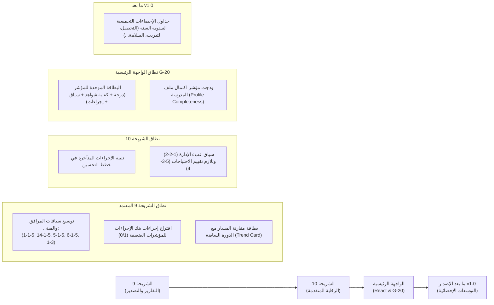

# خارطة طريق السياقات الاسترشادية والتسهيلات الإحصائية للمؤشرات (Indicator Context Roadmap)

> **المرجعية:** تدقيق الـ 109 مؤشرات وواصفات **معايير الاعتماد المدرسي**  
> **الحالة:** معتمدة كخارطة معمارية للشرائح 9 و 10 والواجهة الرئيسية وما بعد الإصدار 1.0  
> **القاعدة الحاكمة الصارمة:** تعتمد كافة السياقات على أرقام تجميعية فقط (`school_staff_metrics`, `school_enrollment_metrics`, `school_facilities`, `evaluations`, `evaluation_results`, `improvement_plans/actions`). **يُحظر قطعياً تتبع أو تسجيل أي بيانات شخصية أو فردية للمعلمين أو الطلاب.**

---

## 1. ملخص تصنيف الـ 109 مؤشرات

بناءً على الفحص الشامل لواصفات مستويات التقدير وشواهد كل مؤشر:

| التصنيف | عدد المؤشرات | النسبة المئوية | الطبيعة والتوصيف |
| :--- | :---: | :---: | :--- |
| **(أ) سياق حسابي تجميعي ممكن حالياً** | **14** | 12.8% | يعتمد على الجداول الإحصائية والمرافق الموجودة حالياً بدون أي تعديل بقاعدة البيانات. |
| **(ب) سياق حسابي مشروط ببيانات مستقبلية** | **26** | 23.9% | قابل للرقمنة التجميعية البحتة (نسب ورسوم) عبر استحداث جداول تجميعية سنوية ما بعد الإصدار 1.0. |
| **(ج) حكم نوعي / شواهد وثائقية بحتة** | **69** | 63.3% | يعتمد أصالةً على فحص الوثائق والملاحظة الصفية والمقابلات، ولا يصح اختزاله في معادلات رقمية. |
| **الإجمالي العام** | **109** | **100%** | جميع مؤشرات مجالات معايير الاعتماد المدرسي الـ 7. |

---

## 2. جدول السياقات الحسابية الممكنة من البيانات الحالية (14 مؤشراً)

جميع هذه السياقات تعتمد على جداول `schools`, `school_staff_metrics`, `school_enrollment_metrics`, `school_facilities`:

| رمز المؤشر | اسم المؤشر | المعادلة الرياضية | مصدر البيانات | عتبات المستويات الاسترشادية | حالة التنفيذ |
| :--- | :--- | :--- | :--- | :--- | :---: |
| **1-1-2** | توافر الكادر التعليمي الثابت والمؤهل | $\text{Ratio} = \frac{\text{qualified\_teachers}}{\text{total\_teachers}} \times 100$ | `school_staff_metrics` | < 55% (مستوى 1) / 56-78% (مستوى 2) / 79-100% (مستوى 3) | **منفذ** (شريحة 6) |
| **2-1-2** | تناسب مؤهلات المعلمين وتخصصاتهم مع المواد | $\text{Ratio} = \frac{\text{matched\_specialization}}{\text{total\_teachers}} \times 100$ | `school_staff_metrics` | < 55% (مستوى 1) / 56-78% (مستوى 2) / 79-100% (مستوى 3) | **منفذ** (شريحة 6) |
| **4-1-5** | تناسب الفصول مع أعداد المتعلمين (الكثافة الصفية) | $\text{Density} = \frac{\sum \text{total\_students}}{\text{classrooms\_count}}$ | `school_enrollment_metrics` + `school_facilities` | $\le 30$ (مستوى 3) / 31-40 (مستوى 2) / $> 40$ (مستوى 1) | **منفذ** (شريحة 6) |
| **13-1-5** | مرافق صحية كافية ونظيفة ومعقمة | $\text{Ratio} = \frac{\sum \text{total\_students}}{\text{restrooms\_count}}$ | `school_facilities` + `school_enrollment_metrics` | $\le 35$ (مستوى 3) / 36-55 (مستوى 2) / $> 55$ (مستوى 1) | **منفذ** (شريحة 6) |
| **7-1-5** | تناسب تجهيزات معامل الحاسوب | $\text{Ratio} = \frac{\text{avg\_class\_size}}{\text{working\_computers}}$ | `school_facilities.details` | $\le 1.2$ (مستوى 3) / 1.3-2.2 (مستوى 2) / $> 2.2$ (مستوى 1) | **منفذ** (شريحة 6) |
| **7-3** | رعاية ودعم الموهوبين والمبتكرين | $\sum \text{talented\_count}$ | `school_enrollment_metrics` | $0$ (مستوى 1) / $> 0$ (مستوى 2/3 استرشادي) | **منفذ** (شريحة 6) |
| **16-1-5** | تسهيلات ذوي الاحتياجات الخاصة (ممرات ومرافق) | $\sum \text{special\_needs\_count} + \text{ramps}$ | `school_enrollment_metrics` + `school_facilities` | فحص تلازمي: وجود الطلاب مع توفر المنحدرات والمرافق المهيأة | **منفذ** (شريحة 6) |
| **1-1-5** | مبنى معد ليكون مؤسسة تعليمية | فحص تصنيف `building_type` | `schools.building_type` | حكومي مخصص (مستوى 3) / تبرع ووقفي (مستوى 2) / مستأجر (مستوى 1) | **مجدول للشريحة 9** |
| **14-1-5** | المساحة الكافية للأنشطة الطلابية | $\text{AreaPerStudent} = \frac{\text{total\_area}}{\sum \text{total\_students}}$ | `schools.total_area` + `school_enrollment_metrics` | $\ge 5 \text{ m}^2$ (مستوى 3) / 3-4.9 $\text{m}^2$ (مستوى 2) / $< 3 \text{ m}^2$ (مستوى 1) | **مجدول للشريحة 9** |
| **5-1-5** | معامل علوم مهيأة ومفعلة بمستلزمات التجارب | فحص `science_lab` (`count` + `is_usable`) | `school_facilities` | متوفر وصالح (مستوى 2/3) / معطل أو غير متوفر (مستوى 1) | **مجدول للشريحة 9** |
| **6-1-5** | معمل حاسوب مجهز ومفعل بالأجهزة | فحص `computer_lab` (`count` + `is_usable`) | `school_facilities` | متوفر وصالح (مستوى 2/3) / معطل أو غير متوفر (مستوى 1) | **مجدول للشريحة 9** |
| **1-3** | توفير الخدمات الصحية الأولية وتفعيلها | فحص عيادة مجهزة أو حقيبة إسعافات | `school_facilities` (`clinic` / `first_aid_kit`) | عيادة مجهزة صالحة (مستوى 3) / حقيبة إسعافات (مستوى 2) / غياب (1) | **مجدول للشريحة 9** |
| **1-2-2** | توافر الكادر الإداري والخدمي المناسب | $\text{AdminRatio} = \frac{\sum \text{total\_students}}{\text{total\_admin\_staff}}$ | `school_staff_metrics` + `school_enrollment_metrics` | إداري لكل $\le 150$ طالب (مستوى 3) / 151-300 (مستوى 2) / $> 300$ (مستوى 1) | **مجدول للشريحة 10** |
| **5-3-4** | أدوات ملائمة لتقييم ذوي الاحتياجات الخاصة | فحص $\sum \text{special\_needs\_count}$ | `school_enrollment_metrics` | تنبيه تلازمي لاشتراط تكييف أدوات التقويم عند وجود طلاب مسجلين | **مجدول للشريحة 10** |

---

## 3. جدول السياقات المستقبلية المشروطة بجداول تجميعية جديدة (26 مؤشراً — ما بعد v1.0)

تعتمد هذه المؤشرات على بيانات تجميعية سنوية لا تمس الأفراد، وتُؤجل لما بعد الإصدار v1.0:

| الجدول التجميعي المقترح | الحقول التجميعية المقترحة | المؤشرات المغطاة | طبيعة السياق والاستفادة |
| :--- | :--- | :--- | :--- |
| `school_academic_metrics` | `pass_rate_pct`, `retention_rate_pct`, `gpa_average`, `ministerial_exam_avg` | **1-4-4, 4-4-4, 1-3-4, 5-2-4** | مقارنة نسب النجاح ونواتج التعلم بالاختبارات الوزارية وإعطاء مؤشر تحصيل عام للمدرسة. |
| `school_pd_metrics` | `total_training_hours`, `trained_teachers_count`, `trained_staff_count` | **3-1-2, 4-1-2, 8-1-2, 3-2-2, 4-2-2, 8-2-2** | حساب متوسط ساعات التدريب لكل معلم ومعدل تغطية برامج التنمية المهنية. |
| `school_attendance_behavior_metrics` | `absence_rate_pct`, `disciplinary_cases_count`, `guidance_sessions_count` | **3-3, 4-3, 5-3, 6-3** | استدلال تفعيل لائحة الضبط السلوكي وبرامج التوجيه والإرشاد ومعدلات الانضباط. |
| `school_activity_metrics` | `extracurricular_events_count`, `competitions_participated_count`, `honored_students_count` | **8-3, 9-3, 10-3, 11-3** | قياس كثافة وتنوع الأنشطة الطلابية والمسابقات المنهجية ورعاية المتميزين. |
| `school_survey_aggregates` | `student_satisfaction_pct`, `parent_satisfaction_pct`, `pta_meetings_count` | **2-3, 1-6, 2-6, 3-6, 4-6** | استخلاص رضا المستفيدين ومعدل مشاركة المجتمع المحلي ومجلس الآباء والأمهات. |
| `school_safety_metrics` | `evacuation_drills_count`, `extinguishers_valid_pct`, `safety_incidents_count` | **1-2-5, 2-2-5, 4-2-5, 12-3, 13-3** | قياس جاهزية خطط الطوارئ والإخلاء الدوري وصلاحية أدوات السلامة المدرسية. |

---

## 4. خارطة الأولويات والتنفيذ المرحلي المعتمدة

---

## 5. مصفوفة الصلاحيات والحوكمة للسياقات والتسهيلات

| الميزة / الـ Endpoint | المقيّم المدرسي | مدير المدرسة | المشرف التربوي | مسؤول النظام |
| :--- | :---: | :---: | :---: | :---: |
| استعراض السياق الإحصائي للمؤشر (`/context`) | قراءة | قراءة | قراءة | قراءة |
| طلب إجراءات موصى بها من البنك للمؤشر (`/action-recommendations`) | قراءة واستخدام | قراءة واستخدام | قراءة | قراءة |
| بطاقة مقارنة الدورة السابقة (`/trend`) | قراءة (لمدرسته) | قراءة (لمدرسته) | قراءة (لمدارسه) | قراءة (الكل) |
| تصدير بطاقة تقويم المدرسة الرسمية PDF | تصدير | تصدير | تصدير | تصدير |
| تصدير جداول البيانات Excel | تصدير (لمدرسته) | تصدير (لمدرسته) | تصدير (لمدارسه) | تصدير (الكل) |
