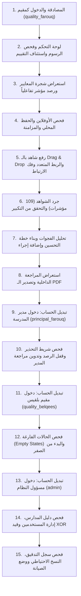

# دليل وخريطة الفحص اليدوي المسبق للشاشات (Pre-Review Checklist)
## منصة ارتقاء للتقييم الذاتي والتحسين المدرسي (`school-quality-system`)

> **تاريخ الإعداد والتدقيق:** 9 نوفمبر 2026م.  
> **الفرع البرمجي المعتمد:** `feature/school-evaluator-ui`.  
> **نطاق الفحص:** واجهات مقيم المدرسة (`school_evaluator`) وواجهات مسؤول النظام (`admin`)، مع وضع القراءة لمدير المدرسة (`school_principal`).  
> **تنبيه النطاق:** واجهات المشرف الوزاري ومسؤول المعايير غير مدرجة في هذا الدليل لأنها قيد التطوير لدى الزميل على فرعه ولم تُدمج بعد.  
> **الهدف:** توفير مرجع تشغيلي ودليل إرشادي خطوة بخطوة للفحص اليدوي الميداني الشامل، مع تحديد السلوك المتوقع ونقاط الضعف المحتملة وبيانات الاختبار الجاهزة.

---

## 1. خريطة الشاشات ونقاط الدخول (Screen Map)

### أ. واجهات مقيم المدرسة ومدير المدرسة (School Suite)

| # | اسم الشاشة | المسار التفاعلي / الداخلي | الدور المسموح | الحالة المتوقعة | نقاط الدخول (طريقة الفتح) |
|---|---|---|:---:|:---:|---|
| **1** | **تسجيل الدخول الموحد** (`LoginPage`) | `/` أو `/login` | الجميع (عام) | مكتملة وجاهزة | المسار الرئيسي للنظام عند عدم المصادقة. |
| **2** | **استعادة كلمة المرور** (`ResetPasswordPage`) | `/reset-password` | الجميع (عام) | مكتملة وجاهزة | رابط «نسيت كلمة المرور؟» من شاشة الدخول أو رابط بريد التفعيل. |
| **3** | **لوحة تحكم المقيم المركزية** (`EvaluatorDashboard`) | `/school` أو تبويب `dashboard` | `school_evaluator` `school_principal` (قراءة) | مكتملة بنسبة 100% | الشاشة الافتراضية بعد الدخول؛ القائمة الجانبية: «لوحة التقييم العام». |
| **4** | **شجرة المعايير الوطنية** (`StandardsTreePage`) | `/school/standards-tree` | `school_evaluator` `school_principal` (قراءة) | مكتملة بنسبة 100% | القائمة الجانبية: «شجرة المعايير والمؤشرات»؛ أو زر «استعراض المعايير» باللوحة. |
| **5** | **استمارة الرصد والتقييم الرباعي** (`RubricAssessmentPage`) | `/school/rubric` أو `rubric-assessment` | `school_evaluator` `school_principal` (مقفل) | مكتملة بنسبة 100% | بطاقة «استئناف التقييم» باللوحة؛ النقر على أي مؤشر في الشجرة أو جدول النواقص. |
| **6** | **خزانة مستندات المدرسة** (`EvidencesRepository`) | `/school/evidences` | `school_evaluator` `school_principal` (قراءة) | مكتملة بنسبة 100% | القائمة الجانبية: «مستودع وثائق المدرسة»؛ أو زر «إدارة الشواهد». |
| **7** | **شاشة جرد وحصر الشواهد** (`EvidenceInventoryPage`) | تبويب داخلي بصفحة الشواهد | `school_evaluator` `school_principal` (قراءة) | مكتملة بنسبة 100% | الزر التبويبي العلوي في صفحة المستودع: «📊 جرد وحصر الشواهد (109 مؤشرات)». |
| **8** | **تحليل الفجوات والمساعد الذكي** (`GapAnalysisPage`) | `/school/ai` أو `ai-assistant` | `school_evaluator` `school_principal` (قراءة) | مكتملة حوكمياً (الشريحة 10) | القائمة الجانبية: «المساعد الذكي وتحليل الفجوات»؛ بطاقة «تحليل الفجوات» باللوحة. |
| **9** | **خطة التحسين والتطوير** (`ImprovementPlanPage`) | `/school/plan` أو `improvement-plan` | `school_evaluator` `school_principal` (قراءة) | مكتملة بنسبة 100% | القائمة الجانبية: «خطة التحسين المدرسي»؛ بطاقة «خطة التحسين» باللوحة. |
| **10** | **المراجعة الداخلية والختم الرقمي** (`InternalReviewPage`) | `/school/review` أو `final-review` | `school_evaluator` `school_principal` (اعتماد) | مكتملة بنسبة 100% | القائمة الجانبية: «المراجعة الداخلية والاعتماد»؛ زر الختم النهائي باللوحة. |
| **11** | **معالجة طلب استكمال الوزارة** (`HandleCompletionPage`) | `/school/completion` | `school_evaluator` | مكتملة بنسبة 100% | شريط التنبيه العلوي (عند وجود طلب)؛ أو القائمة الجانبية عند ورود إشعار طلب استكمال. |
| **12** | **مركز الإشعارات والتعاميم** (`NotificationsCenter`) | `/school/notifications` | كافة مستخدمي المدرسة | مكتملة بنسبة 100% | أيقونة الجرس في الترويسة العلوية؛ القائمة الجانبية: «الإشعارات والتنبيهات». |
| **13** | **الملف الشخصي وإعدادات الحساب** (`ProfileModal`) | نافذة منبثقة | كافة المستخدمين | مكتملة بنسبة 100% | قائمة المستخدم المنسدلة في الشريط العلوي ← خيار «الملف الشخصي». |
| **14** | **تغيير كلمة المرور** (`ChangePasswordModal`) | نافذة منبثقة | كافة المستخدمين | مكتملة بنسبة 100% | قائمة المستخدم المنسدلة في الشريط العلوي ← خيار «تغيير كلمة المرور». |

---

### ب. واجهات مسؤول النظام المركزي (Admin Suite)

| # | اسم الشاشة | المسار التفاعلي / الداخلي | الدور المسموح | الحالة المتوقعة | نقاط الدخول (طريقة الفتح) |
|---|---|---|:---:|:---:|---|
| **15** | **لوحة التحكم المركزية للإدارة** (`AdminDashboard`) | `/admin` أو تبويب `dashboard` | `admin` حصراً | مكتملة بنسبة 100% | الشاشة الافتراضية فور تسجيل دخول المستخدم `admin`. |
| **16** | **إدارة ودليل المدارس** (`SchoolsDirectory`) | `/admin/schools` أو تبويب `schools` | `admin` حصراً | مكتملة بنسبة 100% | القائمة الجانبية للإدارة: «دليل المدارس»؛ بطاقات الإحصاء في اللوحة. |
| **17** | **إدارة المستخدمين والصلاحيات** (`UsersManagement`) | `/admin/users` أو تبويب `users` | `admin` حصراً | مكتملة بنسبة 100% | القائمة الجانبية للإدارة: «إدارة المستخدمين»؛ بطاقات إحصاء الحسابات. |
| **18** | **سجل التدقيق والرقابة الأمنية** (`SecurityAudit`) | `/admin/audit` أو تبويب `audit` | `admin` حصراً | مكتملة بنسبة 100% | القائمة الجانبية للإدارة: «الأمان والتدقيق»؛ بطاقة العمليات الأخيرة. |
| **19** | **النسخ الاحتياطي وإعدادات النظام** (`BackupAndSettings`) | `/admin/backup` أو تبويب `backup` | `admin` حصراً | مكتملة بنسبة 100% | القائمة الجانبية للإدارة: «النسخ الاحتياطي والإعدادات». |
| **20** | **شاشة وضع الصيانة العامة** (`MaintenancePage`) | واجهة حجب شاملة عند التفعيل | كافة المستخدمين (عدا الأدمن) | مكتملة بنسبة 100% | تظهر تلقائياً لأي مستخدم عادي عند تفعيل وضع الصيانة من قبل الأدمن برمز 503. |

---

## 2. بيانات وبيئات الاختبار الجاهزة في قاعدة البيانات

| الحساب | اسم المستخدم (`username`) | كلمة المرور | الدور الفعلي | المدرسة المرتبطة | طبيعة البيانات في هذا الحساب |
|---|:---:|:---:|:---:|---|---|
| **مقيم مدرسة الفاروق** | `quality_farouq` | `DevTestPassword2026!` | `school_evaluator` | مدرسة الفاروق الأساسية للبنين (تعز) | **مكتملة جزئياً ومتقدمة:** 42 مؤشراً مرصوداً، 8 وثائق، 18 رابط شاهد، خطة تحسين بـ 4 مجالات و 5 إجراءات، وإشعارات. مثالي لاختبار الرسوم البيانية، التعديل، والرفع النهائي. |
| **مدير مدرسة الفاروق** | `principal_farouq` | `DevTestPassword2026!` | `school_principal` | مدرسة الفاروق الأساسية للبنين (تعز) | **وضع القراءة الصارم:** استعراض كافة بيانات مدرسة الفاروق مع قفل أزرار الرصد والرفع والختم، وإتاحة حقل المراجعة الداخلية. |
| **مقيم مدرسة بلقيس** | `quality_belqees` | `DevTestPassword2026!` | `school_evaluator` | مدرسة بلقيس الثانوية للبنات (صنعاء) | **حالة فارغة نظيفة (Clean State):** 0 مؤشرات مرصودة، 0 وثائق، 0 خطط. مثالي لاختبار حالات الشاشات الفارغة (Empty States) والبدء من الصفر. |
| **مدير مدرسة بلقيس** | `principal_belqees` | `DevTestPassword2026!` | `school_principal` | مدرسة بلقيس الثانوية للبنات (صنعاء) | **وضع القراءة الفارغ:** مدرسة خالية تماماً لاختبار مظهر القراءة على حالة فارغة. |
| **مسؤول النظام المركزي** | `admin` | `DevTestPassword2026!` | `admin` | بدون (مستخدم نظام عام) | **صلاحيات إدارية كاملة:** كافة المدارس، المستخدمين، السجلات الأمنية، وأرشيف النسخ الاحتياطي. |

---

## 3. سيناريوهات الفحص اليدوي التفصيلية (Step-by-Step Scenarios)

### القسم الأول: سيناريوهات مقيم المدرسة (`school_evaluator`)

#### سيناريو E-01: تسجيل الدخول وبدء الجلسة
* **المسار:** `/login`
* **بيانات الاختبار:** `quality_farouq` / `DevTestPassword2026!`
* **خطوات الفحص:**
  1. إدخال اسم المستخدم وكلمة المرور والنقر على «تسجيل الدخول».
  2. تجربة كلمة مرور خاطئة عمداً للتأكد من رسالة الخطأ العربية.
* **السلوك المتوقع:**
  - عند النجاح: التحويل الفوري إلى `/school` (لوحة تحكم المقيم)، تخزين التوكن في `localStorage` أو `sessionStorage`.
  - ظهور اسم المستخدم «عمار عمر عبدالله» والمدرسة «مدرسة الفاروق الأساسية للبنين» في الشريط العلوي.
  - عند الخطأ: رسالة واضحة دون كشف تفاصيل أمنية حساسة (مثل «بيانات الاعتماد المدخلة غير صحيحة»).
* **ما يجب ألا يحدث:** لا تظهر أي أخطاء `Console` بيضاء أو إعادة توجيه غير منتهية (Redirect Loop).

---

#### سيناريو E-02: لوحة التحكم المركزية واستئناف التقييم الذاتي
* **المسار:** `/school`
* **خطوات الفحص:**
  1. التحقق من بطاقات الـ KPIs الأربع (نسبة الإنجاز 38.5%، المؤشرات المرصودة 42/109، الشواهد 18، إجراءات التحسين 5).
  2. فحص الرسم الدائري (`InteractiveDonutChart`): التحقق من مطابقة الأرقام (20 متقدم، 14 كافٍ، 5 جزئي، 3 غير مستوفٍ، 67 غير مقيم).
  3. النقر على بطاقة الإجراء السريع الأولى: «استئناف التقييم الذاتي».
* **السلوك المتوقع:**
  - الانتقال التلقائي المباشر إلى صفحة التقييم الروبيكي (`RubricAssessmentPage`) محملة بأول مؤشر غير مقيم (المؤشر رقم 43).
  - تمرير الماوس فوق قطاعات الرسم الدائري يُظهر التلميحات بدقة وألوان مستويات الأداء الأربعة (أخضر، أزرق، برتقالي، أحمر).
* **نقاط الضعف المحتملة:** التحقق من عدم وجود NaN% في الرسوم عند تكبير الصفحة لـ 150%.

---

#### سيناريو E-03: استعراض شجرة المعايير والتنقل الهرمي
* **المسار:** `/school/standards-tree`
* **خطوات الفحص:**
  1. استعراض المجالات الرئيسية السبعة للمعيار الوطني اليمني.
  2. النقر على سهم توسيع أحد المجالات لرؤية المعايير الفرعية.
  3. النقر على مؤشر فرعي لرؤية تفاصيله، ثم النقر على زر «تقييم المؤشر».
* **السلوك المتوقع:**
  - فتح وقفل سلس للأكورديون (Accordion) مع مؤشرات ألوان واضحة لحالة كل مؤشر (أخضر = مرصود، رمادي/أصفر = معلق).
  - النقر ينقل فورياً إلى استمارة التقييم الخاصة بذلك المؤشر بالتحديد.
* **نقاط الضعف المحتملة:** تأكد من عدم انكسار الترويسات الطويلة عند الشاشات المتوسطة أو طي القائمة الجانبية.

---

#### سيناريو E-04: رصد المؤشر واستمارة التقييم الرباعية (Rubric Assessment)
* **المسار:** `/school/rubric`
* **خطوات الفحص:**
  1. اختيار أحد المستويات الأربعة (0: غير مفعل، 1: جزئي، 2: كافٍ، 3: متقدم).
  2. كتابة مبررات الرصد وشواهد التحقق في حقل النص التوضيحي.
  3. اختيار أساليب التحقق (فحص وثائق، مقابلة، ملاحظة صفية...).
  4. مراقبة شارة حالة الحفظ في أعلى البطاقة.
  5. استخدام أزرار التنقل «المؤشر السابق» و «المؤشر التالي».
* **السلوك المتوقع:**
  - ظهور مستويات التقدير مع أوصافها الوزارية المعتمدة بوضوح تام.
  - ظهور مؤشر الحفظ الحي: يتحول إلى «قيد الحفظ...» (أزرق دوار) ثم «محفوظ على الخادم» (أخضر مع علامة صح) خلال 500-1000ms.
  - التنقل للأمام والخلف يحفظ البيانات دون فقدان أي حرف تمت كتابته.
* **نقاط الضعف المحتملة:** التحقق من تفريغ الحقول بشكل صحيح عند الانتقال لمؤشر فارغ دون بقاء نصوص المؤشر السابق.

---

#### سيناريو E-05: فحص وضع عدم الاتصال بالإنترنت (Offline Mode & Sync)
* **المسار:** `/school/rubric`
* **خطوات الفحص:**
  1. فتح أدوات المطور (F12) في المتصفح ← تبويب Network ← تفعيل `Offline`.
  2. تغيير تقييم المؤشر وكتابة ملاحظة جديدة.
  3. مراقبة شارة الحفظ وشريط التنبيه العلوي.
  4. إلغاء وضع الـ Offline وإعادة الاتصال بالإنترنت (`No throttling`).
  5. النقر على زر «مزامنة الآن» أو الانتظار للمزامنة التلقائية.
* **السلوك المتوقع:**
  - فور انقطاع الشبكة: تظهر شارة برتقالية «محفوظ محلياً (أوفلاين)» وشريط تحذير أعلى الصفحة يوضح عدد التقييمات المعلقة.
  - تخزين المسودة في مفتاح التخزين المعزول: `school_eval_drafts_u{id}_s{id}_v1`.
  - فور عودة الاتصال: تنفيذ المزامنة واختفاء الشريط البرتقالي وتحول الشارة إلى «محفوظ على الخادم».
* **نقاط الضعف المحتملة:** في حال وجود تعارض، يجب أن تظهر نافذة خيار «اعتماد نسختي المحلية (آخر تعديل يفوز)» أو «إلغاء».

---

#### سيناريو E-06: رفع الشواهد الرقمية (Drag & Drop + فحص الحجم والامتداد)
* **المسار:** `/school/evidences` أو نافذة الرفع من المؤشر
* **خطوات الفحص:**
  1. النقر على «رفع شاهد جديد».
  2. سحب وإفلات ملف PDF أو صورة داخل الصندوق المخصص.
  3. اختبار ملف صورة (PNG/JPG): التحقق من ظهور المعاينة المصغرة الفورية (Thumbnail Preview).
  4. اختبار سلبي: محاولة سحب ملف يزيد حجمه عن 20 ميجابايت (أو ملف تنفيذي `.exe`).
  5. استكمال رفع ملف نظامي صالح ومراقبة شريط التقدم الفعلي.
* **السلوك المتوقع:**
  - عند تجاوز 20MB أو صيغة غير مدعومة: رفض فوري للملف مع رسالة تنبيه حمراء واضحة دون إرسال أي طلب للباك إند.
  - عند اختيار صورة: ظهور معاينة مصغرة أنيقة تتيح للمستخدم التأكد من الوثيقة قبل الرفع.
  - شريط التقدم يعرض نسبة مئوية حقيقية (0% → 100%) تتبع رفع البايتات الفعلي في المتصفح.
  - إضافة الشاهد تلقائياً لجدول المستودع وتحديث المساحة المستخدمة.

---

#### سيناريو E-07: الربط المتعدد للشاهد (Multi-Link) وفك الارتباط الصريح
* **المسار:** `/school/evidences`
* **خطوات الفحص:**
  1. النقر على زر «إدارة الشواهد» أمام أي مستند في المستودع.
  2. في نافذة `LinkEvidenceModal`: تجربة خيار «ربط بمؤشرات إضافية (Multi-link)» واختيار مؤشرين إضافيين من القائمة المنسدلة.
  3. تجربة خيار «فك الارتباط»: اختيار نمط فك الارتباط وقراءة نص التنبيه.
* **السلوك المتوقع:**
  - في نمط فك الارتباط: ظهور تنبيه بلون كهرماني نصه صريح لا لبس فيه:  
    *«فك الارتباط يزيل ربط الشاهد بهذا المؤشر فقط ويبقى المستند محفوظاً بمستودع وثائق المدرسة دون حذفه نهائياً».*
  - بعد فك الارتباط: يختفي الرابط من المؤشر، ويبقى المستند موجوداً في جدول المستودع بكامل بياناته.
* **ما يجب ألا يحدث:** لا يجوز حذف ملف المستند الفعلي من قاعدة البيانات أو القرص عند فك الارتباط.

---

#### سيناريو E-08: جرد وحصر الشواهد لـ 109 مؤشرات (Evidence Inventory)
* **المسار:** `/school/evidences` ← التبويب العلوي: «📊 جرد وحصر الشواهد (109 مؤشرات)»
* **خطوات الفحص:**
  1. التبديل لتبويب الجرد.
  2. فحص تصفية المؤشرات عبر الأزرار الثلاثة: (الكل / نواقص بحاجة لشواهد / مؤشرات مستوفاة).
  3. استخدام شريط البحث بالرمز (مثلاً: `IND-01` أو باسم المعيار).
  4. توسيع معيار وطني وتجربة زر «ربط شاهد» السريع من سطر المؤشر مباشرة.
  5. اختبار التكبير في المتصفح إلى 125% و 150%.
* **السلوك المتوقع:**
  - عرض كافة المؤشرات مرتبة حسب مجالاتها السبعة ونسب إنجاز كل معيار.
  - شارة خضراء للمؤشرات المستوفية وشارة حمراء للنواقص مع بيان عدد الشواهد المودعة مقابل الحد الإلزامي.
  - ظهور شريط التمرير الأفقي السلس عند التكبير دون اقتطاع أزرار الإجراء أو رموز المؤشرات.

---

#### سيناريو E-09: تحليل الفجوات الرياضية والمساعد الذكي (Gap Analysis)
* **المسار:** `/school/ai`
* **خطوات الفحص:**
  1. فحص تصنيف الفجوات المستخرجة آلياً (نقاط القوة للمستويات 3 و 2، ونقاط الضعف والفجوات للمستويات 1 و 0).
  2. مراجعة التوصيات المقترحة ومستوى الأولوية لكل فجوة (حرجة، عالية، متوسطة).
  3. النقر على زر «تحويل إلى إجراء تحسين» أمام إحدى الفجوات المقترحة.
* **السلوك المتوقع:**
  - ظهور تحليل كمي منظم وشفاف يفسر سبب اعتبار العنصر فجوة أو نقطة قوة.
  - عند التحويل لإجراء تحسين: الانتقال السلس أو فتح نموذج إضافة إجراء مع تعبئة اسم الفجوة والأولوية المقترحة تلقائياً.
* **الحوكمة الملزمة:** لا يتم تطبيق أي تعديل على درجات التقييم إلا بموافقة وتدخل يدوي من المقيم.

---

#### سيناريو E-10: بناء خطة التحسين وإدارة الإجراءات التنفيذية
* **المسار:** `/school/plan`
* **خطوات الفحص:**
  1. استعراض خطة التحسين لمدرسة الفاروق (العنوان، المدة الزمنية، نسبة الإنجاز العامة).
  2. فحص مجالات التحسين الأربعة والإجراءات الخمسة المرتبطة بها.
  3. النقر على «إضافة إجراء تنفيذي جديد» وتعبئة البيانات (العنوان، المسؤول، تاريخ البداية والنهاية، نسبة الإنجاز).
  4. تعديل إجراء قائم وتغيير نسبة إنجازه من 40% إلى 70%.
  5. ربط شاهد إثبات إنجاز بأحد الإجراءات.
* **السلوك المتوقع:**
  - إضافة الإجراء وتحديث نسبة إنجاز المجال الإجمالي تلقائياً.
  - حفظ التعديلات في الباك إند وظهور إشعار توست أخضر بالنجاح.
  - عرض الشواهد المرتبطة بالإجراء مع إمكانية استعراضها.

---

#### سيناريو E-11: المراجعة الداخلية والختم الرقمي والتصدير (Internal Review & Submit)
* **المسار:** `/school/review`
* **خطوات الفحص:**
  1. فحص قائمة الفحص المسبق الآلية (Preflight Check): التأكد من نسبة المؤشرات المقيمة، الشواهد الإلزامية، وخطة التحسين.
  2. تجربة زر «تصدير تقرير التقييم الذاتي (PDF)»: التحقق من تنزيل ملف PDF حقيقي منسق عبر mPDF.
  3. كمقيم: ملاحظة أن حقل «ملاحظات المراجعة الداخلية لمدير المدرسة» للقراءة فقط ويظهر تنبيه بأنه مخصص للمدير.
  4. فحص زر «الختم الرقمي والإرسال النهائي للمشرف الوزاري».
* **السلوك المتوقع:**
  - تنزيل ملف PDF حقيقي يحتوي الشعار الرسمي، بيانات مدرسة الفاروق، جدول المؤشرات، وأسماء فريق التقييم.
  - إذا كانت متطلبات الرفع غير مكتملة (كما في مدرسة بلقيس): يظهر تنبيه مانع يوضح النواقص ويكون زر الختم معطلاً أو مشروطاً.
  - عند اكتمال المتطلبات والختم: تظهر نافذة تأكيد الإقرار والمسؤولية القانونية.

---

#### سيناريو E-12: فحص وضع القراءة لمدير المدرسة (School Principal Mode)
* **المسار:** تسجيل الخروج والدخول بحساب `principal_farouq` / `DevTestPassword2026!`
* **خطوات الفحص:**
  1. التحقق من ظهور شريط التنبيه الكهرماني البارز أعلى الصفحة:  
     *«أنت في وضع استعراض التقييم والمراجعة الداخلية — صلاحيات الرصد محصورة بمقيم المدرسة».*
  2. محاولة الانتقال لاستمارة الرصد (`/school/rubric`): التحقق من قفل أزرار اختيار المستويات وتعطيل حقول النصوص.
  3. محاولة الانتقال لمستودع الشواهد (`/school/evidences`): التحقق من اختفاء أو تعطيل أزرار الرفع والاستبدال وإدارة الروابط.
  4. الانتقال لشاشة المراجعة الداخلية (`/school/review`): التحقق من أن حقل «ملاحظات المراجعة الداخلية لمدير المدرسة» مفعل ومتاح للكتابة والحفظ للمدير حصراً.
* **السلوك المتوقع:**
  - القفل الصارم والشامل لكافة أزرار التعديل والحذف والرفع للمدير مع الحفاظ على تجربة استعراض مريحة وشفافة.
  - إمكانية اعتماد المراجعة الداخلية وتدوين التوجيهات الرسمية للمقيم.

---

#### سيناريو E-13: معالجة طلب استكمال وارد من الوزارة (Handle Completion Request)
* **المسار:** `/school/completion`
* **خطوات الفحص:**
  1. فتح شاشة طلب الاستكمال.
  2. استعراض ملاحظات المشرف الوزاري على المؤشرات المعادة للتعديل.
  3. كتابة رد توضيحي وإرفاق شاهد إضافي للمؤشر المطلوب.
  4. كتابة الملاحظات العامة للمدرسة والنقر على «إعادة الإرسال للمشرف الوزاري».
* **السلوك المتوقع:**
  - في حال عدم وجود طلبات استكمال معلقة (الوضع الطبيعي): ظهور Empty State أنيق يحمل علامة صح خضراء ورسالة «لا توجد طلبات استكمال معلقة حالياً».
  - عند وجود طلب: تفعيل استمارة الردود ورفع الوثائق البديلة، مع فحص الحجم والامتداد، وإظهار تأكيد إعادة الإرسال.

---

#### سيناريو E-14: الملف الشخصي وتغيير المظهر وكلمة المرور (Profile & Theme)
* **المسار:** النقر على صورة/اسم المستخدم أعلى اليسار ← «الملف الشخصي» أو «تغيير كلمة المرور»
* **خطوات الفحص:**
  1. في نافذة الملف الشخصي (`ProfileModal`):
     - تبويب «المعلومات الأساسية»: تجربة تعديل الاسم والبريد ورقم الهاتف (مع التأكد من قفل اسم المستخدم `username`).
     - تبويب «الأمان»: تغيير كلمة المرور بالتحقق من الحالية ومطابقة الجديدة مع متطلبات التعقيد.
     - تبويب «المظهر والتفضيلات»: اختيار السمة (فاتح / داكن / تلقائي) وتفضيل كثافة العرض وحجم الخط.
  2. النقر على «حفظ التعديلات» ومراقبة استجابة النظام.
* **السلوك المتوقع:**
  - تحديث بيانات الاسم فورياً في الشريط العلوي وظهور إشعار توست أخضر بالنجاح.
  - قفل حقل اسم المستخدم لمنع تعديل معرف الحساب المؤسسي.
  - رفض كلمات المرور الضعيفة وتأكيد التطابق قبل الإرسال.

---

#### سيناريو E-15: فحص الحالة الفارغة التامة (Clean State on Belqees School)
* **المسار:** تسجيل الخروج والدخول بحساب `quality_belqees` / `DevTestPassword2026!`
* **خطوات الفحص:**
  1. لوحة التحكم: التحقق من بطاقات الـ KPIs (الإنجاز 0%، المؤشرات 0/109، الشواهد 0، إجراءات التحسين 0).
  2. مستودع الشواهد: التحقق من ظهور شاشة المستودع الفارغ ورسالة «لا توجد وثائق مودعة حالياً».
  3. خطة التحسين: ظهور شاشة الخطة الفارغة ورسالة «لم يتم إنشاء خطة تحسين بعد».
  4. جدول النواقص في اللوحة: ظهور المؤشرات الـ 109 كاملة كعناصر بحاجة لاستكمال التوثيق.
* **السلوك المتوقع:**
  - تجربة مستخدم خالية تماماً من الأخطاء البرمجية أو انهيار المكونات (`No Undefined Crashes`).
  - ظهور أزرار دعوة واضحة للبدء (Call to Action) مثل «ابدأ رصد أول مؤشر» أو «إيداع أول شاهد».

---

### القسم الثاني: سيناريوهات مسؤول النظام المركزي (`admin`)

#### سيناريو A-01: تسجيل دخول الإدارة ولوحة التحكم المركزية
* **المسار:** تسجيل الخروج والدخول بحساب `admin` / `DevTestPassword2026!`
* **خطوات الفحص:**
  1. التحقق من التوجيه المباشر إلى بوابة مسؤول النظام المركزية (`AdminLayout`).
  2. فحص بطاقات الإحصاءات العامة: (إجمالي المدارس، المستخدمين النشطين، دورات التقييم، سجلات التدقيق).
  3. التحقق من جدول العمليات والأنشطة الأخيرة ومخطط توزيع المدارس حسب المحافظات.
* **السلوك المتوقع:**
  - ترويسة وقائمة جانبية متوافقة مع معايير منصة ارتقاء (`UI_STANDARDS.md`).
  - أزرار التنقل السريع من بطاقات اللوحة تنقل مباشرة إلى شاشات الإدارة التخصصية.

---

#### سيناريو A-02: إدارة ودليل المدارس (Schools Directory)
* **المسار:** القائمة الجانبية ← «دليل المدارس»
* **خطوات الفحص:**
  1. استعراض جدول المدارس والتحقق من ظهور مدرسة الفاروق ومدرسة بلقيس والمدارس التجريبية الأخرى.
  2. تصفية المدارس بحسب المحافظة (أمانة العاصمة، تعز،...) والنوع (حكومي / أهلي) والمرحلة والحالة.
  3. البحث باسم المدرسة أو رمزها التعريفي (`SCH-TAIZ-2026-001`).
  4. النقر على «إضافة مدرسة جديدة»: إدخال بيانات مدرسة كاملة وتأكيد الإضافة.
  5. تعديل بيانات مدرسة قائمة (مثل رقم الهاتف أو السعة الاستيعابية).
  6. تجربة زر «تعطيل / تفعيل مدرسة»: مراقبة تحول الشارة والتأكيد.
  7. تجربة زر «تصدير إلى Excel»: تنزيل ملف جدول إلكتروني حقيقي.
* **السلوك المتوقع:**
  - تطبيق قاعدة «التعطيل لا الحذف»؛ لا يتوفر أي زر لحذف المدرسة نهائياً لحماية التكامل المرجعي للتقييمات السابقة.
  - تصدير ملف Excel منسق باللغة العربية عبر مكتبة `xlsx`.
  - التحقق الصارم من تفرد الرمز التعريفي للمدرسة (`identification_data`).

---

#### سيناريو A-03: إدارة المستخدمين وتطبيق قيد التكامل المرجعي الصارم (XOR Rule)
* **المسار:** القائمة الجانبية ← «إدارة المستخدمين»
* **خطوات الفحص:**
  1. استعراض جدول المستخدمين والأدوار والمدارس المرتبطة وحالة كل حساب.
  2. تصفية الحسابات حسب الدور (مدير، مقيم، مشرف، أدمن) أو الحالة (نشط / معطل).
  3. النقر على «إضافة مستخدم جديد»:
     - **اختبار قيد XOR الإلزامي:**
       * عند اختيار نوع المستخدم `school`: يجب إظهار حقل اختيار «المدرسة» وإخفاء حقل «الوزارة».
       * عند اختيار نوع المستخدم `ministry`: يجب إظهار حقل «الوزارة» وإخفاء حقل «المدرسة».
       * عند اختيار نوع المستخدم `system`: يجب إخفاء كلا الحقلين (`school_id = null`, `ministry_id = null`).
  4. تجربة تعطيل مستخدم وتنشيطه.
  5. تجربة زر «إعادة تعيين كلمة المرور» لحساب مستخدم.
* **السلوك المتوقع:**
  - منع تسجيل أي مستخدم بمدرسة ووزارة معاً (رفض برمجي صريح في الفرونت إند والباك إند `422`).
  - عند إعادة تعيين كلمة المرور: توليد كلمة مرور مؤقتة آمنة مع تنبيه الأدمن بنسخها أو إرسالها.
  - تطبيق قاعدة «التعطيل لا الحذف الفيزيائي» لحماية سجلات التدقيق والمؤشرات المرصودة.

---

#### سيناريو A-04: سجل التدقيق والأمان وحوكمة الأحداث (Security Audit Trail)
* **المسار:** القائمة الجانبية ← «الأمان والتدقيق»
* **خطوات الفحص:**
  1. استعراض جدول سجل التدقيق (`audit_logs`) والتحقق من تسجيل العمليات السابقة (تسجيل الدخول، تعديل التقييمات، تغيير كلمات المرور).
  2. فحص بيانات كل عملية: (المستخدم، اسم الإجراء، عنوان الـ IP، التاريخ والوقت، ونوع الكيان المتأثر).
  3. تصفية السجل حسب نوع العملية (دخول/خروج، تعديل تقييم، رفع وثيقة) أو مجال التاريخ.
  4. النقر على زر «تفاصيل التغيير» لاستعراض الفروقات (البيانات القديمة مقابل البيانات الجديدة).
  5. تجربة زر «تصدير سجل التدقيق إلى Excel».
* **السلوك المتوقع:**
  - الجدول للعرض فقط (`Append-Only`)؛ لا توجد أي أزرار أو مسارات برمجية تسمح للأدمن بحذف أو تعديل أي سجل تدقيق.
  - استعراض الفروقات بتنسيق JSON نظيف ومنسق باللغة العربية.

---

#### سيناريو A-05: النسخ الاحتياطي وتأمين storage والتحقق من البصمة (SHA-256)
* **المسار:** القائمة الجانبية ← «النسخ الاحتياطي والإعدادات»
* **خطوات الفحص:**
  1. استعراض أرشيف النسخ الاحتياطية المتوفرة في `storage/app/backups/`.
  2. النقر على زر «إنشاء نسخة احتياطية جديدة الآن».
  3. مراقبة شريط التحميل وظهور النسخة الجديدة في الجدول فور اكتمالها.
  4. فحص بيانات النسخة: (اسم الملف، الحجم، تاريخ الإنشاء، وبصمة الهاش الرقمية SHA-256).
  5. النقر على «تحميل النسخة» والتأكد من تنزيل الملف المشفر.
  6. النقر على زر «فحص النزاهة (Verify Integrity)»: التحقق من مطابقة البصمة الرقمية للنسخة مع المخزن بالقاعدة.
* **السلوك المتوقع:**
  - تخزين النسخة خارج مسار الويب العام `public/` في المجلد الآمن `storage/app/backups/`.
  - ظهور علامة خضراء تؤكد «النسخة سليمة ومطابقة تماماً للبصمة الرقمية SHA-256».
* **ملاحظة فنية معتمدة:** النسخة المنشأة حالياً هي ملف وصفي أمني مشفر (تمهيداً للـ DB Dump في مرحلة النشر عبر `BE-GAP-06`).

---

#### سيناريو A-06: وضع الصيانة المجدولة وحظر العناوين المشبوهة
* **المسار:** القائمة الجانبية ← «النسخ الاحتياطي والإعدادات» أو زر التبديل في الترويسة
* **خطوات الفحص:**
  1. فحص زر تبديل «وضع الصيانة المجدولة (Maintenance Mode)».
  2. تفعيل وضع الصيانة: التأكد من ظهور إشعار توست تحذيري كهرماني.
  3. فتح نافذة متصفح خفي (Incognito) ومحاولة تسجيل الدخول كمقيم أو مدير (`quality_farouq`).
  4. التحقق من ظهور صفحة الصيانة الرسمية (`MaintenancePage`) وحجب الوصول للمستخدمين العاديين.
  5. العودة لنافذة الأدمن وإلغاء تفعيل وضع الصيانة.
  6. النقر على زر «إعادة المحاولة» في نافذة المقيم والتأكد من عودة النظام للعمل الطبيعي.
* **السلوك المتوقع:**
  - استثناء الأدمن دائماً من الحجب لتمكينه من إدارة النظام أثناء الصيانة.
  - حظر المستخدمين العاديين فورياً برمز استجابة 503 مع إظهار رسالة الصيانة والاسم الرسمي المعتمد.

---

## 4. جدول نقاط الضعف والمخاطر المحتملة أثناء الفحص (Potential Pitfalls)

| الشاشة / الوظيفة | نقطة الضعف المحتملة (ما قد يفشل) | رمز الخطأ المتوقع عند الفشل | كيفية التحقق أثناء الفحص اليدوي |
|---|---|:---:|---|
| **رصد التقييم الرباعي** | فقدان الملاحظات المكتوبة عند انقطاع مفاجئ بالشبكة أو إغلاق التبويب | LocalStorage Loss | كتابة نص طويل وقطع الإنترنت ثم تحديث الصفحة والتأكد من بقاء النص. |
| **رفع الشواهد** | محاولة رفع ملف بحجم أكبر من 20MB أو بصيغة غير مدعومة | 422 أو 413 | تجربة ملف كبير الحجم وتأكيد ظهور رسالة الخطأ العربية في الواجهة قبل الإرسال. |
| **المراجعة الداخلية** | محاولة مدير المدرسة تعديل درجات التقييم بدلاً من الاكتفاء بالمراجعة | 403 Forbidden | فحص قفل حقول الرصد في الواجهة، وفحص رد الباك إند برمز 403 الصريح. |
| **تصدير تقرير PDF** | توقف محرك التصدير أو تنزيل ملف فارغ أو تداخل النصوص العربية | 500 أو Layout Break | تنزيل ملف التقرير وفتحه في قارئ PDF للتأكد من تنسيق الجداول وظهور الخط العربي. |
| **جرد الشواهد (109)** | بطء التمرير أو تقطيع الصفحة بسبب كثرة العناصر (109 مؤشرات) | Memory Leak / Lag | التمرير السريع وتوسيع كافة المعايير في وقت واحد ومراقبة سلاسة المتصفح. |
| **قيد مستخدمي الإدارة** | اختيار مدرسة ووزارة لمستخدم واحد بالخطأ وتجاوز قيد XOR | 422 Unprocessable | محاولة اختيار الاثنين معاً والتأكد من إخفاء أحدهما فور اختيار الآخر. |
| **أوفلاين المسودات** | تداخل مسودات مستخدمين مختلفين على نفس جهاز المتصفح المشترك | Cache Collision | تسجيل الخروج والدخول بحساب آخر والتأكد من عدم ظهور مسودة المستخدم السابق. |
| **الرسم البياني الدائري** | انكسار الأبعاد أو تشوه النصوص عند درجات تكبير الشاشة (125% و 150%) | SVG Clipping | ضبط تكبير المتصفح على 125% و 150% والتأكد من وضوح الأرقام والتسميات. |
| **النسخ الاحتياطي** | تعذر تنزيل النسخة بسبب صلاحيات مجلد التخزين `storage` | 404 أو 500 | النقر على تحميل النسخة والتأكد من بدء التنزيل الفعلي وحجم الملف. |

---

## 5. الترتيب والمسار المنطقي المقترح للفحص الميداني

لضمان فحص متسلسل يحاكي دورة حياة التقييم الحقيقية دون هدر الوقت في التبديل العشوائي، يُوصى باتباع هذا التسلسل:

---

## 6. قائمة التحقق السريعة للفحص الميداني (Quick Checkbox List)

يمكنك طباعة هذا القسم أو نسخه واستخدامه كنشرة فحص تفاعلية أثناء اختبار الشاشات:

### أولاً: بيئة مقيم المدرسة (`quality_farouq` - مدرسة الفاروق)
- [ ] **[E-01]** تسجيل الدخول سليم وظهور اسم المستخدم والمدرسة في الترويسة.
- [ ] **[E-02]** شاشة الدخول ترفض كلمات المرور الخاطئة وتمنع كشف الثغرات.
- [ ] **[E-03]** مؤشرات لوحة التحكم الأربعة تطابق البيانات الفعلية (42 مؤشر، 18 شاهد، 5 إجراءات).
- [ ] **[E-04]** الرسم الدائري للمستويات يعرض الأعداد الفعلية بدقة (20 متقدم، 14 كافٍ، 5 جزئي، 3 غير مستوفٍ).
- [ ] **[E-05]** بطاقة «استئناف التقييم» تنقل مباشرة للمؤشر رقم 43 (أول مؤشر معلق).
- [ ] **[E-06]** شجرة المعايير تتوسع وتطوى بسلاسة مع ألوان الحالة المعتمدة.
- [ ] **[E-07]** استمارة الرصد الرباعية تعرض أوصاف المستويات الوزارية المعتمدة.
- [ ] **[E-08]** شارة حالة الحفظ الحية تتبدل بسلاسة من «قيد الحفظ...» إلى «محفوظ على الخادم».
- [ ] **[E-09]** وضع الـ Offline يحفظ المسودة محلياً مع شريط التنبيه البرتقالي.
- [ ] **[E-10]** عودة الاتصال تؤدي لمزامنة المسودات بنجاح دون فقدان البيانات.
- [ ] **[E-11]** منطقة السحب والإفلات (Drag & Drop) ترفض الملفات غير المسموحة وأكبر من 20MB.
- [ ] **[E-12]** معاينة الصور المرفوعة (PNG/JPG) تظهر فورياً قبل الضغط على رفع.
- [ ] **[E-13]** شريط تقدم رفع الشاهد يتبع التقدم الفعلي للشبكة (0-100%).
- [ ] **[E-14]** الربط المتعدد للشاهد (Multi-link) يربط المستند بأكثر من مؤشر بنجاح.
- [ ] **[E-15]** فك ارتباط الشاهد يُظهر تنبيهاً صريحاً بأن المستند يبقى محفوظاً بمستودع المدرسة.
- [ ] **[E-16]** شاشة جرد الشواهد تعرض المؤشرات الـ 109 مع التصفية السريعة والبحث.
- [ ] **[E-17]** التمرير الأفقي في الجداول يعمل بسلاسة عند تكبير المتصفح لـ 125% و 150%.
- [ ] **[E-18]** تحليل الفجوات يفرز نقاط القوة والضعف بدقة رياضية شفافة.
- [ ] **[E-19]** خطة التحسين تتيح إضافة إجراء جديد وتعديل نسبة الإنجاز وربط شاهد به.
- [ ] **[E-20]** تنزيل تقرير التقييم الذاتي بصيغة PDF حقيقية عبر mPDF ومنسقة بالعربية.
- [ ] **[E-21]** نافذة الملف الشخصي تتيح تعديل الاسم والأمان والمظهر مع قفل اسم المستخدم.

---

### ثانياً: بيئة مدير المدرسة (`principal_farouq` - مدرسة الفاروق)
- [ ] **[P-01]** ظهور شريط التنبيه الكهرماني الواضح في أعلى كافة الشاشات.
- [ ] **[P-02]** قفل أزرار الرصد والخيارات في استمارة التقييم الرباعية.
- [ ] **[P-03]** قفل أزرار رفع واستبدال وإدارة الشواهد في مستودع الوثائق.
- [ ] **[P-04]** حقل «ملاحظات المراجعة الداخلية لمدير المدرسة» متاح للكتابة والحفظ للمدير فقط.

---

### ثالثاً: بيئة المدرسة الفارغة (`quality_belqees` - مدرسة بلقيس)
- [ ] **[B-01]** لوحة التحكم تظهر بنسب 0% دون أي أخطاء `NaN` أو انهيار برمجي.
- [ ] **[B-02]** شاشات المستودع والخطة وجدول النواقص تعرض حالات فارغة (Empty States) واضحة.
- [ ] **[B-03]** إمكانية رصد أول مؤشر من الصفر وحفظه بنجاح دون أي عوائق.

---

### رابعاً: بيئة مسؤول النظام المركزي (`admin`)
- [ ] **[A-01]** لوحة تحكم الإدارة تستعرض إحصاءات النظام وتوزيع المدارس والعمليات الأخيرة.
- [ ] **[A-02]** دليل المدارس يتيح التصفية والبحث والإضافة وتعديل البيانات وتصدير Excel.
- [ ] **[A-03]** تعطيل المدرسة وتفعيلها يغير حالتها فورياً مع استبعاد خيار الحذف الفيزيائي.
- [ ] **[A-04]** إدارة المستخدمين تطبق قيد XOR الصارم (المدرسة حصراً أو الوزارة حصراً أو نظام عام).
- [ ] **[A-05]** إعادة تعيين كلمة مرور أي مستخدم من قِبل الأدمن تولد كلمة مؤقتة آمنة.
- [ ] **[A-06]** سجل التدقيق الأمني يسجل العمليات بدقة (IP، المستخدم، التاريخ، البيانات السابقة والجديدة).
- [ ] **[A-07]** سجل التدقيق محمي بالكامل من التعديل أو الحذف (`Append-Only`) مع إمكانية التصدير.
- [ ] **[A-08]** إنشاء نسخة احتياطية جديدة يولد الملف ويحسب بصمة SHA-256 بنجاح.
- [ ] **[A-09]** فحص نزاهة النسخة الاحتياطية يؤكد تطابق البصمة الرقمية للنسخة مع قاعدة البيانات.
- [ ] **[A-10]** تفعيل وضع الصيانة يحجب المستخدمين العاديين بشاشة الصيانة الرسمية مع استثناء الأدمن.
- [ ] **[A-11]** إلغاء وضع الصيانة يعيد إتاحة النظام للمدارس والمستخدمين فورياً.

---

## 7. إرشادات وتوجيهات تسجيل الملاحظات أثناء الفحص

عند ملاحظة أي سلوك غير متوقع أو رغبة في تعديل تجربة الاستخدام:
1. **حدد اسم الشاشة والمسار** (مثلاً: `RubricAssessmentPage` - مسار `/school/rubric`).
2. **حدد الحساب المستخدم** (`quality_farouq` أو `admin` أو غيرهما).
3. **دوّن الملاحظة بدقة:** (سلوك غير مرغوب، خطأ نصي، مسافة أو محاذاة بصرية، أو استجابة بطيئة).
4. **أرسل الملاحظات دفعة واحدة أو شاشة بشاشة**؛ وسيتم التعامل معها وتعديلها فورياً خطوة بخطوة.
