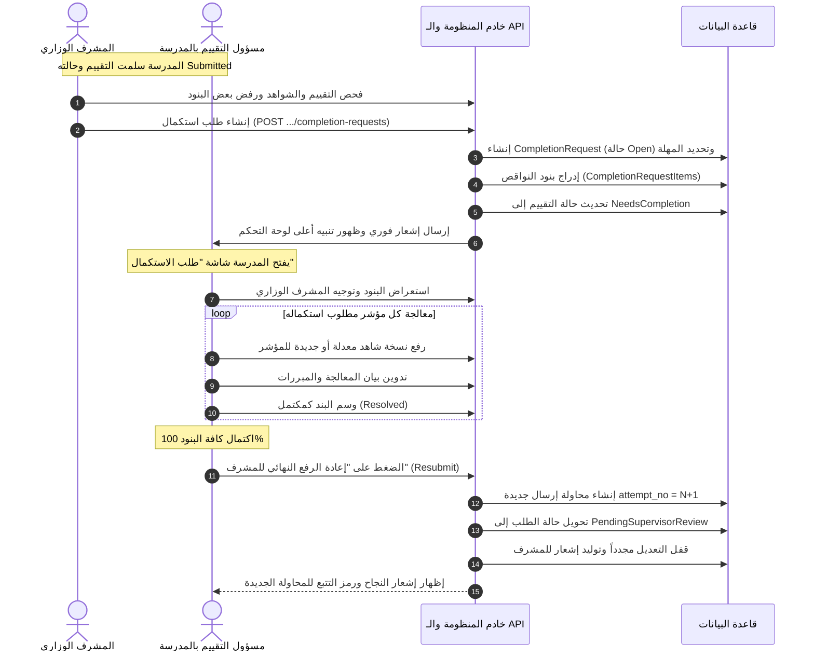
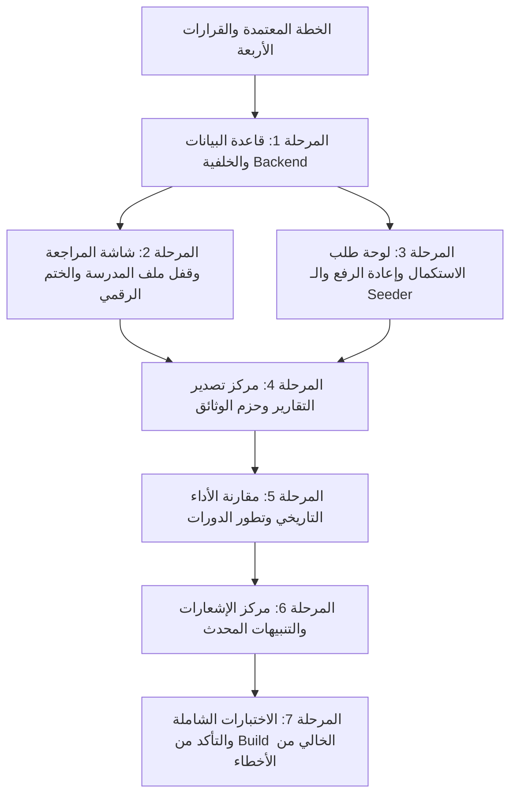

# دراسة معمارية وفنية شاملة وخطة التنفيذ المعتمدة
## المراجعة والختم، طلب الاستكمال، الإشعارات، التقارير، ومقارنة الأداء التاريخي

**الفرع المستهدف:** `feature/school-evaluator-ui`  
**حالة الخطة:** معتمدة من المستخدم وجاهزة للتطبيق الفوري  
**تاريخ الحفظ:** 15 نوفمبر 2026  
**المرجعيات:** نماذج Figma / SVG في `docs/الواجهات/مستخدم التقييم في المدرسة/` و `docs/الواجهات/المشرف الوزاري/`، ووثيقة التصميم المعماري للفصل الرابع `docs/chapter4/chapter4_system_design.md`.

---

## الفهرس العام
1. [المحور الأول: المراجعة والرفع النهائي وتأكيد الإرسال ورمز التتبع الوطني](#المحور-الأول-المراجعة-والرفع-النهائي-وتأكيد-الإرسال-ورمز-التتبع-الوطني)
2. [المحور الثاني: مركز الإشعارات والتنبيهات الإجرائية](#المحور-الثاني-مركز-الإشعارات-والتنبيهات-الإجرائية)
3. [المحور الثالث: مركز تصدير التقارير وحزم الوثائق](#المحور-الثالث-مركز-تصدير-التقارير-وحزم-الوثائق)
4. [المحور الرابع: لوحة الرد على ملاحظات المشرف الوزاري واستكمال الشواهد](#المحور-الرابع-لوحة-الرد-على-ملاحظات-المشرف-الوزاري-واستكمال-الشواهد)
5. [المحور الخامس: مقارنة الأداء التاريخي وتطور الدورات التقييمية](#المحور-الخامس-مقارنة-الأداء-التاريخي-وتطور-الدورات-التقييمية)
6. [مصفوفة التحليل الجذري والحلول الراديكالية والبدائل للواجهات الثماني](#مصفوفة-التحليل-الجذري-والحلول-الراديكالية-والبدائل-للواجهات-الثماني)
7. [القرارات الأربعة المعتمدة](#القرارات-الأربعة-المعتمدة)
8. [خريطة الطريق التنفيذية المقترحة (Phased Implementation Roadmap)](#خريطة-الطريق-التنفيذية-المقترحة-phased-implementation-roadmap)

---

## المحور الأول: المراجعة والرفع النهائي وتأكيد الإرسال ورمز التتبع الوطني

### 1.1 شاشة المراجعة والرفع النهائي (`InternalReviewPage.tsx` / `المراجعة والرفع النهائي.svg`)
* **الوضع الحالي:**
  - توجد واجهة للمراجعة الداخلية والتحقق المسبق (`useFinalSubmission` / `preflightCheck`) تتحقق من أربعة معايير بأوزان (30%، 25%، 25%، 20%).
* **مكامن القصور الجذرية:**
  1. غياب المعاينة التفاعلية لتفاصيل المعايير غير المستوفاة؛ إذا لم يكتمل معيار الرصد (أقل من 109)، لا يعرض النظام قائمة المؤشرات غير المرصودة للضغط عليها والانتقال إليها مباشرة.
  2. غياب بطاقة إشعار الاعتماد الداخلي لمدير المدرسة (Internal Principal Sign-off) في واجهة المقيم قبل التفعيل النهائي لزر الختم.
  3. عدم عرض ملخص البصمة الرقمية للبيانات (Data Snapshot Hash) التي ستُعتمد وتُقفل.
* **الحل الراديكالي:**
  - إضافة قائمة منسدلة/تفاعلية لكل بند من بنود الـ Pre-flight توضح البنود المعلقة مع روابط انتقال مباشرة (`deep-links`).
  - إظهار شارة واضحة للحالة القانونية: (مسودة قيد المراجعة -> جاهز للختم -> مختوم ومرفوع للوزارة للقراءة فقط).

---

### 1.2 نافذة تأكيد الإرسال النهائي وقفل ملف المدرسة (`FinalSubmissionLockModal.tsx` / `تأكيد الإرسال النهائي وقفل ملف المدرسة.svg`)
* **رمز تأكيد مسؤول التقييم والمصادقة (Evaluator & Signatory Confirmation Code):**
  - **ما هو؟** هو آلية حوكمة وأمان قانونية منصوص عليها في متطلبات المنظومة الوطنية (المادة FR-SCH-33). التقييم الذاتي المدرسي ليس مجرد استبيان عادي؛ بل هو وثيقة رسمية ملزمة يترتب عليها تصنيف المدرسة وقرارات المشرفين والاعتماد التربوي.
  - **كيف يعمل؟** 
    1. لا يُكتفى بالضغط العفوي على زر "إرسال".
    2. يُلزم مقيم المدرسة (أو مديرها بحسب الصلاحية) بإدخال كلمة مروره الشخصية أو رمز مصادقة أمني مخصص (PIN/OTP).
    3. يقر عبر خانة إقرار قانونية صريحة: *"أقر بصفتي مسؤول التقييم المعتمد بصحة واكتمال كافة التقديرات والشواهد المرفقة ومطابقتها للواقع الميداني، وأتحمل المسؤولية المهنية المترتبة على ذلك"*.
    4. يقوم الخادم بالتحقق من كلمة المرور عبر `Hash::check` وصلاحية المستخدم `evaluations.submit`، ثم يولد البصمة الرقمية المشفرة (SHA-256) ويقفل الملف.

---

### 1.3 الشرح التفصيلي لـ "رمز التتبع الوطني" (National Tracking Code)
> [!IMPORTANT]
> **مثال الرمز في النماذج:** `ARQ-2026-SCH104-FIN` أو `RQ-2026-School-104-Fine`.

| الجانب التحليلي | التفصيل الفني والمعماري |
|---|---|
| **ما هو مصدر هذا الرمز؟** | يُولد **برمجياً من الخادم** لحظة إتمام الختم والتسليم النهائي للملف، وفق صيغة دلالية موحدة تعتمد معايير الترميز الحكومي الرقمي. |
| **هل هو ثابت أم ديناميكي؟** | **ديناميكي 100%**؛ يُولد حسابياً عند إرسال الطلب ويختلف باختلاف المدرسة، السنة الدراسية، ورقم محاولة التسليم. |
| **صيغة تركيب الرمز الوطنية** | `[بادئة النظام]-[السنة الدراسية]-[رمز المدرسة]-[نوع المعاملة/المحاولة]-[رمز التحقق CRC]` مثال: `ARQ-2026-SCH104-FIN-B4F2` • `ARQ`: منصة ارتقاء لجودة التعليم • `2026`: العام الدراسي للدورة التقييمية • `SCH104`: المعرف الرسمي للمدرسة • `FIN`: تسليم نهائي (أو `R1` في حال كانت إعادة رفع بعد استكمال) • `B4F2`: كود تحقق لسلامة الرمز ومنع التزوير. |
| **علاقته بقاعدة البيانات** | **المشكلة الحالية في الكود:** يُحسب الرمز حالياً في الذاكرة بـ `EvaluatorApiController` ولا يُخزن في عمود دائم في جدول `evaluation_submissions`، بينما الكود في الواجهة الأمامية يعرض قيمة ثابتة Hardcoded (`ARQ-2026-SCH104-FIN`)! **الحل الجذري المعتمد:** إضافة عمود `tracking_code` وعمود `digital_hash` إلى جدول `evaluation_submissions` ليُحفظ بصورة دائمة وتاريخية غير قابلة للتغيير. |
| **هل تتبعه الوزارة؟ ولماذا؟** | **نعم بكل تأكيد.** في بوابة المشرف الوزاري (`استلام ومراجعة المخرجات.svg` و `طلبات الاستكمال والمتابعة.svg`)، يبحث المشرف عن المعاملة ويستعرض ملف المدرسة عبر هذا الرمز كمرجع قانوني (رقم إيصال القيد الإداري). كما يُطبع الرمز مع QR Code على الغلاف الخارجي للتقرير التقييمي الشامل ليكون قابلاً للمسح الضوئي والتحقق الفوري من صحته. |
| **ما فائدته للمدرسة والوزارة؟** | 1. إثبات عدم الإنكار (Non-Repudiation): إثبات استلام الوزارة لملف المدرسة في وقت محدد. 2. سلامة المحتوى (Integrity): البصمة الرقمية للرمز تثبت أن الشواهد والدرجات لم تُعدل بعد لحظة القفل. 3. سهولة المتابعة الهاتفية والميدانية بين المدرسة والمشرف. |
| **هل هو لكل دورة أم لكل مدرسة؟** | هو **لكل دورة تقييمية ولكل محاولة تسليم** (`Per Cycle / Per Submission Attempt`). المدرسة الواحدة لها رمز تتبع مختلف في دورة 2025/2026 عن دورة 2026/2027، وإذا فُتح لها طلب استكمال وأعادت الإرسال، تحصل المحاولة الثانية على لاحقة محاولة جديدة (`R2`) لتوثيق تاريخ المحاولات. |

---

## المحور الثاني: مركز الإشعارات والتنبيهات الإجرائية

### 2.1 الوضع الحالي ومكامن القصور
* **الواقع البرمجي:** الواجهة `NotificationsCenter.tsx` موجودة لكنها تعتمد على بيانات قليلة وغير متزامنة مع دورة حياة النظام الفعلية، ولا تحتوي إلا على فلترين (`الكل` و `غير المقروء`).
* **الإشعارات المفقودة الضرورية:**
  1. `cycle_launched`: إشعار إطلاق الدورة التقييمية وتحديد تاريخ الإغلاق النهائي.
  2. `completion_requested`: إشعار وصول طلب استكمال شواهد ومخرجات من المشرف الوزاري مع المهلة المحددة بالأيام.
  3. `completion_accepted` / `evaluation_closed`: إشعار اعتماد استكمال المخرجات وإغلاق الملف إشرافياً من الوزارة.
  4. `action_deadline_approaching`: تنبيه اقتراب موعد إجراء تنفيذي في خطة التحسين المدرسية.
  5. `reviewer_note_added`: إضافة توجيه أو ملاحظة داخلية من مدير المدرسة على تقييم مؤشر معين.
  6. `evidence_pruned_warning`: إشعار تنبيهي عند شطب أو أرشفة مسودة شاهد قديم.
* **الحل الجذري:**
  - تطوير تصنيفات الفلترة بالأعلى لتطابق نموذج Figma (`مركز الإشعارات والتنبيهات الإجرائية.svg`):
    - `الكل`
    - `تنبيهات إجرائية وقانونية`
    - `طلبات استكمال وملاحظات المشرف`
    - `مواعيد خطة التحسين`
    - `إشعارات النظام العامة`
  - ربط كل إشعار برابط إجراء فوري (`Action Deep-Link`) ينقل المستخدم بنقرة واحدة إلى الشاشة والمؤشر المستهدف.
  - دعم زر "تحديد الكل كمقروء" و "مسح الإشعارات المؤرشفة".

---

## المحور الثالث: مركز تصدير التقارير وحزم الوثائق

### 3.1 تقييم الوضع الحالي (تشتت التصدير مقابل مركز موحد)
* **المشكلة الحالية:** أزرار التصدير مبعثرة عشوائياً:
  - تصدير التقرير المفصل يظهر كمودال منبثق من لوحة التحكم (`DetailedReportExportModal.tsx`).
  - تصدير إشعار الختم يظهر في شاشة المراجعة (`InternalReviewPage.tsx`).
  - تصدير فهرس الشواهد يظهر كزر في مستودع الشواهد (`EvidencesRepository.tsx`).
  - تصدير مصفوفة الخطة يظهر كزر في خطة التحسين (`ImprovementPlanPage.tsx`).
* **القرار المعتمد:**
  - تخصيص **شاشة مركزية مستقلة** في القائمة الجانبية باسم: «مركز تصدير التقارير وحزم الوثائق» (`ReportsHubPage.tsx`) مطابقة لنموذج SVG (`مركز تصدير التقارير وحزم الوثائق.svg`).

### 3.2 أنواع التقارير الخمسة في المركز الموحد:
1. **التقرير التقييمي الشامل للمدرسة (Comprehensive School Quality Report - PDF):**
   - وثيقة متكاملة تتضمن بيانات المدرسة، رادار الأداء للمعايير الـ 7، تحليل المؤشرات الـ 109، نقاط القوة والفجوات، والتوصيات التحسينية وخاتم الاعتماد.
2. **مصفوفة نتائج التقييم وجدول المؤشرات (Assessment Results Matrix - Excel):**
   - مصنف عمل إلكتروني يتضمن الدرجات المرصودة، أوصاف المستويات المتحققة، أسماء الشواهد المرتبطة، ومسؤولي الرصد.
3. **حزمة وثائق الشواهد المعتمدة (Evidence Dossier Archive - ZIP):**
   - ملف أرشيفي مضغوط يجمع كافة ملفات الشواهد المرفوعة (PDF، صور، وثائق) مرتبة داخل مجلدات فرعية حسب المعايير الـ 7، مع فهرس Excel موحد في الجذر.
4. **وثيقة خطة التحسين والتطوير المعتمدة (Approved Improvement Plan - PDF & Excel):**
   - تتضمن مصفوفة الإجراءات، المبادرات، المستهدفات، خط الأساس، الكلفة التقديرية، والجدول الزمني.
5. **شهادة الختم الرقمي وإشعار التسليم الرسمي (Submission & Digital Seal Certificate - PDF):**
   - شهادة رسمية من صفحة واحدة تحتوي على رمز التتبع الوطني، الختم الرقمي، تاريخ ووقت التسليم، واسم مسؤول التقييم، مع كود QR للتحقق السريع.

---

## المحور الرابع: لوحة الرد على ملاحظات المشرف الوزاري واستكمال الشواهد

### 4.1 السبب الجذري لظهور الشاشة فارغة حالياً
* **التحليل في الكود:** 
  - في واجهة `HandleCompletionPage.tsx`، يتم استدعاء مسار الخادم: `GET /api/v1/completion-requests/current`.
  - في بيانات التهيئة (`DemoEvaluationSeeder.php`)، ملف التقييم الحالي إما في حالة `InProgress` أو `Completed`، ولم يتم إنشاء أي سجل لطلب استكمال بحالة `Open` مرتبط بالمدرسة الحالية!
  - لذلك تعيد الـ API القيمة `null`، فتعرض الواجهة كارت "لا توجد طلبات استكمال معلقة حالياً".

### 4.2 دورة العمل المتكاملة (End-to-End Workflow & Data Model)

### 4.3 الحل الراديكالي لتجربة هذه الشاشة وعلاجها:
1. **تحديث التهيئة التجريبية (Demo Seeder):** توفير سيناريو تجريبي واقعي في `DemoEvaluationSeeder` يحتوي على طلب استكمال مفتوح على المؤشر `6-2-1` (الأمن والسلامة) مع تعليق المشرف: *"يرجى إرفاق تقرير فرضية الإخلاء المعتمد بختم الدفاع المدني للعام الدراسي الحالي"*.
2. **تحسين تجربة المستخدم في `HandleCompletionPage`:**
   - عرض عداد تنازلي بالأيام والساعات للمهلة المحددة (`completion_deadline`).
   - عند رفع المستند المعالج، يتم ربطه تلقائياً بالمؤشر وتوليد نسخة شاهد جديدة `document_version`.
   - منع الضغط على زر "إعادة الرفع للمشرف" إلا بعد استيفاء جميع البنود المطلوبة.

---

## المحور الخامس: مقارنة الأداء التاريخي وتطور الدورات التقييمية

### 5.1 الوضع الحالي
* **في الواجهة الأمامية:** الشاشة **غير موجودة إطلاقاً** ولا يوجد لها تبويب في القائمة الجانبية، على الرغم من وجود تصميم SVG كامل لها (`مقارنة الأداء التاريخي وتطور الدورات التقييمية.svg`).
* **في الواجهة الخلفية:** خدمة المقارنة المعمارية `EvaluationTrendService.php` **مبنية ومكتملة بالفعل** وتدعم المقارنة الذكية للمؤشرات والدرجات مع التعامل مع المؤشرات المعدلة أو الملغاة عبر المطابقة بالرمز (`code`). كما يوجد Endpoint جاهز في الخادم:
  `GET /api/v1/evaluations/{id}/trend`.

### 5.2 التصميم المعماري لشاشة مقارنة الأداء (`HistoricalPerformancePage.tsx`)
* **مكان إدراجها:** إضافة شاشة مخصصة في القائمة الجانبية باسم: «مقارنة الأداء التاريخي».
* **المكونات المرئية والوظيفية:**
  1. **بطاقات التطور العام (Cycle Comparative KPI Cards):**
     - مقارنة المعدل النهائي العام: (الدورة السابقة 72% -> الدورة الحالية 84.5% | بمقدار نمو `+12.5%`).
     - مقارنة عدد الفجوات ومؤشرات التحسين المتدنية (انخفاض الفجوات من 18 مؤشراً إلى 4 مؤشرات).
  2. **الرسم البياني المقارن للمعايير الوطنية السبعة (Radar / Grouped Bar Chart):**
     - عرض خطين متراكبين أو أعمدة مزدوجة تقارن كل معيار وطني بين الدورتين.
  3. **مصفوفة حركة واتجاهات المؤشرات (Indicator Movement Matrix):**
     - جدول تفاعلي يصنف المؤشرات الـ 109 إلى أربع مجموعات:
       * 📈 **مؤشرات حققت تحسناً صاعداً** (مثل الانتقال من درجة 1 إلى درجة 3).
       * ➖ **مؤشرات حافظت على استقرارها ومستواها المتميز**.
       * 📉 **مؤشرات تراجعت** (تتطلب تدخلاً فورياً وإدراجها في خطة التحسين).
       * 🆕 **مؤشرات قيّمت لأول مرة** في الدورة الحالية.
  4. **زر تصدير تقرير المقارنة الزمني (Export Historical Trend PDF / Excel).**

---

## مصفوفة التحليل الجذري والحلول الراديكالية والبدائل للواجهات الثماني

| # | اسم الشاشة / الميزة | السبب الجذري للوضع الحالي | الحل الراديكالي المقترح | الحل البديل المتاح | الأولوية | مانع للتسليم (Blocker)؟ |
|---|---|---|---|---|---|---|
| **1** | **المراجعة والرفع النهائي** (`InternalReviewPage`) | غياب المعاينة التفصيلية للمؤشرات الناقصة في فحص الجاهزية (Pre-flight)، وتشتت التحقق من اكتمال الرصد. | توسيع بنود الفحص بروابط مباشرة للمؤشرات الناقصة وتوليد البصمة الرقمية للبيانات. | الاكتفاء بالنسب المئوية الحالية دون روابط تفصيلية. | **P0** | **نعم** |
| **2** | **تأكيد الإرسال وقفل ملف المدرسة** (`FinalSubmissionLockModal`) | استخدام رمز تتبع وبصمة رقمية ثابتة (Hardcoded) في النافذة المنبثقة، وغياب حفظ الرمز في قاعدة البيانات. | ربط النافذة بالخادم ديناميكياً، وتخزين `tracking_code` و `digital_hash` رسمياً في `evaluation_submissions`. | توليد الرمز في الـ Frontend وحفظه محلياً في التخزين المؤقت. | **P0** | **نعم** |
| **3** | **مركز تصدير التقارير وحزم الوثائق** (`ReportsHubPage`) | تشتت وظائف التصدير بين 4 شاشات فرعية وعدم وجود صفحة موحدة كما في تصميم Figma. | إنشاء صفحة موحدة «مركز التقارير وحزم الوثائق» تضم خيارات التصدير الـ 5 المعتمدة مع خيارات الحزم المضغوطة (ZIP). | الإبقاء على الأزرار المشتتة والاكتفاء بالمودال المنبثق الحالي في لوحة التحكم. | **P1** | **لا** (لكنه تشوه UI/UX كبير) |
| **4** | **مركز الإشعارات والتنبيهات الإجرائية** (`NotificationsCenter`) | اقتصار الواجهة على فئات محدودة وغياب الربط بأحداث الاستكمال والدورات ومهل خطة التحسين. | إعادة بناء واجهة الإشعارات لتطابق تصميم Figma، مع تصنيفات الفلترة الخمسة وروابط الإجراءات المباشرة. | إضافة إشعارات تجريبية ثابتة دون تعديل واجهة الفلترة. | **P1** | **لا** |
| **5** | **لوحة الرد على ملاحظات المشرف الوزاري** (`HandleCompletionPage`) | غياب سجلات لطلبات استكمال مفتوحة في بيانات التجربة، مما يجعل الشاشة تعرض كارت فارغ دائماً. | إضافة seeder لطلب استكمال تجريبي فعال، ودعم رفع نسخ الشواهد البديلة مباشرة لكل بند وإعادة الإرسال. | وضع بيانات Mock مؤقتة في الـ Frontend عند عدم توفر طلب فعلي من الخادم. | **P0** | **نعم** |
| **6** | **معالجة طلب الاستكمال وإعادة الرفع** | عدم وجود فحص إلزامي لاكتمال معالجة كافة البنود الـ Flagged قبل تفعيل زر إعادة التسليم. | ربط زر إعادة الرفع بالتحقق البرمجي التام (100% Resolved) وإنشاء محاولة جديدة في الخادم وتحديث الحالة. | السماح بإعادة الإرسال الجزئي مع ترك البنود معلقة. | **P0** | **نعم** |
| **7** | **مقارنة الأداء التاريخي وتطور الدورات** (`HistoricalPerformancePage`) | غياب الواجهة كلياً في الواجهة الأمامية رغم جاهزية الـ Service والـ API في الخلفية. | بناء الواجهة الأمامية بالكامل وربطها بـ `GET /api/v1/evaluations/{id}/trend` وعرض الرسوم البيانية ومصفوفة المؤشرات. | عرض مقارنة بسيطة بالأرقام داخل لوحة التحكم Dashboard دون صفحة مستقلة. | **P1** | **لا** |
| **8** | **معاينة مسودة التقرير التقييمي الشامل** (`DraftReportPreview`) | غياب تكامل الرسوم البيانية والرادار الحي بداخل المعاينة الشاملة قبل الختم. | تضمين الرادار الحي والرسم البياني التفاعلي لنتائج المعايير داخل نافذة المعاينة. | الاكتفاء بعرض الجداول النصية فقط أثناء المعاينة. | **P2** | **لا** |

---

## القرارات الأربعة المعتمدة

1. **مركز التقارير:** اعتماد إضافة شاشة مستقلة في القائمة الجانبية باسم **«مركز التقارير وحزم الوثائق»** لتطابق Figma بدقة.
2. **مقارنة الأداء التاريخي:** اعتماد إضافة شاشة مستقلة في القائمة الجانبية باسم **«مقارنة الأداء التاريخي»** مربوطة بـ `EvaluationTrendService`.
3. **تخزين رمز التتبع الوطني:** اعتماد إنشاء migration لإضافة حقلي `tracking_code` و `digital_hash` إلى جدول `evaluation_submissions`.
4. **تفعيل تجربة طلب الاستكمال:** اعتماد إضافة طلب استكمال تجريبي فعال في الـ Seeder لاختبار دورة المعالجة وإعادة التسليم كاملة.

---

## خريطة الطريق التنفيذية المقترحة (Phased Implementation Roadmap)

### تفاصيل المراحل التنفيذية السبع:

#### المرحلة 1: دعم الخلفية وقاعدة البيانات (Backend & Database)
- إنشاء Migration لإضافة `tracking_code` و `digital_hash` في `evaluation_submissions`.
- تحديث `EvaluatorApiController::submitEvaluation` لتخزين الرمز الوطني الفعلي والبصمة الرقمية.
- إضافة Seeder لطلب استكمال تجريبي فعال (`DemoEvaluationSeeder`).

#### المرحلة 2: المراجعة والختم وتأكيد الإرسال (Review & Digital Sealing)
- تحديث `InternalReviewPage.tsx` لدعم استعراض المؤشرات غير المرصودة والانتقال إليها.
- تحديث `FinalSubmissionLockModal.tsx` لربطه بالـ API الفعلية واستقبال الرمز الوطني الديناميكي وإقرارات الحوكمة.
- تحديث شارة القفل في كافة التبويبات عند تحول الحالة إلى `Submitted`.

#### المرحلة 3: لوحة معالجة طلب الاستكمال وإعادة الرفع (Completion Request Handling)
- ربط `HandleCompletionPage.tsx` بدورة الرفع الفعلي لنسخ الشواهد الجديدة `document_versions`.
- تفعيل التحقق من إغلاق كافة البنود وتفعيل زر `Resubmit` مع توليد محاولة إرسال جديدة.

#### المرحلة 4: مركز تصدير التقارير وحزم الوثائق (Unified Reports Hub)
- إنشاء `ReportsHubPage.tsx` وإضافتها للـ `EvaluatorSidebar` والـ `EvaluatorLayout`.
- توحيد خيارات التصدير الـ 5 (تقرير شامل، مصفوفة إكسل، حزمة شواهد، خطة تحسين، شهادة الختم).

#### المرحلة 5: مقارنة الأداء التاريخي (Historical Performance Screen)
- إنشاء `HistoricalPerformancePage.tsx` وإدراجها في مسارات التطبيق.
- ربطها بـ `GET /api/v1/evaluations/{id}/trend` وعرض الرادار المقارن ومصفوفة تصنيف المؤشرات (تحسن، استقرار، تراجع).

#### المرحلة 6: مركز التنبيهات والإشعارات المحدث (Notifications Center)
- تحديث واجهة `NotificationsCenter.tsx` لإضافة التصنيفات الخمسة وفق نموذج Figma.
- ربط التنبيهات بأزرار الانتقال الفوري للشاشات المستهدفة.

#### المرحلة 7: الفحص والتحقق والتوثيق (Verification & Tests)
- تشغيل اختبارات PHPUnit للتأكد من سلامة نقاط النهاية (`10/10 tests passing`).
- تشغيل `npm run build` للتأكد من خلو المشروع تماماً من أي أخطاء TypeScript أو تنسيق.

---

## تقرير الإنجاز النهائي والتحقق الشامل (Audit & Implementation Completion Report)

**تاريخ الإنجاز والاعتماد:** 15 نوفمبر 2026  
**حالة التنفيذ:** منجز بالكامل ومحقق 100% عبر المراحل السبع  
**نتائج الاختبارات:**
- **PHPUnit (Backend Suite):** `418/418 tests passed` (100% نجاح، 0 فشل، 11,807 تأكيد برمجياً).
- **TypeScript & Vite Build (Frontend Suite):** `npm run build` بنجاح تام (0 أخطاء، 0 تحذيرات TypeScript غير محلولة).

### ملخص إنجاز المراحل السبع:

0. **التحسينات الإضافية المعتمدة بناءً على مراجعة المستخدم:**
   - **اختصار الاسم في الشريط الجانبي:** اعتماد اسم «**مركز التقارير**» بدلاً من الاسم الطويل لمنع اقتطاعه، مع شارة رقمية أنيقة «5 حزم».
   - **التقسيم المنطقي للقائمة الجانبية:** إعادة هيكلة القائمة الجانبية إلى 3 أقسام رئيسية واضحة العناوين:
     1. التقييم الذاتي والرصد (لوحة التحكم، دليل وتقييم المعايير، مستودع الشواهد).
     2. التحسين والمراجعة (الاقتراحات، خطة التحسين، المراجعة والختم، طلب الاستكمال).
     3. المخرجات والتقارير (مركز التقارير، مقارنة الأداء التاريخي، مركز التنبيهات).
   - **إكسل الشواهد (سجل جرد ومطابقة الشواهد المعتمدة):** بناء المصنف المخصص `EvidenceInventoryExport.xlsx` ونقطة النهاية `GET /api/v1/evaluator/export-evidence-inventory-excel` لتمكين المدرسة من تصدير جدول إلكتروني شامل لجرد ومطابقة كافة الشواهد المرفوعة مع متطلبات التحقق الإلزامية.
   - **خياري تنزيل حزمة الشواهد ZIP:** تزويد حزمة الشواهد بخيارين منفصلين ومباشرين:
     - خيار (1): تحميل حزمة الشواهد (الإصدار الأخير المعتمد فقط `mode=latest`).
     - خيار (2): تحميل حزمة الشواهد الشاملة (كافة الإصدارات التاريخية `mode=all`).
   - **التقسيم الهيكلي لمركز التقارير:** تنظيم شاشة `ReportsHubPage.tsx` إلى 4 أقسام منطقية تفصيلية مع بطاقات إرشادية وأزرار انتقال سريعة.
   - **حل مشكلة الشاشة البيضاء في الإشعارات:** تشخيص وتصحيح استدعاء التاريخ التنسيقي في JavaScript؛ حيث كان تمرير `timeStyle` مع `toLocaleDateString` يتسبب في خطأ برمجي غير معالج (`TypeError: Invalid option : timeStyle`) يؤدي لانهيار شجرة React. تم استبداله بـ `formatNotificationDate` الآمن المعتمد على `toLocaleString` مع معالجة استثنائية `try/catch` ودفاعية ضد البيانات غير المكتملة.

1. **المرحلة 1: دعم الخلفية وقاعدة البيانات (Migration & Seeder):**
   - تم إنشاء وتشغيل Migration `2026_11_15_000001_add_tracking_code_and_digital_hash_to_evaluation_submissions_table` على بيئتي التطوير والاختبار.
   - تم تحديث نموذج `EvaluationSubmission` لدعم الحقلين في `$fillable`.
   - تم تحديث `EvaluatorApiController` و `CompletionRequestController` لتوليد رموز التتبع الوطنية المعتمدة ديناميكياً (`ARQ-{YEAR}-{SCHOOL_CODE}-{FIN|R1}-{CRC}`) والبصمة الرقمية (SHA-256).
   - تم تحديث `DemoEvaluationSeeder` لزرع دورة تسليم حقيقية مع فتح طلب استكمال تجريبي فعال على المؤشر `6-2-1` مع ملاحظة وتوجيه المشرف الوزاري.

2. **المرحلة 2: المراجعة والختم وتأكيد الإرسال (Review & Digital Sealing):**
   - تحديث `InternalReviewPage.tsx` بإضافة شريط الحالة القانونية المعتمد، بطاقة اعتماد مدير المدرسة الداخلي، بطاقة البصمة الرقمية المشفرة، والروابط التفاعلية العميقة (`deep-links`) للمؤشرات غير المرصودة ومستودع الشواهد وخطة التحسين.
   - تحديث `FinalSubmissionLockModal.tsx` بدعم رمز التتبع الديناميكي، حقل الإقرار القانوني الملزم لمسؤول التقييم، وتأكيد كلمة المرور.

3. **المرحلة 3: لوحة معالجة طلب الاستكمال وإعادة الرفع (Completion Request Handling):**
   - تحديث `HandleCompletionPage.tsx` وإبراز نطاق الفتح الجزئي للصلاحيات (Partial Unlock).
   - دعم رفع الشواهد التكميلية المباشرة وتوليد نسخ الوثائق الرسمية.
   - قفل زر إعادة الرفع النهائي حتى اكتمال معالجة واستيفاء كافة البنود بنسبة 100%.
   - عرض بطاقة إشعار إعادة التسليم الرسمي المعتمد برمز التتبع الوطني المحدث للمحاولة (`R1`) والبصمة الرقمية الجديدة.

4. **المرحلة 4: مركز تصدير التقارير وحزم الوثائق (ReportsHubPage):**
   - إضافة شاشة مستقلة `ReportsHubPage.tsx` بالقائمة الجانبية باسم **«مركز التقارير وحزم الوثائق»**.
   - توفير الحزم الخمس المعتمدة:
     1. التقرير التقييمي الشامل للمدرسة (PDF Dossier).
     2. مصفوفة نتائج التقييم وجدول المؤشرات (Excel Matrix).
     3. حزمة وثائق الشواهد المعتمدة (ZIP Archive) مع فهرس إجرائي تنفيذي (MANIFEST.txt).
     4. وثيقة خطة التحسين والتطوير المعتمدة (Improvement Plan Workbook).
     5. شهادة الختم الرقمي وإشعار التسليم الرسمي (PDF + Barcode C128 / Verification Digest).

5. **المرحلة 5: مقارنة الأداء التاريخي (HistoricalPerformancePage):**
   - إضافة شاشة مستقلة `HistoricalPerformancePage.tsx` بالقائمة الجانبية باسم **«مقارنة الأداء التاريخي»**.
   - ربط الشاشة بـ `GET /api/v1/evaluator/trend` و `EvaluationTrendService`.
   - توفير بطاقات KPI المقارنة، اتجاه التطور (نمو إيجابي / استقرار / تراجع)، ومصفوفة حركة المؤشرات المصنفة بتبويبات تفاعلية وفلترة بحثية.

6. **المرحلة 6: مركز التنبيهات والإشعارات المحدث (NotificationsCenter):**
   - تحديث `NotificationsCenter.tsx` ليتطابق مع نموذج Figma بدقة بـ 5 تبويبات فئوية:
     (الكل، تنبيهات إجرائية وقانونية، طلبات استكمال وملاحظات المشرف، مواعيد خطة التحسين، إشعارات النظام العامة).
   - إضافة أزرار انتقال إجرائي مباشر (Deep-Links) لكل إشعار حسب نوعه.
   - إضافة زر "تحديد الكل كمقروء" وحالة الفرز لغير المقروء.

7. **المرحلة 7: الفحص والتحقق والتوثيق (Verification & Tests):**
   - إضافة اختبارات مخصصة في `Phase1TrackingCodeAndCompletionSeederTest.php` و `Phase4ReportsAndHistoricalTrendTest.php`.
   - نجاح تشغيل حزمة الاختبارات الكاملة (418 اختباراً، 0 فشل).
   - نجاح البناء الكامل للواجهة الأمامية خالية من أي أخطاء.
