# توثيق الواقع الفعلي للشريحة الأولى: المصادقة والعزل المؤسسي وإدارة النظام (As-Built Documentation)

**النظام:** نظام إدارة وتقويم الجودة المدرسية (School Quality System)  
**الحزمة:** `school-eval-api` (Backend) و `school-eval-web` (Frontend)  
**الشريحة:** الشريحة الأولى (Vertical Slice 1: Authentication, Multi-tenant Isolation & System Administration)  
**تاريخ التوثيق:** 25 أكتوبر 2026  
**طبيعة الوثيقة:** توثيق الواقع الفعلي المنفذ في الكود البرمجي (As-Built) دون افتراضات غير متحققة.

---

## 0. بيانات التوليد والبيئة (Metadata & Test Summary)

* **الفرع الحالي (Git Branch):** `feature/evaluation-evidence-api`
* **آخر التزام (Last Commit):** `0704b4e55af7435b44114dc4a521e4e9e2897c5e اضافة شرح لاين وصل المشروع (2026-10-25 19:42:27 +0300)`
* **تاريخ التوليد:** 25 أكتوبر 2026
* **نتيجة تشغيل الاختبارات الكلية (`php artisan test`):**
  * إجمالي الاختبارات: **65 اختباراً** (نجاح 100%، 0 إخفاق، 0 أخطاء).
  * إجمالي التأكيدات: **5,757 تأكيداً (Assertions)**.
  * زمن التنفيذ: نحو 7.2 ثانية.
  * اختبارات الشريحة الأولى الحصرية (`AuthenticationAndAuthorizationFeatureTest` و `UserAuthenticationTest`): **15 اختباراً ناجحاً و444 تأكيداً**.

---

## 1. الغرض والنطاق وقائمة الملفات

### 1.1 الغرض والنطاق المنفذ
تمكين النظام من توفير بنية تحتية أمنية وإدارية قوية تشمل:
1. المصادقة عبر رموز الوصول الشخصية (`Bearer Token`) بحزمة Laravel Sanctum وإصدار الجلسات التشغيلية.
2. فرض انتهاء الجلسة بعد 30 دقيقة من الخمول (`EnforceSessionTimeout`).
3. إغلاق الجلسات السابقة للمستخدم عند تسجيل الدخول الجديد (حصر المستخدم بجلسة نشطة واحدة).
4. فرض العزل المؤسسي الصارم بين المدارس (`School Tenant Isolation`) وحجب الموارد عبر `404 Not Found` (القرار المعماري 9).
5. إدارة المدارس والمستخدمين لمسؤول النظام (`system_admin`) بصلاحيتي `schools.manage` و `users.manage` مع تطبيق سياسة «تعطيل لا حذف».
6. فرض قيد التكامل الحصري للمستخدمين (XOR): الحساب المدرسي يرتبط بمدرسة فقط، والحساب الوزاري يرتبط بجهة وزارية فقط، وحساب النظام لا يرتبط بأي منهما.

### 1.2 قائمة الملفات المنشأة والمعدلة في الشريحة الأولى

| المسار | الحالة | الدور الوظيفي الفعلي |
|---|---|---|
| `routes/api.php` | منشأ | تسجيل مسارات المصادقة العامة والمسارات المحمية للمدارس والمستخدمين والتقييمات. |
| `app/Http/Controllers/Api/V1/AuthController.php` | منشأ | معالجة تسجيل الدخول، إصدار رمز Sanctum، تسجيل جلسة جدول `sessions`، الخروج، واستعلام `/auth/me`. |
| `app/Http/Controllers/Api/V1/SchoolController.php` | منشأ | استعراض المدارس مع عزل نطاق المدرسة، استعراض مدرسة محددة (404 للعزل)، إضافة وتعديل وتفعيل/تعطيل المدارس. |
| `app/Http/Controllers/Api/V1/UserController.php` | منشأ | إدارة حسابات المستخدمين، إضافة مع إسناد الدور، تعديل، تفعيل/تعطيل مع حظر تعطيل النفس، واسترجاع meta الأدوار والجهات. |
| `app/Http/Middleware/EnforceSessionTimeout.php` | منشأ | وسيط فرض خمول 30 دقيقة على جلسات المستخدم، وتحديث طابع الجلسة أو إلغاؤها وإلغاء رمز Sanctum وإرجاع 401. |
| `app/Policies/SchoolPolicy.php` | منشأ | سياسة أمان المدارس: السماح لمسؤول النظام، وحصر مستخدم المدرسة بمدرسته فقط لمطابقة `school_id`. |
| `app/Http/Requests/Auth/LoginRequest.php` | منشأ | التحقق من صحة مدخلات تسجيل الدخول (`username`, `password`). |
| `app/Http/Requests/Admin/StoreSchoolRequest.php` | منشأ | التحقق من صحة بيانات إنشاء مدرسة جديدة وتفرد رمز التعريف والمحافظة. |
| `app/Http/Requests/Admin/UpdateSchoolRequest.php` | منشأ | التحقق من صحة بيانات تعديل مدرسة قائمة. |
| `app/Http/Requests/Admin/StoreUserRequest.php` | منشأ | التحقق من تفرد اسم المستخدم والبريد وفرض قيد XOR للجهة بحسب `userType`. |
| `app/Http/Requests/Admin/UpdateUserRequest.php` | منشأ | التحقق من صحة تحديث بيانات المستخدم والدور وكلمة المرور المشفرة. |
| `app/Http/Resources/UserResource.php` | منشأ | تحويل بيانات المستخدم وأدواره وصلاحياته ومدرسته إلى JSON بنمط camelCase. |
| `app/Http/Resources/SchoolResource.php` | منشأ | تحويل بيانات المدرسة إلى JSON بنمط camelCase وتواريخ UTC Z. |
| `app/Http/Responses/ApiResponse.php` | منشأ | المغلف الموحد للاستجابات (data, message, errors, meta). |
| `tests/Feature/AuthenticationAndAuthorizationFeatureTest.php` | منشأ | 12 اختبار ميزة تغطي الدخول، الخروج، الخمول 30 دقيقة، عزل المدارس (404)، ومصفوفة الصلاحيات. |
| `tests/Feature/UserAuthenticationTest.php` | منشأ | 3 اختبارات تغطي تجزئة كلمات المرور والتحقق عبر `Hash::check`. |
| `school-eval-web/src/api/client.ts` | منشأ | عميل استدعاء API الموحد بالفرونت مع إدارة Bearer Token ومغلف ApiResponse. |
| `school-eval-web/src/features/auth/AuthContext.tsx` | منشأ | سياق إدارة جلسة المستخدم في React، تسجيل الدخول والخروج واسترجاع الملف الشخصي. |
| `school-eval-web/src/features/auth/LoginPage.tsx` | منشأ | واجهة تسجيل الدخول الرسمية للهوية البصرية للنظام. |
| `school-eval-web/src/features/admin/adminApi.ts` | منشأ | دوال استدعاء API للمدارس والمستخدمين لمسؤول النظام. |
| `school-eval-web/src/features/admin/SchoolsManagementPage.tsx` | منشأ | واجهة إدارة المدارس (إضافة، تعديل، بحث، تعطيل/تفعيل). |
| `school-eval-web/src/features/admin/UsersManagementPage.tsx` | منشأ | واجهة إدارة المستخدمين والحسابات وإسناد الأدوار. |
| `school-eval-web/src/features/admin/AdminDashboardOverview.tsx` | منشأ | لوحة إحصائيات عامة لمسؤول النظام. |

---

## 2. جدول نقاط النهاية المنفذة فعلياً (API Endpoints Table)

| المسار (URI) | الطريقة | الصلاحية / الحماية | المتحكم والدالة (Action) | التحقق (Request Form) | السياسة الصلاحية (Policy) | مورد الاستجابة (Resource) |
|---|---|---|---|---|---|---|
| `/api/v1/auth/login` | `POST` | عام (Public) | `AuthController@login` | `LoginRequest` | لا يوجد | `UserResource` |
| `/api/v1/auth/logout` | `POST` | مصادَق (Sanctum) | `AuthController@logout` | `Request` مباشر | لا يوجد | لا يوجد (`data: null`) |
| `/api/v1/auth/me` | `GET` | مصادَق (Sanctum) | `AuthController@me` | `Request` مباشر | لا يوجد | `UserResource` |
| `/api/v1/schools` | `GET` | مصادَق (عزل مدرسي) | `SchoolController@index` | `Request` مباشر (فلترة `status, governorate, q`) | فحص برمجي لعزل المدرسة | `SchoolResource` |
| `/api/v1/schools` | `POST` | `schools.manage` | `SchoolController@store` | `StoreSchoolRequest` | `StoreSchoolRequest::authorize` | `SchoolResource` |
| `/api/v1/schools/{id}` | `GET` | مصادَق (عزل مدرسي) | `SchoolController@show` | لا يوجد | `SchoolPolicy@view` + عزل برمجي | `SchoolResource` |
| `/api/v1/schools/{id}` | `PUT` | `schools.manage` | `SchoolController@update` | `UpdateSchoolRequest` | `UpdateSchoolRequest::authorize` | `SchoolResource` |
| `/api/v1/schools/{id}/toggle-status` | `PATCH` | `schools.manage` | `SchoolController@toggleStatus` | لا يوجد | فحص برمجي للصلاحية | `SchoolResource` |
| `/api/v1/users` | `GET` | `users.manage` | `UserController@index` | `Request` مباشر (فلترة `userType, status, schoolId, q`) | فحص برمجي للصلاحية | `UserResource` |
| `/api/v1/users/meta` | `GET` | `users.manage` | `UserController@meta` | لا يوجد | فحص برمجي للصلاحية | مصفوفة عادية (`roles, schools, ministries`) |
| `/api/v1/users` | `POST` | `users.manage` | `UserController@store` | `StoreUserRequest` | `StoreUserRequest::authorize` | `UserResource` |
| `/api/v1/users/{id}` | `GET` | `users.manage` | `UserController@show` | لا يوجد | فحص برمجي للصلاحية | `UserResource` |
| `/api/v1/users/{id}` | `PUT` | `users.manage` | `UserController@update` | `UpdateUserRequest` | `UpdateUserRequest::authorize` | `UserResource` |
| `/api/v1/users/{id}/toggle-status` | `PATCH` | `users.manage` | `UserController@toggleStatus` | لا يوجد | فحص برمجي للصلاحية وحظر تعطيل النفس | `UserResource` |

---

## 3. خريطة التأثير على البيانات (Data Impact Map)

| نقطة النهاية | الجداول المقروءة (R) | الجداول المكتوبة (W) | الأعمدة المتأثرة | القيود وقواعد النزاهة المفروضة |
|---|---|---|---|---|
| `POST /auth/login` | `users`, `schools`, `ministries`, `user_roles`, `roles`, `role_permissions`, `permissions` | `personal_access_tokens`, `sessions` | `sessions.active`, `sessions.ended_at`, `sessions.session_token`, `sessions.started_at` | فحص `users.status = 'Active'`، تجزئة الرمز SHA-256، قيد فريد لجلسة نشطة للمستخدم |
| `POST /auth/logout` | `users`, `personal_access_tokens`, `sessions` | `personal_access_tokens`, `sessions` | `sessions.active = false`, `sessions.ended_at = now()`, حذف التوكن | مطابقة `session_token` ببصمة التوكن الحالي |
| `GET /auth/me` | `users`, `schools`, `ministries`, `user_roles`, `roles`, `permissions` | لا يوجد | قراءة فقط | التحقق من هوية Bearer Token الفعالة |
| `GET /schools` | `schools` | لا يوجد | قراءة فقط | عزل المدرسة: `where('school_id', $user->school_id)` لمستخدم المدرسة |
| `POST /schools` | `schools` | `schools` | `school_name`, `educational_stage`, `identification_data`, `educational_district`, `governorate`, `status` | قيد فريد `UNIQUE(identification_data)` وقيم مقيدة لـ `educational_stage` و `status` |
| `GET /schools/{id}` | `schools` | لا يوجد | قراءة فقط | قيد العزل (القرار 9): إذا لم يتطابق `school_id` يرجع 404 بدلاً من 403 |
| `PUT /schools/{id}` | `schools` | `schools` | الأعمدة المحدثة + `updated_at` | التحقق من تفرد رمز التعريف مع استثناء المعرف الحالي |
| `PATCH /schools/{id}/toggle-status` | `schools` | `schools` | `status` (`Active` $\leftrightarrow$ `Inactive`), `updated_at` | سياسة «تعطيل لا حذف» (لا يتم حذف أي سجل نهائياً) |
| `GET /users` | `users`, `schools`, `ministries`, `user_roles`, `roles` | لا يوجد | قراءة فقط | اشتراط صلاحية `users.manage` |
| `GET /users/meta` | `roles`, `schools`, `ministries` | لا يوجد | قراءة فقط | تصفية المدارس النشطة فقط `status = 'Active'` |
| `POST /users` | `users`, `roles`, `schools`, `ministries` | `users`, `user_roles` | `username`, `password_hash`, `full_name`, `email`, `user_type`, `school_id`, `ministry_id`, `status`، وجدول `user_roles` | **قيد XOR:** (`user_type = school` $\to$ `school_id NOT NULL`), (`user_type = ministry` $\to$ `ministry_id NOT NULL`), (`user_type = system` $\to$ كلاهما `NULL`). تفرد `username` و `email`. |
| `GET /users/{id}` | `users`, `schools`, `ministries`, `user_roles`, `roles` | لا يوجد | قراءة فقط | التحقق من وجود المستخدم أو 404 |
| `PUT /users/{id}` | `users`, `roles` | `users`, `user_roles` | الأعمدة المحدثة، وإلغاء الدور السابق في `user_roles` وإسناد دور جديد داخل Transaction | تفرد البريد واسم المستخدم، تحديث `password_hash` فقط عند إرسال كلمة مرور جديدة |
| `PATCH /users/{id}/toggle-status` | `users` | `users` | `status` (`Active` $\leftrightarrow$ `Disabled`), `updated_at` | **حظر تعطيل النفس:** منع المستخدم الحالي من تعطيل حسابه الشخصي (رمز 400) |

---

## 4. مخططات التسلسل والنشاط للتدفقات الستة (Sequence & Activity Diagrams)

### 4.1 تدفق تسجيل الدخول (Login Flow)

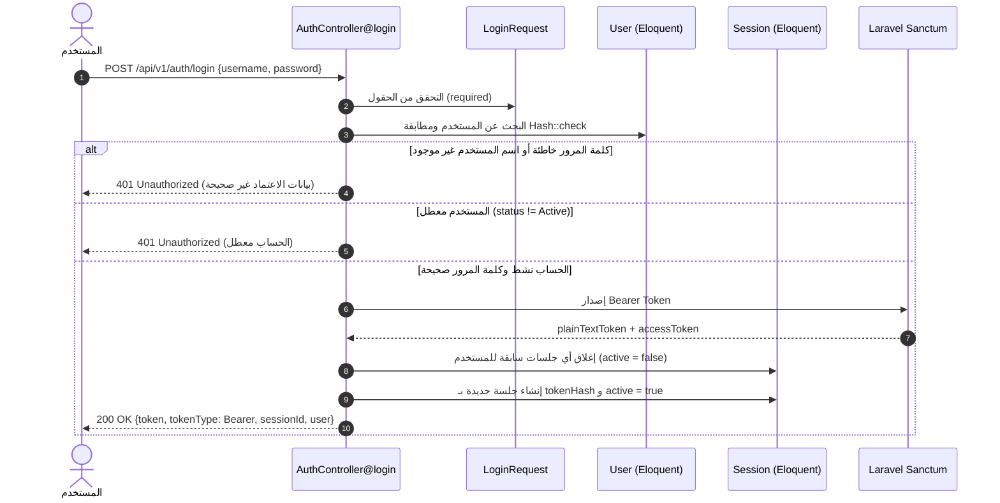

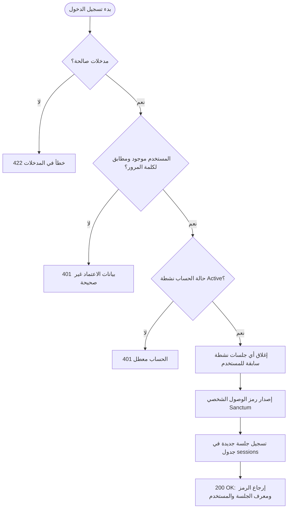

| الخطوة | الملف الحاضن | الدالة / السطور المسؤولة |
|---|---|---|
| التحقق من المدخلات | `app/Http/Requests/Auth/LoginRequest.php` | `rules()` |
| فحص كلمة المرور وحالة الحساب | `app/Http/Controllers/Api/V1/AuthController.php` | `login()` الأسطر 35-45 |
| إغلاق الجلسات السابقة وإنشاء الجلسة | `app/Http/Controllers/Api/V1/AuthController.php` | `login()` الأسطر 56-71 |

---

### 4.2 تدفق فرض الخمول 30 دقيقة (Idle Session Timeout)

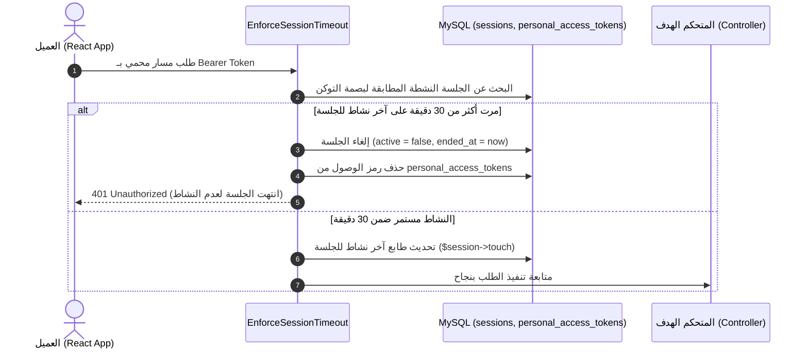

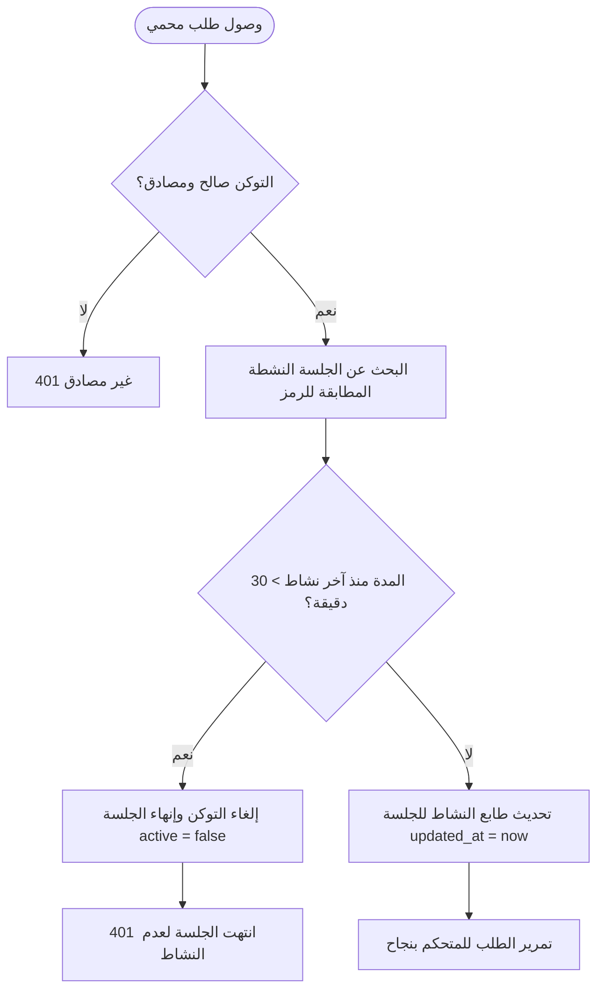

| الخطوة | الملف الحاضن | الدالة / السطور المسؤولة |
|---|---|---|
| فحص مدة الخمول وإلغاء الرمز | `app/Http/Middleware/EnforceSessionTimeout.php` | `handle()` الأسطر 64-83 |
| تمديد الجلسة عند النشاط | `app/Http/Middleware/EnforceSessionTimeout.php` | `handle()` السطر 85 (`$session->touch()`) |

---

### 4.3 تدفق طلب مورد مدرسة أخرى وإرجاع 404 (School Isolation - Decision 9)

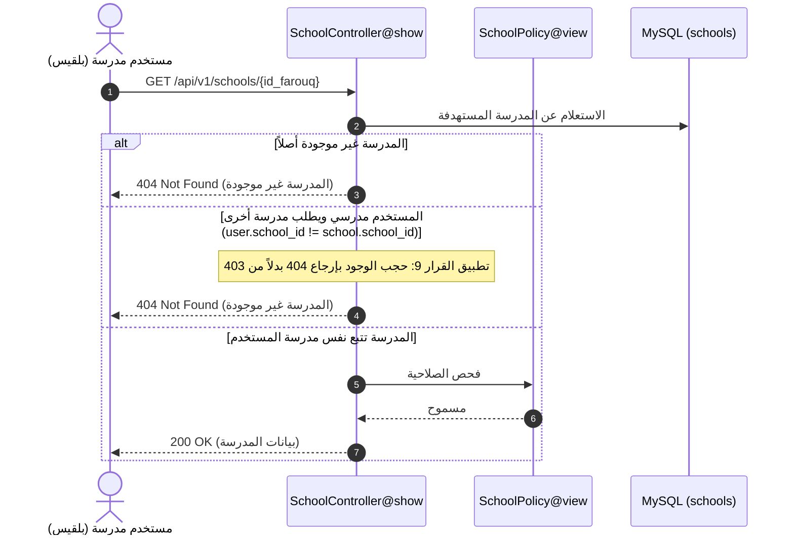

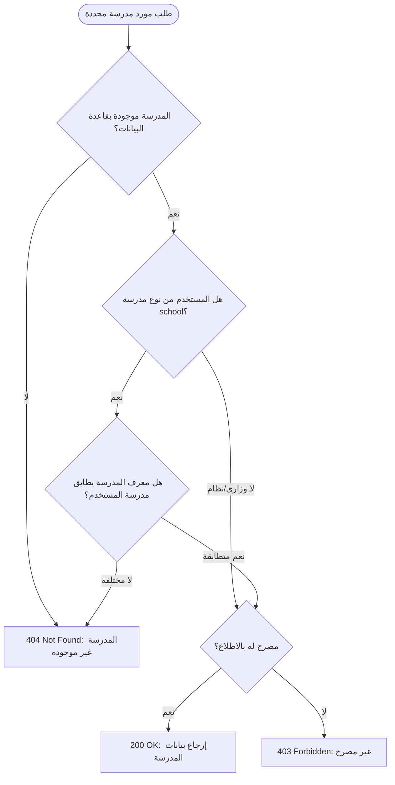

| الخطوة | الملف الحاضن | الدالة / السطور المسؤولة |
|---|---|---|
| فحص تطابق المدرسة وإرجاع 404 | `app/Http/Controllers/Api/V1/SchoolController.php` | `show()` الأسطر 75-78 |
| فحص سياسة العرض لمستخدم المدرسة | `app/Policies/SchoolPolicy.php` | `view()` الأسطر 40-54 |

---

### 4.4 تدفق إنشاء مستخدم جديد وقيد التكامل الحصري XOR

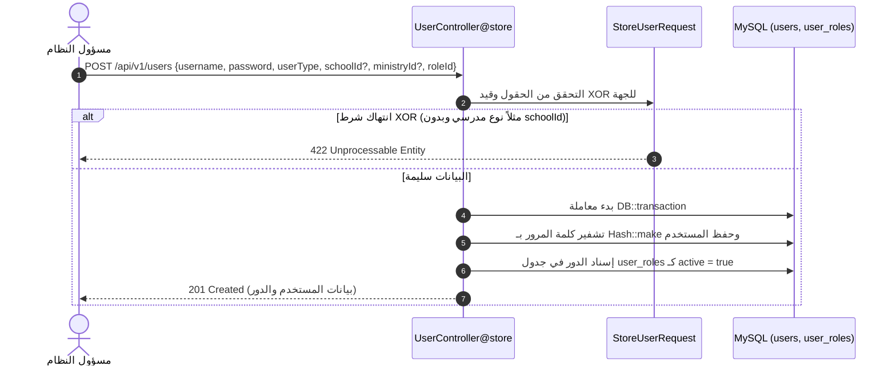

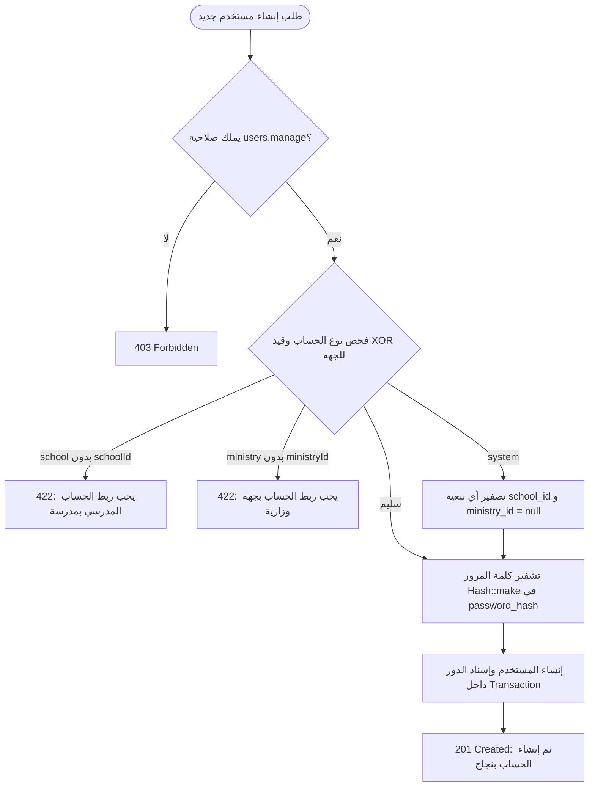

| الخطوة | الملف الحاضن | الدالة / السطور المسؤولة |
|---|---|---|
| قواعد التحقق وقيد XOR | `app/Http/Requests/Admin/StoreUserRequest.php` | `rules()` الأسطر 20-29 |
| التخزين المشفر وإسناد الدور | `app/Http/Controllers/Api/V1/UserController.php` | `store()` الأسطر 105-130 |

---

### 4.5 تدفق تفعيل/تعطيل الحساب وحظر تعطيل النفس

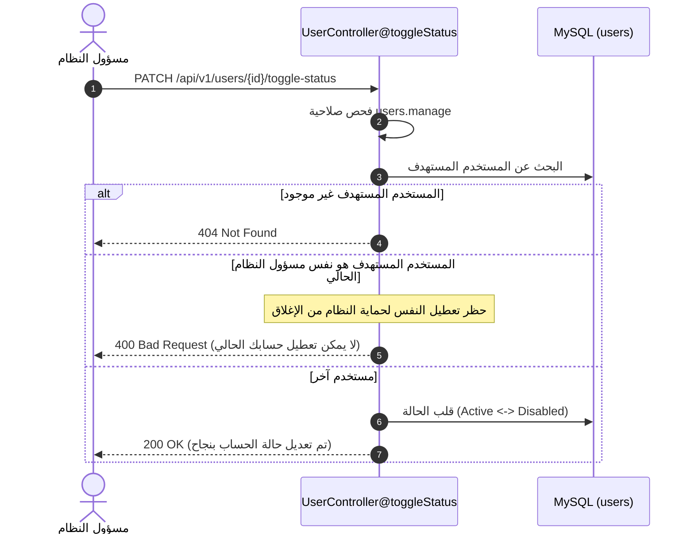

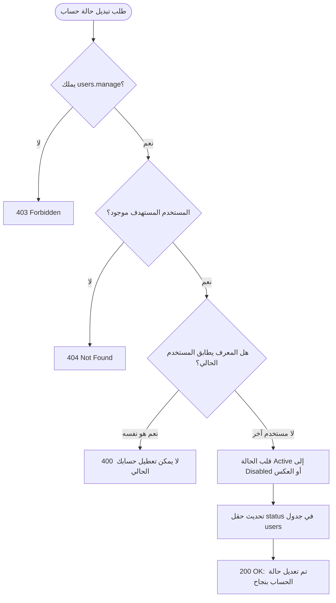

| الخطوة | الملف الحاضن | الدالة / السطور المسؤولة |
|---|---|---|
| حظر تعطيل النفس وقلب الحالة | `app/Http/Controllers/Api/V1/UserController.php` | `toggleStatus()` الأسطر 218-232 |

---

### 4.6 تدفق تفعيل وتعطيل مدرسة (سياسة تعطيل لا حذف)

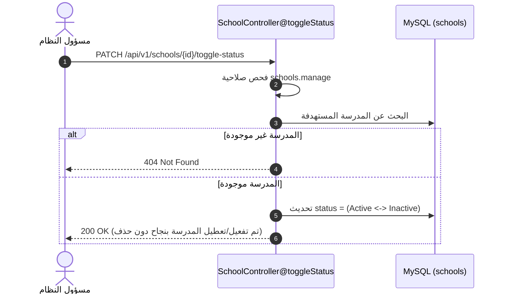

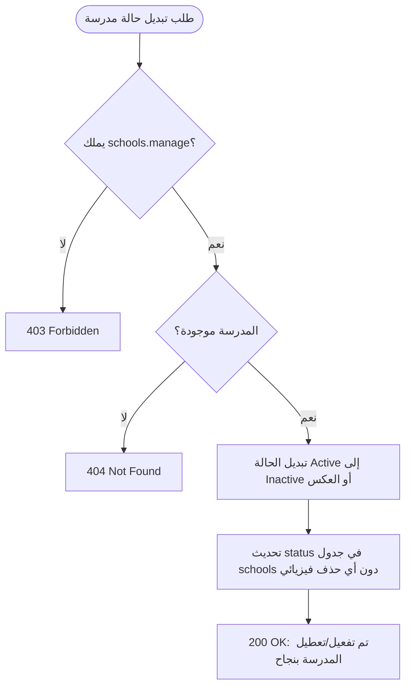

| الخطوة | الملف الحاضن | الدالة / السطور المسؤولة |
|---|---|---|
| تبديل حالة المدرسة دون حذف | `app/Http/Controllers/Api/V1/SchoolController.php` | `toggleStatus()` الأسطر 164-179 |

---

## 5. القواعد المنفذة وموضع فرض كل منها (Business & Security Rules)

| رمز القاعدة | عنوان القاعدة | الوصف المنفذ | الملف الحاضن والدالة الفعلية |
|---|---|---|---|
| **FR-GEN-01** | تسجيل الدخول والتحقق | التحقق من صحة بيانات الدخول وحالة الحساب وإصدار رمز Sanctum وجلسة. | `AuthController@login` |
| **FR-GEN-02** | تسجيل الخروج وتتبع الجلسات | إلغاء رمز الوصول وإنهاء الجلسة وفرض خمول 30 دقيقة. | `AuthController@logout`, `EnforceSessionTimeout@handle` |
| **FR-GEN-03** | استعلام الملف الشخصي والصلاحيات | جلب بيانات المستخدم المصادق مع أدواره وصلاحياته ومدرسته. | `AuthController@me`, `UserResource@toArray` |
| **FR-ADM-01** | إدارة دليل المدارس | استعراض وإضافة وتعديل بيانات المدارس بالرموز الرسمية. | `SchoolController@index`, `store`, `update` |
| **FR-ADM-02** | استعراض وفلترة المستخدمين | استعراض قائمة الحسابات والفلترة بالنوع، المدرسة، والحالة. | `UserController@index` |
| **FR-ADM-03** | إدارة الحسابات والأدوار | إنشاء وتحديث الحسابات وإسناد الدور المؤسسي (RBAC). | `UserController@store`, `update` |
| **FR-ADM-04** | تفعيل وتعطيل الكيانات | تفعيل وتعطيل المدارس والمستخدمين دورياً مع بقاء السجلات التاريخية. | `SchoolController@toggleStatus`, `UserController@toggleStatus` |
| **BR-GEN-06** | حظر مسؤول النظام من التقييم | مسؤول النظام يملك صلاحيات الإدارة ومحظور قطعياً من أي صلاحيات أو مسارات تقييم. | مصفوفة Seeders + `EvaluationPolicy@viewAny`, `view` |
| **BR-GEN-07** | الجلسة النشطة الواحدة والخمول | حصر المستخدم بجلسة نشطة واحدة وإغلاق الجلسة بعد 30 دقيقة خمول. | `AuthController@login` (إغلاق القديم), `EnforceSessionTimeout` |
| **NFR-SEC-02** | تجزئة كلمات المرور المشفرة | تخزين كلمات المرور مشفرة بخوارزمية Bcrypt الآمنة في حقل `password_hash` وتجريدها من أي استجابة. | `UserController@store`, `update`, `User::getAuthPassword()` |
| **NFR-SEC-03** | العزل المؤسسي وحماية التوكن | عزل وصول المدارس للموارد وإلغاء الرمز عند الخمول أو الخروج. | `SchoolController@show`, `EvaluationController@show`, `EnforceSessionTimeout` |
| **تعطيل لا حذف** | سياسة الحفاظ على البيانات | عدم استخدام دوال الحذف الفيزيائي نهائياً، واستبدالها بحقول الحالة `status`. | `SchoolController@toggleStatus`, `UserController@toggleStatus` |

---

## 6. جدول التتبع المعماري (Traceability Matrix)

| العنصر | مصدره التوثيقي | ما هو موجود في الكود الفعلي | الحالة | ملاحظاتي |
|---|---|---|---|---|
| **UC-GEN-01** | الفصل الثالث / 4.4.4 | مسار `POST /api/v1/auth/login` و `logout` و `me` | مطابق | |
| **UC-ADM-01** | الفصل الثالث / 4.4.4 | مسارات `/api/v1/schools` و `/api/v1/users` بكافة عملياتها | مطابق | |
| **FR-GEN-01..03** | وثيقة المتطلبات الوظيفية | متحكم `AuthController` ومورد `UserResource` وميدلوير Sanctum | مطابق | |
| **FR-ADM-01..04** | وثيقة المتطلبات الوظيفية | متحكما `SchoolController` و `UserController` مع التحقق والـ Resources | مطابق | |
| **جدول users** | ERD-01 / قاموس البيانات | النموذج `User.php` وميجريشن الحزمة 1، حقل `password_hash` و `status` | مطابق | |
| **جدول sessions** | ERD-01 / conventions §4 | النموذج `Session.php` بـ `session_token` وحقول البدء والانتهاء و `active` | مطابق | |
| **جدول schools** | ERD-01 / قاموس البيانات | النموذج `School.php` بـ `identification_data` و `educational_stage` | مطابق | |
| **جدول roles** | ERD-01 / قاموس البيانات | النموذج `Role.php` ومصفوفة الأدوار الخمسة المعتمدة | مطابق | |
| **جدول permissions** | ERD-01 / قاموس البيانات | النموذج `Permission.php` وربطه بالـ Roles عبر `role_permissions` | مطابق | |
| **جدول user_roles** | ERD-01 / قاموس البيانات | النموذج `UserRole.php` كعلاقة Many-to-Many مفعلة بحقل `active` | مطابق | |
| **جدول ministries** | ERD-01 / قاموس البيانات | النموذج `Ministry.php` لربط الحسابات الوزارية | مطابق | |
| **قيد XOR للجهة** | conventions §7 و ERD-01 | التحقق في `StoreUserRequest` والتخزين في `UserController` | مطابق | |
| **قسم 4.5 الأمان** | الفصل الرابع | وسيط `EnforceSessionTimeout`، عزل المدارس (القرار 9)، والـ Policies | مطابق | |
| **conventions.md** | الاتفاقيات المعمارية | التواريخ UTC Z، الحقول camelCase، المغلف الرباعي ApiResponse | مطابق | |
| **مسارات استعادة كلمة المرور** | كتالوج 4.4.4 (`auth/password/*`) | غير مبنية في هذه الشريحة | غير منفّذ | |

---

## 7. الفجوات والانحرافات عن التصميم والكتالوج (Gaps & Deviations)

1. **مسارات استعادة وتغيير كلمة المرور:**
   * *في كتالوج 4.4.4:* ذُكرت مسارات `POST /api/v1/auth/password/forgot` و `/reset` و `/change`.
   * *في الكود الفعلي:* غير منفذة في الشريحة الأولى؛ تغيير كلمة المرور يتم إدارياً فقط عبر مسؤول النظام في مسار `PUT /api/v1/users/{id}`.
2. **غياب ملف Policy مخصص للمستخدمين (`UserPolicy`):**
   * *الواقع:* فحص صلاحية `users.manage` يتم برمجياً مباشرة داخل دوال متحكم `UserController` وداخل `StoreUserRequest::authorize()` و `UpdateUserRequest::authorize()` دون وجود ملف `app/Policies/UserPolicy.php` منفصل.
3. **غياب Trait باسم `BelongsToSchool`:**
   * *الواقع:* فحص العزل المؤسسي لم يُبْنَ كـ Trait أو Global Scope تلقائي، بل فُرض صراحة في استعلامات المتحكمات (`where school_id`) وفحوص السياسات لضمان الدقة والتحكم الكامل في سلوك إرجاع 404 (القرار 9).
4. **تخزين بصمة التوكن في sessions:**
   * *الواقع:* استُخدمت بصمة `hash('sha256', (string) $accessToken->id)` لربط جلسة Sanctum بجلسة جدول `sessions`، وهو حل عملي لربط الجلستين لم ينص عليه الكتالوج صراحة.

---

## 8. سيناريوهات التحقق اليدوي والآلي (Verification Scenarios)

### 8.1 السيناريو اليدوي بالحسابات التجريبية
* **كلمة المرور المشتركة للتطوير:** `ChangeMeDevPassword@2026`
1. **تسجيل دخول مسؤول النظام:**
   * استدعاء `POST /api/v1/auth/login` بـ `admin`.
   * المتوقع: 200 OK، إرجاع التوكن وأدوار المستخدم وتأكيد امتلاك `users.manage` و `schools.manage`.
2. **إنشاء مدرسة جديدة:**
   * استدعاء `POST /api/v1/schools` ببيانات مدرسة جديدة برمز تعريفي فريد.
   * المتوقع: 201 Created وإرجاع بيانات المدرسة.
3. **إنشاء مستخدم مدرسي بمدرسة بلقيس:**
   * استدعاء `POST /api/v1/users` مع `userType: school` و `schoolId: 1` ودور `school_evaluator`.
   * المتوقع: 201 Created وتأكيد قيد XOR.
4. **فحص العزل المؤسسي (القرار 9):**
   * تسجيل دخول مقيم بلقيس `quality_belqees` وطلب مورد مدرسة الفاروق `GET /api/v1/schools/2`.
   * المتوقع: 404 Not Found (حجب الوجود).
5. **فحص حظر تعطيل النفس:**
   * محاولة مسؤول النظام تعطيل حسابه عبر `PATCH /api/v1/users/1/toggle-status`.
   * المتوقع: 400 Bad Request برفض تعطيل الحساب الشخصي.

### 8.2 قائمة السيناريوهات الآلية المعتمدة (من مخرجات `testdox`)

```text
Authentication And Authorization Feature (Tests\Feature\AuthenticationAndAuthorizationFeature)
 [x] User can login with valid credentials
 [x] Login fails with invalid password
 [x] Login fails with non existent username
 [x] Login validation errors comply with standard envelope
 [x] Disabled user cannot login
 [x] Authenticated user can access me endpoint
 [x] User can logout and revoke token and session
 [x] Session expires after 30 minutes of inactivity
 [x] School tenant isolation returns 404 when accessing another school
 [x] School index list is isolated to users own school
 [x] Evaluation policy enforces school isolation and roles
 [x] Negative permission rules for standards manager and admin

User Authentication (Tests\Feature\UserAuthentication)
 [x] User password is hashed and not plain text
 [x] Auth attempt succeeds with correct credentials
 [x] Auth attempt fails with wrong password
```

---

## 9. واجهات المستخدم في الفرونت إند (`school-eval-web`)

تتضمن الحزمة الأمامية المكونات والصفحات التالية المنفذة فعلياً للشريحة الأولى:

| اسم الصفحة / المكون | المسار البرمجي في React | نقاط النهاية التي تستدعيها بالخلفية | الدور الوظيفي |
|---|---|---|---|
| **صفحة تسجيل الدخول** | `src/features/auth/LoginPage.tsx` | `POST /api/v1/auth/login` | شاشة الدخول الموحدة بحسب الهوية البصرية، والتحقق من الحقول وحفظ التوكن في التخزين المحلي. |
| **سياق المصادقة العام** | `src/features/auth/AuthContext.tsx` | `POST /api/v1/auth/login`<br/>`POST /api/v1/auth/logout`<br/>`GET /api/v1/auth/me` | إدارة حالة المستخدم المصادق، التحقق عند تحميل التطبيق، وتوفير دالة الخروج. |
| **إدارة المدارس** | `src/features/admin/SchoolsManagementPage.tsx` | `GET /api/v1/schools`<br/>`POST /api/v1/schools`<br/>`PUT /api/v1/schools/{id}`<br/>`PATCH /api/v1/schools/{id}/toggle-status` | جدول المدارس، الفلترة والبحث، نافذة منبثقة لإضافة وتعديل مدرسة، وزر تفعيل/تعطيل المدرسة. |
| **إدارة المستخدمين** | `src/features/admin/UsersManagementPage.tsx` | `GET /api/v1/users`<br/>`POST /api/v1/users`<br/>`PUT /api/v1/users/{id}`<br/>`PATCH /api/v1/users/{id}/toggle-status`<br/>`GET /api/v1/users/meta` | جدول الحسابات، فلترة النوع والدور، نافذة إضافة مستخدم مع ربط الجهة والدور، وتفعيل/تعطيل الحساب. |
| **لوحة تحكم الأدمن** | `src/features/admin/AdminDashboardOverview.tsx` | تستند لبيانات المدارس والمستخدمين | بطاقات إحصائية لإجمالي المدارس، المدارس النشطة، المستخدمين، ونسبة النشاط. |
| **لوحة الهبوط الرئيسية** | `src/components/DashboardPage.tsx` | تستند لحالة `useAuth` والملف الشخصي | توجيه المستخدم لصفحته المخصصة بحسب دوره الوظيفي. |
