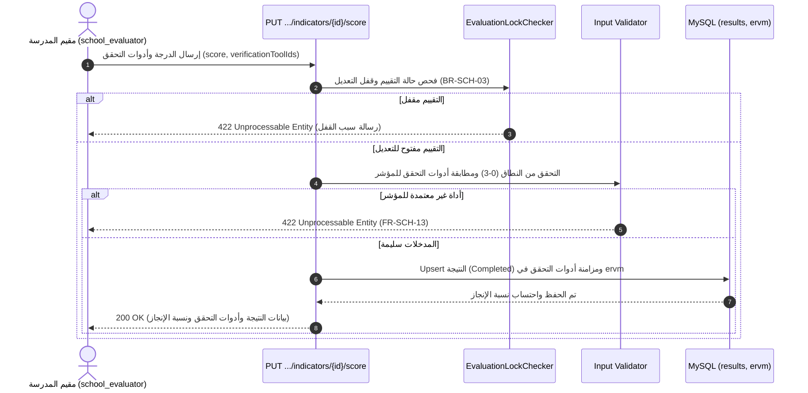
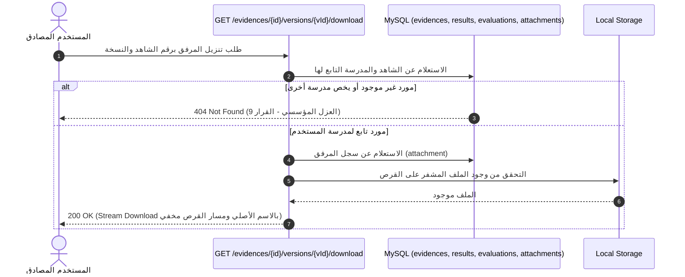

# توثيق الواقع الفعلي للشريحة الثانية: التقييم الذاتي والشواهد (As-Built Documentation)

**النظام:** نظام إدارة وتقويم الجودة المدرسية (School Quality System)  
**الحزمة:** `school-eval-api` (Backend)  
**الشريحة:** الشريحة الثانية (Vertical Slice 2: Self-Evaluation, Scoring & Evidence Management — إغلاق الفجوات)  
**تاريخ التوثيق:** 26 أكتوبر 2026  
**طبيعة الوثيقة:** توثيق الواقع الفعلي المنفذ في الكود البرمجي (As-Built) بدون افتراضات غير متحققة.

---

## 0. بيانات التوليد والبيئة (Metadata & Test Summary)

* **الفرع الحالي (Git Branch):** `feature/slice2-closure`
* **آخر التزام (Last Commit):** `58b28b9 اغلاق فجوات الشريحة 2 ومزامنة التوثيق والاختبارات`
* **تاريخ التوليد:** 26 أكتوبر 2026
* **نتيجة تشغيل الاختبارات (`php artisan test`):**
  * إجمالي الاختبارات: **72 اختباراً** (نجاح 100%، 0 إخفاق، 0 أخطاء).
  * إجمالي التأكيدات: **5,790 تأكيداً (Assertions)**.
  * زمن التنفيذ: نحو 8.2 ثانية.
  * اختبارات الشريحة الثانية الحصرية (`EvaluationAndEvidenceFeatureTest`): **20 اختباراً ناجحاً و2,780 تأكيداً**.

---

## 1. الغرض والنطاق وقائمة الملفات

### 1.1 الغرض والنطاق المنفذ
تمكين مقيم المدرسة (`school_evaluator`) من:
1. استعراض شجرة المعايير والمؤشرات والواصفات للإصدار المعياري الخام أو مدمجة مع نتائج التقييم الذاتي ونسبة الإنجاز وأدوات التحقق لمدرسته.
2. رصد وتعديل نتائج المؤشرات بأسلوب الإدراج أو التحديث (Upsert) مع التحقق من النطاق المعياري (0-3)، والواصفة أو اشتقاقها آلياً، ومزامنة أدوات التحقق المعتمدة للمؤشر (`verificationToolIds`).
3. تدوين الملاحظات التوثيقية المباشرة على نتائج المؤشرات المرصودة وفق كتالوج 4.4.4 (`POST /api/v1/evaluation-results/{id}/notes`).
4. إدارة الشواهد والأدلة الداعمة: استعراض شواهد النتيجة، إنشاء شاهد جديد ورفع النسخة الأولى، رفع النسخ التاريخية المتتابعة مع ضمان نسخة حالية واحدة (`current=true`)، وتنزيل المرفق الرقمي بالاسم الأصلي دون كشف مسار التخزين الداخلي.
5. فرض العزل المؤسسي الصارم بين المدارس (القرار المعماري 9: إرجاع 404 لمنع استكشاف الموارد).
6. فرض قفل التقييم ومنع التعديل بعد الإرسال النهائي للتقرير إلا في البنود المفتوحة لطلبات الاستكمال (قاعدة العمل BR-SCH-03).

### 1.2 قائمة الملفات المنشأة والمعدلة في الشريحة

| المسار | الحالة | الدور الوظيفي الفعلي |
|---|---|---|
| `routes/api.php` | معدل | تسجيل مسارات الإصدارات المعيارية، شجرة التقييم، رصد المؤشرات، ملاحظات النتائج، استعراض الشواهد ورفعها وتنزيل مرفقاتها تحت بادئة `/api/v1`. |
| `app/Http/Controllers/Api/V1/StandardVersionController.php` | منشأ | متحكم استعراض شجرة الإصدار المعياري الخام بصلاحية `standards.view`. |
| `app/Http/Controllers/Api/V1/EvaluationController.php` | معدل / موسّع | استعراض التقييمات، شجرة التقييم المدمجة بالنتائج وأدوات التحقق، رصد درجات المؤشرات ومزامنة أدوات التحقق Upsert، وتدوين الملاحظات على النتيجة. |
| `app/Http/Controllers/Api/V1/EvidenceController.php` | معدل / موسّع | إدارة الشواهد: استعراض شواهد النتيجة، إنشاء الشاهد والنسخة والمرفق، رفع النسخ التاريخية، وتنزيل المرفق بالاسم الأصلي دون تسريب مسار التخزين. |
| `app/Services/EvaluationLockChecker.php` | منشأ | خدمة مركزية مستقلة لفحص حالات قفل التقييم بعد الإرسال وفحص استثناءات بنود طلب الاستكمال (BR-SCH-03). |
| `app/Policies/EvaluationPolicy.php` | معدل | إضافة فحص قفل التقييم عبر `EvaluationLockChecker` في دالة `update` بجانب العزل وصلاحية `evaluations.edit`. |
| `app/Policies/EvidencePolicy.php` | منشأ | سياسة ضبط الوصول للشواهد وفرض العزل المؤسسي وصلاحية `evidence.manage`. |
| `app/Providers/AppServiceProvider.php` | معدل | تسجيل ربط `EvidencePolicy` بنموذج `Evidence` صراحة عبر `Gate::policy`. |
| `app/Http/Resources/EvaluationResource.php` | منشأ سابقاً | مورد تحويل التقييم ونتائجه وشواهده إلى JSON بنمط camelCase وتواريخ UTC Z. |
| `tests/Feature/EvaluationAndEvidenceFeatureTest.php` | معدل / موسّع | 20 اختبار ميزة يغطي الشجرة والرصد وأدوات التحقق والملاحظات والقفل والعزل واستعراض وتنزيل الشواهد. |
| `docs/api/evaluation_endpoints.md` | معدل | دليل تفصيلي لكافة نقاط النهاية المنفذة ونماذج الطلب والاستجابة موجّه لمطور الواجهة الأمامية. |
| `docs/slices/slice2_evaluation_evidence.md` | معدل | هذا الملف؛ توثيق الواقع الفعلي المنفذ (As-Built). |
| `docs/api/evaluation.http` | معدل | ملف تجربة واستدعاء مباشر بصيغة REST Client متوافق مع المسارات المنفذة فعلياً. |

---

## 2. جدول نقاط النهاية المنفذة فعلياً (API Endpoints Table)

| المسار (URI) | الطريقة (Method) | الصلاحية (Permission) | المتحكم والدالة (Action) | التحقق من المدخلات (Validation/Request) | السياسة الصلاحية (Policy) |
|---|---|---|---|---|---|
| `/api/v1/standard-versions/{id}` | `GET` | `standards.view` | `StandardVersionController@show` | لا يوجد مدخلات (معرف مسار) | فحص مباشر: `$user->hasPermission('standards.view')` |
| `/api/v1/evaluations/{id}/standards-tree` | `GET` | `standards.view` أو `evaluations.view` | `EvaluationController@standardsTree` | لا يوجد مدخلات (معرف مسار) | `EvaluationPolicy@view` + فحص العزل المؤسسي |
| `/api/v1/evaluations/{evaluationId}/indicators/{indicatorId}/score` | `PUT` | `evaluations.edit` | `EvaluationController@scoreIndicator` | تحقق مدمج: `score` (0-3), `scoreDescriptorId`, `verificationToolIds` (مطابقة لأدوات المؤشر), `textualResult` | `EvaluationPolicy@update` + `EvaluationLockChecker::canModifyIndicator` |
| `/api/v1/evaluation-results/{id}/notes` | `POST` | `evaluations.edit` | `EvaluationController@addNote` | تحقق مدمج: `text` (مطلوب، أقصى 2000 حرف) | فحص `evaluations.edit` + فحص العزل (404) + `EvaluationLockChecker` |
| `/api/v1/evaluation-results/{id}/evidences` | `GET` | `evaluations.view` أو `evidence.manage` | `EvidenceController@indexByResult` | لا يوجد مدخلات (معرف مسار) | فحص الصلاحية + فحص العزل المؤسسي (404) |
| `/api/v1/evaluation-results/{id}/evidences` | `POST` | `evidence.manage` | `EvidenceController@store` | تحقق مدمج: `title`, `description`, `justification`, `file` (10MB, mimes) | فحص `evidence.manage` + فحص العزل (404) + `EvaluationLockChecker` |
| `/api/v1/evidences/{id}/versions` | `POST` | `evidence.manage` | `EvidenceController@addVersion` | تحقق مدمج: `file` (10MB, mimes) | `EvidencePolicy@manage` + فحص العزل (404) + `EvaluationLockChecker` |
| `/api/v1/evidences/{id}/versions/{versionId}/download` | `GET` | `evaluations.view` أو `evidence.manage` | `EvidenceController@downloadVersion` | لا يوجد مدخلات (معرفات مسار) | فحص الصلاحية + فحص العزل المؤسسي (404) |

---

## 3. القواعد المنفذة وموقع فرضها في الكود (Business Rules Enforcement)

| رمز / اسم القاعدة | الوصف المنفذ | الملف الحاضن | الدالة / السطور المسؤولة |
|---|---|---|---|
| **BR-SCH-03** (قفل التقييم بعد الإرسال) | منع التعديل ورصد الدرجات وتدوين الملاحظات ورفع الشواهد إن كان آخر تسليم بحالة `Submitted` أو `UnderReview` أو `Completed` أو حالة التقييم `Completed`. السماح فقط في `Draft`، أو في `NeedsCompletion` للبنود المفتوحة في `completion_request_items`. | `app/Services/EvaluationLockChecker.php` | `checkEvaluationGeneralStatus()`, `canModifyIndicator()`, `canModifyEvidence()` |
| **BR-SCH-05** (تقديرات المؤشرات) | التحقق من أن الدرجة عدد صحيح محصور بين 0 و 3 حصراً ومطابقتها لواصفة معيارية معتمدة. | `app/Http/Controllers/Api/V1/EvaluationController.php` | `scoreIndicator()` (سطر التحقق `'score' => ['required', 'integer', 'between:0,3']`) |
| **FR-SCH-13** (أدوات التحقق) | قبول مصفوفة `verificationToolIds` والتحقق من أن كل أداة معتمدة للمؤشر في `indicator_verification_methods` وإلا يُرجع 422، ومزامنتها في جدول `evaluation_result_verification_methods`. | `app/Http/Controllers/Api/V1/EvaluationController.php` | `scoreIndicator()` و `standardsTree()` |
| **قيد النسخة الحالية الواحدة** (`current=true`) | إلغاء النسخ السابقة لتصبح `current = false` وترقية النسخة الجديدة كـ `current = true` برقم إصدار تزايدي داخل Transaction. | `app/Http/Controllers/Api/V1/EvidenceController.php` | `store()` (النسخة 1) و `addVersion()` (النسخ التالية داخل `DB::transaction`) |
| **العزل المؤسسي** (القرار المعماري 9) | إرجاع `404 Not Found` بدلاً من 403 عند محاولة مستخدم مدرسة الوصول لأي تقييم أو نتيجة أو شاهد أو ملاحظة أو تحميل مرفق يخص مدرسة أخرى لمنع كشف وجود المورد. | `EvaluationController.php`, `EvidenceController.php`, `EvaluationPolicy.php` | كافة دوال العرض والرصد والملاحظات والشواهد والتنزيل |
| **قيود المرفقات وتنزيلها الآمن** (`conventions §9`) | الحد الأقصى 10MB (10240 KB)، والامتدادات المسموحة: `pdf, png, jpg, jpeg, docx, xlsx`، وتخزين الملف باسم UUID سري دون كشف مسار التخزين للعميل، وتنزيله بالاسم الأصلي المحفوظ. | `app/Http/Controllers/Api/V1/EvidenceController.php` | `store()`, `addVersion()`, `downloadVersion()` |
| **اشتقاق الواصفة تلقائياً** | إذا لم يُرسل `scoreDescriptorId`، يُستعلم تلقائياً عن واصفة المؤشر التي تطابق `score_value = score` لنفس المؤشر وإصدار الدورة. | `app/Http/Controllers/Api/V1/EvaluationController.php` | `scoreIndicator()` |
| **معادلة نسبة الإنجاز** | $\text{النسبة} = \text{round}\left(\frac{\text{النتائج المرصودة المكتملة}}{\text{المؤشرات الفعالة في إصدار الدورة}} \times 100, 2\right)$ | `app/Http/Controllers/Api/V1/EvaluationController.php` | `standardsTree()` و `scoreIndicator()` |

---

## 4. مخططات التسلسل والنشاط للمسارات الأساسية (Sequence Diagrams)

### 4.1 مسار رصد المؤشر ومزامنة أدوات التحقق مع فحص القفل

### 4.2 مسار تنزيل المرفق الرقمي للشاهد مع العزل المؤسسي

---

## 5. جدول تتبع المتطلبات والمخططات (Traceability Matrix)

| البند المرجعي | التوصيف المرجعي من الوثيقة | الحالة في الكود | الدليل والملف الحاضن والدالة الفعلية |
|---|---|---|---|
| **UC-SCH-01** | استعراض شجرة المعايير والمؤشرات وتفاصيل التقييم المدرسي | **مطابق** | `StandardVersionController@show` (الشجرة الخام)، `EvaluationController@standardsTree` (الشجرة المدمجة)، `EvaluationController@show` (ملف التقييم). |
| **UC-SCH-02** | تقييم المؤشرات ورصد الدرجات والملاحظات وتحديد أدوات التحقق | **مطابق** | `EvaluationController@scoreIndicator` (الرصد، الواصفة، أدوات التحقق)، `EvaluationController@addNote` (تدوين الملاحظات). |
| **UC-SCH-03** | إدارة وتوثيق الشواهد والأدلة الداعمة ورفع نسخها وتنزيل مرفقاتها | **مطابق** | `EvidenceController@store` (إنشاء الشاهد والنسخة 1)، `EvidenceController@addVersion` (النسخ المتتالية)، `EvidenceController@indexByResult` (قائمة الشواهد)، `EvidenceController@downloadVersion` (تنزيل المرفق). |
| **FR-SCH-01** | الوصول إلى دورة نشطة ضمن فترتها | **مطابق** | `EvaluationLockChecker::checkEvaluationGeneralStatus` (فحص حالة الدورة Closed ومنع الرصد والتعديل مع إرجاع 422 و errors.cycle)، `EvaluationController@standardsTree` (استعراض تقييم الدورة النشطة للمدرسة). |
| **FR-SCH-02** | عرض هيكل الإصدار الفعّال | **مطابق** | `StandardVersionController@show` (عرض الشجرة الخام للإصدار المعتمد)، `EvaluationController@standardsTree` (عرض هيكل معايير ومؤشرات الإصدار المرتبط بالتقييم). |
| **FR-SCH-03** | عرض أدوات التحقق المعتمدة لكل مؤشر قبل الرصد | **مطابق** | `EvaluationController@standardsTree` (تضمين قائمة applicableVerificationTools المعتمدة للمؤشر مع الاسم والنوع والوصف في كل مؤشر بالشجرة). |
| **FR-SCH-04** | إدخال التقدير 0-3 والنتيجة النصية | **مطابق** | `EvaluationController@scoreIndicator` (استقبال التقدير score بين 0 و3، ومطابقة الواصفة المقابلة أو اشتقاقها آلياً وحفظها في score_descriptor_id). |
| **FR-SCH-05** | الحفظ في أي لحظة دون اكتمال | **مطابق** | `EvaluationController@scoreIndicator` (تنفيذ Upsert فوري على المؤشر الفردي وتحديث حالته إلى Completed دون اشتراط اكتمال بقية المؤشرات). |
| **FR-SCH-06** | قيود التعديل بحسب حالة المخرج | **مطابق** | `EvaluationLockChecker::canModifyIndicator` و `EvaluationLockChecker::canModifyEvidence` (منع التعديل عند قفل التقييم بعد تسليم التقرير Submitted/UnderReview/Completed، والسماح ببنود الاستكمال المفتوحة في NeedsCompletion وفق BR-SCH-03). |
| **FR-SCH-07** | قائمة المؤشرات غير المكتملة وحالة الاكتمال | **مطابق** | `EvaluationController@standardsTree` (تضمين completionStatus لكل مؤشر، وحساب meta.completionPercentage و meta.completedIndicatorsCount، وإرجاع resultId: null للمؤشرات غير المرصودة). |
| **FR-SCH-08** | إضافة شاهد ببياناته الوصفية | **مطابق** | `EvidenceController@store` (إنشاء سجل Evidence بالبيانات الوصفية: title, description, justification, indicator_id, result_id). |
| **FR-SCH-09** | رفع الملفات | **مطابق** | `EvidenceController@store` و `EvidenceController@addVersion` (التحقق من الامتداد والحجم <= 10 ميغابايت وحفظ الملف المشفر بـ UUID في attachments والتخزين المحلي). |
| **FR-SCH-10** | ربط كل شاهد بمؤشر | **مطابق** | `EvidenceController@store` (اشتراط ربط الشاهد بنتيجة مؤشر موجودة result_id تابعة لمدرسة المستخدم وحفظ indicator_id في جدول evidences). |
| **FR-SCH-11** | نص يبرر النتيجة أو الشاهد | **مطابق** | `EvidenceController@store` (حقل justification للشاهد)، و `EvaluationController@addNote` (تدوين الملاحظات التبريرية على النتيجة المرصودة). |
| **FR-SCH-12** | ملاحظة مرتبطة بالمؤشر وبأداة التحقق | **جزئي** | `EvaluationController@addNote` (ربط الملاحظة بنتيجة المؤشر result_id في جدول notes). *قيد معماري:* لا يوجد عمود لأداة التحقق tool_id في بنية جدول notes وقاموس البيانات المعتمد. |
| **FR-SCH-13** | تسجيل أدوات التحقق المستخدمة | **مطابق** | `EvaluationController@scoreIndicator` (استقبال verificationToolIds والتحقق من اعتمادها للمؤشر ومزامنتها في جدول evaluation_result_verification_methods). |
| **FR-SCH-14** | عرض الشواهد وتعديلها وإضافة الناقص عند الاستكمال | **مطابق** | `EvidenceController@indexByResult` (عرض الشواهد والنسخ)، `EvidenceController@downloadVersion` (تنزيل المرفق)، و `EvaluationLockChecker::canModifyEvidence` (السماح برفع نسخ الشواهد ضمن بنود الاستكمال المفتوحة). |
| **FR-SCH-14b** | حفظ النسخ | **مطابق** | `EvidenceController@addVersion` (حفظ النسخ التاريخية المتسلسلة في evidence_versions وضمان نسخة وحيدة نشطة current=true داخل transaction). |
| **FR-SCH-15** | عرض النتائج مع الملاحظات والشواهد | **مطابق** | `EvaluationController@standardsTree` (عرض شجرة التقييم المدمجة بالنتائج والدرجات والواصفات وعدد الشواهد والملاحظات)، `EvidenceController@indexByResult` (عرض تفاصيل الشواهد). |
| **خطوات SD-01: خطوة 1** | استعلام المقوم عن شجرة التقييم ونسبة الإنجاز الأولية | **مطابق** | `EvaluationController@standardsTree` |
| **خطوات SD-01: خطوة 2** | التحقق من قفل التقييم قبل إجراء أي تعديل (BR-SCH-03) | **مطابق** | `EvaluationLockChecker::canModifyIndicator` |
| **خطوات SD-01: خطوة 3** | إرسال التقدير الرقمي (0-3) والملاحظة النصية عبر Upsert | **مطابق** | `EvaluationController@scoreIndicator` |
| **خطوات SD-01: خطوة 4** | مطابقة الواصفة المحددة مع التقدير أو اشتقاقها تلقائياً | **مطابق** | `EvaluationController@scoreIndicator` |
| **خطوات SD-01: خطوة 5** | التحقق من أدوات التحقق المرسلة ومطابقتها للمؤشر ومزامنتها | **مطابق** | `EvaluationController@scoreIndicator` (جدول `evaluation_result_verification_methods`) |
| **خطوات SD-01: خطوة 6** | تدوين الملاحظة التوثيقية على النتيجة المرصودة عبر مسار النتيجة | **مطابق** | `EvaluationController@addNote` (`POST /api/v1/evaluation-results/{id}/notes`) |
| **خطوات SD-01: خطوة 7** | إرسال بيانات الشاهد وملفه المرفق المرتبط بنتيجة مرصودة | **مطابق** | `EvidenceController@store` (`POST /api/v1/evaluation-results/{id}/evidences`) |
| **خطوات SD-01: خطوة 8** | تخزين المرفق بالاسم المشفر بـ UUID وحفظ بياناته الأصلية في `attachments` | **مطابق** | `EvidenceController@store` |
| **خطوات SD-01: خطوة 9** | إنشاء أول نسخة تاريخية للشاهد كنسخة حالية (`version_no=1`, `current=true`) | **مطابق** | `EvidenceController@store` |
| **خطوات SD-01: خطوة 10** | رفع نسخة جديدة للشاهد وتحويل النسخ السابقة لـ `false` داخل `DB::transaction` | **مطابق** | `EvidenceController@addVersion` |
| **خطوات SD-01: خطوة 11** | استعراض قائمة الشواهد لنتيجة المؤشر مع نسخها ومرفقاتها | **مطابق** | `EvidenceController@indexByResult` |
| **خطوات SD-01: خطوة 12** | تنزيل المرفق الرقمي بالاسم الأصلي ودون كشف مسار التخزين الداخلي | **مطابق** | `EvidenceController@downloadVersion` |
| **جدول ERD-03: `evaluations`** | المعرف، الدورة، المدرسة، المنشئ، الحالة. (القيد: عزل 404) | **مطابق** | `app/Models/Evaluation.php` |
| **جدول ERD-03: `evaluation_results`** | النتيجة، المؤشر، الدورة، التقدير (0-3 NOT NULL)، الواصفة (NOT NULL). (القيد: فريد مركب `evaluation_id, indicator_id`) | **مطابق** | `app/Models/EvaluationResult.php` |
| **جدول ERD-03: `evidences`** | الشاهد، معرف النتيجة (NOT NULL)، معرف المؤشر (NOT NULL)، العنوان والمبرر | **مطابق** | `app/Models/Evidence.php` |
| **جدول ERD-03: `evidence_versions`** | النسخة، معرف الشاهد، رقم الإصدار، الحالة الحالية. (القيد: نسخة حالية واحدة فقط `current=true` تدار برمجياً) | **مطابق** | `app/Models/EvidenceVersion.php` |
| **جدول ERD-03: `attachments`** | المرفق متعدد الأشكال (`target_type`, `target_id`). (القيد: الحجم $\le 10$ ميغابايت، التخزين المحلي بـ UUID) | **مطابق** | `app/Models/Attachment.php` |
| **جدول ERD-03: `notes`** | الملاحظات التوثيقية. (القيد: الربط بـ `result_id` والحد الأقصى 2000 حرف) | **مطابق** | `app/Models/Note.php` |
| **جدول ERD-03: `evaluation_result_verification_methods`** | أساليب التحقق المستخدمة فعلياً. (القيد: الربط بنتيجة التقييم وأداة معتمدة للمؤشر) | **مطابق** | `app/Models/EvaluationResultVerificationMethod.php` |

---

## 6. الفجوات والقيود والانحرافات عن التصميم والكتالوج (Gaps & Deviations)

### 6.1 حالة الفجوات السابقة بعد إغلاق الشريحة الثانية
1. **ربط أدوات التحقق المستخدمة بالنتيجة (`evaluation_result_verification_methods`):**
   * **أُغلقت بالكامل:** أصبحت نقطة النهاية `PUT .../score` تقبل `verificationToolIds` وتتحقق من مطابقتها لأدوات المؤشر وتزامنها مع جدول الربط، وتنعكس في استجابة الرصد وفي شجرة التقييم.
2. **مسار مستقل لاستعراض قائمة شواهد النتيجة:**
   * **أُغلقت بالكامل:** تم توفير مسار `GET /api/v1/evaluation-results/{id}/evidences` لجلب قائمة الشواهد ونسخها ومرفقاتها دون كشف مسار التخزين.
3. **تنزيل المرفق الرقمي للشاهد:**
   * **أُغلقت بالكامل:** تم توفير مسار `GET /api/v1/evidences/{id}/versions/{versionId}/download` لتنزيل المرفق بالاسم الأصلي مع حماية المسار المحلي وفرض العزل المؤسسي.

### 6.2 القيود المعمارية الموثقة (Constraints)
* **قيد ربط الملاحظات بأدوات التحقق:** متطلب FR-SCH-13 يوحي بإمكانية ربط تعليق الملاحظة بأداة التحقق، ولكن جدول `notes` في قاعدة البيانات وقاموس البيانات المعتمد لا يحتوي على عمود لأداة التحقق (`tool_id`)؛ والتزاماً بالقاعدة الصارمة «عدم تعديل بنية الجداول»، تم توثيق ذلك كقيد معماري بحيث ترتبط الملاحظة بنتيجة المؤشر العامة حصراً.

### 6.3 الانحرافات المعتمدة عن كتالوج 4.4.4
1. **مسار رصد النتيجة (Upsert):**
   * في الكتالوج: `PUT /api/v1/evaluation-results/{id}`
   * في الكود الفعلي: `PUT /api/v1/evaluations/{evaluationId}/indicators/{indicatorId}/score`
   * *السبب:* المؤشرات غير المرصودة لا تملك سجلاً مسبقاً في `evaluation_results`، مما يتطلب مساراً مركباً يربط التقييم بالمؤشر مباشرة.
2. **مسار شجرة التقييم المدمجة:**
   * في الكتالوج: كان موجوداً فقط `GET /api/v1/standard-versions/{id}`.
   * في الكود الفعلي: أُضيف مسار `GET /api/v1/evaluations/{id}/standards-tree` لجلب شجرة الإصدار مدمجة برصد المدرسة وأدوات التحقق ونسبة الإنجاز.
3. **مسار تنزيل المرفق الرقمي:**
   * إضافة أمنية ضرورية: `GET /api/v1/evidences/{id}/versions/{versionId}/download`.

---

## 7. سيناريو التحقق اليدوي بالحسابات التجريبية (Manual Verification Scenario)

### 7.1 بيانات الحسابات الاختبارية
* **كلمة المرور المشتركة للتطوير:** `ChangeMeDevPassword@2026`
* **مقيم مدرسة بلقيس:** `quality_belqees` (`school_id: 1`)
* **مقيم مدرسة الفاروق:** `quality_farouq` (`school_id: 2`)
* **مدير مدرسة بلقيس:** `principal_belqees` (`school_id: 1`)
* **مسؤول النظام العام:** `admin` (`system_admin`)

### 7.2 خطوات سيناريو التحقق العملي
1. **تسجيل دخول مقيم بلقيس:** `POST /api/v1/auth/login` بالحساب `quality_belqees` للحصول على الرمز.
2. **استعراض شجرة التقييم المدمجة:** `GET /api/v1/evaluations/1/standards-tree` والتأكد من ظهور المعايير والمؤشرات وأدوات التحقق ونسبة الإنجاز.
3. **فحص العزل المؤسسي (القرار 9):** تسجيل دخول مقيم الفاروق `quality_farouq` وطلب شجرة تقييم بلقيس -> النتيجة المتوقعة: `404 Not Found`.
4. **رصد درجة مؤشر مع أدوات التحقق:** `PUT /api/v1/evaluations/1/indicators/1/score` مع `score: 3` و `verificationToolIds: [2, 4]` -> النتيجة المتوقعة: `200 OK`، ومزامنة أدوات التحقق واشتقاق الواصفة وارتفاع نسبة الإنجاز.
5. **تدوين ملاحظة توثيقية:** `POST /api/v1/evaluation-results/{resultId}/notes` مع نص الملاحظة -> النتيجة المتوقعة: `201 Created`.
6. **رفع شاهد جديد (v1 ومرفق):** `POST /api/v1/evaluation-results/{resultId}/evidences` بنمط `multipart/form-data` مع ملف PDF -> النتيجة المتوقعة: `201 Created`، وظهور المرفق باسمه الأصلي ودون كشف مسار التخزين.
7. **استعراض شواهد النتيجة:** `GET /api/v1/evaluation-results/{resultId}/evidences` -> النتيجة المتوقعة: `200 OK` واسترجاع الشاهد ونسخه ومرفقاته.
8. **تنزيل المرفق الرقمي:** `GET /api/v1/evidences/{evidenceId}/versions/{versionId}/download` -> النتيجة المتوقعة: `200 OK` مع ترويسة تنزيل المرفق باسمه الأصلي وتدفق الملف الثنائي.
9. **رفع نسخة جديدة للشاهد (v2):** `POST /api/v1/evidences/{evidenceId}/versions` -> النتيجة المتوقعة: `201 Created`، النسخة 2 تصبح `current=true` والنسخة 1 تتحول إلى `current=false`.
10. **فحص قفل التقييم (BR-SCH-03):** محاكاة تسليم التقرير بحالة `Submitted` ومحاولة الرصد أو تدوين الملاحظات -> النتيجة المتوقعة: `422 Unprocessable Entity` مع رسالة القفل الصريحة.

---

## 8. الدَّين التقني (Technical Debt)

1. **التحقق من صحة المدخلات داخل المتحكمات (Inline Validator in Controllers):**
   * تم استخدام `Validator::make` مباشرة داخل دوال `EvaluationController` و `EvidenceController` بدلاً من استخراجها إلى Form Request Classes مخصصة (مثل `ScoreIndicatorRequest`, `StoreEvidenceRequest`, `StoreNoteRequest`).
   * *الإجراء المستقبلي المقترح:* إعادة صياغة التحقق عبر Form Requests منفصلة لتحسين قابلية القراءة وإعادة الاستخدام.
2. **منطق المعاملات وإدارة التخزين في EvidenceController (Transaction & Storage Logic in Controller):**
   * إدارة المعاملة `DB::transaction` لحفظ الشاهد والنسخة والمرفق وتحديث رايات `current` وتخزين الملفات على القرص تقع بالكامل داخل `EvidenceController` بدلاً من نقلها إلى خدمة تطبيقية مخصصة (مثل `EvidenceService`).
   * *الإجراء المستقبلي المقترح:* نقل منطق المعاملة والتخزين إلى Service Layer عند الانتقال للشرائح المتقدمة.
