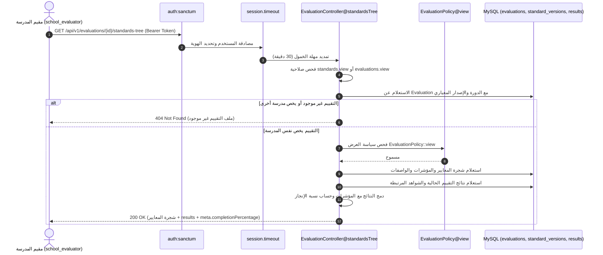
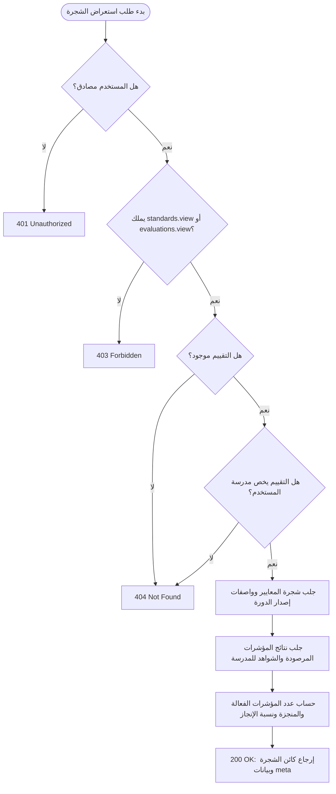
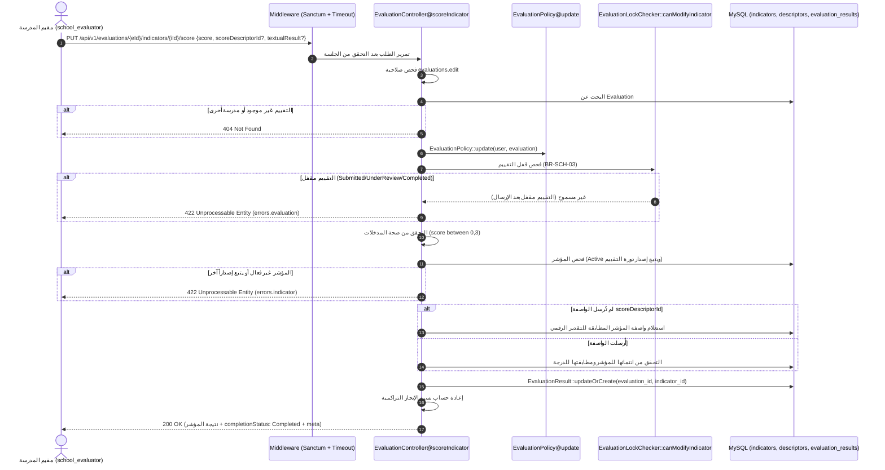
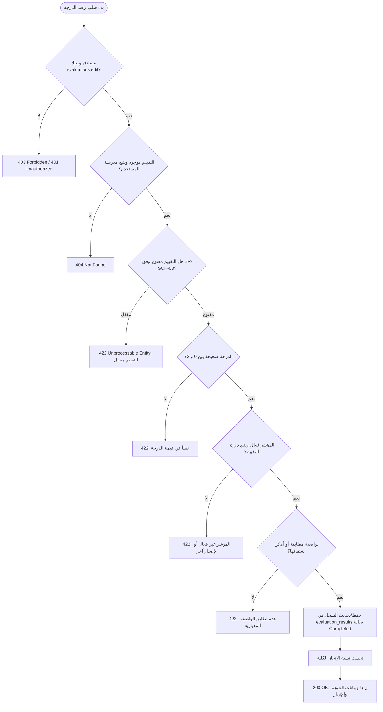
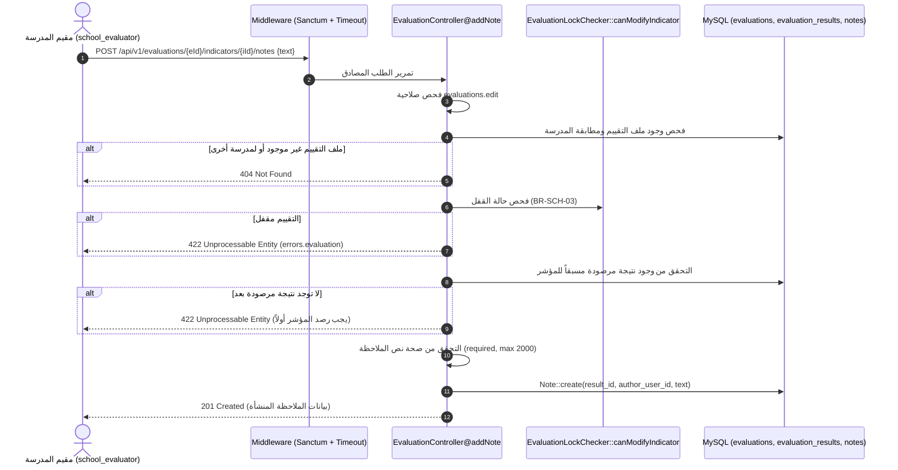
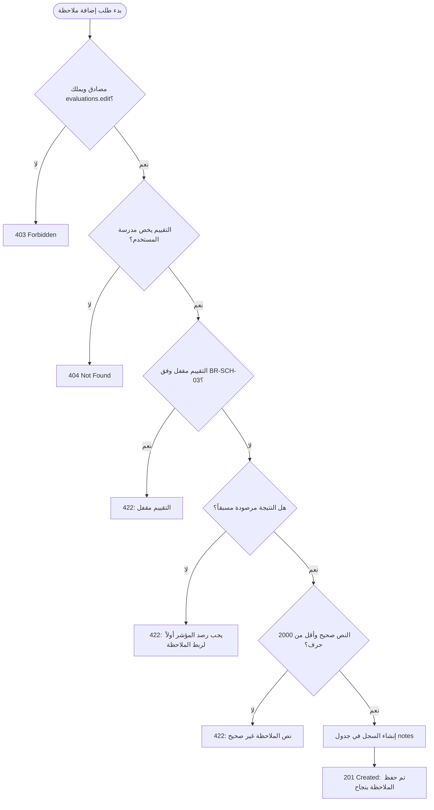
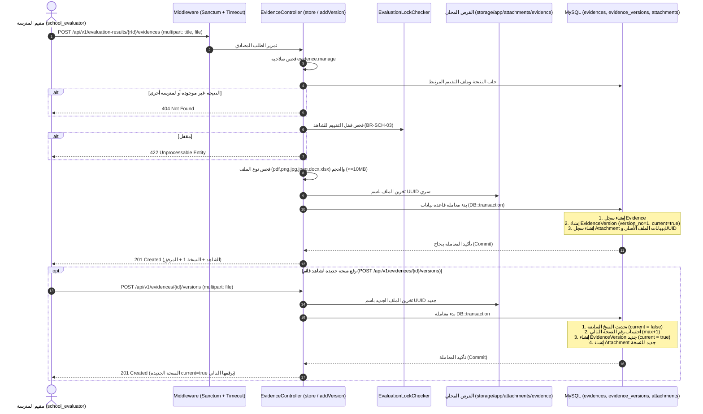
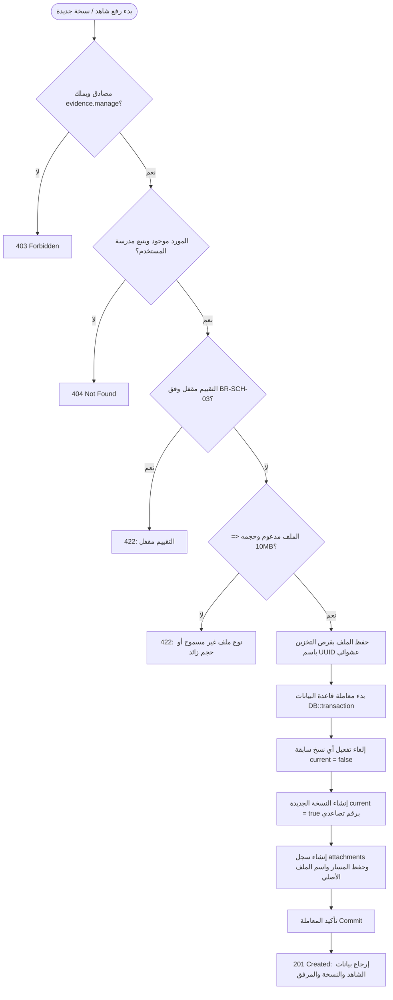

# توثيق الواقع الفعلي للشريحة الثانية: التقييم الذاتي والشواهد (As-Built Documentation)

**النظام:** نظام إدارة وتقويم الجودة المدرسية (School Quality System)  
**الحزمة:** `school-eval-api` (Backend)  
**الشريحة:** الشريحة الثانية (Vertical Slice 2: Self-Evaluation, Scoring & Evidence Management)  
**تاريخ التوثيق:** 25 أكتوبر 2026  
**طبيعة الوثيقة:** توثيق الواقع الفعلي المنفذ في الكود البرمجي (As-Built) بدون افتراضات غير متحققة.

---

## 0. بيانات التوليد والبيئة (Metadata & Test Summary)

* **الفرع الحالي (Git Branch):** `feature/evaluation-evidence-api`
* **آخر التزام (Last Commit):** `0704b4e55af7435b44114dc4a521e4e9e2897c5e اضافة شرح لاين وصل المشروع (2026-10-25 19:42:27 +0300)`
* **تاريخ التوليد:** 25 أكتوبر 2026
* **نتيجة تشغيل الاختبارات (`php artisan test`):**
  * إجمالي الاختبارات: **65 اختباراً** (نجاح 100%، 0 إخفاق، 0 أخطاء).
  * إجمالي التأكيدات: **5,757 تأكيداً (Assertions)**.
  * زمن التنفيذ: نحو 7.2 ثانية.
  * اختبارات الشريحة الثانية الحصرية (`EvaluationAndEvidenceFeatureTest`): **13 اختباراً ناجحاً و2,747 تأكيداً**.

---

## 1. الغرض والنطاق وقائمة الملفات

### 1.1 الغرض والنطاق المنفذ
تمكين مقيم المدرسة (`school_evaluator`) من:
1. استعراض شجرة المعايير والمؤشرات والواصفات للإصدار المعياري الخام أو مدمجة مع نتائج التقييم الذاتي ونسبة الإنجاز لمدرسته.
2. رصد وتعديل نتائج المؤشرات بأسلوب الإدراج أو التحديث (Upsert) مع التحقق من النطاق المعياري (0-3) والواصفة أو اشتقاقها آلياً.
3. تدوين الملاحظات التوثيقية المباشرة على المؤشرات المرصودة.
4. إنشاء الشواهد والأدلة الداعمة لنتائج التقييم ورفع نسخها التاريخية ومرفقاتها مع ضمان نسخة حالية واحدة (`current=true`) وحفظ المرفقات وفق معايير الأمان وUUID.
5. فرض العزل المؤسسي الصارم بين المدارس (القرار المعماري 9: إرجاع 404 لمنع استكشاف الموارد).
6. فرض قفل التقييم ومنع التعديل بعد الإرسال النهائي للتقرير إلا في البنود المفتوحة لطلبات الاستكمال (قاعدة العمل BR-SCH-03).

### 1.2 قائمة الملفات المنشأة والمعدلة في الشريحة

| المسار | الحالة | الدور الوظيفي الفعلي |
|---|---|---|
| `routes/api.php` | معدل | تسجيل مسارات الإصدارات المعيارية، شجرة التقييم، رصد المؤشرات، الملاحظات، والشواهد ونسخها تحت بادئة `/api/v1` وميدلوير Sanctum والخمول. |
| `app/Http/Controllers/Api/V1/StandardVersionController.php` | منشأ | متحكم استعراض شجرة الإصدار المعياري الخام بصلاحية `standards.view`. |
| `app/Http/Controllers/Api/V1/EvaluationController.php` | منشأ / موسّع | متحكم استعراض التقييمات، شجرة التقييم المدمجة بالنتائج والإنجاز، رصد درجات المؤشرات Upsert، وتدوين الملاحظات. |
| `app/Http/Controllers/Api/V1/EvidenceController.php` | منشأ | متحكم إنشاء الشواهد لنتائج التقييم ورفع النسخ التاريخية والمرفقات وإدارة قيد النسخة الحالية داخل Transaction. |
| `app/Services/EvaluationLockChecker.php` | منشأ | خدمة مركزية مستقلة لفحص حالات قفل التقييم بعد الإرسال وفحص استثناءات بنود طلب الاستكمال (BR-SCH-03). |
| `app/Policies/EvaluationPolicy.php` | معدل | إضافة فحص قفل التقييم عبر `EvaluationLockChecker` في دالة `update` بجانب العزل وصلاحية `evaluations.edit`. |
| `app/Policies/EvidencePolicy.php` | منشأ | سياسة ضبط الوصول للشواهد وفرض العزل المؤسسي وصلاحية `evidence.manage`. |
| `app/Providers/AppServiceProvider.php` | معدل | تسجيل ربط `EvidencePolicy` بنموذج `Evidence` صراحة عبر `Gate::policy`. |
| `app/Http/Resources/EvaluationResource.php` | منشأ سابقاً | مورد تحويل التقييم ونتائجه وشواهده إلى JSON بنمط camelCase وتواريخ UTC Z. |
| `phpunit.xml` | معدل | ضبط `SEED_DEFAULT_PASSWORD` بقيمة اختبارية مخصصة لحل تعطل اختبارات Seeder في بيئة `testing`. |
| `tests/Feature/AuthenticationAndAuthorizationFeatureTest.php` | معدل | قراءة كلمة المرور الافتراضية من متغير البيئة الاختبارية لضمان انسجام بيئة الاختبار. |
| `tests/Feature/EvaluationAndEvidenceFeatureTest.php` | منشأ | ملف اختبارات ميزة متكامل يضم 13 اختباراً يغطي الشجرة والرصد والقفل والعزل والشواهد والمرفقات. |
| `docs/api/evaluation_endpoints.md` | منشأ | دليل تفصيلي لنقاط النهاية ونماذج الطلب والاستجابة والأخطاء موجّه لمطور الواجهة الأمامية. |
| `docs/slices/slice2_evaluation_evidence.md` | منشأ | هذا الملف؛ توثيق الواقع الفعلي المنفذ (As-Built). |
| `docs/api/evaluation.http` | منشأ | ملف تجربة واستدعاء مباشر بصيغة REST Client لـ VS Code. |

---

## 2. جدول نقاط النهاية المنفذة فعلياً (API Endpoints Table)

| المسار (URI) | الطريقة (Method) | الصلاحية (Permission) | المتحكم والدالة (Action) | التحقق من المدخلات (Validation/Request) | السياسة الصلاحية (Policy) |
|---|---|---|---|---|---|
| `/api/v1/standard-versions/{id}` | `GET` | `standards.view` | `StandardVersionController@show` | لا يوجد مدخلات (معرف مسار) | فحص مباشر: `$user->hasPermission('standards.view')` |
| `/api/v1/evaluations/{id}/standards-tree` | `GET` | `standards.view` أو `evaluations.view` | `EvaluationController@standardsTree` | لا يوجد مدخلات (معرف مسار) | `EvaluationPolicy@view` + فحص العزل المؤسسي |
| `/api/v1/evaluations/{evaluationId}/indicators/{indicatorId}/score` | `PUT` | `evaluations.edit` | `EvaluationController@scoreIndicator` | تحقق مدمج (`Validator::make`): `score` (0-3), `scoreDescriptorId`, `textualResult` | `EvaluationPolicy@update` + `EvaluationLockChecker::canModifyIndicator` |
| `/api/v1/evaluations/{evaluationId}/indicators/{indicatorId}/notes` | `POST` | `evaluations.edit` | `EvaluationController@addNote` | تحقق مدمج (`Validator::make`): `text` (مطلوب، أقصى 2000 حرف) | فحص `evaluations.edit` + فحص العزل + `EvaluationLockChecker` |
| `/api/v1/evaluation-results/{id}/evidences` | `POST` | `evidence.manage` | `EvidenceController@store` | تحقق مدمج (`Validator::make`): `title`, `description`, `justification`, `file` (10MB, mimes) | فحص `evidence.manage` + فحص العزل + `EvaluationLockChecker` |
| `/api/v1/evidences/{id}/versions` | `POST` | `evidence.manage` | `EvidenceController@addVersion` | تحقق مدمج (`Validator::make`): `file` (10MB, mimes) | `EvidencePolicy@manage` + فحص العزل + `EvaluationLockChecker` |

---

## 3. القواعد المنفذة وموقع فرضها في الكود (Business Rules Enforcement)

| رمز / اسم القاعدة | الوصف المنفذ | الملف الحاضن | الدالة / السطور المسؤولة |
|---|---|---|---|
| **BR-SCH-03** (قفل التقييم بعد الإرسال) | منع التعديل إن كان آخر تسليم بحالة `Submitted` أو `UnderReview` أو `Completed` أو حالة التقييم `Completed`. السماح فقط في `Draft`، أو في `NeedsCompletion` للبنود المفتوحة في `completion_request_items`. | `app/Services/EvaluationLockChecker.php` | `checkEvaluationGeneralStatus()`, `canModifyIndicator()`, `canModifyEvidence()` |
| **BR-SCH-05** (تقديرات المؤشرات) | التحقق من أن الدرجة عدد صحيح محصور بين 0 و 3 حصراً. | `app/Http/Controllers/Api/V1/EvaluationController.php` | `scoreIndicator()` (سطر التحقق `'score' => ['required', 'integer', 'between:0,3']`) |
| **قيد النسخة الحالية الواحدة** (`current=true`) | إلغاء النسخ السابقة لتصبح `current = false` وترقية النسخة الجديدة كـ `current = true` برقم إصدار تزايدي داخل Transaction. | `app/Http/Controllers/Api/V1/EvidenceController.php` | `store()` (النسخة 1) و `addVersion()` (النسخ التالية داخل `DB::transaction`) |
| **العزل المؤسسي** (القرار المعماري 9) | إرجاع `404 Not Found` بدلاً من 403 عند محاولة مستخدم مدرسة الوصول لأي تقييم أو نتيجة أو شاهد يخص مدرسة أخرى لمنع كشف وجود المورد. | `EvaluationController.php`, `EvidenceController.php`, `EvaluationPolicy.php` | `EvaluationController@show`, `standardsTree`, `scoreIndicator`, `addNote`, `EvidenceController@store`, `addVersion` |
| **قيود المرفقات والملفات** (`conventions §9`) | الحد الأقصى 10MB (10240 KB)، والامتدادات المسموحة: `pdf, png, jpg, jpeg, docx, xlsx`، وتخزين الملف باسم UUID سري مع الاحتفاظ بالاسم الأصلي في `attachments`. | `app/Http/Controllers/Api/V1/EvidenceController.php` | `store()`, `addVersion()` (التحقق وتخزين الملف بـ `storeAs('attachments/evidence', $uuid.$ext, 'local')`) |
| **اشتقاق الواصفة تلقائياً** | إذا لم يُرسل `scoreDescriptorId`، يُستعلم تلقائياً عن واصفة المؤشر التي تطابق `score_value = score` لنفس المؤشر وإصدار الدورة. وإن أُرسلت يتم التحقق من انتمائها للمؤشر ومطابقتها للدرجة. | `app/Http/Controllers/Api/V1/EvaluationController.php` | `scoreIndicator()` (الأسطر 300-340) |
| **معادلة نسبة الإنجاز** | $\text{النسبة} = \text{round}\left(\frac{\text{النتائج المرصودة المكتملة}}{\text{المؤشرات الفعالة في إصدار الدورة}} \times 100, 2\right)$ | `app/Http/Controllers/Api/V1/EvaluationController.php` | `standardsTree()` (السطور 190-205) و `scoreIndicator()` (السطور 360-368) |

---

## 4. مخططات التسلسل والنشاط للمسارات الأربعة (Sequence & Activity Diagrams)

### 4.1 مسار استعراض شجرة التقييم المخصصة (`GET /api/v1/evaluations/{id}/standards-tree`)





---

### 4.2 مسار رصد نتيجة المؤشر Upsert (`PUT /api/v1/evaluations/{evalId}/indicators/{indId}/score`)





---

### 4.3 مسار تدوين الملاحظة التوثيقية (`POST /api/v1/evaluations/{evalId}/indicators/{indId}/notes`)





---

### 4.4 مسار إنشاء الشاهد ورفع النسخ والمرفقات (`POST .../evidences` و `POST .../versions`)





---

## 5. جدول تتبع المتطلبات والمخططات (Traceability Matrix)

| المتطلب / الخطوة | التوصيف | الحالة في الكود | الملف الحاضن والدالة الفعلية |
|---|---|---|---|
| **خطوات SD-01** | مخطط تسلسل رصد التقييم والشواهد ومطابقة الواصفات وقفل التعديل | **منفذ** | `EvaluationController@scoreIndicator`, `EvidenceController@store` |
| **مخطط AD-01** | مخطط نشاط دورة التقييم والرصد ورفع النسخ المتتالية | **منفذ** | `EvaluationController.php` و `EvidenceController.php` |
| **FR-SCH-10** | رصد نتيجة المؤشر وتسجيل التقدير (0 إلى 3) | **منفذ** | `EvaluationController@scoreIndicator` (سطر التحقق `between:0,3`) |
| **FR-SCH-11** | اختيار واصفة الأداء ومطابقتها لمستوى التقدير أو اشتقاقها | **منفذ** | `EvaluationController@scoreIndicator` (اشتقاق آلي أو تحقق من التطابق) |
| **FR-SCH-12** | تدوين الملاحظات التوثيقية والتعليلات على المؤشرات | **منفذ** | `EvaluationController@addNote` (يحفظ في جدول `notes`) |
| **FR-SCH-13** | إرفاق وتوثيق الشواهد والأدلة الداعمة لنتيجة المؤشر | **منفذ** | `EvidenceController@store` (يحفظ في جدول `evidences`) |
| **FR-SCH-14** | رفع وثيقة الشاهد الرقمية وتخزينها في المرفقات | **منفذ** | `EvidenceController@store` (يحفظ في `attachments` باسم UUID) |
| **FR-SCH-14b** | إدارة النسخ التاريخية مع الاحتفاظ بالقديم ونسخة حالية واحدة | **منفذ** | `EvidenceController@addVersion` (تحويل القديم لـ false والجديد لـ true داخل transaction) |
| **FR-SCH-15** | استعراض الشواهد الداعمة المرتبطة بالنتائج | **منفذ جزئياً** | مدمج في `EvaluationController@standardsTree` و `EvaluationController@show` (كعلاقة `evidences`)، ولا يوجد مسار مستقل `GET /api/v1/evaluation-results/{id}/evidences`. |
| **BR-SCH-03** | قفل التقييم بعد الإرسال النهائي ومنع التعديل إلا في الاستكمال | **منفذ** | `EvaluationLockChecker.php` بكافة دواله + `EvaluationPolicy@update` |
| **BR-SCH-05** | حصر قيم التقدير بالقيم الصحيحة (0، 1، 2، 3) | **منفذ** | `EvaluationController@scoreIndicator` (`Validator` + اشتقاق المستوى) |

---

## 6. الفجوات والانحرافات عن التصميم والكتالوج (Gaps & Deviations)

### 6.1 ما لم يُنفّذ في الكود الفعلي (Gaps)
1. **ربط أدوات التحقق المستخدمة بالنتيجة (`evaluation_result_verification_methods`):**
   * *الواقع:* جدول `evaluation_result_verification_methods` معرّف في قاعدة البيانات ولديه نموذج Eloquent، ولكن لم تُبنَ في هذه الشريحة أي نقطة نهاية برمجية لربط أدوات وأساليب التحقق بالنتيجة أثناء الرصد.
2. **الاشتقاق الذكي للتحليل النصي (`textual_result`):**
   * *الواقع:* الحقل مدعوم في الطلب ويُخزن كما هو كنص حر مرسل من المستخدم، لكن لا توجد معالجة آلية أو توليد تلقائي له في هذه الشريحة.
3. **مسار مستقل لاستعراض قائمة شواهد النتيجة:**
   * *الواقع:* لا يوجد مسار منفصل `GET /api/v1/evaluation-results/{id}/evidences`؛ الشواهد تُستعرض فقط مدمجة داخل تفاصيل النتيجة في شجرة التقييم (`standards-tree`) أو تفاصيل التقييم (`EvaluationController@show`).

### 6.2 الانحرافات عن كتالوج 4.4.4 المعتمد (Deviations)
1. **مسار الملاحظات:**
   * في الكتالوج: `POST /api/v1/evaluation-results/{id}/notes`
   * في الكود الفعلي: `POST /api/v1/evaluations/{evaluationId}/indicators/{indicatorId}/notes`
   * *السبب:* تمكين المقيم من تدوين الملاحظة مباشرة من سياق شجرة المؤشرات والتقييم قبل الحاجة لمعرفة `result_id`.
2. **مسار رصد النتيجة (Upsert):**
   * في الكتالوج: `PUT /api/v1/evaluation-results/{id}`
   * في الكود الفعلي: `PUT /api/v1/evaluations/{evaluationId}/indicators/{indicatorId}/score`
   * *السبب:* المؤشرات غير المرصودة لا تملك سجلاً في `evaluation_results` مسبقاً، لذا تم اعتماد مسار مركب ينشئ النتيجة أو يعدلها مباشرة.
3. **إضافة مسار شجرة التقييم المدمجة:**
   * في الكتالوج: كان موجوداً فقط `GET /api/v1/standard-versions` وتفاصيلها.
   * في الكود الفعلي: أُضيف مسار `GET /api/v1/evaluations/{id}/standards-tree` لجلب الشجرة مدمجة بنتائج ورصد المدرسة.

### 6.3 الافتراضات البرمجية المعتمدة في التنفيذ
1. **اعتماد حالة `Draft` فقط كحالة فتح للتقييم:**
   * اعتمد الكود أن أي تسليم بحالة `Submitted` أو `UnderReview` أو `Completed` يعتبر قفلاً تاماً للتقييم ويمنع التعديل.
2. **تخطي حالة `Pending` في `evaluation_results`:**
   * قاموس البيانات يعرف حالة `Pending`، لكن الكود الفعلي يكتب دائماً `completion_status = 'Completed'` نظراً لأن حقلي `score` و `score_descriptor_id` هما `NOT NULL` في قاعدة البيانات.
3. **قفل التقييم في `NeedsCompletion` مبني على بنود المؤشر أو الشاهد:**
   * افترض الكود فحص وجود بند غير مغلق في `completion_request_items` يستهدف المؤشر أو الشاهد للسماح بالتعديل أثناء الاستكمال.

---

## 7. سيناريو التحقق اليدوي بالحسابات التجريبية (Manual Verification Scenario)

### 7.1 بيانات الحسابات الاختبارية
* **كلمة المرور المشتركة للتطوير:** `ChangeMeDevPassword@2026`
* **مقيم مدرسة بلقيس:** `quality_belqees` (`school_id: 1`)
* **مقيم مدرسة الفاروق:** `quality_farouq` (`school_id: 2`)
* **مدير مدرسة بلقيس:** `principal_belqees` (`school_id: 1`)
* **مشرف وزاري:** `supervisor_ministry` (`ministry_id: 1`)

### 7.2 خطوات سيناريو التحقق العملي والمتوقع
1. **الخطوة 1: تسجيل دخول مقيم بلقيس والحصول على التوكن:**
   * استدعاء `POST /api/v1/auth/login` بالحساب `quality_belqees`.
   * المتوقع: استجابة `200 OK` واستخراج `data.token`.
2. **الخطوة 2: استعراض شجرة التقييم لمدرسة بلقيس:**
   * استدعاء `GET /api/v1/evaluations/1/standards-tree`.
   * المتوقع: استجابة `200 OK`، إرجاع 7 معايير رئيسية تضم 109 مؤشرات فعالة، ونسبة الإنجاز الأولية في `meta.completionPercentage`.
3. **الخطوة 3: فحص العزل المؤسسي (القرار 9):**
   * تسجيل دخول مقيم الفاروق `quality_farouq` واستدعاء `GET /api/v1/evaluations/1/standards-tree` (طلب تقييم بلقيس).
   * المتوقع: استجابة `404 Not Found` برسالة "ملف التقييم المطلوب غير موجود".
4. **الخطوة 4: رصد درجة مؤشر (Upsert) بحساب مقيم بلقيس:**
   * استدعاء `PUT /api/v1/evaluations/1/indicators/1/score` مع جسم الطلب:
     `{"score": 3, "textualResult": "متحقق بكفاءة عالية"}`
   * المتوقع: استجابة `200 OK`، واشتقاق الواصفة المعيارية رقم 4 آلياً، و`completionStatus: Completed`، وارتفاع نسبة الإنجاز في `meta`.
5. **الخطوة 5: إضافة ملاحظة للمؤشر المرصود:**
   * استدعاء `POST /api/v1/evaluations/1/indicators/1/notes` مع نص ملاحظة.
   * المتوقع: استجابة `201 Created` وربط الملاحظة بالنتيجة ورقم المقيم.
6. **الخطوة 6: رفع شاهد جديد لنتيجة المؤشر (v1 ومرفق):**
   * استدعاء `POST /api/v1/evaluation-results/{resultId}/evidences` بنمط `multipart/form-data` مع ملف PDF.
   * المتوقع: استجابة `201 Created`، إنشاء النسخة الأولى `versionNo: 1` و `current: true`، وتخزين المرفق باسم UUID.
7. **الخطوة 7: رفع نسخة ثانية لنفس الشاهد (v2):**
   * استدعاء `POST /api/v1/evidences/{evidenceId}/versions` مع ملف PDF جديد.
   * المتوقع: استجابة `201 Created`، إنشاء `versionNo: 2` و `current: true`، وتحول النسخة الأولى آلياً إلى `current: false`.
8. **الخطوة 8: فحص قفل التقييم (BR-SCH-03):**
   * محاكاة قفل التقييم أو تعديل حالة آخر تسليم إلى `Submitted`.
   * محاولة تعديل درجة المؤشر مجدداً عبر `PUT /api/v1/evaluations/1/indicators/1/score`.
   * المتوقع: استجابة `422 Unprocessable Entity` مع رسالة قفل صريحة في `errors.evaluation`.

### 7.3 أوامر فحص قاعدة البيانات للتحقق اليدوي (SQL Queries)

```sql
-- 1. فحص النتيجة المرصودة للمؤشر والواصفة وحالة الاكتمال
SELECT result_id, evaluation_id, indicator_id, score, score_descriptor_id, completion_status, evaluator_user_id, updated_at
FROM evaluation_results
WHERE evaluation_id = 1 AND indicator_id = 1;

-- 2. التحقق من النسخ التاريخية وضمان نسخة واحدة فقط current = 1
SELECT evidence_version_id, evidence_id, version_no, current, created_at
FROM evidence_versions
WHERE evidence_id = (SELECT evidence_id FROM evidences WHERE result_id = 1 LIMIT 1)
ORDER BY version_no ASC;

-- 3. التحقق من ربط المرفق متعدد الأشكال بالنسخة وباسم UUID
SELECT attachment_id, target_type, target_id, file_name, file_type, file_size, storage_uri
FROM attachments
WHERE target_type = 'evidence_version';

-- 4. التحقق من الملاحظات التوثيقية المرتبطة بالنتيجة
SELECT note_id, result_id, author_user_id, text, created_at
FROM notes
WHERE result_id = 1;
```
