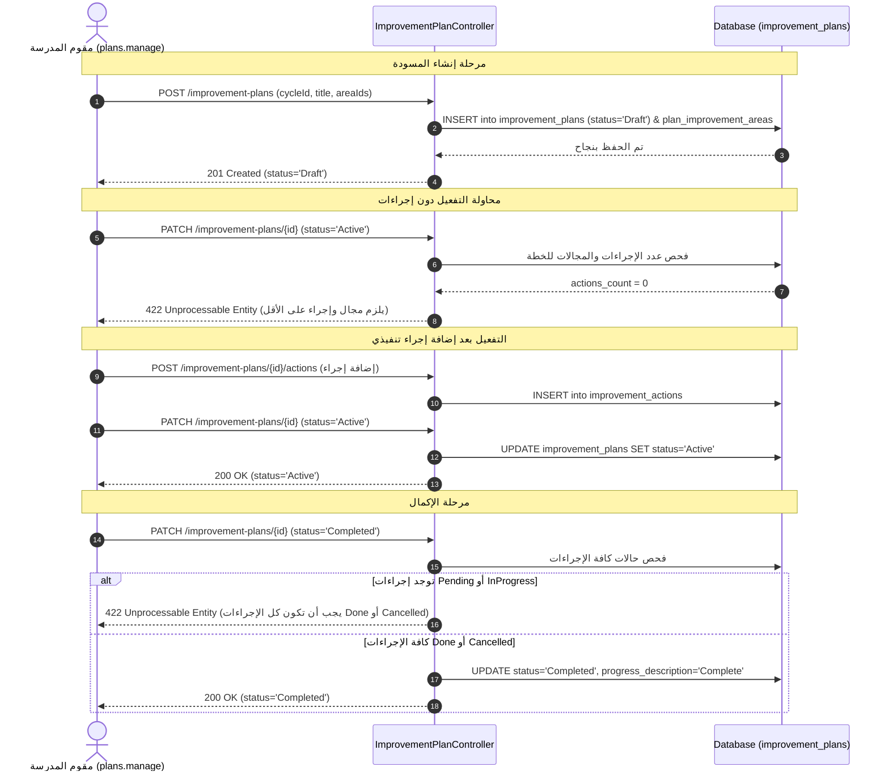
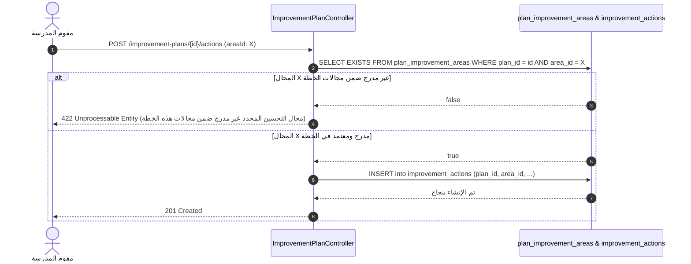
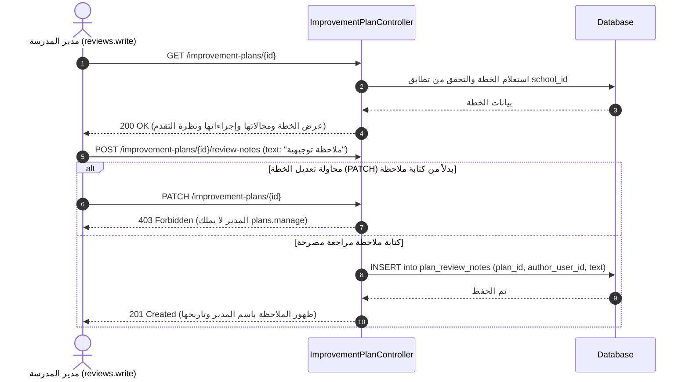

# وثيقة توثيق الشريحة الثالثة: خطط التحسين المدرسي وإجراءاتها وملاحظات المراجعة (As-Built)

**النظام:** نظام إدارة الجودة المدرسية (`school-eval-api`)  
**الشريحة:** الشريحة الثالثة (Backend Only)  
**الفرع المصدري:** `feature/slice3-improvement-plans`  
**تاريخ التوثيق:** 26 أكتوبر 2026  
**حالة الاختبارات:** 87 اختباراً ناجحاً بنسبة 100% (5,861 تأكيداً)  
**المرجعية:** الفصل الرابع (4.4.4 و4.7)، اتفاقيات `conventions.md`، قاموس البيانات، حالات الاستخدام `UC-SCH-04`, `UC-SCH-05`, `UC-PRIN-01`.

---

## 1. الغرض والنطاق وقائمة الملفات

### 1.1 الغرض والنطاق
تنفيذ واجهات برمجة التطبيقات الخلفية الخاصة بتخطيط ومتابعة التحسين المدرسي:
1. توليد اقتراحات مجالات التحسين ديناميكياً عند الطلب بناءً على نتائج التقييم الأقل من المستهدف (`target_score = 3`).
2. إدارة مجالات التحسين وتبني المقترحات مع فرض العزل المؤسسي الصارم عبر معرّف النتيجة (`resultId`).
3. إدارة خطط التحسين المدرسي ودورة حياتها (`Draft` -> `Active` -> `Completed` / `Cancelled`) واشتراطات التفعيل والإكمال.
4. إدارة الإجراءات التنفيذية المحكومة بالمفتاح الأجنبي المركب `(plan_id, area_id)` واحتساب حالة التأخر `isDelayed` ديناميكياً دون وظائف مجدولة.
5. استخدام قائمة مغلقة لمستويات التقدم (`ProgressLevel`) بالأكواد اللاتينية دون نسب مئوية مفروضة، واحتساب التقدم الإجمالي للخطة.
6. تمكين مدير المدرسة من استعراض الخطة (`plans.view`) وتدوين ملاحظات المراجعة (`reviews.write`) دون منحه صلاحية التعديل (`plans.manage`).

### 1.2 قائمة الملفات المنشأة والمعدلة
| المسار | الحالة | الدور الوظيفي |
|---|---|---|
| `config/evaluation.php` | منشأ | ملف إعدادات التقييم متضمناً `target_score` الافتراضي (3) القابل للتخصيص عبر البيئة. |
| `app/Enums/ProgressLevel.php` | منشأ | قائمة مغلقة (Enum) لمستويات التقدم (`NotStarted`, `Limited`, `Moderate`, `Significant`, `Complete`) مع تسمياتها العربية. |
| `app/Http/Controllers/Api/V1/ImprovementSuggestionController.php` | منشأ | حساب اقتراحات مجالات التحسين ديناميكياً للمؤشرات الأقل من المستهدف وتحديد الأولويات المقترحة. |
| `app/Http/Controllers/Api/V1/ImprovementAreaController.php` | منشأ | إدارة مجالات التحسين (استعراض، إنشاء بالتبني، تعديل) وفرض العزل المؤسسي بـ `resultId`. |
| `app/Http/Controllers/Api/V1/ImprovementPlanController.php` | منشأ | إدارة الخطط، دورة الحياة، الإجراءات بالمفتاح المركب، احتساب التأخر والتقدم الإجمالي، وملاحظات المدير. |
| `app/Policies/ImprovementPlanPolicy.php` | معدل/مؤكد | سياسة صلاحيات الخطط (`viewAny`, `view`, `create`, `update`, `review`) وفرض العزل المدرسي. |
| `app/Providers/AppServiceProvider.php` | معدل | تسجيل ربط السياسة `ImprovementPlanPolicy` بنموذج `ImprovementPlan` لدى بوابة الصلاحيات. |
| `routes/api.php` | معدل | تسجيل مسارات الاقتراحات ومجالات التحسين وخطط التحسين والإجراءات وملاحظات المراجعة. |
| `tests/Feature/ImprovementPlanFeatureTest.php` | منشأ | 11 اختبار ميزة شامل للصلاحيات، العزل، المفتاح المركب، التأخر، دورة الحياة، والمراجعة. |
| `docs/api/improvement_endpoints.md` | منشأ | دليل API التوجيهي الشامل لمطور الواجهة الأمامية متضمناً الحمولات والاستجابات والتحذيرات. |
| `docs/api/improvement.http` | منشأ | ملف تجربة تفاعلي (REST Client) لنقاط النهاية الـ 11 بحسابات وبيانات تجريبية. |
| `docs/slices/slice3_improvement_plans.md` | منشأ | هذا الملف (توثيق الواقع المنفذ الفعلي للشريحة 3). |

---

## 2. جدول نقاط النهاية المعتمدة (API Endpoints Matrix)

| المسار | الطريقة | الصلاحية | المتحكم والدالة | فئة التحقق | السياسة المطبقة |
|---|---|---|---|---|---|
| `/api/v1/evaluations/{id}/improvement-suggestions` | `GET` | `plans.view` أو `plans.manage` | `ImprovementSuggestionController@index` | `Inline Validator` | فحص العزل المؤسسي (404) |
| `/api/v1/improvement-areas` | `GET` | `plans.view` أو `plans.manage` | `ImprovementAreaController@index` | — | عزل نطاق المدرسة تلقائياً |
| `/api/v1/improvement-areas` | `POST` | `plans.manage` | `ImprovementAreaController@store` | `Inline Validator` | التحقق من ملكية `resultId` (404) |
| `/api/v1/improvement-areas/{id}` | `PATCH` | `plans.manage` | `ImprovementAreaController@update` | `Inline Validator` | التحقق من ملكية المجال (404) |
| `/api/v1/improvement-plans` | `GET` | `plans.view` أو `plans.manage` | `ImprovementPlanController@index` | — | `ImprovementPlanPolicy@viewAny` |
| `/api/v1/improvement-plans` | `POST` | `plans.manage` | `ImprovementPlanController@store` | `Inline Validator` | `ImprovementPlanPolicy@create` |
| `/api/v1/improvement-plans/{id}` | `GET` | `plans.view` أو `plans.manage` | `ImprovementPlanController@show` | — | `ImprovementPlanPolicy@view` (404) |
| `/api/v1/improvement-plans/{id}` | `PATCH` | `plans.manage` | `ImprovementPlanController@update` | `Inline Validator` | `ImprovementPlanPolicy@update` (404) |
| `/api/v1/improvement-plans/{id}/actions` | `POST` | `plans.manage` | `ImprovementPlanController@storeAction` | `Inline Validator` | قيد المفتاح المركب (422) والعزل (404) |
| `/api/v1/improvement-plans/{id}/actions/{actionId}` | `PATCH` | `plans.manage` | `ImprovementPlanController@updateAction` | `Inline Validator` | مطابقة الخطة والإجراء (404) |
| `/api/v1/improvement-plans/{id}/review-notes` | `POST` | `reviews.write` | `ImprovementPlanController@storeReviewNote` | `Inline Validator` | `ImprovementPlanPolicy@review` (404) |

---

## 3. التأثير على البيانات ونماذج الـ Database

### 3.1 الجداول المستخدمة وقيودها الصارمة
1. **`improvement_areas`:**
   - الحقول: `area_id`, `result_id` (إلزامي في API), `indicator_id`, `name`, `description`, `priority` (`Low`, `Medium`, `High`).
   - قيد الفحص: `chk_improvement_areas_source` محقق دائماً عبر اشتقاق `indicator_id` من النتيجة المعتمدة.
2. **`improvement_plans`:**
   - الحقول: `plan_id`, `cycle_id`, `school_id`, `created_by_user_id`, `title`, `start_date`, `end_date`, `status`, `progress_description`.
   - الحالات: `Draft`, `Active`, `Completed`, `Cancelled`.
3. **`plan_improvement_areas`:**
   - المفتاح الأساسي المركب: `PRIMARY KEY (plan_id, area_id)`.
   - يتضمن `created_at` فقط دون `updated_at` التزاماً بقاموس البيانات.
4. **`improvement_actions`:**
   - قيد المفتاح الأجنبي المركب:
     `FOREIGN KEY (plan_id, area_id) REFERENCES plan_improvement_areas (plan_id, area_id)`
   - الحالات: `Pending`, `InProgress`, `Done`, `Cancelled`.
   - حقل التقدم: `progress_description` يخزن أكواد `ProgressLevel`.
5. **`plan_review_notes`:**
   - الحقول: `note_id`, `plan_id`, `author_user_id`, `text`, `created_at`, `updated_at`.

---

## 4. المخططات التسلسلية (Mermaid Diagrams)

### 4.1 دورة حياة الخطة وتفعيلها وإكمالها

### 4.2 فرض قيد المفتاح الأجنبي المركب لإجراءات التحسين

### 4.3 مراجعة مدير المدرسة وتدوين الملاحظة

---

## 5. جدول تتبع المتطلبات والمخططات (Traceability Matrix)

| البند المرجعي | التوصيف المرجعي من الوثيقة | الحالة في الكود | الدليل والملف الحاضن والدالة الفعلية |
|---|---|---|---|
| **UC-SCH-04** | إعداد وبناء خطة التحسين المدرسي وربطها بمجالات التحسين | **مطابق** | `ImprovementPlanController@store` (إنشاء الخطة وربط المجالات بـ `plan_improvement_areas`)، `ImprovementAreaController@store`. |
| **UC-SCH-05** | إدارة ومتابعة تنفيذ إجراءات التحسين والتقدم الزمني | **مطابق** | `ImprovementPlanController@storeAction` و `updateAction`، واحتساب `isDelayed` ونظرة التقدم `overview`. |
| **UC-PRIN-01** | مراجعة مدير المدرسة لخطة التحسين وتدوين الملاحظات التوجيهية | **مطابق** | `ImprovementPlanController@storeReviewNote` (صلاحية `reviews.write`)، `ImprovementPlanPolicy@review`. |
| **FR-SCH-15** | عرض النتائج مع الملاحظات والشواهد كأساس لبناء خطط التحسين | **مطابق** | `ImprovementSuggestionController@index` (استرجاع النتائج الأقل من المستهدف مع الفجوة) و `EvaluationController@standardsTree`. |
| **FR-SCH-16** | استخراج مجالات التحسين تلقائياً من النتائج الأقل من التقدير المستهدف | **مطابق** | `ImprovementSuggestionController@index` (مقارنة الدرجة بـ `target_score = 3` واقتراح الاسم والفجوة وحالة التبني). |
| **FR-SCH-17** | ترتيب مجالات التحسين بحسب الأولوية المقترحة أو المحددة | **مطابق** | `ImprovementSuggestionController@index` (اقتراح High للدرجة 0-1، وMedium للدرجة 2)، و `ImprovementAreaController@store` (تحديد الأولوية النهائية). |
| **FR-SCH-18** | مراجعة مدير المدرسة لمجالات التحسين والخطة وتدوين الملاحظات | **مطابق** | `ImprovementPlanController@storeReviewNote` (يحفظ في `plan_review_notes` مع منع التعديل المباشر 403). |
| **FR-SCH-19** | إنشاء خطة تحسين مدرسية وربطها بمجال تحسين واحد على الأقل | **مطابق** | `ImprovementPlanController@store` (تحقق `areaIds.min:1` والحفظ في `plan_improvement_areas`). |
| **FR-SCH-20** | تحديد الإجراءات التنفيذية والجدول الزمني والمسؤولين | **مطابق** | `ImprovementPlanController@storeAction` (ربط الإجراء بالمجال، `start_date`, `due_date`, `responsible_person_description`). |
| **FR-SCH-21** | وصف المسؤول عن التنفيذ دون اشتراط حساب مستخدم في النظام | **مطابق** | `ImprovementPlanController@storeAction` (حقل `responsiblePersonDescription` نصي بحد أقصى 150 حرفاً وفق المتطلب). |
| **FR-SCH-22** | متابعة وتحديث حالة الإجراءات ومستوى التقدم | **مطابق** | `ImprovementPlanController@updateAction` (تحديث `status` وتحديث `progress` عبر قائمة `ProgressLevel` المغلقة). |
| **FR-SCH-23** | احتساب حالة التأخر ديناميكياً بناءً على الموعد النهائي | **مطابق** | `ImprovementPlanController@formatAction` (`isDelayed = due_date < today() && !in_array(status, ['Done', 'Cancelled'])`). |
| **FR-SCH-24** | إدارة دورة حياة الخطة (مسودة، نشطة، مكتملة، ملغاة) | **مطابق** | `ImprovementPlanController@update` (قيود التفعيل بشرط وجود مجال وإجراء، وقيود الإكمال بإنجاز أو إلغاء كافة الإجراءات). |
| **FR-SCH-25** | استعراض الخطة ونظرة عامة على التقدم والإحصائيات | **مطابق** | `ImprovementPlanController@show` (تضمين كائن `overview` بإحصائيات الإجراءات لكل حالة والتقدم الإجمالي المحسوب). |

---

## 6. الفجوات والقيود والانحرافات عن الكتالوج (Gaps & Deviations)

### 6.1 الانحرافات المعتمدة عن كتالوج 4.4.4
1. **نقطة نهاية اقتراحات التحسين المضافة:**
   * `GET /api/v1/evaluations/{id}/improvement-suggestions`
   * *سبب الإضافة:* تمكين النظام من توليد اقتراحات ذكية وفورية للمقوم بالمؤشرات ذات الأداء المنخفض دون تخزين مسبق يثقل قاعدة البيانات.
2. **إلزامية `resultId` في إنشاء مجالات التحسين:**
   * في الكتالوج النظري: كان يمكن إنشاء المجال مستقلاً أو بمؤشر فقط.
   * في الواقع المنفذ: أُلزم `resultId` لأن جدول `improvement_areas` يفتقر لعمود `school_id`، فكان ربطه بنتيجة تقييم تخص مدرسة المستخدم هو السبيل الوحيد لضمان العزل المؤسسي الصارم ومنع تسريب بيانات المدارس.

### 6.2 الافتراضات المعمارية الموثقة
* **عدم قفل خطة التحسين عند تسليم التقرير (BR-SCH-03 / FR-SCH-29):**
  * بالرجوع لنص BR-SCH-03، فإن القفل ينطبق حصراً على **استمارة التقييم الذاتي والرصد والشواهد**.
  * خطط التحسين المدرسية تمثل خططاً تشغيلية ممتدة على مدار العام الدراسي لمتابعة العلاج والتطوير؛ وبناءً عليه **لا تُقفل خطط التحسين ولا إجراءاتها عند إرسال التقرير النهائي للتقييم**، وتستمر المدرسة في تحديث حالات الإجراءات وإنجازها حتى الوصول لحالة `Completed`.

---

## 7. سيناريو التحقق اليدوي بالحسابات التجريبية (Manual Verification Scenario)

### 7.1 بيانات الحسابات الاختبارية
* **كلمة المرور المشتركة للتطوير:** `ChangeMeDevPassword@2026`
* **مقيم مدرسة بلقيس:** `quality_belqees` (`school_id: 1`)
* **مديرة مدرسة بلقيس:** `principal_belqees` (`school_id: 1`)
* **مقيم مدرسة الفاروق:** `quality_farouq` (`school_id: 2`)

### 7.2 خطوات السيناريو العملي
1. **تسجيل دخول المقيم:** تسجيل دخول `quality_belqees` للحصول على الرمز.
2. **استعراض الاقتراحات:** استدعاء `GET /api/v1/evaluations/1/improvement-suggestions` وملاحظة ظهور المؤشرات المرصودة بـ 1 أو 2 مع الأولويات المقترحة.
3. **فحص العزل المؤسسي:** دخول مقيم الفاروق `quality_farouq` وطلب اقتراحات تقييم بلقيس -> النتيجة المتوقعة: `404 Not Found`.
4. **تبني مجال تحسين:** إرسال `POST /api/v1/improvement-areas` مع `resultId` لنتيجة درجة منخفضة -> النتيجة المتوقعة: `201 Created`، وتغير علامة `isAlreadyAdopted` إلى `true`.
5. **إنشاء خطة تحسين (مسودة):** إرسال `POST /api/v1/improvement-plans` بـ `title` وتواريخ و `areaIds: [1]` -> النتيجة المتوقعة: `201 Created` بحالة `Draft`.
6. **محاولة التفعيل الفاشلة:** إرسال `PATCH /api/v1/improvement-plans/1` بـ `status: Active` دون إضافة إجراءات -> النتيجة المتوقعة: `422 Unprocessable Entity`.
7. **إضافة إجراء تنفيذي:** إرسال `POST /api/v1/improvement-plans/1/actions` بمعرّف المجال المعتمد -> النتيجة المتوقعة: `201 Created`.
8. **فحص المفتاح المركب:** محاولة إرسال إجراء على الخطة بمعرّف مجال غير مربوط بها -> النتيجة المتوقعة: `422 Unprocessable Entity`.
9. **تفعيل الخطة:** إرسال `PATCH /api/v1/improvement-plans/1` بـ `status: Active` -> النتيجة المتوقعة: `200 OK`.
10. **مراجعة المديرة:** تسجيل دخول المديرة `principal_belqees` واستدعاء `GET /api/v1/improvement-plans/1` ثم تدوين ملاحظة عبر `POST /api/v1/improvement-plans/1/review-notes` -> النتيجة المتوقعة: `201 Created`، وعند محاولتها تعديل الخطة ترجع `403 Forbidden`.

---

## 8. الدَّين التقني (Technical Debt)

1. **التحقق المضمن في المتحكمات (Inline Controllers Validation):**
   * تم استخدام `Validator::make` داخل دوال `ImprovementPlanController` و `ImprovementAreaController` بدلاً من استخراجها إلى Form Requests مخصصة.
   * *الإجراء المستقبلي:* إنشاء Form Requests مثل `StoreImprovementPlanRequest`, `StoreImprovementActionRequest`.
2. **منطق التقدم الإجمالي (Progress Calculation Logic):**
   * تم تنفيذ دالة احتساب التقدم داخل المتحكم كـ static method. يُفضل لاحقاً نقلها إلى Service Layer مخصصة (`ImprovementPlanningService`).
