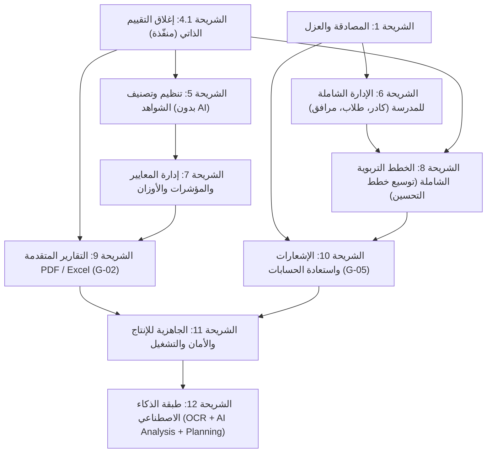

# خارطة الطريق للشرائح المستقبلية لنظام تقويم الجودة المدرسية (Future Slices Roadmap)

**المشروع:** نظام إدارة وتقويم الجودة المدرسية (`school-quality-system`)  
**تاريخ التحديث:** 27 أكتوبر 2026م  
**الحالة:** وثيقة معمارية تخطيطية تحدد مسار التطوير بعد اكتمال الشرائح الأساسية (0 إلى 4.1)، وفق المبدأ الحاكم الجديد: **تأجيل الذكاء الاصطناعي كطبقة تحسين لاحقة وبناء نظام متكامل وحتمي بنسبة 100% يعتمد على الإدخال البشري المنظم والمدقق أولاً.**  
**المرجعية:** الفصل الرابع من وثيقة التصميم، قاموس البيانات، فحص الكود الفعلي (40 نموذجاً و40 جدولاً تشغيلياً في قاعدة البيانات)، ومخرجات حزمة الاختبارات الآلية (112 اختباراً ناجحاً بنسبة 100%).

---

## 1. الملخص التنفيذي وحالة المشروع الراهنة

أنجز النظام حتى اللحظة بنية تحتية تشغيلية متكاملة تغطي:
* **الشريحة 0:** بنية قاعدة البيانات، 40 نموذج Eloquent، والبيانات المرجعية الوطنية (7 معايير، 14 مجالاً، 109 مؤشرات، 436 واصفة، 278 متطلب شواهد، و5 أدوار معتمدة).
* **الشريحة 1:** المصادقة (Sanctum)، العزل المؤسسي الصارم للمدارس (القرار المعماري 9)، وإدارة الحسابات.
* **الشريحة 2:** التقييم الذاتي، رصد الدرجات (Upsert 0-3)، إدارة الشواهد بنسخها التاريخية (`is_current`)، وقفل التقييم (BR-SCH-03).
* **الشريحة 3:** اقتراحات ومجالات خطط التحسين، إدارة الخطط بالمفتاح المركب `(plan_id, area_id)`، احتساب التأخر ديناميكياً، ومراجعة المدير.
* **الشريحة 4:** الحسابات الإجمالية الموزونة بالأوزان الرسمية، ملخص الشواهد والخطط، لوحة المعلومات (Dashboard)، وتصدير التقرير كـ JSON.
* **الشريحة 4.1:** إغلاق واعتماد التقييم (G-01)، التحقق من اكتمال رصد كافة المؤشرات الـ 109 واستيفاء الحد الأدنى من الشواهد، وتفعيل القفل النهائي الصارم.

### القاعدة الحاكمة الجديدة (Human-First & Deterministic Engineering):
> [!IMPORTANT]
> **يؤجل الذكاء الاصطناعي (OCR، تحليل النص، تصنيف المحتوى، توليد التوصيات، تجميع الخطط) بالكامل إلى الشريحة الأخيرة (الشريحة 12).**  
> الشرائح من 5 إلى 11 تبني نظاماً متكاملاً، صلباً، ومستقلاً بذاته تماماً يعتمد حصراً على كود PHP حتمي وإدخال بشري مدقق من فرق الجودة والمدارس، بحيث يعمل النظام في الميدان بكفاءة تامة بدون أي استدعاءات خارجية أو ذكاء اصطناعي. سيكون الذكاء الاصطناعي في الشريحة 12 مجرد "طبقة تسريع وتحسين مساعدة" فوق نظام مكتمل ومستقر.

---

## 2. جدول المقارنة والترتيب الزمني المعتمد للشرائح (12 شريحة)

| رقم الشريحة | مسمى الشريحة | الهدف الأساسي | مستوى الصعوبة | الاعتماديات المباشرة | أهم مخرجات الشريحة المقترحة |
|:---:|---|---|:---:|---|---|
| **4.1** | **إغلاق واعتماد التقييم الذاتي (G-01)** | نقل التقييم إلى `Completed` وتفعيل القفل (BR-SCH-03) واشتراط اكتمال الرصد والشواهد. | **سهل** | الشرائح 2 و 4 | **[منفذة ومحققة 100%]** مسار `POST .../submit` والحدث `EvaluationSubmitted`. |
| **5** | **تنظيم الشواهد وربطها بالمؤشرات (بدون AI)** | تصنيف الشاهد يدوياً، ربطه بالمؤشر، ضبط حالته وملاحظات المراجع، وحصر الشواهد المكتملة والناقصة. | **سهل - متوسط** | الشرائح 2 و 4.1 | حقول `evidence_type`, `status`, `reviewer_notes`، مسارات التصنيف والربط، ومسار الجرد الحصري للشواهد. |
| **6** | **الإدارة الشاملة للمدرسة** | سد النقص الجوهري في بيانات المدرسة: الكادر التعليمي، الطلاب، الأنشطة، والمرافق والتجهيزات. | **متوسط** | الشريحة 1 | جداول ونماذج جديدة للكادر والطلاب والأنشطة والمرافق وربطها بالمدرسة. |
| **7** | **الإدارة الشاملة للمعايير والمؤشرات** | إدارة المعايير الوطنية، تحديث الأوزان، ربط متطلبات الشواهد، وتوليد تقارير المعايير الرسمية. | **متوسط** | الشريحة 0 و 4 | مسارات إدارة مرجعيات المعايير، تعديل الأوزان ديناميكياً، وتقارير مقارنة الأداء. |
| **8** | **الخطط التربوية الشاملة وتوسيع خطط التحسين** | الخطة الاستراتيجية والتطويرية للمدرسة، خطة التطوير المهني، ودمجها مع خطة التحسين المنبثقة من التقييم. | **متوسط - صعب** | الشريحة 3 و 6 | دورة حياة متكاملة للخطط المدرسية التربوية الشاملة وربطها ببيانات الكادر والمرافق. |
| **9** | **التقارير المتقدمة والتصدير الرسمي PDF و Excel (G-02)** | تصدير التقرير الشامل للتقييم، خطة التحسين، وكشوف الشواهد بتنسيقات PDF الرسمية و Excel. | **متوسط** | الشريحة 4 و 4.1 | قوالب Blade مهيأة للطباعة RTL، محرك PDF (`snappy`/`dompdf`)، وتصدير Excel (`PhpSpreadsheet`). |
| **10** | **الإشعارات واستعادة الحسابات (G-05)** | التنبيه بالأحداث الحرجة (تأخر إجراء، إغلاق دورة، طلب استكمال)، واستعادة كلمة المرور عبر SMTP. | **سهل - متوسط** | الشريحة 1 و 8 | وسيط البريد، تفعيل جدول `notifications`، ومسارات استعادة وتعيين كلمة المرور. |
| **11** | **الجاهزية للإنتاج والأمان والأداء** | تحصين المنصة، تدقيق أمان المرفقات، التخزين المؤقت، فهارس الأداء، وحزم التوثيق للنشر الميداني. | **صعب** | كافة الشرائح 1-10 | سياسات Rate Limiting، تعقيم الملفات، فهارس مركبة، ومصفوفة الصلاحيات الشاملة. |
| **12** | **طبقة الذكاء الاصطناعي (AI Layer - مساعدة واختيارية)** | OCR للمرفقات، التحليل الذكي للشواهد، اقتراح درجات استرشادية، وتوليد وتجميع الخطط بموافقة بشرية. | **صعب** | كافة الشرائح 1-11 | محرك OCR، ربط LLM عبر Structured Output، وتفعيل جدولي `ai_analyses` و `ai_recommendations`. |

---

## 3. مخطط تدفق الاعتماديات للشرائح (Mermaid)

---

## 4. تفصيل الشرائح المستقبلية

### الشريحة 4.1: إغلاق واعتماد التقييم الذاتي (G-01) — [منفّذة ومحققة]
* **الهدف:** توفير مسار رسمي لنقل التقييم من `InProgress` إلى `Completed` وتفعيل القفل (BR-SCH-03) ومنع التعديل.
* **ما تحتويه:** مسار `POST /api/v1/evaluations/{id}/submit` مع فحص:
  1. رصد درجات كافة المؤشرات الفعالة الـ 109.
  2. استيفاء الحد الأدنى من الشواهد الإلزامية (شاهد مرفوع واحد على الأقل لكل مؤشر يتطلب شواهد إلزامية في `indicator_evidence_requirements`).
  3. حظر الإغلاق المتكرر أو في دورة مغلقة.
  4. العزل المؤسسي للمدارس (القرار 9: 404).
  5. إطلاق حدث `EvaluationSubmitted` وتحديث الطوابع الزمنية.
* **الاعتماديات:** الشريحة 2 و الشريحة 4.
* **مستوى الصعوبة:** **سهل**؛ تم بناؤه وإسناده بـ 9 اختبارات ميزة متخصصة وحقق نسبة نجاح 100%.

---

### الشريحة 5: تنظيم الشواهد وربطها بالمؤشرات (Evidence Organization & Manual Linking - No AI)
* **الهدف الأساسي:** تمكين لجان الجودة من تنظيم وفرز وتصنيف الشواهد المرفوعة يدوياً، وربط الشاهد بالمؤشر الصحيح، وضبط حالة الشاهد وتدوين ملاحظات المقيم الداخلي دون أي تدخل ذكاء اصطناعي.
* **ما تحتويه بالتفصيل:**
  1. **التصنيف اليدوي للشاهد (`evidence_type`):** قائمة محددة يختار منها المستخدم: محضر (`minutes`)، خطة (`plan`)، سجل (`record`)، تقرير (`report`)، لوحة إعلانية/إرشادية (`board`)، صورة ميدانية (`image`)، أخرى (`other`).
  2. **الربط اليدوي بالمؤشر مع تأكيد المستخدم (`link-indicator`):** مسار لنقل أو ربط الشاهد بمؤشر آخر مع التأكد من وجود سجل النتيجة في نفس التقييم أو إنشائه تلقائياً، والتحقق من عدم تكرار الشاهد.
  3. **إدارة حالة الشاهد (`status`):** ضبط دورة تدقيق الشاهد داخلياً: مسودة (`Draft`)، مكتمل (`Completed`)، مدقق ومقبول (`Audited`).
  4. **ملاحظات المراجع/المقيم (`reviewer_notes`):** حقل لتسجيل ملحوظات عضو لجنة الجودة أو المقيم حول كفاية الشاهد مع توثيق هوية المراجع ووقت المراجعة.
  5. **حصر الشواهد لكل مؤشر (`evidence-inventory`):** مسار استعلامي يقارن الشواهد المرفوعة لكل مؤشر مع متطلبات الشواهد الإلزامية (`indicator_evidence_requirements`)، مبيناً حالة كل مؤشر: هل استوفى الشواهد المطلوبة أم ناقص؟
* **الاعتماديات المباشرة:** الشريحة 2 (إدارة الشواهد والمرفقات) والشريحة 4.1 (الحد الأدنى للشواهد والقفل).
* **مستوى الصعوبة:** **سهل إلى متوسط**.
* **أهم المخاطر والتنبيهات:**
  - تعديل شاهد في تقييم مقفل (`Completed`): يجب احترام قاعدة القفل (BR-SCH-03) وإرجاع كود 422 إذا كان التقييم مقفلاً.
  - محاولة مستخدم من مدرسة أخرى الوصول لشواهد مدرسة ثانية: يجب الالتزام الصارم بالقرار المعماري 9 وإرجاع 404.
* **التقسيم إلى شرائح فرعية:** شريحة موحدة ومدمجة بالكامل لسرعة التنفيذ والترابط.
* **التفريق بين المستنتج والمقترح:**
  - *مستنتج من الكود القائم:* جداول `evidences`, `attachments`, `evidence_versions`, `indicator_evidence_requirements`.
  - *مقترح جديد يضاف:* إضافة حقول `evidence_type`, `status`, `reviewer_notes`, `reviewed_by_user_id`, `reviewed_at` لجدول `evidences`، ومسارات `classify`, `link-indicator`, `status`, `review-notes`, `evidence-inventory`.

---

### الشريحة 6: الإدارة الشاملة للمدرسة (Full School Management)
* **الهدف الأساسي:** استكمال بيانات المدرسة الحيوية التي يحتاجها التقويم المؤسسي والتي تبين أنها غير موجودة نهائياً في الجداول الـ 40 الحالية.
* **فحص الكود الفعلي والجداول الـ 40 (ملاحظة تدقيق هامة وصريحة):**
  > [!WARNING]
  > **نتيجة الفحص الفعلي لقاعدة البيانات ونماذج Eloquent:**  
  > جدول `schools` الحالي يحتوي فقط على 7 أعمدة أساسية (`id`, `school_code`, `name`, `gender`, `education_level`, `created_at`, `updated_at`).  
  > **لا يوجد أي جدول أو نموذج إطلاقاً للكادر التعليمي والإداري، ولا للطلاب/المتعلمين، ولا للأنشطة المدرسية، ولا للمرافق والتجهيزات.**  
  > الجداول الـ 40 الموجودة تركز بالكامل على القياس والتقويم والمعايير والمؤشرات وخطط التحسين والمصادقة، وخلت تماماً من البنية التحتية لإدارة الكيانات المدرسية التفصيلية.
* **ما تحتويه الشريحة بالتفصيل (كيانات مقترحة جديدة):**
  1. **توسيع بيانات المدرسة الأساسية:** إضافة العنوان، الهاتف، البريد، الإدارة التعليمية، الطاقة الاستيعابية، والرقم الوزاري.
  2. **إدارة الكادر التعليمي والإداري (`school_staff`):** جدول ونموذج للموظفين: الاسم، الرقم الوطني، التخصص، المؤهل العلمي، المسمى الوظيفي (معلم، إداري، أمين مختبر، وكيل، مدير)، تاريخ المباشرة، وحالة العمل.
  3. **إدارة بيانات الطلاب / المتعلمين (`school_learners`):** إحصائيات وأعداد الطلاب موزعين حسب المراحل والصفوف والشعب، والنوع، وأعداد الطلبة ذوي الاحتياجات الخاصة.
  4. **إدارة الأنشطة والبرامج المدرسية (`school_activities`):** توثيق الأنشطة المنهجية واللامنهجية، الفئات المستهدفة، تاريخ التنفيذ، ومسؤول النشاط (مرتبط بمعايير المتعلمين والبيئة).
  5. **إدارة المرافق والتجهيزات (`school_facilities`):** توثيق الفصول، المختبرات، المكتبة، الملاعب، دورات المياه، تجهيزات الأمن والسلامة، وحالة الصلاحية لكل مرفق (مرتبط بمعيار البيئة المدرسية).
* **الاعتماديات:** الشريحة 1 (العزل المؤسسي للمدارس).
* **مستوى الصعوبة:** **متوسط** (يتطلب كتابة تهجيرات جديدة ونماذج Eloquent وسياسات تحكم RBAC متوافقة مع مدرسة المستخدم).
* **أهم المخاطر:** تضخم الجداول وتشعب العلاقات؛ يجب ضبط النماذج بحقول أساسية تخدم معايير الجودة السبعة دون التحول لنظام شؤون طلاب تفصيلي ضخم.
* **التقسيم إلى شرائح فرعية:**
  - **6.1:** توسيع بيانات المدرسة وإدارة الكادر التعليمي والإداري.
  - **6.2:** إدارة أعداد وتوزيعات المتعلمين والأنشطة المدرسية.
  - **6.3:** إدارة المرافق والمختبرات وتجهيزات الأمن والسلامة.

---

### الشريحة 7: الإدارة الشاملة للمعايير والمؤشرات (Standards & Indicators Management)
* **الهدف الأساسي:** تمكين مسؤولي الوزارة ومشرفي النظام من استعراض وتحديث المعايير والمؤشرات وأوزانها النسبية وإدارة متطلبات الشواهد، وتوليد تقارير مقارنة للأداء المعياري.
* **ما تحتويه بالتفصيل:**
  1. **إدارة المعايير والمجالات والمؤشرات:** مسارات CRUD لمسؤولي الوزارة لتحديث نصوص الواصفات ومستويات الأداء (0-3).
  2. **إدارة أوزان المعايير وتحديثها ديناميكياً:** نقل الأوزان النسبية للمعايير (حالياً ثابتة في `ReportsAnalyticsService`: 15%، 20%...) إلى جدول قاعدة بيانات مع إمكانية تعديل الأوزان مع التحقق الحتمي من أن مجموع الأوزان = 100%.
  3. **إدارة متطلبات الشواهد (`indicator_evidence_requirements`):** إضافة أو تعديل متطلبات الشواهد الإلزامية والاسترشادية لكل مؤشر.
  4. **تقارير المعايير على مستوى الوزارة والمدرسة:** استعلامات إحصائية مقارنة بين المدارس في معيار محدد (مثل معيار "التعليم والتعلم" عبر جميع مدارس المديرية).
* **الاعتماديات:** الشريحة 0 (البيانات المرجعية الوطنية) والشريحة 4 (محرك الحسابات).
* **مستوى الصعوبة:** **متوسط**.
* **أهم المخاطر والتنبيهات:** أي تغيير في وزن المعيار بعد إغلاق تقييم معين يجب ألا يؤثر بأثر رجعي على التقييمات المقفلة مسبقاً (تخزين الوزن المستخدم وقت الإغلاق Snapshot).
* **التفريق بين المستنتج والمقترح:**
  - *مستنتج:* جداول المعايير والمؤشرات والواصفات والمتطلبات موجودة وممتلئة بالبذور.
  - *مقترح جديد:* واجهات ومسارات تعديل، إضافة حقل `weight` بجدول `standards`، ومنطق تجميد الوزن عند إغلاق التقييم.

---

### الشريحة 8: الخطط التربوية الشاملة وتوسيع خطط التحسين (Comprehensive Educational Plans)
* **الهدف الأساسي:** توسيع إدارة خطط التحسين (الموجودة بالشريحة 3) لتتحول إلى منظومة خطط مدرسية متكاملة تشمل الخطة الاستراتيجية، الخطة التطويرية السنوية، خطة التطوير المهني، وربطها بنقاط الضعف المكتشفة في التقييم.
* **ما تحتويه بالتفصيل:**
  1. **الخطة الاستراتيجية والتطويرية للمدرسة:** تحديد الرؤية والرسالة والأهداف الاستراتيجية وربطها بمؤشرات جودة قابلة للقياس.
  2. **خطة التطوير المهني وتدريب الكادر:** حصر الاحتياجات التدريبية للمعلمين والإداريين الناتجة عن مؤشرات الأداء المتدنية في التقييم المدرسي.
  3. **توسيع خطة التحسين المدرسية:** ربط الإجراءات التحسينية مباشرة بمرافق المدرسة (الشريحة 6) وكوادرها وتحديد تكلفة التمويل ومصادره.
  4. **متابعة دورية للخطط (ربع سنوية ونصف سنوية):** لوحة تتبع تقدم الإجراءات ونسب الإنجاز التراكمية.
* **الاعتماديات:** الشريحة 3 (خطط التحسين الحالية) والشريحة 6 (الكادر والمرافق).
* **مستوى الصعوبة:** **متوسط إلى صعب**.
* **التقسيم إلى شرائح فرعية:**
  - **8.1:** إدارة الخطط الاستراتيجية والتطويرية السنوية.
  - **8.2:** إدارة خطط التدريب والتطوير المهني للكادر.
  - **8.3:** ربط خطة التحسين التقييمية بالموازنة والمرافق ومؤشرات الإنجاز التراكمي.

---

### الشريحة 9: التقارير المتقدمة والتصدير الرسمي PDF و Excel (G-02)
* **الهدف الأساسي:** تحويل تقارير التقييم وخطط التحسين والشواهد من مخرجات شاشة وJSON إلى ملفات PDF رسمية منسقة للطباعة وملفات Excel للجداول الإحصائية.
* **ما تحتويه بالتفصيل:**
  1. **تصدير تقرير التقييم الذاتي الشامل PDF:** وثيقة رسمية متكاملة تشمل الغلاف، ملخص الدرجات، الرادار البياني، نتائج المعايير الـ 7، الشواهد المرفقة، وتوقيعات لجنة الجودة، متوافقة مع المتطلبات الميدانية لوزارة التربية.
  2. **تصدير خطة التحسين المدرسية PDF و Excel:** تصدير مصفوفة الخطة (المجال، المؤشر، الفجوة، الإجراء، المسؤول، التكلفة، التاريخ، وحالة التنفيذ).
  3. **تصدير كشف حصر الشواهد والأدلة Excel:** جدول تفصيلي يوضح حالة الشواهد لكل مؤشر والمستوفى منها والناقص مع تواريخ الرفع والتعديل.
  4. **مسارات التصدير المصرح بها:**
     - `GET /api/v1/evaluations/{id}/export/pdf`
     - `GET /api/v1/evaluations/{id}/export/excel`
     - `GET /api/v1/evaluations/{id}/improvement-plan/export/pdf`
     - `GET /api/v1/evaluations/{id}/improvement-plan/export/excel`
* **الاعتماديات:** الشريحة 4 و الشريحة 4.1.
* **مستوى الصعوبة:** **متوسط**؛ التركيز على دقة مظهر الخط العربي (RTL) وتنسيق الجداول وتجاوز قيود محركات التحويل للـ PDF.
* **التفريق بين المستنتج والمقترح:**
  - *مستنتج:* كائن JSON الشامل منتج بالكامل عبر `ReportsAnalyticsService`.
  - *مقترح جديد:* قوالب Blade مهيأة للطباعة RTL، ودمج حزمتي `barryvdh/laravel-snappy` (أو DomPDF) و `phpoffice/phpspreadsheet`.

---

### الشريحة 10: منظومة الإشعارات الفورية واستعادة الحسابات (G-05)
* **الهدف الأساسي:** إخطار المستخدمين بالأحداث الحرجة (تأخر إجراءات، إغلاق الدورة، طلبات الاستكمال) عبر لوحة التحكم والبريد الإلكتروني، وتوفير مسار آمن لاستعادة كلمات المرور المنسية.
* **ما تحتويه بالتفصيل:**
  1. **إشعارات الأحداث الحرجة الميدانية:**
     - إشعار بتسليم التقييم بنجاح وإغلاقه.
     - إشعار باقتراب الموعد النهائي لدورة التقييم.
     - إشعار بتأخر إجراء تنفيذي في خطة التحسين عن تاريخه المحدد.
     - إشعار بملاحظات المراجع على الشواهد.
  2. **تفعيل قنوات الإشعار:** عبر قاعدة البيانات (جدول `notifications` المنشأ مسبقاً) وعبر البريد الإلكتروني SMTP.
  3. **مسارات استعادة وتعيين كلمة المرور:**
     - `POST /api/v1/auth/password/forgot` (إرسال رابط التحقق المشفر).
     - `POST /api/v1/auth/password/reset` (تعيين كلمة مرور جديدة).
     - `POST /api/v1/auth/password/change` (تغيير كلمة المرور من داخل النظام).
* **الاعتماديات:** الشريحة 1 (المصادقة) والشريحة 8.
* **مستوى الصعوبة:** **سهل إلى متوسط**.

---

### الشريحة 11: الجاهزية للإنتاج والأمان والأداء (Production Readiness & Performance)
* **الهدف الأساسي:** تحصين النظام وتجهيزه تقنياً للعمل مع مئات المدارس وآلاف المعلمين في بيئة إنتاجية مستقرة وعالية الأمان.
* **ما تحتويه بالتفصيل:**
  1. **الأمان وفحص المرفقات:** فحص الملفات المرفوعة من الفيروسات، قيود أمان Headers، وتوليد روابط تنزيل مؤقتة مشفرة (Temporary Signed URLs).
  2. **الأداء والتخزين المؤقت:** تخزين الشجرة المعيارية الثابتة في Redis Cache، ضبط الفهارس المركبة في قاعدة البيانات لتسريع التقارير والاستعلامات الكبيرة.
  3. **تحديد معدل الطلبات (Rate Limiting):** حماية واجهات الـ API من الهجمات المتكررة ومنع الإغراق.
  4. **النسخ الاحتياطي والتعافي من الكوارث:** إعداد آليات نسخ احتياطي تلقائي لقاعدة البيانات ومجلدات الشواهد.
  5. **دليل النشر والتشغيل الميداني:** وثائق متكاملة لمديري الأنظمة لتثبيت المنصة وإعداد خوادم الإنتاج (Nginx, PHP-FPM, MySQL, Redis, Cron/Supervisor).
* **الاعتماديات:** كافة الشرائح 1 إلى 10.
* **مستوى الصعوبة:** **صعب**.

---

### الشريحة 12: طبقة الذكاء الاصطناعي (AI Layer - مساعدة واختيارية)
* **الهدف الأساسي:** إضافة ميزات ذكاء اصطناعي اختيارية مساعدة للمقيمين ولجان الجودة بعد أن يكون النظام بالكامل قادراً على العمل يدوياً بدونها بنسبة 100%.
* **المبدأ الحاكم للذكاء الاصطناعي:**
  > [!IMPORTANT]
  > **الذكاء الاصطناعي مستشار مقترح وليس متخذ قرار.**  
  > لا يقوم بأي تغيير في أي درجة تقييم أو اعتماد شاهد أو إنشاء خطة دون موافقة صريحة ونقر يدوي من المقيم البشري.
* **ما تحتويه بالتفصيل (كل ما تم تأجيله يجمع هنا):**
  1. **محرك OCR واستخراج النصوص من المرفقات:** معالجة ملفات PDF الممسوحة ضوئياً وصور الشواهد واستخراج النصوص العربية منها وفهرستها في الخلفية (Queue Worker).
  2. **التحليل الذكي للشواهد ومطابقتها مع الواصفات:** مقارنة النص المستخرج من الشاهد مع واصفات المؤشر الأربع، وتوليد بطاقة تحليل توضح مدى كفاية الشاهد ونقاط القوة والضعف ومواضع الدلالة (Citations / Snippets).
  3. **اقتراح التقدير الاسترشادي (Confidence Score & Score Suggestion):** اقتراح تقدير (0-3) مع بيان نسبة الثقة ومبررات مقترحة، مع حفظ النتيجة بحالة `Suggested` وإلزام المقيم بالنقر على "قبول" أو "رفض".
  4. **توليد مقترحات إجراءات التحسين الذكية:** اقتراح أهداف وإجراءات إجرائية واقعية للمؤشرات الحاصلة على درجات متدنية (0-2).
  5. **تجميع الإجراءات المتشابهة وإزالة التكرار (Deduplication & Clustering):** خوارزمية ذكية تدمج الإجراءات المتطابقة في معيار معين وتمنع تشتت المدرسة في عشرات الإجراءات الفردية.
* **الاعتماديات:** الشريحة 5 (الشواهد المرفوعة)، الشريحة 7 (المعايير والواصفات)، والشريحة 8 (خطط التحسين).
* **الجداول التشغيلية المعتمدة للذكاء الاصطناعي (موجودة فعلياً في الهيكل):**
  - جدول `ai_analyses`: يسجل `evaluation_id`, `analysis_type`, `input_summary`, `results`, `confidence_score`, `model_name`.
  - جدول `ai_recommendations`: يسجل `analysis_id`, `indicator_id`, `recommendation_type`, `title`, `details`, `priority`, `status` (Suggested, Accepted, Rejected).
* **مستوى الصعوبة:** **صعب**؛ يتطلب ربط LLM عبر Structured Output وإعداد نماذج Prompt متقدمة وضمان عدم الهلوسة وحماية خصوصية بيانات المدارس.
* **التقسيم إلى شرائح فرعية:**
  - **12.1:** معالجة واستخراج النصوص من المرفقات (OCR Worker).
  - **12.2:** التحليل الذكي للشواهد ومطابقتها وتقدير درجة الثقة.
  - **12.3:** توليد وتجميع خطط التحسين الذكية وواجهة الاعتماد البشري.

---

## 5. المبادئ الهندسية الصارمة المعتمدة

1. **الاستمرار الصارم بمبدأ عدم كسر ما سبق:** كل شريحة جديدة تبنى وتُختبر دون المساس بسلامة الاختبارات السابقة (112 اختباراً ناجحاً حالياً).
2. **الحتمية قبل التوليد (Determinism First):** كل حساب رقمي أو نسبة أو شرط قفل يحسب حصراً بكود PHP نظيف وخاضع لاختبارات صارمة، والذكاء الاصطناعي في الشريحة 12 هو طبقة ثانوية لا تؤثر على مسار العمل الحتمي.
3. **التدخل البشري الإلزامي (Human-in-the-Loop):** لا يتم اعتماد أي مخرج للذكاء الاصطناعي دون موافقة بشرية صريحة وموثقة من مقيم الجودة أو مدير المدرسة.
4. **العزل المؤسسي وحماية الخصوصية (Decision 9):** بيانات كل مدرسة وشواهدها تظل معزولة تماماً (404 عند محاولة الوصول من مدرسة أخرى).
