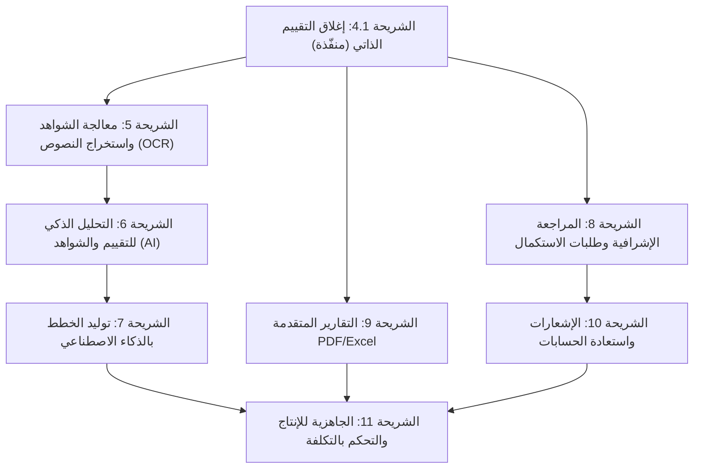

# خارطة الطريق للشرائح المستقبلية لنظام تقويم الجودة المدرسية (Future Slices Roadmap)

**المشروع:** نظام إدارة وتقويم الجودة المدرسية (`school-quality-system`)  
**تاريخ الإعداد:** 27 أكتوبر 2026م  
**الحالة:** وثيقة معمارية تخطيطية تحدد مسار التطوير للشرائح القادمة بعد اكتمال الشرائح الأساسية (0 إلى 4.1).  
**المرجعية:** الفصل الرابع من وثيقة التصميم، قاموس البيانات، كود النماذج وقواعد البيانات (40 نموذجاً و40 جدولاً تشغيلياً)، ومخرجات حزمة الاختبارات الآلية (112 اختباراً ناجحاً بنسبة 100%).

---

## 1. الملخص التنفيذي وحالة المشروع الراهنة

أنجز النظام حتى اللحظة بنية تحتية متكاملة تغطي:
* **الشريحة 0:** بنية قاعدة البيانات، 40 نموذج Eloquent، والبيانات المرجعية الوطنية (7 معايير، 14 مجالاً، 109 مؤشرات، 436 واصفة، 278 متطلب شواهد، و5 أدوار معتمدة).
* **الشريحة 1:** المصادقة (Sanctum)، العزل المؤسسي الصارم للمدارس (القرار المعماري 9)، وإدارة الحسابات.
* **الشريحة 2:** التقييم الذاتي، رصد الدرجات (Upsert 0-3)، إدارة الشواهد بنسخها التاريخية (`is_current`)، وقفل التقييم (BR-SCH-03).
* **الشريحة 3:** اقتراحات ومجالات خطط التحسين، إدارة الخطط بالمفتاح المركب `(plan_id, area_id)`، احتساب التأخر ديناميكياً، ومراجعة المدير.
* **الشريحة 4:** الحسابات الإجمالية الموزونة بالأوزان الرسمية، ملخص الشواهد والخطط، لوحة المعلومات (Dashboard)، وتصدير التقرير كـ JSON.
* **الشريحة 4.1:** إغلاق واعتماد التقييم (G-01)، التحقق من اكتمال رصد كافة المؤشرات الـ 109 واستيفاء الحد الأدنى من الشواهد، وتفعيل القفل النهائي الصارم.

---

## 2. جدول المقارنة والترتيب الزمني المعتمد للشرائح المستقبلية

| رقم الشريحة | مسمى الشريحة | الهدف الأساسي | مستوى الصعوبة | الاعتماديات المباشرة | أهم مخرجات الشريحة |
|:---:|---|---|:---:|---|---|
| **4.1** | **إغلاق واعتماد التقييم الذاتي (G-01)** | نقل التقييم إلى `Completed` وتفعيل القفل (BR-SCH-03) واشتراط اكتمال الرصد والشواهد. | **سهل** | الشرائح 2 و 4 | **[مكتملة ومحققة باختبارات 100%]** مسار `POST .../submit` والحدث `EvaluationSubmitted`. |
| **5** | **معالجة الشواهد واستخراج النصوص (OCR)** | التخزين السحابي الآمن للمرفقات، التحقق من سلامة الملفات، واستخراج النصوص العربية للوثائق. | **متوسط** | الشريحة 2 و 4.1 | معالجة الخلفية (Queue Jobs)، محرك استخراج النصوص (OCR / Text Extraction)، وفهارس الشواهد. |
| **6** | **التحليل الذكي للتقييم والشواهد (AI)** | مطابقة الشواهد رقمياً مع واصفات المؤشرات وتوليد تقرير فجوات ذكي مع درجة الثقة وموافقة المقيم. | **صعب** | الشريحة 2 و 4 و 5 | جداول `ai_analyses` و `ai_recommendations`، ربط LLM عبر Structured Output، وواجهة مراجعة التدقيق. |
| **7** | **توليد وتجميع خطط التحسين بالذكاء الاصطناعي** | اقتراح إجراءات تحسين قابلة للتنفيذ على مستوى المؤشر ثم تجميعها آلياً على مستوى المعيار والمدرسة. | **صعب** | الشريحة 3 و 6 | قوالب توليد الإجراءات، منطق التجميع الحتمي (Deduplication & Clustering)، وموافقة المقيم والمدير. |
| **8** | **المراجعة والاعتماد الوزاري والإشرافي** | تسليم مخرجات التقييم للوزارة، دورة المراجعة الإشرافية، طلبات الاستكمال، والاعتماد النهائي. | **متوسط** | الشريحة 4.1 و 9 | جداول `evaluation_submissions`، `completion_requests`، و `supervisor_notes`. |
| **9** | **التقارير المتقدمة PDF و Excel (G-02)** | تصدير وثائق التقييم الرسمية المطبوعة وجداول خطط التحسين والشواهد بتنسيقات وزارة التربية. | **متوسط** | الشريحة 4 و 4.1 | محرك قوالب Blade للطباعة، مكتبة توليد PDF (`snappy`/`dompdf`)، وتصدير Excel (`PhpSpreadsheet`). |
| **10** | **الإشعارات واستعادة الحسابات (G-05)** | إرسال التنبيهات اللحظية بالأحداث الحرجة (تأخر، طلب استكمال)، واستعادة كلمة المرور عبر SMTP. | **سهل - متوسط** | الشريحة 1 و 8 | وسيط البريد، جداول `notifications`، ومسارات استعادة كلمة المرور المنسية (`/auth/password/*`). |
| **11** | **الجاهزية للإنتاج والأمان والتحكم بالتكلفة** | حماية النظام عند الإطلاق، ترشيد استهلاك الذكاء الاصطناعي، التخزين المؤقت (Redis)، ومراقبة الأداء. | **صعب** | كافة الشرائح | سياسات Rate Limiting، مراقبة تكلفة الـ Tokens، تدقيق الأمان (OWASP)، ومحاكاة الأحمال الميدانية. |

---

## 3. تفصيل الشرائح المستقبلية

---

### الشريحة 4.1: إغلاق واعتماد التقييم الذاتي (G-01) — [منفّذة ومحققة]
* **الهدف:** توفير مسار رسمي لنقل التقييم من `InProgress` إلى `Completed` وتفعيل القفل (BR-SCH-03) ومنع التعديل.
* **ما تحتويه:** مسار `POST /api/v1/evaluations/{id}/submit` مع فحص:
  1. رصد درجات كافة المؤشرات الفعالة الـ 109.
  2. استيفاء الحد الأدنى من الشواهد الإلزامية (شاهد مرفوع واحد على الأقل لكل مؤشر يتطلب شواهد إلزامية في `indicator_evidence_requirements`).
  3. حظر الإغلاق المتكرر أو في دورة مغلقة.
  4. العزل المؤسسي للمدارس (القرار 9: 404).
  5. إطلاق حدث `EvaluationSubmitted` وتحديث الطوابع الزمنية.
* **الاعتماديات:** الشريحة 2 و الشريحة 4.
* **مستوى الصعوبة:** **سهل**؛ تم بناؤه وإسناده بـ 9 اختبارات ميزة متخصصة وحقق نسبة نجاح 100%.

---

### الشريحة 5: معالجة الشواهد المتقدمة واستخراج النصوص (Evidence Processing & Arabic OCR)
* **الهدف:** تحويل ملفات الشواهد المرفوعة (PDF والصور) من مجرد مرفقات رقمية خام على القرص إلى مستندات مفهرسة نصياً جاهزة للمطابقة الذكية مع المؤشرات.
* **واقع الكود الحالي:**
  - *الموجود حالياً:* تُرفع الملفات إلى القرص المحلي `storage/app/evidences/YYYY/MM` وتُسجل في جدول `attachments` بأنواع محددة (`pdf, png, jpg, jpeg, docx, xlsx`) وبحجم أقصى 10 ميغابايت، وتُدار النسخ التاريخية في `evidence_versions`.
  - *المطلوب بناؤه:* معالجة المرفق بعد الرفع عبر Queue Job لاستخراج النصوص.
* **مكونات الشريحة:**
  1. مشغل مهام غير متزامنة (Queue Worker) لمعالجة الملفات في الخلفية دون تأخير استجابة المستخدم.
  2. محرك استخراج النصوص الرقمية لملفات PDF و Word النصية (`pdf-to-text` / `docx-parser`).
  3. محرك التعرف الضوئي على الحروف (OCR) للمستندات المصورة والماسحات الضوئية (عبر Google Cloud Vision API أو Tesseract OCR المدعوم باللغة العربية).
  4. حفظ النص المستخرج وحجمه وحالة المعالجة في جدول مخصص أو حقل إضافي بجدول المرفقات.
* **الاعتماديات:** الشريحة 2 والشريحة 4.1.
* **مستوى الصعوبة:** **متوسط**؛ الصعوبة تكمن في جودة استخراج النصوص العربية المشوهة أو الممسوحة ضوئياً بجودة منخفضة وتكلفة زمن المعالجة.
* **أهم المخاطر والتنبيهات:**
  - استهلاك موارد الخادم عند رفع ملفات PDF ضخمة (استخدام Queue ضروري).
  - خطأ قراءة النصوص العربية المكتوبة بخط اليد؛ يجب وضع وسم يوضح درجة دقة استخراج النص.
* **التقسيم إلى شرائح فرعية:**
  - **5.1:** معالجة واستخراج نصوص ملفات PDF و Word الإلكترونية (Pure Text Extraction).
  - **5.2:** معالجة الصور والمستندات الممسوحة ضوئياً عبر محرك OCR عربي.

---

### الشريحة 6: التحليل الذكي للتقييم ومطابقة الشواهد (AI-Powered Evaluation & Evidence Analysis)
* **الهدف:** مساعدة مقيم الجودة في التحقق من كفاية الشاهد ومطابقته للواصفة المعيارية للمؤشر وحصر الفجوات والدرجة المستحقة عبر الذكاء الاصطناعي.
* **واقع الكود الحالي:**
  - *الموجود حالياً:* توجد جداول في قاعدة البيانات منشأة عبر تهجير `000011_create_notifications_and_ai_tables.php`:
    * جدول `ai_analyses`: يسجل `evaluation_id`, `analysis_type`, `input_summary`, `results`, `confidence_score`, `model_name`.
    * جدول `ai_recommendations`: يسجل `analysis_id`, `indicator_id`, `recommendation_type`, `title`, `details`, `priority`, `status` (Suggested, Accepted, Rejected).
  - *المطلوب بناؤه:* خدمة الربط مع نماذج الذكاء الاصطناعي (مثل Gemini 1.5 Pro / Flash)، صياغة Pointers موجهة، وربط الواجهات للمراجعة والاعتماد.
* **الضوابط الصارمة لدمج الذكاء الاصطناعي:**
  1. **ما يُحسب بالكود الحتمي (Deterministic Code):**
     - جلب المؤشر، واصفاته الأربع، نص متطلب الشاهد الإلزامي، والنص المستخرج من الشاهد (من الشريحة 5).
     - التحقق من الصلاحيات وحالة قفل التقييم.
     - حفظ التوصيات وتحديث حالتها في قاعدة البيانات.
  2. **ما يقترحه نموذج الذكاء الاصطناعي (LLM):**
     - تحليل مدى توافق محتوى الشاهد مع الواصفة المعيارية.
     - استخراج مواضع الدلالة (Citations / Snippets) من نص الشاهد التي تدعم التحقق.
     - صياغة التعليل والملاحظات المقترحة للمقيم، واقتراح التقدير الاسترشادي (0-3).
     - إرجاع مخرجات JSON منظمة بنمط صارم (Structured Outputs / JSON Schema).
  3. **نقطة الموافقة والتدخل البشري (Human-in-the-Loop):**
     - **النموذج لا يغير أي درجة ولا يقر أي شاهد من تلقاء نفسه مطلقاً.**
     - يتم حفظ المخرجات بحالة `Suggested`.
     - يجب على مقيم الجودة المدرسي فتح بطاقة التحليل، ومراجعة التوصية ونقاط الدلالة، والضغط يدوياً على زر "قبول التوصية" أو "رفض التوصية وتعديلها" مع تدوين مبرراته.
  4. **اختبار الجودة ومخاطر الهلوسة والتكلفة:**
     - *اختبار الجودة:* إعداد مجموعة بيانات مرجعية (Gold Dataset) مكونة من شواهد حقيقية معتمدة من خبراء جودة ومقارنة مخرجات النموذج بها (Accuracy, Precision, Recall).
     - *مخاطر الهلوسة:* إلزام النموذج بإيراد اقتباس حرفي من الشاهد المرفوع كدليل؛ فإذا عجز عن إيراد الاقتباس تُرفض التوصية آلياً بالكود.
     - *التكلفة والكمون:* استخدام نماذج سريعة ومنخفضة التكلفة (مثل Gemini 1.5 Flash) مع تقليم النصوص وتمرير المقاطع ذات الصلة فقط (Chunking) بدلاً من كامل الوثيقة.
* **الاعتماديات:** الشريحة 2 و 4 و 5.
* **مستوى الصعوبة:** **صعب**؛ يتطلب هندسة أوامر محكمة (Prompt Engineering) ومعالجة حالات عدم استقرار النموذج وإرجاع JSON منضبط بنسبة 100%.
* **التقسيم إلى شرائح فرعية:**
  - **6.1:** خدمة الاتصال بالنموذج مع قوالب الأوامر وStructured Output.
  - **6.2:** تحليل مطابقة الشواهد لكل مؤشر فردي وإظهار مؤشر الثقة (Confidence Score).
  - **6.3:** واجهة مراجعة التوصيات واعتمادها يدوياً من المقيم وتوثيقها بجدول `ai_recommendations`.

---

### الشريحة 7: توليد وتجميع خطط التحسين بالذكاء الاصطناعي (AI-Driven Improvement Planning)
* **الهدف:** توليد إجراءات تحسين ذكية وقابلة للتطبيق للمؤشرات التي حصلت على تقدير أقل من 3، ثم تجميعها ذكياً وكودياً على مستوى المعيار والمدرسة لمنع تشتت الجهود.
* **واقع الكود الحالي:**
  - *الموجود حالياً:* الشريحة 3 توفر إدارة كاملة للمجالات (`improvement_areas`) والخطط (`improvement_plans`) والإجراءات (`improvement_actions`) بالمفتاح المركب وحساب التأخر.
* **آلية التوليد والتجميع المقترحة:**
  1. **المستوى 1 (المؤشر):** يولد النموذج إجراءات تحسينية مبنية على الفجوة الدقيقة المذكورة في الواصفة المعيارية المرصودة.
  2. **المستوى 2 (المعيار):** يقوم الكود بتجميع الإجراءات المتشابهة في نفس المعيار (مثل: برامج تدريب المعلمين على استراتيجيات التدريس) في إجراء رئيسي واحد بمستهدفات مجمعة.
  3. **المستوى 3 (المدرسة):** خوارزمية كودية تدمج المسؤوليات والمدد الزمنية والموارد المالية بما يتناسب مع التقويم الدراسي للمدرسة.
* **ضوابط الذكاء الاصطناعي:**
  - *ما يقترحه النموذج:* نص الهدف الإجرائي، خطوات التنفيذ المقترحة، ومؤشر التحقق.
  - *ما يُحسب بالكود:* تواريخ البداية والنهاية الافتراضية، ربط الإجراء بمجال الخطة الحالي، والتحقق من المفتاح المركب `(plan_id, area_id)`.
  - *الموافقة البشرية:* مدير المدرسة والمقيم يراجعان الإجراءات ويحددان المسؤول الفعلي وتاريخ الاستحقاق قبل اعتماد الإجراء في خطة التحسين الرسمية.
* **مستوى الصعوبة:** **صعب**؛ بسبب الحاجة لدمج منطق ذكاء اصطناعي مع منطق خوارزمي كودي لمنع توليد عشرات الإجراءات المكررة غير القابلة للتنفيذ في المدارس.
* **التقسيم إلى شرائح فرعية:**
  - **7.1:** توليد إجراءات تحسين المؤشرات المتدنية (Scores 0-2).
  - **7.2:** محرك تجميع الإجراءات المتشابهة وإزالة التكرار (Deduplication & Clustering).
  - **7.3:** واجهة تحويل المقترحات الذكية إلى إجراءات فعلية في جدول `improvement_actions`.

---

### الشريحة 8: منظومة المراجعة والاعتماد الوزاري والإشرافي (Supervision & Completion Workflow)
* **الهدف:** إدارة دورة حياة تسليم المخرجات للوزارة، تمكين المشرف من تدقيق التقييم والشواهد، وإرسال طلبات الاستكمال (NeedsCompletion)، والاعتماد النهائي.
* **واقع الكود الحالي:**
  - *الموجود حالياً:* جداول `evaluation_submissions`, `completion_requests`, `completion_request_items`, `supervisor_notes` موجودة بالكامل في الهيكل وقاموس البيانات ومصفوفة الصلاحيات (`supervision.review`, `completion.request`).
  - منطق فحص حالة الاستكمال مدمج بالفعل في `EvaluationLockChecker` (الخطوط 19-21 و 83-93).
* **مكونات الشريحة:**
  1. مسار إرسال التقرير النهائي للوزارة من قبل مدير المدرسة حصراً (`POST .../submissions`).
  2. مسار استعراض المشرف الوزاري لملفات التقييم المرسلة مع الفرز والبحث.
  3. إنشاء طلب استكمال وتحديد البنود غير المستوفية (مؤشرات محددة أو شواهد ناقصة)، مما يعيد فتح التعديل لتلك البنود فقط دون غيرها وفق قاعدة العمل `BR-SCH-03`.
  4. تدوين ملاحظات المشرف الإشرافية (`supervisor_notes`).
  5. الاعتماد الوزاري النهائي وإغلاق الدورة.
* **الاعتماديات:** الشريحة 4 و 4.1.
* **مستوى الصعوبة:** **متوسط**؛ البنية الأساسية والجداول جاهزة، والصعوبة تنحصر في ضبط دورة حياة الاستكمال المتكررة والتحقق الصارم من صلاحيات المشرفين.

---

### الشريحة 9: التقارير المتقدمة والتصدير الرسمي PDF و Excel (G-02)
* **الهدف:** توليد ملفات PDF رسمية منسقة للطباعة لتقارير التقييم الذاتي، وخطط التحسين المدرسية، وكشوف الشواهد، وتصدير جداول المؤشرات كملفات Excel.
* **واقع الكود الحالي:**
  - *الموجود حالياً:* خدمة `ReportsAnalyticsService` تنتج كائن JSON تفصيلي شجري يغطي 100% من بيانات التقرير والنتائج ونقاط القوة والشواهد والخطط.
* **مكونات الشريحة:**
  1. تصميم قوالب Blade مهيأة للطباعة باللغة العربية (RTL) متوافقة مع متطلبات الهوية البصرية لوزارة التربية.
  2. تكامل محرك توليد PDF (باستخدام `wkhtmltopdf` عبر حزمة `barryvdh/laravel-snappy` أو محرك متصفح Chromium عبر `spatie/browsershot` لضمان الدقة العالية للخطوط العربية والجداول والألوان).
  3. بناء مصدّر ملفات Excel عبر حزمة `phpoffice/phpspreadsheet` لإنتاج جداول التقييم وتفاصيل الشواهد المرفقة والإجراءات التنفيذية.
  4. مسارات التنزيل المصرح بها:
     - `GET /api/v1/schools/{s}/assessments/{a}/export/pdf`
     - `GET /api/v1/schools/{s}/assessments/{a}/export/excel`
* **الاعتماديات:** الشريحة 4 و 4.1.
* **مستوى الصعوبة:** **متوسط**؛ تتركز الصعوبة في ضبط محاذاة الخطوط العربية (RTL) وترقيم الصفحات والجداول العريضة في ملفات الـ PDF.
* **التقسيم إلى شرائح فرعية:**
  - **9.1:** تصدير التقرير الشامل لتقييم المدرسة بصيغة PDF.
  - **9.2:** تصدير خطة التحسين المدرسية بصيغة PDF و Excel.
  - **9.3:** تصدير كشف الشواهد والأدلة بصيغة Excel.

---

### الشريحة 10: منظومة الإشعارات الفورية واستعادة الحسابات (G-05)
* **الهدف:** إخطار المستخدمين بالأحداث التشغيلية المهمة وتوفير مسار آمن لاستعادة كلمات المرور عبر البريد الإلكتروني.
* **واقع الكود الحالي:**
  - *الموجود حالياً:* جدول `notifications` منشأ ويدعم الربط متعدد الأشكال (`target_type`, `target_id`).
* **مكونات الشريحة:**
  1. إعداد قنوات الإشعار في Laravel (قاعدة البيانات والبريد الإلكتروني SMTP).
  2. إشعارات دورة حياة التقييم: (إطلاق دورة جديدة، اقتراب موعد الإغلاق، تلقي طلب استكمال من المشرف، تأخر إجراء في خطة التحسين).
  3. مسارات استعادة وتعيين كلمة المرور للمستخدمين:
     - `POST /api/v1/auth/password/forgot`
     - `POST /api/v1/auth/password/reset`
     - `POST /api/v1/auth/password/change`
* **الاعتماديات:** الشريحة 1 والشريحة 8.
* **مستوى الصعوبة:** **سهل إلى متوسط**.

---

### الشريحة 11: الجاهزية للإنتاج والأمان والتحكم بالتكلفة (Production Readiness & Cost Control)
* **الهدف:** تجهيز المنصة لتحمل آلاف المدارس والتحكم الصارم بتكلفة استدعاءات الذكاء الاصطناعي وحماية أمان البيانات.
* **مكونات الشريحة:**
  1. **التحكم بمعدل الطلبات وتكلفة الذكاء الاصطناعي (AI Rate Limiting & Token Budgeting):**
     - فرض حدود قصوى لاستدعاءات الـ AI لكل مدرسة شهرياً (مثلاً: 50 استدعاء/شهر).
     - تسجيل عدد الـ Tokens المستهلكة في جدول `ai_analyses`.
     - تطبيق تقنية التخزين المؤقت للطلبات المتكررة (Prompt Caching).
  2. **الأمان وحماية المرفقات:**
     - فحص الملفات المرفوعة ضد البرمجيات الخبيثة (Malware Scanning).
     - منع هجمات CSRF و XSS وحماية روابط التنزيل عبر Temporary Signed URLs.
  3. **الأداء والتخزين المؤقت:**
     - تخزين شجرة المعايير الثابتة في Redis Cache لتقليل الاستعلامات المتكررة.
     - ضبط فهارس قاعدة البيانات (Database Indexing) للاستعلامات الإحصائية.
* **الاعتماديات:** كافة الشرائح السابقة.
* **مستوى الصعوبة:** **صعب**؛ يتطلب إجراء اختبارات حمل ميدانية ومراجعة أمنية متقدمة.

---

## 4. المبادئ الحاكمة لتنفيذ الشرائح المستقبلية

1. **الاستمرار الصارم بمبدأ عدم كسر ما سبق:** كل شريحة جديدة تبنى وتُختبر دون المساس بسلامة الاختبارات القديمة (112 اختباراً حالياً).
2. **الحتمية قبل التوليد (Determinism First):** كل حساب رقمي أو نسبة أو شرط قفل يحسب حصراً بكود PHP نظيف وخاضع لاختبارات صارمة، ويقتصر دور الذكاء الاصطناعي على الاستشارة والاقتراح التوليدي المصحوب بدرجة ثقة.
3. **التدخل البشري الإلزامي (No Autonomous Actions):** لا يُعتمد أي مخرج للذكاء الاصطناعي في سجلات التقييم أو الخطط دون موافقة بشرية صريحة وموثقة من مقيم الجودة أو مدير المدرسة.
4. **العزل المؤسسي وحماية الخصوصية:** بيانات كل مدرسة وشواهدها تظل معزولة تماماً (القرار 9: 404)، ولا تُمرر إلى نماذج الذكاء الاصطناعي إلا بعد تجريدها من أي بيانات تعريفية حساسة.
