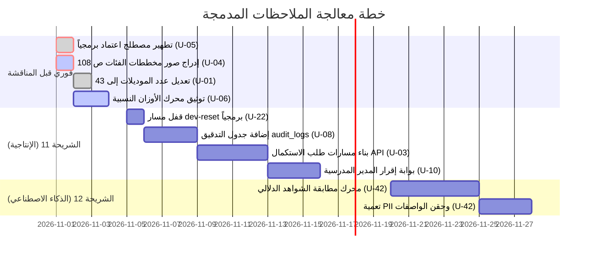
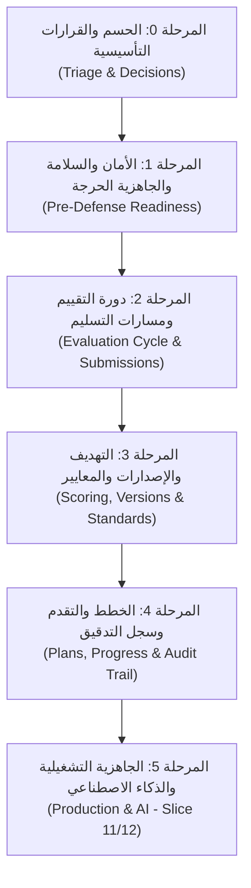

# خطة المعالجة المرحلية وجداول الأولويات

> تحدد هذه الوثيقة خارطة الطريق المتكاملة لتنفيذ الإصلاحات والتحسينات الناتجة عن المراجعة التحكيمية الشاملة، مقسمة إلى ست مراحل محكمة (من المرحلة 0 إلى المرحلة 5) مع تحديد أولويات العمل، معايير الإنجاز (Definition of Done)، ومخطط زمني تفصيلي.

---

# الثاني عشر: خطة المعالجة وجداول الأولويات

### جدول الأولويات المعتمد

| المرحلة | البنود المشمولة | الإجراء المطلوب بالتفصيل | معيار الإغلاق (Definition of Done) |
|---|---|---|---|
| **فوري (قبل المناقشة والطباعة)** | U-01, U-04, U-05, U-06, U-07, U-14, U-15, U-16, U-17, U-25, U-30 | 1. إعادة تصدير PDF بدمج صور CD-0..06. 2. تعديل تسمية الصلاحية ورسالة الإرسال في الكود. 3. تحديث عدد النماذج إلى 43 وإضافة مبحث الأوزان والمعادلة. 4. تصحيح رسوم ERD وإضافة الأدوات الست ومصفوفة الصلاحيات الـ 19. | صدور النسخة المنقحة من PDF ومطابقة الكود الحرفية للمصطلحات وخلو الاختبارات من لفظ "اعتماد". |
| **الشريحة 11 (الجاهزية الإنتاجية)** | U-03, U-08, U-10, U-11, U-13, U-22, U-24, U-27, U-28, U-35, U-37, U-40 | 1. قفل مسار `dev-reset` بالبيئة المحلية. 2. بناء متحكم ومسارات طلبات الاستكمال `completion-requests`. 3. استحداث جدول وسجل التدقيق `audit_logs`. 4. تفعيل بوابة إقرار المدير وتصحيح استنساخ أدوات التحقق. | اجتياز اختبارات التكامل الآلية الجديدة للتدقيق وطلبات الاستكمال. |
| **الشريحة 12 (الذكاء الاصطناعي)** | U-42 (بفروعه) | 1. ربط واجهة Gemini Flash / OpenRouter. 2. تنفيذ معالجة OCR للشواهد ومطابقتها بالواصفات استرشادياً. 3. تفعيل تعمية البيانات التعريفية (PII Anonymization). | توليد مسودة خطة التحسين في حالة `PendingReview` مع الحفاظ على القرار البشري. |
| **رؤية مستقبلية (ما بعد v1.0)** | U-36, U-41, وتوسعات الجداول الإحصائية الستة | 1. دراسة خيار N/A مع وزارة التربية. 2. تفعيل حسابات مكاتب التربية بالمديريات. 3. جداول إحصاءات الاختبارات الوزارية وساعات التطوير المهني. | وثيقة المتطلبات الموسعة للإصدار الوطني العام v2.0. |

---

---

## تفصيل مراحل خارطة الطريق

### المرحلة 0: مرحلة الحسم والقرارات التأسيسية (Triage & Foundational Decisions)
* **الهدف:** حسم المسائل غير المحسومة، اتخاذ القرارات المعمارية مع مالك النظام، وتثبيت منهجية التطوير.
* **البنود المشمولة:** `U-02`, `U-25`, `U-26`, والمسائل الخمس في `10_بنود_تحتاج_تنقيحا.md`.
* **المخرجات:** وثيقة قرارات معتمدة وتحديث مقدمة ومنهجية الفصل الأول.

### المرحلة 1: الأمان والسلامة والجاهزية الحرجة قبل المناقشة (Pre-Defense Critical Readiness)
* **الهدف:** تصحيح كافة الانحرافات التوثيقية والبرمجية الحساسة التي تضعف موقف الباحثين أمام لجنة التحكيم.
* **البنود المشمولة:** `U-01`, `U-04`, `U-05`, `U-06`, `U-07`, `U-14`, `U-15`, `U-16`, `U-17`, `U-22`, `U-30`.
* **الإجراءات الجوهرية:**
  1. إعادة دمج وتصدير صور مخططات الفئات السبعة (CD-00 إلى CD-06) في ملف PDF الصفحات 108–114.
  2. تطهير الكود والرسائل والبذور تماماً من المصطلح المحظور («اعتماد»).
  3. قفل مسار `dev-reset` بالبيئة المحلية حصراً لمنع العبث بالبيانات.
  4. تحديث عدد النماذج إلى 43 موديلاً وتوثيق نماذج الشريحة 6 في ERD الفصل الثالث.
  5. إضافة مبحث المواصفة الحسابية للأوزان النسبية ومعادلة النتيجة الموزونة وتصنيف الأداء.
  6. إدراج مصفوفة الصلاحيات الحبيبية الـ 19 وتصحيح أخطاء ERD-02 و ERD-03.
* **معيار الإنجاز (DoD):** صدور نسخة PDF منقحة، نجاح كافة الاختبارات دون لفظ "اعتماد"، وقفل المسارات التطويرية.

### المرحلة 2: دورة التقييم ومسارات التسليم والإغلاق (Evaluation Cycle & Submissions)
* **الهدف:** استكمال حلقة تسليم ومراجعة التقييم ومعالجة الثغرات الإجرائية.
* **البنود المشمولة:** `U-03`, `U-10`, `U-11`, `U-13`, `U-19`, `U-20`, `U-21`, `U-29`.
* **الإجراءات:**
  1. بناء مسارات ومتحكم طلبات الاستكمال والمحاولات المتعددة في الـ API.
  2. ضبط بوابة مراجعة مدير المدرسة (إلزامية أو مرنة).
  3. معالجة حالة التعليق عند إغلاق الدورة التقييمية وطلبات الاستكمال المفتوحة.
  4. توثيق آلية إلحاق المدارس الجديدة منتصف العام الدراسي.
* **معيار الإنجاز (DoD):** كتابة اختبارات تكاملية لمسار الاستكمال واجتيازها بنسبة 100%.

### المرحلة 3: التهديف والإصدارات والمعايير (Scoring, Versions & Standards)
* **الهدف:** ضبط دقة العمليات الحسابية والنسخ المعيارية ومطابقة الشواهد.
* **البنود المشمولة:** `U-18`, `U-23`, `U-24`, `U-27`, `U-28`, `U-31`, `U-32`, `U-33`, `U-34`, `U-36`.
* **الإجراءات:**
  1. تصحيح دالة استنساخ الإصدارات المعيارية (`cloneVersion`) لنسخ أدوات التحقق.
  2. إتاحة ربط الشاهد بعدة مؤشرات عبر جدول وسيط (إذا أُقر معمارياً).
  3. ضبط المقارنات عبر الإصدارات المعيارية والتأكد من التعامل مع المؤشرات المحذوفة.
* **معيار الإنجاز (DoD):** استنساخ إصدار معياري كامل والتحقق من سلامة كافة العلاقات الرياضية.

### المرحلة 4: الخطط والتقدم وسجل التدقيق (Plans, Progress & Audit Trail)
* **الهدف:** إحكام متابعة خطط التحسين المدرسية وتوفير سجل تدقيق للعمليات الحساسة.
* **البنود المشمولة:** `U-08`, `U-09`, `U-12`, `U-38`, `U-39`.
* **الإجراءات:**
  1. إنشاء جدول وسجل التدقيق `audit_logs` لتتبع العمليات الحساسة على التقييمات.
  2. معالجة انقطاع خطة التحسين بعد إغلاق ملف التقييم وإتاحة المتابعة متعددة السنوات.
  3. التوفيق بين التقدم الوصفي والنسبة المئوية الكمية في وثيقة التخرج.
* **معيار الإنجاز (DoD):** تسجيل كافة عمليات التعديل الحساسة في جدول التدقيق واختبارها آلياً.

### المرحلة 5: الجاهزية التشغيلية والذكاء الاصطناعي (Slice 11/12 Operations)
* **الهدف:** تجهيز النظام للبيئة الإنتاجية الحقيقية وتفعيل ميزات الذكاء الاصطناعي الاستشارية.
* **البنود المشمولة:** `U-35`, `U-37`, `U-40`, `U-41`, `U-42`.
* **الإجراءات:**
  1. بناء مسارات تغيير وتحديث كلمة المرور الشخصية للمستخدمين.
  2. وضع سياسة الاحتفاظ بالبيانات وأرشفتها وحذفها الآمن.
  3. بناء طبقة الذكاء الاصطناعي الاستشارية (Gemini Flash / OpenRouter) في الشريحة 12 مع تعمية PII وفرض مبدأ Human-in-the-Loop.
  4. دعم التخزين المحلي والعمل دون اتصال في الواجهة الأمامية (PWA / IndexedDB).
* **معيار الإنجاز (DoD):** استيفاء متطلبات النشر السحابي والتشغيل التجريبي الميداني.

---

## روابط التنقل
* **دليل الحزمة:** [00_README.md](00_README.md)
* **المشكلات المؤكدة:** [02_المشكلات_المؤكدة.md](02_المشكلات_المؤكدة.md)
* **سجل المهام التنفيذية:** [08_سجل_المهام.md](08_سجل_المهام.md)
* **مصفوفة التتبع:** [09_مصفوفة_المصادر_والتتبع.md](09_مصفوفة_المصادر_والتتبع.md)