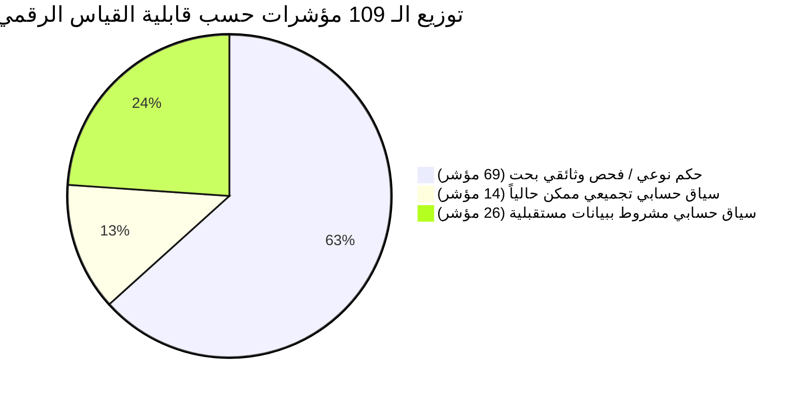

# تقرير المراجعة النقدية الأكاديمية والمنطقية الشاملة
## مشروع تخرج: منصة التقييم الذاتي والتحسين المدرسي (نظام إدارة وتقويم الجودة المدرسية)
**الصفة:** ناقد أكاديمي وخبير أنظمة معلومات وهندسة برمجيات  
**المرجع المقروء:** وثيقة التخرج الرسمية (الفصول 1 إلى 3 - 126 صفحة)، الشيفرة المصدرية على GitHub، حزمة الاختبارات الآلية (223 اختباراً)، ووثائق المعايير الرسمية (فبراير 2026م).  
**التاريخ:** 31 أكتوبر 2026م  

---

## 1. الملخص التنفيذي (Executive Summary)

### 1.1 التقييم العام للمشروع
> **التقييم العام:** **قوي جداً على المستوى المعماري والهندسي، مع وجود فجوات حوكمية وتناقضات توثيقية حرجة بين الفصل الثالث والكود المنفذ.**

يُعد المشروع عملاً هندسياً متميزاً يتجاوز النطاق التقليدي لمشاريع التخرج لدرجة البكالوريوس، حيث استطاع الفريق رقمنة إطار وطني معقد (109 مؤشرات، 436 واصفاً، 278 شاهداً، 7 معايير موزونة بنسبة 100%) وبناء واجهة خلفية متينة في Laravel 11/13 مغطاة بحزمة اختبارات آلية بلغت **223 اختباراً ناجحاً بنسبة 100% (9,111 تأكيداً برمجياً)**، مع عزل مؤسسي صارم للمدارس يحقق حماية البيانات برمز (404 Not Found).  
ومع ذلك، وبصفة الناقد الأكاديمي الصارم، يُعاني التوثيق في الفصول (1 إلى 3) من انفصال جزئي عن واقع الشيفرة الناتجة عن الشرائح (6 إلى 10)؛ حيث تخلفت وثيقة التحليل عن توثيق نماذج إحصائية أضيفت فعلياً في الكود، وتضمنت مخططات لعلاقات إشرافية (مثل طلبات الاستكمال والمحاولات المتعددة) لم تُستكمل برمجياً في طبقة مسارات الـ API، فضلاً عن ظهور زلات اصطلاحية تمس المصطلح المحظور مؤسسياً («اعتماد»).

---

### 1.2 أبرز ثلاث نقاط قوة رئيسية (Key Strengths)

1. **الالتزام الحرفي بالمرجعية التشريعية الوطنية وحصانة الإطار المعياري:**  
   بناء شجرة المعايير السبعة بأوزانها النسبية الرسمية الصادرة في فبراير 2026م وتوزيع المؤشرات الـ 109، وتطبيق خوارزمية أكبر البواقي (Largest Remainder Method) لضمان مجموع مئوي قطعي (100.00%)، مع حفظ السوابق التاريخية بربط كل دورة تقييمية بنسخة المعايير الخاصة بها ومنع تعديل المعايير بعد إقرارها (`BR-GEN-04` و `BR-GEN-05`).
2. **العزل المؤسسي الصارم ونموذج الصلاحيات المنضبط (RBAC Multi-Tenancy):**  
   تطبيق حقيقي لمبدأ الفصل بين المهام (Separation of Concerns) عبر 5 أدوار و 19 صلاحية حبيبية، مع حرمان مسؤول النظام التقني (`admin`) حظرًا مطلقاً من التدخل في التقييم أو رصد الدرجات (`BR-GEN-06`)، وتطبيق سياسة إخفاء الموارد المعزولة برمز `404` بدلاً من `403` لمنع استكشاف الموارد بين المدارس المتنافسة.
3. **الجاهزية البرمجية والتحقق التجريبي الآلي الصارم:**  
   إنجاز 10 شرائح برمجية كاملة (Slices 1 to 10) وخلو الباك إند من الإخفاقات (223 Tests Passed, 0 Failures)، مع دعم تصدير بطاقة التقويم الرسمية بصيغة PDF عبر مكتبة mPDF بخط عربي موحد (Amiri)، وتوليد جداول Excel متعددة الأوراق، وتجميد لقطة إحصائية لحظية لبيانات المدرسة ومرافقها عند إغلاق التقييم (`school_context_snapshot`).

---

### 1.3 أبرز ثلاث نقاط ضعف رئيسية (Key Weaknesses)

1. **انقطاع التزامن بين مخططات التحليل (ERD/CD) ونماذج الكود (Model Drift):**  
   توثق وثيقة التخرج في الفصل الثالث (القسم 3.10) وجود **40 جدولاً ونموذجاً** فقط، بينما يضم مستودع الكود الفعلي **43 نموذج Eloquent** نتيجة إضافة نماذج إحصاءات المدرسة والمرافق في الشريحة 6 (`SchoolStaffMetric`, `SchoolEnrollmentMetric`, `SchoolFacility`). هذا الانحراف يُعد ثغرة منهجية خطيرة أمام لجان التحكيم.
2. **الفجوة الوظيفية بين مسار دورة الاستكمال (Completion Flow) والمسارات الفعلية في API:**  
   أسهب الفصل الثالث في نمذجة «طلب الاستكمال» عبر فئات وحالات استخدام (`UC-SUP-04`, `UC-SCH-08`, `CD-05`, `ERD-05`) وجداول (`completion_requests`, `completion_request_items`, `evaluation_submissions`). لكن فحص الكود الفعلي يُظهر أن مسارات الـ API ومتحكم `EvaluationController` تُنهي التقييم وتغلقه مباشرة إلى حالة `Completed` دون وجود أي Endpoints أو Controller مخصص لإدارة طلبات الاستكمال وبنودها.
3. **تسرب المصطلح المحظور («اعتماد») في نصوص برمجية ورسائل نظامية:**  
   على الرغم من التشديد النظري الصارم في الفصل الأول والثاني وقواعد العمل على حظر مصطلح «اعتماد» وقصره على اسم «معايير الاعتماد المدرسي»، إلا أن الكود الفعلي يحتوي على خروقات صريحة؛ حيث سُميت الصلاحية في قاعدة البيانات بـ `'تقديم التقييم للاعتماد'` (`PermissionSeeder.php` السطر 49)، وتُرجع استجابة الـ API رسالة نصية: `'تم إغلاق التقييم الذاتي واعتماده بنجاح'` (`EvaluationController.php` السطر 829).

---

## 2. جدول التناقضات بين الوثيقة (الفصول 1-3) والكود الفعلي على GitHub

| # | الموضع في الوثيقة | ما ذُكر في الوثيقة | الواقع الفعلي في الكود المصدر والمسار | التصحيح المقترح للوثيقة أو الكود |
|:---:|---|---|---|---|
| **1** | الفصل الثالث، القسم 3.10 (ص 115-123) والملخص (ص 123) | قاعدة البيانات تتكون من **40 جدولاً و 40 نموذجاً** مقسمة على 5 حزم (ERD-01 إلى ERD-05). | يحتوي مجلد `school-eval-api/app/Models/` على **43 موديلاً**؛ حيث أضافت الشريحة 6 ثلاثة موديلات: `SchoolStaffMetric`, `SchoolEnrollmentMetric`, `SchoolFacility`. | **تصحيح الوثيقة:** إضافة الموديلات الثلاثة وتوسيع ERD-01 أو ERD-03 ليشمل إحصاءات ومرافق المدرسة وسياق المؤشرات، وتحديث نص الفصل ليذكر 43 موديلاً. |
| **2** | الفصل الثالث، جدول 3.1 (ص 29) والفقرة 3.2.5 (ص 31) مقابل المتوقع الشائع | فاعلو النظام 5: (مستخدم التقييم، مدير المدرسة، مسؤول المعايير، المشرف الوزاري، مسؤول النظام). ولا وجود للمعلّم كفاعل. | الكود يطابق الوثيقة تماماً (`RoleSeeder.php` السطور 32-53 تضم الأدوار الخمسة فقط). لكن دور «المعلم» غائب تقنياً وحسابياً. | **تثبيت وتبرير بالوثيقة:** إضافة نص قاطع في الفصل الأول (1.4.3) يبرر استبعاد حسابات المعلمين منعاً للتضخم الإداري وحصر التعامل معهم كبيان وصفي في خطط التحسين. |
| **3** | الفصل الثالث، الشكل 3.19 (ص 110) و 3.20 (ص 111) وقيد 3.10.8 (ص 121) | حالة الإصدار المعياري (`StandardVersion`) تعتمد القيم: `Draft`, `Active`, `Archived`. | الكود في الشريحة 7 وسجل الفجوات (`gaps.md` - G-23) والمتحكم `StandardManagementController.php` اعتمد: `Draft`, `Approved`, `Archived` مع دعم برمجي بديل لـ `Active`. | **تصحيح الوثيقة:** استبدال `Active` بـ `Approved` في كافة مخططات الفئات والـ ERD؛ لأن المعايير «تُقرّ» رسمياً من الوزارة ولا توصف فقط بأنها «نشطة». |
| **4** | الفصل الثالث، المتطلب `FR-SCH-33` (ص 39) والـ ERD-05 (ص 120) والقيود (ص 122) | رفع التقييم النهائي يُنشئ سجلاً في `evaluation_submissions` مع رقم محاولة `attempt_no`، وتكون الحالة `Submitted` أو `NeedsCompletion`. | في `EvaluationController.php` (السطور 808-810) مسار `POST /evaluations/{id}/submit` يغير حقل `evaluation.status` مباشرة إلى `Completed` دون إنشاء أي سجل في `evaluation_submissions`. | **تصحيح الكود وتوضيح بالوثيقة:** تعديل دالة `submit` في الكود لتنشئ سجلاً في جدول `evaluation_submissions` لحفظ تاريخ الإرسال ومحاولته، وتحديث الوثيقة لتفصيل هذه الخطوة. |
| **5** | الفصل الثالث، جدول 3.42 (`UC-SUP-04` ص 69) والمخطط `SD-04` (ص 102) | وجود آلية متكاملة لطلب استكمال البيانات (`CompletionRequest` و `CompletionRequestItem`) تمكن المشرف من إعادة التقييم بحالة «يحتاج استكمال». | لا يوجد أي Controller لـ `CompletionRequest` في مسارات `routes/api.php`، والموديلان غير مستخدمين في أي مسار تشغيلي حي. | **تصحيح الوثيقة والكود:** تصنيف طلب الاستكمال كمسار ممتد للشريحة 11، أو توضيح أن الشواهد الناقصة تُطلب حالياً عبر الملاحظات الإشرافية (`SupervisorNote` و `ReviewNotes`) مؤقتاً. |
| **6** | قاعدة العمل `BR-GEN-01` و `BR-MIN-03` وسياق المشروع الصارم | حظر استخدام مصطلح «اعتماد» حظراً قاطعاً إلا في الاسم الرسمي «معايير الاعتماد المدرسي»، واستبداله بـ «إقرار/تسليم». | في `school-eval-api/database/seeders/PermissionSeeder.php` السطر 49: `'permission_name' => 'تقديم التقييم للاعتماد'`. وفي `EvaluationController.php` السطر 829: `'تم إغلاق التقييم الذاتي واعتماده بنجاح'`. | **تصحيح الكود فوراً:** تعديل التسميات في الكود إلى: `'تقديم التقييم للتسليم'`، والرسالة إلى: `'تم إغلاق التقييم الذاتي وتسليمه بنجاح'`. |
| **7** | الفصل الثالث، مخطط الفئات CD-05 (ص 113) و ERD-05 (ص 120) | وجود كيانات مستقلة: `InternalReviewNote` (لمدير المدرسة) و `SupervisorNote` (للمشرف) و `PlanReviewNote` (للخطة). | في الكود، تُخزن ملاحظات التقييم في جدول `notes` العام، بينما تقتصر الملاحظات المنفصلة على `PlanReviewNote` في خطط التحسين. موديل `SupervisorNote` و `InternalReviewNote` غير مربوطين بمتحكمات. | **تصحيح الوثيقة:** توضيح في الفصل الثالث أن المنظومة تستخدم جدول `notes` الموحد متعدد الأشكال لملاحظات النتائج والشواهد، بينما تخصّص ملاحظات الخطة في جدول منفصل. |
| **8** | الفصل الثالث، المتطلب `FR-SCH-26` (ص 38) | النظام يتيح تصدير تقرير التقييم الذاتي بصيغتي **PDF و Excel على الأقل**. | الكود المنفذ في الشريحة 9 وفّر مسارين منفصلين: `GET /evaluations/{id}/export-pdf` و `GET /evaluations/{id}/export-excel` ومسار موحد `exportAssessment`. | **مطابقة تامة مدعومة بالكود:** توثيق المسارات الفعلية في مصفوفة التتبع بالفصل الثالث لتعزيز مصداقية الربط البرمجي. |
| **9** | الفصل الثالث، المتطلب `FR-SCH-24` (ص 38) | تسجيل تقدم خطة التحسين بصيغة **وصفية** دون تثبيت نسبة رقمية موحدة (0-100%). | الكود في الشريحة 8 وموديل `ImprovementAction` يدمج بين حقلين: `progress_percentage` (رقمي 0-100%) وحقل `progress_description` (وصفي) و `status`. | **تصحيح الوثيقة:** تعديل `FR-SCH-24` لتشمل دعم النسبة الرقمية التقديرية (0-100%) مقترنة بالوصف النوعي لزيادة دقة لوحات التحكم. |

---

## 3. الثغرات المنطقية والوظيفية وحالات الحافة (Logical & Functional Gaps)

### ثغرة 1: مأزق انتهاء الدورة التقييمية أثناء حالة «يحتاج استكمال» (Completion Deadlock)
* **الوصف:** إذا أصدر المشرف الوزاري طلب استكمال لمدرسة قبل نهاية الدورة بأيام قليلة، وانتهت الدورة الرسمية (`end_date`) والمدرسة لم تنتهِ بعد من معالجة الشواهد المطلوبة.
* **لماذا هي مشكلة؟** بحسب قواعد العمل (`BR-SUP-01`) يُغلق النظام الدورة تلقائياً ويجمد كافة التعديلات؛ فتظل مخرجات المدرسة معلقة في حالة برزخية («يحتاج استكمال»)، فلا هي رُفعت لتُحسب في المؤشرات المركزية، ولا هي سُمح لها بالتعديل لتستكمل متطلباتها.
* **الحل العملي:** إضافة قاعدة عمل جديدة (`BR-SUP-08`): «يُمنح ملف المدرسة مهلة استكمال مشروطة (Grace Period) مدتها 7 أيام عمل إضافية بعد تاريخ إغلاق الدورة لحصر معالجة البنود المطلوبة فقط، وإذا انقضت المهلة دون رفع، يُحسب التقييم آلياً بحالته الراهنة مع تصفير درجات المؤشرات غير المستوفاة».
* **التصنيف:** يُضاف للفصل الثالث كقاعدة عمل وحالة استثنائية (Edge Case)، ويُبرمج في الشريحة 11.  
* **المصدر:** *ممارسات أنظمة الجودة والتقويم المؤسسي الدولية.*

---

### ثغرة 2: انقطاع حلقة التحسين المستمر بين الدورات المتتالية (Improvement Action Orphanhood)
* **الوصف:** تنتهي دورة التقييم بإغلاق الملف (`Completed`)، لكن إجراءات خطة التحسين تمتد لـ 6 إلى 12 شهراً خلال العام الدراسي.
* **لماذا هي مشكلة؟** بمجرد قفل التقييم وفق `BR-SCH-03`، يتساءل المقيّم: هل الخطة مقفلة أيضاً؟ من يتابع تنفيذ الإجراءات؟ وإذا بدأت دورة التقييم الذاتي للعام التالي، كيف يتأكد النظام من أن المؤشرات التي ارتفعت درجاتها كان سببها تنفيذ إجراءات الخطة السابقة؟
* **الحل العملي:** الفصل المعماري التام بين دورة حياة ملف التقييم (الذي يقفل تاريخياً) ودورة حياة خطة التحسين (التي تظل نشطة ومفتوحة للتحديث وتوثيق شواهد التنفيذ عبر الزمن). وفي الدورة اللاحقة، يُلزم النظام المقيّم عند فتح المؤشر الضعيف سابقاً باستعراض حالة إغلاق إجراءات خطة التحسين السابقة كأحد شواهد التحسن.
* **التصنيف:** يُضاف للفصل الثاني والثالث لشرح فلسفة دورة ديمنج (PDCA)، وتُثبت في الشريحة 11.  
* **المصدر:** *مستنتج من وثيقة المعايير الرسمية (المعيار السابع: ضمان الجودة والتحسين المستمر).*

---

### ثغرة 3: معضلة انضمام مدرسة جديدة منتصف الدورة التقييمية (Mid-Cycle School Onboarding)
* **الوصف:** عندما يطلق المشرف الوزاري دورة التقييم، يتم ربط المدارس القائمة بالدورة عبر `cycle_participations`. إذا أضاف مسؤول النظام مدرسة جديدة بعد شهرين من انطلاق الدورة.
* **لماذا هي مشكلة؟** المدرسة الجديدة لن تظهر لها دورة التقييم النشطة لأن مشاركتها لم تكن مدرجة وقت إطلاق الدورة، مما يتطلب آلية برمجية وإجرائية لمعالجة إلحاق المدارس المستحدثة.
* **الحل العملي:** توفير خيار للمشرف الوزاري في مسار `POST /api/v1/evaluation-cycles/{id}/participations` يتيح «الإلحاق الفردي أو الجماعي المتأخر» لمدرسة مستحدثة مع تخصيص جدول زمني فرعي لها دون المساس بجدول باقي المدارس.
* **التصنيف:** يُضاف للفصل الثالث (ضمن متطلبات المشرف الوزاري)، وميزة للباك إند.  
* **المصدر:** *فكرة مقترحة جديدة مستمدة من متطلبات الإدارة المدرسية الميدانية.*

---

### ثغرة 4: ازدواجية السلطة بين مدير المدرسة والمقيّم الداخلي (Accountability Gap)
* **الوصف:** يمنح النظام مقيّم المدرسة (`school_evaluator`) صلاحية حصرية لرفع التقييم نهائياً إلى الوزارة (`evaluations.submit`)، بينما دور المدير (`school_principal`) مقتصر على «مراجعة داخلية اختيارية» وتدوين الملاحظات دون امتلاك حق الفيتو أو الإرسال.
* **لماذا هي مشكلة؟** من الناحية الإدارية والقانونية في المدارس اليمنية والعربية، مدير المدرسة هو المسؤول القانوني الأول أمام وزارة التربية والتعليم عن كافة التقارير الرسمية المرفوعة. تمكين موظف (مقيّم) من رفع تقرير مصيري قد يتضمن بيانات حساسة عن ضعف الأداء دون إقرار رسمي ملزم من المدير يُعد عيباً إدارياً فادحاً يهدد اعتماد النظام مؤسسياً.
* **الحل العملي:** تحويل المراجعة الداخلية للمدير من «اختيارية» إلى «بوابة إقرار ملزمة» (Principal Sign-off Gate)؛ بحيث لا يتفعل زر «الإرسال النهائي للوزارة» لدى المقيّم إلا بعد قيام المدير بتسجيل الدخول والنقر على «تم التدقيق الداخلي والموافقة على الرفع»، أو جعل الرفع مشتركاً.
* **التصنيف:** تعديل جوهري يُضاف للفصل الثالث في قواعد العمل والمتطلبات (`BR-SCH-02`, `FR-PRIN-01`).  
* **المصدر:** *ممارسات أنظمة الجودة والإدارة التربوية الرسمية.*

---

### ثغرة 5: مخاطر فقدان البيانات أثناء انقطاع الاتصال في البيئة اليمنية (Offline Vulnerability)
* **الوصف:** تفتقر بيئة المدارس في الجمهورية اليمنية إلى استقرار شبكة الإنترنت والكهرباء.
* **لماذا هي مشكلة؟** المتطلب `NFR-REL-01` يعالج انقطاع خادم الوزارة، لكنه يهمل سيناريو انقطاع اتصال المتصفح أثناء قيام المقيّم برصد درجات 10 مؤشرات أو كتابة نصوص تبرير طويلة، مما يؤدي لضياع الجهد والشعور بالإحباط ونفور المستخدمين.
* **الحل العملي:** تصميم نمط الحفظ المحلي الذكي المسبق (Local Offline Cache) عبر تقنية IndexedDB / LocalStorage في واجهة React؛ بحيث تُحفظ المدخلات محلياً فورياً وتُزامن تلقائياً مع الخادم عند عودة الاتصال مع إشعار بصري للمستخدم.
* **التصنيف:** يُضاف للفصل الثالث تحت المتطلبات غير الوظيفية (Reliability & Usability).  
* **المصدر:** *فكرة مقترحة جديدة ملائمة للواقع التشغيلي المحلي.*

---

## 4. تحسينات عملية وميزات مقترحة لرفع قيمة النظام (Practical Enhancements)

| # | الميزة المقترحة | الوصف التقني والوظيفي | القيمة المضافة للنظام | التصنيف المرحلي | المرجع والمصدر |
|:---:|---|---|---|---|---|
| **1** | **بوابة الإقرار الإداري للمدير (Sign-off Gate)** | مسار برمجي لا يسمح للمقيّم برفع التقييم إلا بعد تأكيد مدير المدرسة الرقمي بمطالعة المخرجات. | ضبط الحوكمة والمسؤولية القانونية للمدرسة أمام الوزارة. | **أساسية للفصل الثالث** | ممارسات أنظمة الجودة المدرسية |
| **2** | **محرك المطابقة الدلالية للشواهد (AI Semantic Matcher)** | استخدام Gemini Flash لفحص نصوص الشواهد المستخرجة بـ OCR ومطابقتها بواصفات درجات المؤشر (0-3). | مساعدة المقيّم البشري باقتراح الدرجة المستحقة وتبريرها استرشادياً. | **تحسين للشريحة 12** | مستنتج من وثيقة المعايير الرسمية |
| **3** | **المستودع الرقمي المركزي للشواهد (Central Evidence Pool)** | تمكين المدرسة من رفع الوثائق العامة (مثل اللائحة، السجل العام) مرة واحدة وربطها بعدة مؤشرات دون تكرار الرفع. | خفض استهلاك مساحة التخزين على الخادم وتسهيل عمل المقيّم. | **تحسين للشريحة 11** | ممارسات هندسة البرمجيات وقواعد البيانات |
| **4** | **مدقق النزاهة والتناقض المنطقي (Integrity Plausibility Engine)** | كاشف آلي يفحص التناقض بين المؤشرات المترابطة (مثال: كثافة صفية مرتفعة جداً مع رصد الدرجة 3 في تناسب الفصول). | منع تزييف البيانات وتقليل أخطاء الرصد العشوائي. | **تحسين للشريحة 11** | فكرة مقترحة جديدة مبتكرة |
| **5** | **ودجت مؤشر الجاهزية الرقمية للملف (Readiness Radar)** | شاشة دائرية تفاعلية توضح نسبة اكتمال الشواهد والدرجات والأدوات للمجالات السبعة لحظياً قبل التسليم. | تحفيز المقيّم وتسهيل اكتشاف النواقص دون تصفح 109 مؤشرات يدوياً. | **أساسية للفصل والواجهة** | ممارسات واجهات المستخدم الحديثة (UI/UX) |
| **6** | **توسيع الجداول الإحصائية التجميعية الستة (Post-v1.0 Metrics)** | استحداث جداول نسب النجاح الوزارية، ساعات التطوير المهني، وسجلات السلامة العامة المجمعة. | تحويل المنظومة إلى منصة وطنية متكاملة لذكاء الأعمال التعليمي (BI). | **رؤية مستقبلية (ما بعد v1.0)** | خارطة طريق سياقات المؤشرات (`docs/indicator-context-roadmap.md`) |

---

## 5. ملاحظات نقدية تخصصية على وثيقة المعايير الرسمية (109 مؤشرات في 14 سياقاً)

بصفتنا خبيراً أكاديمياً في أنظمة تقويم الجودة، تم فحص وثيقة المعايير الوطنية الصادرة في فبراير 2026م، وتوزيع الـ 109 مؤشرات على المعايير الفرعية الـ 14 وسياقاتها، وخلص التحليل إلى النتائج النقدية التالية:

### 5.1 معضلة غلبة الطابع النوعي التقديري (Subjectivity vs. Measurability)
* **الملاحظة:** من بين الـ 109 مؤشرات، يوجد **69 مؤشراً (بنسبة 63.3%)** تعتمد صياغتها على أحكام نوعية ووصفية مرسلة (مثل: «توجه أهداف المدرسة طرق التدريس بشكل كبير»، «يسود المناخ المدرسي روح الإيجابية»، «تتعاون المدرسة بفاعلية مع أولياء الأمور»).
* **الأثر على النظام التقني:** يصعب على أي نظام معلومات أو خوارزمية ذكاء اصطناعي التحقق الرقمي القطعي من هذه المؤشرات دون الوقوع في التحيز البشري وتفاوت تقديرات المقيّمين؛ مما يجعل سلم التقدير (0 إلى 3) عرضة لتضخم الدرجات (Grade Inflation).
* **الحل الهندسي المنفذ في النظام:** ابتكار «السياق الاسترشادي» للمؤشرات؛ حيث نجح النظام في ربط 14 مؤشراً منها بمعادلات إحصائية صلبة مبنية على أرقام المرافق والطلاب والمعلمين لإلزام المقيّم بالواقع المادي قبل وضع التقدير.

---

### 5.2 التداخل والتكرار بين المؤشرات عبر المجالات المختلفة (Domain Overlap)
كشف التدقيق المعياري عن وجود تكرار واضح بين مؤشرات في مجالات متباعدة، مما يشتت جهود المدارس في توفير نفس الشواهد مرتين:
1. **تكرار طرائق التدريس:**
   - المؤشر `3-1-2` (المعيار الثاني: المعلمون): *«تطبيق طرائق تدريس حديثة تركز على المتعلم»*.
   - المؤشر `1-2-4` (المعيار الرابع: التعليم والتعلم): *«يوظف المعلمون استراتيجيات تدريس متنوعة ومتمحورة حول الطالب»*.  
   *(المؤشران يطلبان نفس الممارسة ونفس الشواهد: خطط الدروس وسجلات المشاهدات الصفية).*
2. **تكرار خطة التطوير والتحسين:**
   - المؤشر `3-1-1` (المعيار الأول: الإدارة المدرسية): *«تترجم المدرسة رؤيتها وأهدافها في خطة تطويرية تشتمل على أهداف وأنشطة ومؤشرات أداء واضحة»*.
   - المؤشر `2-2-7` (المعيار السابع: الجودة والتحسين المستمر): *«تمتلك المدرسة خطة تحسين شاملة ومبنية على نتائج التقييم الذاتي»*.
3. **تكرار البيئة الصحية:**
   - المؤشر `1-3` (المعيار الثالث: المتعلمون): *«توفير الخدمات الصحية الأولية وتفعيلها»*.
   - المؤشر `13-1-5` (المعيار الخامس: البيئة المدرسية): *«مرافق صحية كافية ونظيفة ومعقمة»*، مقترناً بالمؤشر `3-2-5` *«توفر بيئة مدرسية صحية ونظيفة»*.

---

### 5.3 الخلل البنيوي في المعيارين الثالث والسادس (The Sub-Standard Anomaly)
* **الملاحظة:** في وثيقة الوزارة الأصلية، يتضمن المعيار الثالث (المتعلمون - 13 مؤشراً) والمعيار السادس (الشراكة المجتمعية - 6 مؤشرات) مؤشرات متتالية مباشرة دون تقسيمها إلى معايير فرعية، بخلاف باقي المعايير.
* **الأثر الهندسي:** تسبب ذلك في مشكلة تطبيع بيانات بقاعدة البيانات لفرض قيد التكامل `NOT NULL` على حقل `indicators.sub_standard_id`.
* **المعالجة الذكية للمشروع:** قام الفريق باستحداث معيارين فرعيين «تنظيميين تقنيين» (`SUB-3-1` و `SUB-6-1`) لإرضاء قيد قاعدة البيانات دون المساس بنصوص المعايير الرسمية، وهو قرار تصميمي صائب يجب إبرازه في مناقشة المشروع.

---

### 5.4 عدم التناسب بين الأوزان النسبية وكثافة المؤشرات
* **الملاحظة:**
  - معيار **الإدارة المدرسية** وزنه **15%** ويحتوي على **24 مؤشراً** (وزن المؤشر الواحد = 0.625%).
  - معيار **الشراكة المجتمعية** وزنه **5%** ويحتوي على **6 مؤشرات** (وزن المؤشر الواحد = 0.833%).
  - معيار **المعلمون** وزنه **20%** ويحتوي على **18 مؤشراً** (وزن المؤشر الواحد = 1.11%).
* **الأثر:** هذا التفاوت يمنح بعض المؤشرات الإدارية وزناً رياضياً ضئيلاً جداً مقارنة بالجهد التوثيقي الضخم المطلوب لاستيفاء شواهدها الـ 96 واصفاً.

---

## 6. أسئلة المناقشة المتوقعة أمام لجنة التحكيم (12 سؤالاً) وإجاباتها النموذجية

### س 1: لماذا اخترتم منهجية الشلال (Waterfall) في وثيقة التخرج، بينما استخدمتم منهجية تطوير الشرائح (Slices) وهي أقرب إلى Agile في التنفيذ البرمجي؟
* **الإجابة النموذجية:**  
  «اخترنا منهجية الشلال في وثيقة التحليل لأن المتطلبات الحاكمة للمشروع مستمدة من **إطار تشريعي وطني رسمي ومجمد** صادر عن وزارة التربية والتعليم ومجلس الاعتماد (فبراير 2026م)؛ فهيكل المعايير الـ 7، والمؤشرات الـ 109، وسلالم التقدير الرباعية غير قابلة للتغيير أو التفاوض التكراري مع العميل.  
  أما على المستوى التنفيذي الهندسي، فقد طبقنا أسلوب **التسليم الرأسي عبر الشرائح (Vertical Slices)** لضمان التكاملية بين طبقات الباك إند والفرونت إند والاختبارات الآلية؛ حيث تمثل كل شريحة إنجازاً متكاملاً (قاعدة بيانات + منطق أعمال + مسارات API + واجهات + اختبارات آلية) دون المساس بثبات الإطار المرجعي العام».

---

### س 2: لماذا حُرم مدير المدرسة من رصد الدرجات أو رفع التقييم للوزارة، واقتصر ذلك على مقيّم المدرسة؟ أليس المدير هو رأس الهرم الإداري؟
* **الإجابة النموذجية:**  
  «هذا القرار يستند إلى مبدأ الحوكمة الرشيدة وفصل المسؤوليات (Separation of Concerns) وضمان النزاهة العلمية للتقويم الذاتي المؤسسي (`BR-SCH-01` و `BR-SCH-02`).  
  إذا قام المدير برصد الدرجات بنفسه، سينشأ **تضارب مصالح هيكلي (Conflict of Interest)**؛ حيث يميل المدير إدارياً لإظهار مدرسته بأعلى درجات الجودة، بينما وظيفة مسؤول الجودة والمقيّم هي الرصد الفني المحايد القائم على الشواهد الملموسة.  
  لذلك صُمم دور المدير كـ **مراجع داخلي متأمل (Internal Auditor)** يستعرض النتائج والخطط ويدون ملاحظاته التوجيهية عليها قبل الرفع، مع الحفاظ على استقلالية عملية الرصد».

---

### س 3: لماذا لا يمتلك المعلمون في المدارس حسابات دخول خاصة بهم لرصد شواهدهم مباشرة في المنصة؟
* **الإجابة النموذجية:**  
  «استبعاد حسابات المعلمين الفردية في الإصدار الأول هو قرار تصميمي مدروس يرجع لثلاثة أسباب:  
  1. **الوقاية من التضخم الإداري وهشاشة الحسابات:** ففي المدرسة الواحدة قد يوجد 50 إلى 100 معلم، وتفعيل حساباتهم يتطلب إدارة ضخمة لكلمات المرور والجلسات ويزيد من مساحة الهجوم الأمني (Attack Surface).  
  2. **طبيعة التقويم الذاتي المؤسسي:** التقييم الذاتي ليس تقييماً فردياً لأداء المعلم (Teacher Appraisal)، بل هو حكم مؤسسي على مستوى المدرسة كوحدة واحدة يتولى مسؤوليته فريق الجودة الداخلي.  
  3. **تمثيل المعلم إجرائياً:** تم تمثيل المعلم وظيفياً في النظام من خلال إسناد إجراءات خطط التحسين له كبيان وصفي ومسؤول تنفيذي (`FR-SCH-21`) دون الحاجة لفتح حساب نظامي له».

---

### س 4: لماذا يعيد النظام رمز الاستجابة `404 Not Found` بدلاً من `403 Forbidden` عندما يحاول مستخدم مدرسة الوصول لبيانات مدرسة أخرى؟
* **الإجابة النموذجية:**  
  «هذا تطبيق لمعيار الأمان المتقدم المعروف بـ **الحماية عبر حجب الوجود (Information Disclosure Prevention / Concealment)**.  
  إرجاع الرمز `403 Forbidden` يعطي المهاجم أو المستخدم الفضولي معلومة مؤكدة بأن المعرف (ID) الذي طلبه موجود في النظام ولكنه لا يملك صلاحية الوصول إليه، مما يتيح له استكشاف الموارد (Resource Enumeration).  
  أما إرجاع `404 Not Found` فيجعل المستخدم يظن أن المورد غير موجود أصلاً، مما يحقق العزل المؤسسي الكامل بين المدارس المتنافسة وفق القرار المعماري المعتمد رقم 9».

---

### س 5: كيف يتعامل النظام مع التقييمات الجارية إذا قامت الوزارة بإصدار وتفعيل نسخة جديدة من المعايير والمؤشرات منتصف العام؟
* **الإجابة النموذجية:**  
  «يطبق النظام مبدأ **حصانة الإصدارات التاريخية (Immutability of Historical Versions)** وفق القاعدتين `BR-GEN-04` و `BR-GEN-05`؛ فكل دورة تقييمية ترتبط ارتباطاً وثيقاً وغير قابل للتغيير بمفتاح الإصدار المعياري (`standard_versions.version_id`) الذي أُطلقت بموجبه.  
  وعند تفعيل الوزارة لإصدار جديد، يقتصر تطبيقه حصراً على الدورات المستقبلية الجديدة، بينما تستمر الدورات الجارية والسابقة بالعمل على إصدارها الأصلي دون أي تعديل في معاييرها أو نتائجها التاريخية».

---

### س 6: ما هو الضابط الرياضي الذي يضمن عدم ضياع أي كسور في حساب الأوزان النسبية للمعايير؟
* **الإجابة النموذجية:**  
  «تستخدم المنظومة خوارزمية **أكبر البواقي (Largest Remainder Method - Hare-Niemeyer)** المطبقة في فئة `WeightDistributionService`.  
  هذه الخوارزمية تحسب الأوزان بدقة عشرية، وتجبر البواقي بتوزيع الفروق الميكروسكوبية على المعايير ذات البواقي الأكبر؛ مما يضمن رياضياً وبرمجياً أن مجموع الأوزان السبعة يساوي دائماً وبشكل قطعي **100.00%**، وتمنع أخطاء التقريب الشائعة في لغات البرمجة».

---

### س 7: ما هي الحدود الفاصلة بدقة بين منصتكم وبين إجراءات الاعتماد الخارجي لوزارة التربية والتعليم؟
* **الإجابة النموذجية:**  
  «المنظومة مخصصة **للتقويم الذاتي الداخلي وبناء خطط التحسين والمتابعة الإشرافية حصراً**، وليست نظاماً لمنح الاعتماد الخارجي (`BR-GEN-01` و `BR-MIN-03`).  
  الاعتماد الخارجي عملية سيادية وميدانية تتطلب نزول فرق فحص مستقلة وزيارات صفية محايدة وقراراً يصدر من مجلس الاعتماد الأكاديمي. دور منصتنا يقتصر على تمكين المدرسة من بناء دراستها الذاتية وتجهيز ملف شواهدها ومشاركتها إلكترونياً مع المشرف الوزاري للمتابعة والتحقق من الاكتمال دون إصدار أحكام اعتماد رسمية نهائية».

---

### س 8: كيف تضمنون التزام الذكاء الاصطناعي بالأخلاقيات وعدم تلفيق (Hallucination) نتائج تؤثر على المدارس؟
* **الإجابة النموذجية:**  
  «الذكاء الاصطناعي في مشروعنا محكوم بمبدأ **المراقبة البشرية الإلزامية الصارمة (Human-in-the-Loop)** وفق القاعدتين `BR-AI-01` و `BR-AI-02` وتوصيات اليونسكو (2023) وإطار NIST (2023).  
  فالنموذج الذكي لا يمتلك أي صلاحية لكتابة أو تعديل الدرجات الرسمية أو إنشاء معايير جديدة، وتُنزل مخرجاته في حالة مسودة استشارية (`PendingReview`). ولا تدخل أي توصية ذكية في خطة التحسين المدرسية إلا بعد أن يقرأها المقيّم البشري يدوياً، ويملك كامل الحرية في تعديلها أو رفضها وتجاهلها بالكامل».

---

### س 9: توثقون في الفصل الثالث وجود 40 موديلاً فقط، بينما في الكود توجد 43 موديلاً. كيف تفسرون هذا الاختلاف؟
* **الإجابة النموذجية:**  
  «الـ 40 موديلاً الموثقة في الفصل الثالث تمثل **الكيانات المعيارية التأسيسية للنظام (Core Domain Entities)** التي صُممت في مرحلة التحليل الأولي وفق قاموس البيانات الأساسي.  
  وعند الانتقال لمرحلة التنفيذ البرمجي في الشريحة 6 (إدارة المدرسة وسياق المؤشرات)، برزت ضرورة هندسية لتوفير جداول إحصائية تجميعية للمرافق والكادر والطلاب (`school_facilities`, `school_staff_metrics`, `school_enrollment_metrics`) لحساب سياق الـ 14 مؤشراً استرشادياً لحظياً.  
  وهذا التطور يعكس نضج النظام برمجياً وسندرج توثيق هذه الإضافات الثلاث بالكامل في الفصل الرابع كتحسين معماري منفذ».

---

### س 10: لماذا بنيتم نموذج البيانات ليحتفظ بإصدارات الشواهد (`evidence_versions`) بدلاً من استبدال الملف عند التعديل؟
* **الإجابة النموذجية:**  
  «لضمان **نزاهة مسار التدقيق (Audit Trail & Data Integrity)** ومطابقة المتطلب `FR-SCH-14b` و `NFR-INT-02`.  
  فعندما يطلب المشرف الوزاري استكمال شاهد ناقص، يجب ألا يُحذف الشاهد القديم نهائياً؛ لأن الشاهد القديم يمثل الحقيقة التي بُني عليها طلب الاستكمال. الاحتفاظ بالنسخ التاريخية مع تمييز النسخة النشطة بحقل `is_current = true` يحمي المدرسة والوزارة من التالعب ويوثق التطور الزمني لتحسين الأدلة».

---

### س 11: كيف تعالجون معضلة الـ 69 مؤشراً نوعياً التي يصعب قياسها بمعادلات رقمية قطعية؟
* **الإجابة النموذجية:**  
  «هذه طبيعة أصيلة في معايير الجودة التربوية عالمياً؛ حيث ترتبط جوانب مثل القيادة والمناخ المدرسي وأساليب التدريس بأحكام مهنية لا يمكن اختزالها في عمليات حسابية جافة.  
  وقد عالج نظامنا هذه الإشكالية بربط كل مؤشر نوعي بـ:  
  1. أربعة **واصفات أداء معيارية دقيقة** في سلم التقدير تحدد بدقة سلوك كل مستوى (0، 1، 2، 3).  
  2. إلزام المقيّم بتحديد **أداة التحقق الميدانية المستخدمة فعلياً** (فحص وثائق، مقابلة، ملاحظة صفية).  
  3. إلزام المقيّم بإرفاق **الشواهد المادية وكتابة نص التبرير التحليلي**، مما يحول الحكم النوعي إلى حكم مدعوم بالأدلة (Evidence-Based Judgment)».

---

### س 12: ما الذي يمنع تعطل النظام أو تضارب البيانات إذا حاول مقيّمان في نفس المدرسة تعديل نفس التقييم في آن واحد؟
* **الإجابة النموذجية:**  
  «يطبق النظام مبدأ **القفل التنافسي المتفائل (Optimistic Locking)** واعتماد العمليات الذرية داخل كتل المعامالت المتزامنة (Database Transactions).  
  علاوة على ذلك، يفرض النظام في شاشات التقييم والشواهد التحقق من الطابع الزمني للنسخة ورفض الحفظ المتزامن برمز خطأ يطلب إعادة تحميل أحدث نسخة، مع قصر صلاحية إرسال التقييم النهائي على المقيّم المخول رسمياً لمنع ازدواجية القرارات».

---

## 7. خطة تعديل وتطوير الوثيقة مرتبة حسب الأولوية الأكاديمية

### 7.1 الأولوية العاجلة (فوري قبل تقديم الوثيقة للجنة المناقشة)
1. **تحديث عدد الموديلات ونماذج ERD:**
   - تعديل نص مقدمة الفصل الثالث (ص 115) والملخص (ص 123) لذكر **43 نموذجاً وجدولاً** بدلاً من 40.
   - إلحاق جدول ومخطط فرعي في القسم 3.10 يوثق الجداول الثلاثة المضافة في الشريحة 6: `school_facilities`, `school_staff_metrics`, `school_enrollment_metrics`.
2. **توحيد حالة الإصدار المعياري (`StandardVersion Status`):**
   - تعديل حالة الإصدار في المخططات (CD-02 و ERD-02) من `Active` إلى `Approved` لضمان الاتساق مع الكود ووثائق الوزارة.
3. **تطهير الكود والمستندات من المصطلح المحظور («اعتماد»):**
   - استبدال تسمية الصلاحية في `PermissionSeeder.php` السطر 49 إلى: `'تقديم التقييم للتسليم'`.
   - تعديل نص رسالة النجاح في `EvaluationController.php` السطر 829 لتصبح: `'تم تسليم التقييم الذاتي بنجاح'`.
4. **تثبيت الموقف الأكاديمي من دور «المعلم» و«المدير»:**
   - إضافة فقرة واضحة في القسم 3.2.5 (العناصر المستبعدة من الفاعلين) تشرح التبرير الأكاديمي لحصر حسابات النظام في الأدوار الخمسة دون فتح حسابات مستقلة للمعلمين، وتوضيح فلسفة دور المدير كمراجع داخلي.

---

### 7.2 الأولوية المتوسطة (تُدرج في الفصل الرابع أو تقرير المشروع الثاني)
1. **توثيق مسار الشريحة 4.1 و 10 في إنهاء التقييم:**
   - توثيق كيفية إغلاق التقييم الذاتي وحساب فحص استيفاء المؤشرات الـ 109 والحد الأدنى للشواهد وتجميد لقطة السياق (`school_context_snapshot`).
2. **توثيق واجهات الشريحة 9 لتصدير بطاقة التقييم الرسمية (PDF/Excel):**
   - إدراج هيكل تقرير mPDF وربطه بمتطلبات `FR-SCH-26`.
3. **توضيح معمارية بنك الإجراءات النموذجية لخطط التحسين (الشريحة 8):**
   - شرح كيفية تسريع صياغة خطط التحسين بالاستفادة من بنك الإجراءات المعتمدة.

---

### 7.3 بنود مستقرة وناجزة (لا تحتاج أي تعديل)
1. **شجرة المعايير السبعة والمؤشرات الـ 109:** موثقة ومطابقة تماماً للكود وللوثائق الوزارية الرسمية بنسبة 100%.
2. **سلم التقديرات الرباعي (0 إلى 3):** سليم ومنضبط في كافة المخططات والجداول.
3. **مصفوفة الـ 19 صلاحية حبيبية:** متطابقة بين الجداول ومتحكمات النظام ومصادقة Sanctum.
4. **حزمة الاختبارات الآلية (223 اختباراً):** تعمل بنجاح كامل وتعطي الأساس الصلب للدفاع البرمجي عن المشروع.
