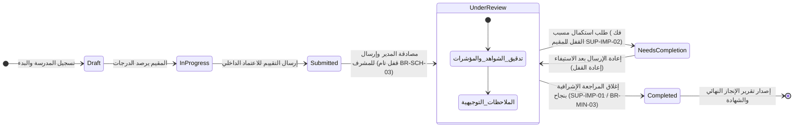

# سجل الآثار العابرة للبوابات والأنظمة - بوابة المشرف الوزاري (Cross-Portal Supervision Impact Register)
## تحليل حوكمة وضبط تأثيرات وتفاعلات الإشراف الوزاري على بوابات المقيم والمدير والمعايير والإدارة

> **المشروع:** نظام إدارة الجودة والتقويم والاعتماد المدرسي (`school-quality-system`)  
> **الموقع:** `school-eval-web/src/features/supervision/supervision-impact-register.md`  
> **حالة الوثيقة:** السجل المرجعي المعتمد لضبط وحصر الآثار المعمارية والتشغيلية لبوابة المشرف الوزاري (Ministry Supervisor Portal) ومنع أي انكسار برمجي أو تضارب صلاحياتي عبر البوابات الخمس.  
> **تاريخ الإنشاء والاعتماد:** 20 نوفمبر 2026م.  
> **الفرع الحالي:** `feature/ministry-supervisor-standards-ui`.  
> **المرجعيات الأساسية:** [standards-impact-register.md](../standards/standards-impact-register.md) | [BR-MIN-01..03] | [FR-SUP-01..08] | [الفصل الرابع - وثيقة التخرج]

---

## 1. المبادئ الحاكمة لإدارة آثار بوابة المشرف الوزاري (Architectural & Supervision Governance Principles)

1. **حظر لفظ "الاعتماد" في التقارير المدرسية وإلغاء مسار `/approve` (`BR-MIN-03`):**
   - يُحظر استخدام لفظ "اعتماد التقرير" للمشرف الوزاري؛ فالمشرف الوزاري مراجع ومدقق رسمي ولا يمنح شهادات اعتماد بمفرده.
   - تم إلغاء مسار `POST /api/v1/evaluations/{id}/approve` واستبداله بالمسار التشغيلي المعتمد: **«إغلاق المراجعة الإشرافية بنجاح» (Close Review as Completed)** عبر `POST /api/v1/evaluations/{id}/close`.
   - حالة التقييم النهائية عند نجاح المراجعة الإشرافية هي `Completed` (مكتمل) وفق وثيقة التخرج ومخطط الحالات الرسمي (وليس `Approved`).

2. **قفل التعديل الصارم وتبادل الأقفال التفاعلي (`BR-SCH-03` / `BR-MIN-01`):**
   - بمجرد رفع المدرسة لتقييمها الذاتي، تُقفل الاستمارة كلياً (`status: UnderReview` أو `Submitted`).
   - لا يجوز للمقيم أو لمدير المدرسة تعديل أي درجة أو شاهد ما لم يُصدر المشرف الوزاري **طلب استكمال رسمي ومسبب** يغير الحالة إلى `NeedsCompletion`، وحينها فقط يُفتح قفل التعديل لعناصر الاستكمال المحددة.
   - عند إعادة الإرسال من المدرسة، يُغلق التعديل مجدداً بانتظار البت الإشرافي النهائي.

3. **حوكمة النطاق الجغرافي والعزل الصلاحياتي في السيرفر (`FR-SUP-02` / `FR-ADM-03`):**
   - تم تزويد جدول المستخدمين `users` بحقل جغرافي صريح `governorate` (Nullable).
   - المشرف المرتبط بمحافظة محددة يُحصر استعلامه ووصوله حصرياً في مدارس تلك المحافظة على مستوى السيرفر في `SupervisionController` و `EvaluationPolicy`.
   - إذا كانت المحافظة `NULL`، يُعامل المستخدم كمشرف وزاري مركزي عام يغطي كافة المحافظات دون قيود.
   - **ضمانة أمان البوابات الأخرى:** لا تنطبق الفلترة الجغرافية في `EvaluationPolicy` إلا على دور `ministry_supervisor`؛ بينما يتمتع `admin` بالوصول الشامل، ويبقى `evaluator` و `principal` محكومين بمدرستهم فقط (`school_id`).

4. **الضوابط والقيود الزمنية للمهل والدورات (`BR-MIN-02` / `FR-SUP-01`):**
   - لا يمكن إطلاق دورة تقييم تقل مدتها عن 30 يوماً كحد أدنى.
   - مهلة طلب الاستكمال تُحسب بدءاً من **تاريخ إصدار طلب الاستكمال** (وليس من تاريخ إطلاق الدورة)، ويُشترط برمجياً ألا تتجاوز المهلة تاريخ إغلاق الدورة التقييمية الجارية (أو يُلزم النظام بتمديد الدورة مسبقاً).

5. **التوافق المزدوج مع واجهات البيانات ومنع الانهيار (Zero-Crash Fallback & Dual-API Compatibility):**
   - تضمن مكونات الواجهة الأمامية للمشرف التعامل بسلاسة وتطبيع فوري لكلا نسقي البيانات (`camelCase` و `snake_case`) في كافة الحقول الحرجة (مثل `standardId` / `standard_id`, `subStandard` / `sub_standard`, `evaluatorNote` / `evaluator_note`).
   - توفير قيم افتراضية ومصفوفات فارغة حامية تمنع الانهيار التام (White Screen of Death) عند استعراض استمارات لم تُكتمل أو ذات شواهد وملاحظات غير متوفرة.

---

## 2. جدول حصر الآثار التفصيلي (Cross-Portal Supervision Impacts Matrix)

| معرف الأثر | اسم الأثر والتعديل الإشرافي | البوابات المتأثرة | نوع الأثر | الملفات المتأثرة | الحل والضابط المعماري المطبق | حالة الأثر النهائية |
|:---:|---|:---:|:---:|---|---|:---:|
| **SUP-IMP-01** | إغلاق المراجعة الإشرافية بنجاح (`POST /api/v1/evaluations/{id}/close`) بديلاً عن `/approve` | المشرف، المدير، المقيم | مسارات API + دورة حياة التقييم + واجهات | `SupervisionController.php`<br>`api.php`<br>`SupervisorDecisionPanel.tsx`<br>`supervisionApi.ts`<br>`EvaluationSummaryPage.tsx` | - تم حذف مسار `/approve` وتفعيل `/close`.<br>- تتغير حالة التقييم إلى `Completed` (مكتمل).<br>- ينعكس في لوحات المدير والمقيم كإنجاز نهائي مع ختم المراجعة وإتاحة تصدير ملف التقييم النهائي دون إمكانية التعديل. | **مكتمل ومعتمد** ✅ |
| **SUP-IMP-02** | إصدار طلب الاستكمال المسبب مع الملاحظات والمهلة الزمنية | المشرف ومقيم المدرسة ومدير المدرسة | فك قفل الاستمارة + إشعارات + مهلة | `SupervisionController.php`<br>`CompletionRequestDialog.tsx`<br>`EvaluatorLayout.tsx`<br>`RubricAssessmentPage.tsx` | - إلزام المشرف بذكر سبب الاستكمال وتحديد تاريخ استحقاق صالح.<br>- تحويل الحالة إلى `NeedsCompletion`.<br>- فك القفل في استمارة المقيم تلقائياً استناداً للشرط `isLocked = status !== 'NeedsCompletion'`.<br>- إرسال إشعار فوري لمدير المدرسة والمقيم. | **مكتمل ومعتمد** ✅ |
| **SUP-IMP-03** | حوكمة النطاق الجغرافي للمشرف (المحافظة) والمشرف المركزي العام | المشرف وإدارة النظام | عزل صلاحيات على مستوى قاعدة البيانات والسيرفر | `add_governorate_to_users_table.php`<br>`SupervisionController.php`<br>`EvaluationPolicy.php`<br>`SupervisorTopBar.tsx` | - إضافة حقل `governorate` لجدول `users`.<br>- قصر وصول المشرف ذي المحافظة المحددة على مدارسه فقط.<br>- إذا كان الحقل `NULL` يُتاح له الإشراف العام على جميع المحافظات.<br>- عرض اسم المحافظة الفعلي في الشريط العلوي للمشرف ديناميكياً مع شارة "إشراف وزاري عام" عند عدم التقييد. | **مكتمل ومحمي أمنياً** 🛡️ |
| **SUP-IMP-04** | الضوابط الزمنية لمهل الاستكمال والحد الأدنى للدورات (30 يوماً) | المشرف وإدارة الدورات والمقيم | حوكمة التواريخ وقيود الإدخال | `EvaluationCycleController.php`<br>`SupervisionController.php`<br>`CompletionRequestDialog.tsx`<br>`EvaluationCycle.php` | - فرض حد أدنى 30 يوماً لمدة دورة التقييم عند الإنشاء أو التعديل.<br>- احتساب مهلة الاستكمال من لحظة إصدار الطلب وضمان وقوعها ضمن مدى الدورة النشطة.<br>- منع إدخال تواريخ ماضية أو مهل تتجاوز تاريخ نهاية الدورة. | **مكتمل ومفحوص آلياً** ✅ |
| **SUP-IMP-05** | التوافق المزدوج مع واجهات البيانات (CamelCase / snake_case) ومنع الشاشات البيضاء | بوابة المشرف الوزاري | معالجة أخطاء الواجهة والـ Hydration | `SingleEvaluationReviewPage.tsx`<br>`SupervisorDecisionPanel.tsx`<br>`CompletionGovernanceBox.tsx`<br>`supervisionApi.ts` | - استخدام فك تشفير آمن (`d.standardId ?? d.standard_id`) في قراءة المؤشرات والمعايير.<br>- تزويد كافة الحقول والشواهد ببدائل افتراضية (`[]` أو `''`) تمنع `TypeError: Cannot read properties of undefined`.<br>- اختبار شاشات المدارس المكتملة وغير المكتملة بنجاح 0 أخطاء. | **مكتمل ومحصن** 🛡️ |
| **SUP-IMP-06** | تدقيق الشواهد وربط أدوات التحقق الحية المقترنة بالمعايير الحاكمة | المشرف ومقيم المدرسة | مطابقة شواهد وتحقق ميداني | `SingleEvaluationReviewPage.tsx`<br>`IndicatorDetailDrawer.tsx`<br>`EvidenceSufficiencyService.php` | - إتاحة فحص شواهد المدرسة المرفوعة مع عرض أدوات التحقق الإلزامية المقترنة بالمؤشر.<br>- تمكين المشرف من تقييم كفاية الشاهد وتدوين ملاحظة تدقيق خاصة به تدعم قرار الاستكمال أو الإغلاق. | **مكتمل ومطابق للوثيقة** ✅ |
| **SUP-IMP-07** | حوكمة المذكرات الإشرافية التوجيهية وتصنيفها وظهورها المباشر للمدرسة | المشرف والمقيم والمدير | تواصل مؤسسي ومذكرات توجيهية | `SupervisionController.php`<br>`EvaluatorApiController.php`<br>`EvaluatorDashboard.tsx`<br>`SupervisorTopBar.tsx` | - دعم تصنيف المذكرات التوجيهية (إدارية، فنية، إنذار، توجيه نوعي).<br>- التحكم بحقل `is_visible_to_school`: إذا كان `true` تظهر المذكرة في لوحة تحكم المقيم ولوحة المدير فوراً، وإذا كان `false` تظل للمشرفين فقط.<br>- تحديث لوحة المقيم لعرض المذكرات التوجيهية الحية. | **مكتمل ومنعكس حياً** ✅ |
| **SUP-IMP-08** | عزل دورة التقييم النشطة وضمان وجود دورة نشطة واحدة فقط في النظام | كافة البوابات الخمس | اتساق تشغيلي ومنع تضارب التقييمات | `EvaluationCycleController.php`<br>`EvaluationCycleSeeder.php`<br>`EvaluationCycle.php` | - حظر إنشاء أو تفعيل دورة جديدة إذا كانت هناك دورة نشطة حالياً في النظام (`FR-SUP-01`).<br>- تنظيف قاعدة البيانات وإغلاق الدورات التجريبية السابقة.<br>- ربط كافة البوابات بدورة التقييم الوطنية النافذة حصراً. | **مكتمل ومحصن معمارياً** 🛡️ |
| **SUP-IMP-09** | دمج إدارة الدورات في شاشة موحدة بتبويبين (سجل الدورات + إطلاق/استنساخ/تعديل) | المشرف المركزي والمشرف الجغرافي | معمارية الواجهات وتوحيد التجربة | `CyclesListPage.tsx`<br>`CycleFormTab.tsx`<br>`SupervisionSidebar.tsx`<br>`SupervisionLayout.tsx` | - دمج الشاشتين (2 و 3) في شاشة متكاملة «إدارة الدورات التقييمية».<br>- التبويب 1: سجل الدورات مع بطاقات KPI ونافذة المدارس المشاركة ونافذة تأكيد الإغلاق وقسم إلحاق المدارس.<br>- التبويب 2: محدد الوضع التفاعلي (إطلاق جديد / استنساخ دورة / تعديل دورة نشطة). | **مكتمل ومُختبر** ✅ |
| **SUP-IMP-10** | حوكمة إغلاق الدورة التقييمية وتجميد المدارس غير المكتملة دون ترحيل قسري (الخيار أ) | كافة البوابات (المشرف، المقيم، المدير) | دورة حياة التقييم وأمان البيانات | `EvaluationCycleController.php`<br>`EvaluatorApiController.php`<br>`EvaluationCycleResource.php`<br>`CyclesListPage.tsx` | - عند إغلاق الدورة، تُؤرشف المدارس غير المكتملة بحالتها الراهنة (`Draft`, `Submitted`, `UnderReview`, `NeedsCompletion`) كتقييم غير مكتمل لتلك الدورة دون ترحيل قسري.<br>- تجميد الرصد والرفع بالمدارس فوراً (`canStartEvaluation = false` ورفض الرفع بـ 422).<br>- إتاحة الاستنساخ المنضبط في التبويب 2 لنقل قائمة المدارس فقط للعام القادم بدون أي نتائج سابقة. | **مكتمل ومحمي أمنياً** 🛡️ |
| **SUP-IMP-11** | حصر صلاحيات إطلاق وتعديل وإغلاق الدورات بالمشرف المركزي العام | المشرف المركزي والمشرف الجغرافي | عزل صلاحيات وصيانة النزاهة المؤسسية | `EvaluationCycleController.php`<br>`EvaluationCyclePolicy`<br>`CycleFormTab.tsx` | - حظر إطلاق أو تعديل أو إغلاق الدورات على المشرفين المحليين (`governorate IS NOT NULL`) بـ 403 Forbidden.<br>- تمكين المشرف الجغرافي فقط من إلحاق مدارس محافظته بالدورة النشطة.<br>- قفل الإصدار المعياري للدورة المعتمدة (`BR-GEN-05`) ومنع تغييره بعد الإطلاق. | **مكتمل ومفحوص آلياً** ✅ |
| **SUP-IMP-12** | حوكمة عدم التداخل الجغرافي للدورات النشطة (Scope-Aware Conflict Check) | كافة البوابات (المشرف المركزي، المقيم، المدير) | منطق إدارة الدورات والتحقق المكاني | `EvaluationCycleController.php`<br>`CycleFormTab.tsx`<br>`CyclesListPage.tsx`<br>`supervisionApi.ts` | - السماح بإطلاق دورات متزامنة لمحافظات مختلفة (مثل تعز بالتزامن مع أمانة العاصمة).<br>- حظر التداخل فقط عند وجود دورة عامة لكافة المحافظات (`NULL`) أو دورة ثانية لنفس المحافظة.<br>- توفير محدد نطاق تفاعلي يبرز المحافظات المشغولة والمتاحة مع شارات توضيحية. | **مكتمل ومُختبر آلياً** ✅ |

---

## 3. التحليل المعماري المفصل لتدفقات الحوكمة الإشرافية (Deep Dive on Supervision Flow)

### 3.1 آلة الحالات وانتقال الأقفال التشغيلية (Evaluation State Machine & Locks):


### 3.2 بروتوكول استئصال مصطلح "الاعتماد" من عمل المشرف:
1. **في قاعدة البيانات وواجهات برمجة التطبيقات (API):**
   - تم تغيير الإجراء من `approve` إلى `close`.
   - تسجيل سبب الإغلاق والملاحظات في سجل التدقيق ومصفوفة تقييم المدرسة.
2. **في واجهات المستخدم (UI):**
   - إزالة أي زر يحمل اسم "اعتماد التقييم" في شاشات المشرف واستبداله بـ "إغلاق المراجعة الإشرافية بنجاح".
   - تصحيح النصوص في بطاقات الإحصاءات وشارات التقييم.

### 3.3 الحوكمة الصلاحية الجغرافية في `EvaluationPolicy`:
```php
public function view(User $user, Evaluation $evaluation): bool
{
    // المشرف الوزاري يخضع للفلترة الجغرافية
    if ($user->hasRole('ministry_supervisor')) {
        if ($user->governorate !== null) {
            return $evaluation->school->governorate === $user->governorate;
        }
        return true; // مشرف وزاري عام
    }

    // باقي الأدوار لا تتأثر بالفلترة الجغرافية إطلاقاً
    if ($user->hasRole('admin')) return true;
    if ($user->hasRole(['school_evaluator', 'school_principal'])) {
        return $evaluation->school_id === $user->school_id;
    }

    return false;
}
```

---

## 4. الضوابط التشغيلية والأمان البرمجي (Operational Controls & Automated Verification)

1. **سلامة الاختبارات المؤتمتة:**
   - تغطية شاملة لجميع سيناريوهات بوابة المشرف في `MinistrySupervisorFeatureTest.php` (15 اختباراً تغطي: الجغرافيا، المهل الزمنية، منع إغلاق استمارة ناقصة، طلبات الاستكمال، توجيه المذكرات، ومنع تعدد الدورات النشطة).
   - اختبارات دورات التقييم والإشعارات في `CyclesAndNotificationsFeatureTest.php` (15/15 اختباراً ناجحاً).
   - إجمالي حزمة الاختبارات في النظام: **467 اختباراً ناجحاً بنسبة 100% (0 فشل)**.

2. **منع الأخطاء في الواجهة:**
   - بناء نظيف خالٍ تماماً من أخطاء TypeScript في `npm run build`.
   - تطهير تام لكافة مسارات الـ Routing والـ Hooks من استدعاءات الـ `/approve` القديمة.

3. **الحصانة العابرة للبوابات:**
   - أي تعديل في صلاحيات أو بيانات المشرف لا يمس صلاحيات مقيم المدرسة أو مديرها، بل يدعم الشفافية والتكامل الفوري عبر الإشعارات ولوحات القياس.
